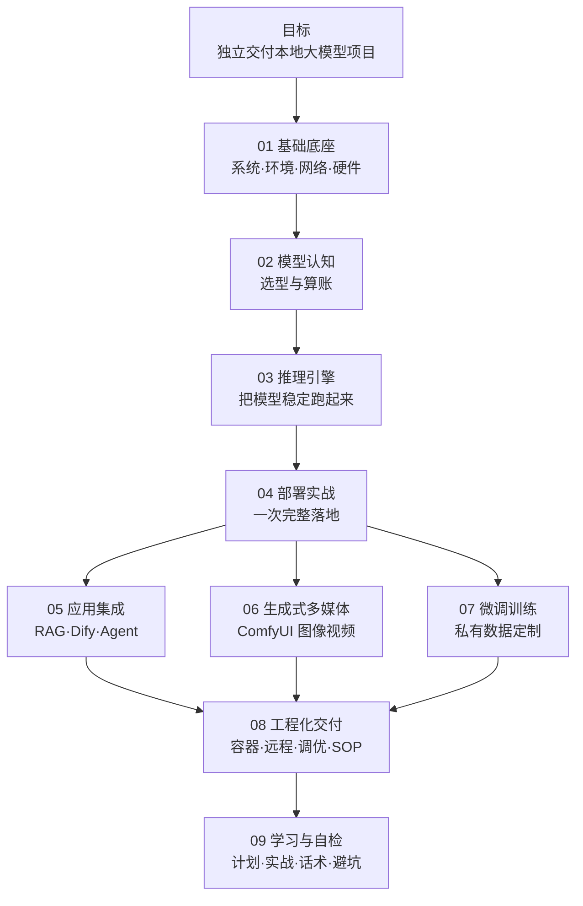
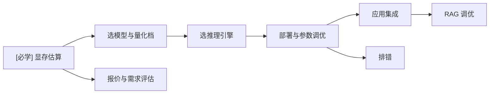

# 技能栈总览 MOC

> [!abstract] 一句话讲清楚
> 这张图是整个知识库的"目录的地图"：本地大模型这套技能栈由 **8 个领域**组成，彼此有严格的先后依赖。先看这张图建立全局感，再进任何一个领域都不会迷路。

---

## 一、这套技能栈到底在解决什么问题

一句话：**把开源大模型变成客户/自己机器上"能稳定干活、数据不出门"的服务。**

拆开就是五个连续的问题：

| # | 问题 | 对应领域 |
|---|---|---|
| 1 | 这台机器跑得动吗？ | [[硬件基础与 GPU 生态]]、[[参数量与显存估算]] |
| 2 | 用哪个工具把它跑起来？ | [[推理引擎选型决策树]]、[[Ollama]]、[[vLLM]] |
| 3 | 怎么把它变成一个稳定的服务？ | [[本地部署全流程]]、[[服务化与 API 鉴权]] |
| 4 | 跑起来之后拿它干什么？ | [[RAG 原理与全链路]]、[[ComfyUI 核心概念]]、[[LoRA 与 QLoRA 原理]] |
| 5 | 怎么交付、怎么收款、怎么不出事故？ | [[交付 SOP 与报价]]、[[安全与合规]]、[[排错方法论]] |

---

## 二、技能栈全景图

> [!tip] 怎么读这张图
> **纵向是依赖，横向是可并行的分支。**
> - 01 和 02 是地基，跳过去会一直"玄学报错"。
> - 03、04 是主干，必须动手跑通一遍。
> - 05、06、07 是三选一或按需的三条变现路线，可以先选一条。
> - 08 是收口，决定你是不是"能交付"而不只是"能跑通"。

---

## 三、8 个领域，各自负责什么

| 领域 | 一句话职责 | 不学它的后果 | 入口 |
|---|---|---|---|
| **01 基础底座** | Linux / Shell / Python / Docker / 网络 / 硬件 | 遇到报错完全无法定位，只会重装 | [[基础底座 MOC]] |
| **02 模型认知** | 架构、量化、显存估算、模型谱系 | 被营销话术牵着走，选错模型和量化档 | [[模型认知 MOC]] |
| **03 推理引擎** | Ollama / llama.cpp / vLLM / MLX 的定位与参数 | 只会点 UI，换个场景就跑不动 | [[推理引擎 MOC]] |
| **04 部署实战** | 三平台完整落地流程与检查清单 | 每次部署都像第一次，漏步骤 | [[部署实战 MOC]] |
| **05 应用集成** | RAG、Dify、Agent、MCP、客户端 | 模型跑起来了但客户用不起来 | [[应用集成 MOC]] |
| **06 生成式多媒体** | 扩散模型、ComfyUI、文生图、图生视频 | 接不了图像/视频类需求 | [[生成式多媒体 MOC]] |
| **07 微调训练** | 数据工程、LoRA/QLoRA、评估、闭环 | 客户说"用我的数据训练"时接不住 | [[微调训练 MOC]] |
| **08 工程化交付** | 容器化、远程、调优、监控、安全、SOP | 能跑通但交付不了，售后全是坑 | [[工程化交付 MOC]] |
| **09 学习与自检** | 学习计划、项目阶梯、话术、误区 | 学得散、练得假、不会跟客户沟通 | [[学习与自检 MOC]] |

---

## 四、三层能力模型：你在哪一层

| 层级 | 能力描述 | 客户视角 | 市场定位 |
|---|---|---|---|
| **L1 会装** | 能在给定硬件上把指定模型跑起来，给出可用的 API 和客户端 | "能用了" | 部署工，单价低、可替代 |
| **L2 会调** | 能根据显存/并发/质量要求做选型与参数调优，能定位故障层 | "比之前快了/稳了" | 调优工程师，有溢价 |
| **L3 会交付** | 能评估需求、出方案、报价、部署、验收、售后，能预判风险 | "这个人靠谱" | 方案/交付专家，可复购 |

> [!important] 关键认知
> **大部分人是卡在 L1→L2 之间。** L1 靠教程就能到，L2 必须懂 [[参数量与显存估算]] 和 [[推理性能指标与调优]] 这类"算账 + 归因"的东西，L3 必须补 [[交付 SOP 与报价]] 和 [[安全与合规]]。

用 [[能力自检清单]] 给自己打分，能清楚看到卡在哪一层。

---

## 五、按任务场景导航（最常用）

| 我要做的事 | 按顺序读 |
|---|---|
| 客户问"我这台电脑能跑吗" | [[参数量与显存估算]] → [[硬件基础与 GPU 生态]] |
| 8G / 12G 显存装什么模型 | [[参数量与显存估算]] → [[量化技术]] → [[模型谱系 Qwen]] → [[Ollama]] |
| 要给 10 个人同时用 | [[vLLM]] → [[推理性能指标与调优]] → [[服务化与 API 鉴权]] |
| 搭一个企业知识库 | [[RAG 原理与全链路]] → [[文档解析与切分策略]] → [[检索与 Rerank]] → [[Dify 平台与工作流]] |
| 接 ComfyUI 图像/视频需求 | [[ComfyUI 核心概念]] → [[ComfyUI 工作流实操]] → [[低显存工作流优化]] → [[图生视频模型生态]] |
| 客户要"用我的数据训练" | [[微调决策与 RAG 取舍]] → [[训练数据工程]] → [[LoRA 与 QLoRA 原理]] → [[合并导出与部署闭环]] |
| 本地模型驱动 AI 干活 | [[OpenAI 兼容 API 规范]] → [[本地模型接入编码助手]] → [[Agent 与 Function Calling]] |
| 报错 / OOM / 特别慢 | [[排错方法论]] → [[故障案例库]] → [[性能调优清单]] |
| 该报多少钱、怎么排工期 | [[交付 SOP 与报价]] → [[项目复盘模板]] |
| 完全从零开始学 | [[学习路线图]] → [[8 周学习计划]] → [[项目阶梯与实战清单]] |

---

## 六、按角色导航

| 如果你是 | 优先学 | 可以暂缓 |
|---|---|---|
| **个人自用**（搭个本地助手/画图） | 02 → 03 → 04 → 05 | 07、08 |
| **接单交付**（这是本库默认目标） | 01→02→03→04→05 全过一遍，再按客户类型补 06 或 07，最后补 08 | — |
| **企业内部工程师** | 01→02→03→04→08，重点是稳定性与安全 | 06 |
| **想做微调算法** | 02→07→04，重点数据工程与评估 | 06、08 |
| **只想做 AI 绘画/视频** | 01→06，补一点 02 与 [[参数量与显存估算]] | 05、07 |

---

## 七、知识依赖关系（什么必须在前）

三个"枢纽级"笔记，缺一个后面全断：

1. [[参数量与显存估算]] —— 所有选型、报价、排错的出发点。
2. [[推理引擎选型决策树]] —— 决定你用什么工具、什么参数。
3. [[排错方法论]] —— 决定你能不能自己解决问题。

---

## 八、这个库不包含什么

> [!warning] 明确边界，避免误用
> - **不含大段安装命令/环境配置流水账**：这类内容版本变化快，直接问 AI 要当前可用版本更靠谱。
> - **不含精确 benchmark 分数、模型排名、价格表**：迭代太快，背了就是负资产。
> - **不是学术教材**：不推导公式，只讲"它是什么、为什么会这样、对你的决策有什么影响"。
> - **不含客户隐私数据与合同模板**：涉及法务，必须找专业人士。

---

## 九、怎么用这个库效率最高

1. **先读主干五篇**（见 [[README 从这里开始]] 第三节），建立全局地图。
2. **每学一个领域，立刻做一个最小项目**：见 [[项目阶梯与实战清单]]。
3. **建自己的"踩坑库"**：用 [[排错记录模板]] 记录，这是你区别于"看教程的人"的地方。
4. **每交付一个项目就复盘一次**：用 [[项目复盘模板]]，修正报价和工期模型。
5. **补充知识时遵守 [[写作规范]]**：结构固定，未来你才找得到。

---

## 相关笔记

- [[README 从这里开始]]
- [[学习路线图]]
- [[术语总表]]
- [[能力自检清单]]
- [[基础底座 MOC]]
- [[模型认知 MOC]]
- [[推理引擎 MOC]]
- [[部署实战 MOC]]
- [[应用集成 MOC]]
- [[生成式多媒体 MOC]]
- [[微调训练 MOC]]
- [[工程化交付 MOC]]
- [[学习与自检 MOC]]
