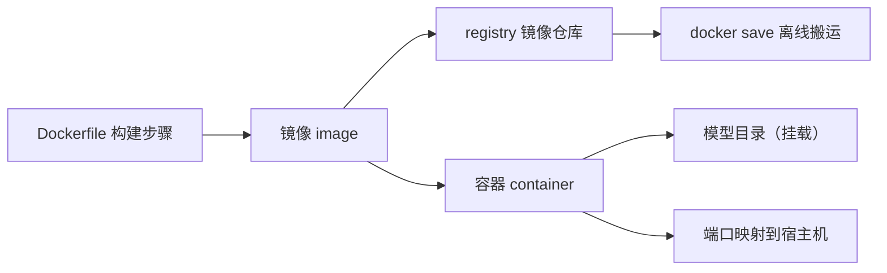

# Docker 与容器化基础

> [!abstract] 一句话讲清楚
> 容器就是给程序配一个"自带依赖和配置的盒子"，换台机器开箱就跑；你部署大模型时它主要解决两件事——环境不会装坏、交付可以复制。

## 为什么重要

- 本地部署最烦的不是"跑不起来"，而是"在 A 机器能跑、到 B 机器就报错"。容器把这份不确定性锁进镜像里。
- 推理框架对驱动、CUDA、依赖版本非常敏感；容器能把"框架 + Python 依赖 + 运行时"固定成一份可复现的东西。
- 客户交付经常涉及换机器、重装系统、内网环境。镜像可以离线搬运（`docker save` / `docker load`），比现场"照文档装一遍"稳得多。
- 反过来，容器不是万能药：GPU 直通、挂载、网络没配好时，问题比裸装更难查，所以基础概念必须先想清楚。
- 接单视角：客户机房通常不让你随便改系统，容器是你唯一能"只动自己那摊"的方案。

## 核心名词全解

| 名词 | 英文/缩写 | 大白话解释 | 容易混淆/注意 |
|---|---|---|---|
| 镜像 | Image | 打包好的只读程序盒子，里面有系统库、依赖和你的代码 | 镜像本身不运行，运行的是容器 |
| 容器 | Container | 镜像跑起来之后的"进程 + 独立文件系统" | 容器删掉，里面新写的数据一般也一起没 |
| Dockerfile | Dockerfile | 一份"怎么把盒子做出来"的步骤说明 | 不是脚本，别写复杂逻辑；相关命令尽量合并 |
| 镜像层 | Layer | 镜像是很多层叠起来的，每条构建指令通常对应一层 | 层有缓存，改前面一行可能让后面全部重建 |
| 镜像仓库 | Registry | 存放和分发镜像的地方，Docker Hub 是公共仓库 | 国内拉取慢；企业内网要自建或离线搬运 |
| 标签 | Tag | 镜像的版本记号，比如 `vllm:版本号`、`latest` | `latest` 会随时间变；交付必须写固定 tag |
| 基础镜像 | Base image | 你站在别人的肩膀上，比如 `python:3.11-slim` | 要匹配 CPU 架构和 CUDA 需求 |
| 卷 | Volume | Docker 管理的持久化目录，容器删了数据还在 | 和绑定挂载用途像、机制不同 |
| 绑定挂载 | Bind mount | 把宿主机某个目录直接映射进容器 | 路径写错、权限不对、跨系统慢都从这来 |
| 端口映射 | Port mapping | 把宿主机端口转给容器端口，如 `-p 8000:8000` | 冒号前是宿主机、后是容器；服务还得监听 `0.0.0.0` |
| bridge 网络 | Bridge network | 容器默认待的虚拟网络，容器间用名字互访 | 默认网络里 IP 会变，别写死 |
| 命名空间 | Namespace | 让容器"以为"自己独占文件系统、网络、进程号 | 隔离的是"看不看得见"，不是"能用多少" |
| 控制组 | Cgroup | 限制容器能用多少 CPU、内存 | 限制太狠会被系统杀掉，现象是莫名重启 |
| 入口与参数 | ENTRYPOINT / CMD | ENTRYPOINT 是固定入口程序，CMD 是默认参数 | 弄反了会出现参数被忽略、命令跑不起来 |
| 单机编排 | Compose | 用一份 yaml 描述跑哪几个容器、什么端口、什么挂载 | 是单机编排，不是集群方案 |
| GPU 直通 | GPU passthrough | 把宿主机显卡"借"给容器使用 | 宿主机必须装驱动，容器里不用装驱动 |
| 多阶段构建 | Multi-stage build | 分几个阶段构建，只把最终产物搬进目标镜像 | 能明显减小镜像，代价是 Dockerfile 变长 |

## 原理与机制

### 直觉版

- 把镜像想成一张"集装箱装箱清单 + 已经装好的货"，容器就是真正在跑的那一个箱子。
- Dockerfile 是装箱步骤说明；镜像仓库是港口；`docker save` 就是把整箱货搬走。
- 数据要放在箱子外面的仓库（卷或宿主目录），因为箱子一扔，箱子里临时写的东西就没了。
- 这样理解就够用了：**镜像 = 模板，容器 = 实例，卷 = 外挂硬盘**。

### 拆解版

**1. 镜像是只读层叠出来的文件系统**

- 每条构建指令生成一层，底层是基础系统，上面是依赖和代码，最后是启动配置。
- 层是共享和复用的：两个镜像用同一个基础镜像，磁盘上只存一份。
- 容器启动时在镜像最上面加一个可写层，所有改动都落在这一层。

**2. 容器 = 镜像 + 可写层 + 隔离 + 限制**

- 进程层面它就是宿主机上的普通进程，只是被隔离了视野。
- namespace 负责"看得见什么"：独立的文件系统、网络栈、进程树。
- cgroup 负责"能用多少"：CPU、内存的上限。
- 所以容器启动是秒级，不是虚拟机那种分钟级。

**3. 容器不是虚拟机，共享宿主内核**

- 虚拟机里跑的是完整的另一个操作系统，容器只是被隔离的进程。
- 后果一：Linux 容器不能直接跑在 Windows/macOS 内核上，Docker Desktop 其实在背后开了一个 Linux 虚拟机。
- 后果二：容器对内核有要求，宿主机内核太老，某些容器会起不来。
- 后果三：容器里 `uname` 看到的还是宿主内核版本，别被这个误导。

**4. GPU 直通到底做了什么**

- 容器默认看不到 `/dev/nvidia*` 这些设备节点，所以容器里 `nvidia-smi` 报不存在。
- `--gpus all` 通过 NVIDIA Container Toolkit 把设备节点、驱动库、工具注入容器。
- 因此：**宿主机必须有驱动，容器里不需要装驱动，也不需要装 CUDA Toolkit**。
- 想只给容器部分卡，用 `--gpus '"device=0,1"'` 之类的方式限制。

**5. 数据放哪：可写层 / 卷 / 绑定挂载**

- 可写层：临时文件放这里没问题，删容器就没了，不能放模型和数据库。
- 卷（volume）：Docker 管理，删容器不删卷，适合长期数据。
- 绑定挂载（bind mount）：直接映射宿主目录，模型目录最常用，路径和权限自己负责。

### 后果

- 镜像越叠越胖 → 拉取和搬运变慢，离线交付时 U 盘都装不下。要分层设计并清缓存。
- 数据写进容器可写层 → 容器一删全没，这是新手最常见的数据丢失方式。
- 容器里没有前台进程 → 容器立刻退出。不是"服务挂了"，是 PID 1 结束了。
- 服务在容器里只监听 `127.0.0.1` → 端口映射也白做，容器外永远连不上。

## 分类与对比

### 容器 vs 虚拟机 vs conda 环境

| 维度 | 容器 | 虚拟机 | conda/venv 环境 |
|---|---|---|---|
| 隔离粒度 | 进程级，共享宿主内核 | 操作系统级，完整隔离 | 只有 Python 包，系统层全共享 |
| 启动速度 | 秒级 | 分钟级 | 秒级 |
| 资源开销 | 小 | 大，要占内存和磁盘 | 极小 |
| 跨机器一致性 | 强，镜像整体搬运 | 强，但镜像大 | 弱，换个系统可能就装不上 |
| GPU 使用 | 直通，接近原生 | 需要虚拟化直通，配置麻烦 | 直接使用 |
| 典型用途 | 部署交付、环境固化 | 隔离强需求、跑别的系统 | 日常开发、快速试验 |
| 主要坑 | 挂载、网络、GPU 直通配置 | 性能损耗、显卡支持 | 换个机器就报错 |

### 单条 run vs compose vs Kubernetes

| 方案 | 配置载体 | 适合规模 | 优点 | 缺点 |
|---|---|---|---|---|
| `docker run` | 命令行参数 | 临时测试、单个容器 | 最快、最直接 | 参数记不住，重跑容易漏 |
| Compose | 一份 yaml | 单机、2~5 个容器 | 参数固化、可版本管理 | 只管单机 |
| Kubernetes | 一堆 yaml | 多机集群 | 弹性、滚动更新 | 学习成本高，小项目用它是灾难 |

### 一张图看清关系



- 图里的意思：Dockerfile 生成镜像，镜像既可以推到仓库、也可以在本地起成容器；容器通过挂载拿模型、通过端口对外提供服务。

## 完整流程：把一个模型服务装进容器

### 第 1 步：梳理它到底依赖什么

- **做什么**：列出 Python 版本、框架版本、CUDA 要求、模型路径、端口、显存/内存需求、启动命令、哪些数据必须持久化。
- **为什么**：这些决定基础镜像和挂载方案，漏一项后面就会返工。
- **验收标准**：能在裸机（或临时环境）上完整跑通一遍，并记下所有版本。
- **失败表现**：容器构建成功但一启动就报缺库，说明第 1 步没列全。

### 第 2 步：选基础镜像

- **做什么**：优先用框架官方的镜像（很多推理框架都提供）；没有就用 `python` 精简版自己装。
- **为什么**：官方镜像已经解决了 CUDA 和依赖的搭配问题，能省掉大量排错。
- **验收标准**：镜像里 `python` 版本、框架版本、CUDA 版本都对得上，并且在目标机器架构上可用。
- **失败表现**：容器里 `torch.cuda` 不可用、或者镜像是 ARM 架构在 x86 机器上跑不起来。

### 第 3 步：写 Dockerfile，只装依赖，模型不进镜像

```dockerfile
FROM python:3.11-slim
WORKDIR /app
COPY requirements.txt .
RUN pip install --no-cache-dir -r requirements.txt
COPY app ./app
ENV HF_HOME=/models/.cache
EXPOSE 8000
CMD ["python", "-m", "app.server"]
```

- 这段在干嘛：先拷依赖清单装依赖，再拷代码，最后声明端口和启动命令。
- 关键点：`COPY requirements.txt` 放在装依赖之前，依赖不变时这层能复用缓存。
- 关键点：`--no-cache-dir` 让镜像瘦一圈；模型目录故意不拷进来，运行时挂载。

### 第 4 步：构建并打固定 tag

```bash
docker build -t myserver:1.0.0 .
```

- 这段在干嘛：按当前目录的 Dockerfile 构建镜像，并打上 `myserver:1.0.0` 这个版本标签。
- 关键点：tag 里写版本号，交付时绝不写 `latest`；顺手加 `.dockerignore` 排除模型、日志和缓存目录。
- 验收标准：`docker images` 能看到这个 tag，大小在可接受范围。
- 失败表现：镜像动不动几十 GB，通常是模型、数据集或缓存被误打包进去了。

### 第 5 步：用挂载补齐模型和数据

```bash
docker run -d --name llm --gpus all -p 8000:8000 \
  -v /data/models:/models:ro --restart unless-stopped myserver:1.0.0
```

- 这段在干嘛：后台起一个容器，给全卡，把 8000 端口映射出来，模型目录只读挂进去。
- 关键点：`:ro` 只读挂载能防止程序误写模型文件；`--restart unless-stopped` 让容器跟机器一起活。
- 验收标准：容器里 `nvidia-smi` 能看到卡，`curl localhost:8000` 有响应。
- 失败表现：容器反复重启 → 看 `docker logs`，多半是模型路径或显存不够。

### 第 6 步：用 compose 把所有参数固化

```yaml
services:
  llm:
    image: myserver:1.0.0
    ports: ["8000:8000"]
    volumes: ["./models:/models:ro"]
    restart: unless-stopped
    deploy:
      resources:
        reservations:
          devices:
            - driver: nvidia
              count: all
              capabilities: [gpu]
```

- 这段在干嘛：把第 5 步那一长串参数翻译成 yaml，以后一条 `docker compose up -d` 就能起。
- 关键点：compose 里的 GPU 写法与 `run` 不同，容易抄错；文件进版本管理，改动可追溯。

### 第 7 步：离线交付

```bash
docker save myserver:1.0.0 -o myserver-1.0.0.tar
docker load -i myserver-1.0.0.tar
```

- 这段在干嘛：第一个命令把镜像打包成 tar 文件，第二个命令在客户机器上恢复。
- 关键点：客户机器只要装了 Docker + 驱动 + toolkit 就能跑；同时把镜像 ID 记进交付文档。
- 验收标准：客户机器上 `docker images` 能看到镜像，启动命令能跑通。
- 失败表现：`load` 后镜像名是 `<none>`，说明 `save` 时标签丢了或对方版本处理方式不同。

## 决策点

- **岔路口 1：模型放镜像里还是挂载？** 推荐挂载。镜像只装代码和依赖，模型放宿主目录。代价：交付时要一起拷贝模型目录，但换来镜像小、换模型不用重建。
- **岔路口 2：用官方镜像还是自己写 Dockerfile？** 先用官方镜像跑通，再决定要不要自建。官方镜像省事，自建镜像可控。代价：自建要自己处理版本搭配。
- **岔路口 3：单条 run 还是 compose？** 临时测试用 run；要给客户交付、参数超过三行，一律 compose。
- **岔路口 4：交付用容器还是 conda 环境？** 客户机器干净、换机器可能 → 容器；就在同一台机器、客户自己维护日常 → conda 也行。代价：容器让客户多一个"Docker 这层"要理解。
- **岔路口 5：Windows 上装 Docker 用什么后端？** 用 WSL2 后端，兼容性和性能都更好。代价：WSL2 占内存，跨系统读写大文件慢。
- **岔路口 6：要不要上 Kubernetes？** 单机、几个容器 → 不要；多机、要弹性伸缩 → 才考虑。代价：小项目上 K8s 是纯负担。
- **岔路口 7：容器里要不要装驱动？** 不要。驱动只能在宿主机装，容器里装驱动不生效还可能把环境搞乱。
- **岔路口 8：要不要限制容器资源？** 单卡独占 → 可以不限；多服务共享 → 必须限，否则互相抢显存和内存。

## 参数与配置说明

| 参数 / 配置 | 作用 | 推荐值 / 注意 |
|---|---|---|
| `-d` | 后台运行 | 部署时几乎必加 |
| `--name` | 给容器起名 | 起有意义的名字，别用随机名 |
| `--gpus all` | 把所有显卡给容器 | 部分卡用 `--gpus '"device=0"'` |
| `-p 宿主:容器` | 端口映射 | 前面是宿主机端口，别写反 |
| `-v 宿主:容器` | 挂载目录 | 模型目录加 `:ro` 只读 |
| `--restart unless-stopped` | 自动重启策略 | 别用 `always` 掩盖崩溃循环 |
| `--shm-size` | 共享内存大小 | 某些框架默认太小会报错，按需调大 |
| `-e KEY=值` | 传环境变量 | 敏感信息别硬编码在镜像里 |
| `--network` | 指定网络 | 容器间互相访问用自定义 bridge |
| `ENTRYPOINT` | 固定入口程序 | 和 `CMD` 分工要清楚 |
| `CMD` | 默认参数 | 可被 `docker run` 后面的参数覆盖 |
| `docker compose up -d` | 按 yaml 起服务 | 交付首选 |
| `.dockerignore` | 排除不该进镜像的文件 | 模型、日志、缓存必须排除 |

## 常见坑与误区

| 现象 | 原因 | 对策 |
|---|---|---|
| 容器里 `nvidia-smi` 不存在 | 没加 `--gpus` 或宿主机没装 container toolkit | 先确认宿主机能跑，再检查 run 参数和 toolkit |
| 镜像几十 GB，搬运痛苦 | 模型、数据集、缓存被打进镜像 | 模型挂载，`.dockerignore` 排掉大目录 |
| 重启容器后数据没了 | 数据写在容器的可写层 | 数据库、上传文件放卷或宿主目录 |
| 端口映射了外部还是连不上 | 服务在容器里只监听 `127.0.0.1` | 启动参数改成 `0.0.0.0`，再查防火墙 |
| Windows 上挂载模型目录特别慢 | 跨 WSL 和 Windows 文件系统读写 | 把模型放 WSL 自己的文件系统里 |
| 容器里时间不对、中文乱码 | 没设时区和 locale | 传 `TZ` 环境变量，镜像里装语言包 |
| 容器不停重启 | 启动命令立刻失败，被重启策略反复拉起 | 先 `docker logs` 看真实错误，别急着调重启策略 |
| 宿主目录出现一堆 root 属主文件 | 容器内默认以 root 运行 | 指定用户或调整目录权限 |
| 参数太多记不住、每次重跑不一致 | 全靠手敲 `docker run` | 写成 compose 文件 |

## 自检问题

- [ ] 能说清镜像和容器的区别，以及镜像为什么是"只读层叠加"吗？
- [ ] 知道容器为什么比虚拟机轻，代价是什么吗？
- [ ] 容器里需要装显卡驱动吗？为什么？
- [ ] 模型为什么不建议打进镜像？挂载时为什么加只读？
- [ ] 能解释端口映射了外部却连不上的两个常见原因吗？
- [ ] 交付给客户时，为什么必须用固定 tag 而不是 `latest`？
- [ ] 哪些数据必须放卷，哪些可以留在容器里？
- [ ] 能写出一个最小可用的 compose 文件吗？

## 相关笔记

- [[基础底座 MOC]]
- [[Linux 基础与服务器操作]]
- [[硬件基础与 GPU 生态]]
- [[模型获取与离线搬运]]
- [[容器化部署]]
- [[vLLM]]
- [[远程交付与远程运维]]

## 交付视角

- 对客户怎么讲："这套服务打包成容器，换电脑、重装系统都能一键恢复，不会因为环境版本不对跑不起来。"
- 客户常问"镜像多大、要不要联网"：镜像只装运行环境，模型单独放硬盘，交付时用 U 盘或内网拷贝，全程不需要联网。
- 客户常问"以后能不能自己换模型"：能，容器参数里把模型目录做成了挂载，换模型只换目录、不重建镜像。
- 客户 IT 会关心"会不会影响我们服务器"：容器只占指定端口和目录，删掉容器就恢复原样。
- 报价时把"环境固化 + 离线交付包"作为独立项，这是客户最认的价值点，也是你最容易翻车的部分，务必写进验收清单。
