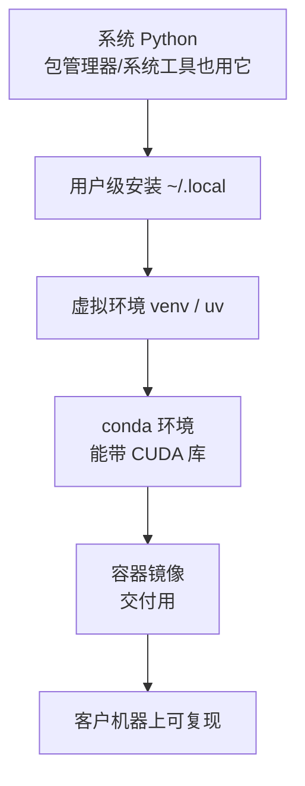

# Python 环境与依赖管理

> [!abstract] 一句话讲清楚
> 本地大模型的工具链几乎全是 Python 写的，而"装环境"是新手卡住最久的一步。这篇讲清楚解释器、虚拟环境、pip/conda/uv、依赖冲突都是怎么回事，目标是让你拿到任何一台机器都能装出一个**可复现、不互相污染**的环境。

## 为什么重要

- **位置**：上游是 [[Shell 与命令行基础]]（命令怎么跑、PATH 怎么找），下游是 [[Docker 与容器化基础]]（环境最终要封进镜像）。[[Ollama]] 这类工具替你把环境管好了，但 [[vLLM]]、[[llama.cpp 与 GGUF]] 的很多组件、以及全部微调框架都要自己装。
- **不懂会怎样**：`pip install` 一路报错、装完发现 `torch.cuda.is_available()` 是 False、两个项目互相把对方的依赖升级坏、客户机器上装不出来只能把整台机器重装。
- **真实场景**：客户给了一台内网机器，没外网。你需要在有网的机器上把所有 Python 依赖（包括需要编译的包）准备好，搬到内网装上，并且保证和客户机器系统版本、架构一致——这就是"环境管理"这门手艺的真实考卷。

## 核心名词全解

| 名词 | 英文 / 缩写 | 大白话解释 | 容易混淆 / 注意 |
|---|---|---|---|
| 解释器 | interpreter / CPython | 真正执行 Python 代码的那个程序，`python` 命令最终指向它 | 同一台机器可以有多个解释器；命令名指向谁由 PATH 决定 |
| 虚拟环境 | virtual environment | 给一个项目单独隔出来的"包仓库"，装什么都不影响别人 | 它隔离的是 Python 包，不隔离显卡驱动和系统库 |
| venv | venv | Python 自带的虚拟环境工具，轻量、无额外依赖 | 它只认同一个 Python 版本，不能装不同版本的 Python |
| conda | conda / miniforge | 能同时管 Python 包和非 Python 依赖（如 CUDA 库）的环境工具 | 它和 pip 混用会把环境搞乱，是经典坑 |
| uv | uv | 新一代 Python 包管理器，装包快、自带环境管理 | 快是优点，但生态更新需要确认兼容性，以官方文档为准 |
| pip | pip | Python 官方的包安装工具，从 PyPI 下载安装 | 它默认装到"当前环境"，装错环境是最高频的坑 |
| wheel | wheel / `.whl` | 预编译好的安装包，下载即用，不需要编译 | 和系统架构/平台绑定，Linux 的包不能直接搬到 Windows |
| sdist | source distribution / `.tar.gz` | 只有源码的包，安装时要现场编译 | 需要编译器和系统头文件；内网/无编译器时最容易失败 |
| PyPI | Python Package Index | Python 官方的包仓库（还分不同的镜像站） | 国内访问慢，通常配镜像源，但镜像可能滞后 |
| 依赖解析 | dependency resolution | 安装前算出"所有包各自该用哪个版本还能共存" | 算不出来就报冲突；报错信息里通常直接告诉你哪两个版本打架 |
| requirements | requirements.txt | 记录"这个项目需要哪些包、什么版本"的清单 | 只写直接依赖的话，重现性差；生产交付要锁全量版本 |
| lock 文件 | lockfile | 把全部依赖（含间接依赖）的精确版本钉死 | 有 lock 才能保证"和交付时一模一样" |
| site-packages | site-packages | 某个环境里实际存放已安装包的目录 | 出问题时看这个目录，就能知道到底装到哪去了 |
| CUDA 变体 | CUDA wheel / cuXXX | 同一套 PyTorch 有 CPU 版和不同 CUDA 版的安装包 | 从错误索引下载会装成 CPU 版，跑模型速度差一个量级 |
| 镜像源 | index-url / mirror | 用自己的服务器代替官方 PyPI 加速下载 | 源不可信有供应链风险；企业环境优先用官方或自建源 |
| PYTHONPATH | PYTHONPATH | 额外告诉 Python"去这些目录找模块" | 和虚拟环境是两回事；乱设会让 import 到意料之外的包 |

## 原理与机制

### 直觉版

如果没有环境隔离，Python 就像**一栋楼只有一个公共储藏室**：A 项目要的螺丝刀必须放在那、B 项目要的长螺丝刀也得放那，只能留一把，于是两个项目永远在互相替换工具。虚拟环境就是**给每个项目单独一个储物柜**。

### 拆解版

1. **解释器可以有很多个**：系统自带一个、conda 装一个、uv 又下一个。你敲 `python` 时到底用哪个，由 PATH 顺序决定。
2. **全局 site-packages 是共享的**：不建环境直接 `pip install`，包会装进系统解释器的目录。所有项目共享同一份，一个版本只能存在一个 → 版本需求不同的两个项目必然打架。
3. **隔离是一层套一层的**：系统环境 → 用户级安装（`~/.local`）→ 虚拟环境 → conda 环境 → 容器。越往后越干净、越可复现，代价是越重。
4. **pip 装的东西有两种**：wheel 是预编译好的，装上就能用；sdist 是源码包，安装时要现场编译，需要编译器和系统库。**内网机器装不上，十有八九是遇到了 sdist**。
5. **依赖解析的本质是找交集**：每个包都声明"我要某个范围的依赖版本"，安装器要找出所有包都能接受的版本组合。找不到就报冲突，信息里会点名哪两个包要求矛盾。
6. **PyTorch 是特殊情况**：它的 GPU 版本是一套带 CUDA 运行库的独立安装包（自带 cuDNN 等），跟系统装不装 CUDA Toolkit 关系不大；真正决定能不能跑的是**驱动够不够新**（见 [[驱动-CUDA-框架版本兼容]]）。
7. **锁版本是交付的分水岭**：`requirements.txt` 只写直接依赖，别人装出来的可能完全不同；lock 文件把全量版本钉死，才能做到"我交付的和你装出来的一样"。

### 后果

- 不建环境 → 迟早遇到"两个项目互相升级坏"。
- 不锁版本 → 交付当天能跑，客户一周后重装就报错。
- 不区分 CPU 版和 CUDA 版 → 模型能跑但慢很多，还以为硬件不行。
- 环境装得越重（conda + pip 混装）→ 迁移和复现成本越高，出问题越难定位。
- 环境管得好，故障率会明显下降；管得糙，一半时间都在重装。

## 一张图看懂隔离层级



- 越往下越"重"，但越独立、越可复现。排错时先问自己"我现在在哪一层"，就知道 `pip` 到底装到哪去了。
- 常见事故都是"跨层"造成的：在系统的层里装框架、在 conda 环境里用 pip、在容器里又改宿主机的环境。

## 分类与对比：venv / conda / uv / 容器

| 维度 | venv | conda（miniforge） | uv | 容器 |
|---|---|---|---|---|
| 管什么 | 只有 Python 包 | Python 包 + 系统级依赖（含 CUDA 库） | 只有 Python 包，但很快 | 整个运行环境 |
| 能否换 Python 版本 | 不能 | 能 | 能（管理解释器） | 能 |
| 装包速度 | 中 | 慢（依赖求解） | 快 | 取决于构建 |
| 隔离彻底程度 | 中 | 较高 | 中 | 最高 |
| 适合场景 | 单项目、简单依赖 | CUDA/A 卡/多版本混用、老项目 | 新项目、追求效率 | **交付给客户** |
| 主要代价 | 换了系统就得重来 | 环境大、和 pip 混用易乱 | 相对新，边界情况需验证 | 多一层，调试要进容器 |

> 推荐组合：**本地试验用 uv 或 venv；GPU 依赖复杂、需要固定 CUDA 库时用 conda；交付给客户一律容器化**（见 [[Docker 与容器化基础]]）。

## 三个常见场景的推荐组合

| 场景 | 推荐做法 | 理由 |
|---|---|---|
| 本机试玩、接 API 用 | 用 [[Ollama]] 自带环境，或 uv + venv | 不用自己拼依赖，最省事 |
| vLLM 服务部署 | 官方容器镜像 | 版本组合官方已经调好，别自己从零拼 |
| LoRA 微调 | conda 或官方镜像 | 依赖复杂，需要固定 CUDA 库 |
| 交付客户内网 | 容器 + 离线 wheel | 可复现、可回滚、可交接 |

> 一句话：**能不自拼就不自拼**。官方镜像、官方安装脚本是别人已经踩过坑的产物，自己拼只在有明确理由时做。

## 完整流程：从零装出一个可交付的 Python 环境

### 第 1 步：先确认"要什么版本"

- **做什么**：查目标框架的官方安装文档，确认它支持的 Python 版本区间和 CUDA 变体。
- **为什么**：先定框架版本，再倒推 Python 和依赖版本，顺序反了会返工。
- **验收**：写下一行"Python 版本 + 框架版本 + CUDA 变体"，作为后面所有操作的依据。
- **口径提醒**：版本号变化快，一律以官方文档和发布说明为准，不要背网上文章的版本。

### 第 2 步：建独立环境并激活

```bash
python3 -m venv .venv
source .venv/bin/activate
```

- 这段在干嘛：在当前项目目录建一个独立环境，激活后 `pip install` 会装进这个环境而不是系统。
- 关键点：`.venv` 是可删的，项目不要了就整个删掉，不会污染系统。

- **为什么**：这是"不污染系统"的最低成本做法。
- **验收**：命令行前面出现 `(.venv)`，`which python` 指向项目目录下的解释器。
- **失败表现**：`python3: command not found` → 系统没装 Python 或者只有别的名字，先解决解释器问题。

### 第 3 步：先装"重框架"，再装其余依赖

- **做什么**：先装 PyTorch/vLLM 这类体积大、对版本敏感的框架，并且**按官方文档指定的索引**装 GPU 版；再装其他小包。
- **为什么**：框架对依赖的版本约束最强，先装它的"决定权"最大；反过来先装小包，后面框架一装，小包版本全被推翻。
- **验收**：能打印出框架版本，且 CUDA 可用。

### 第 4 步：验证"真的用上了 GPU"

```bash
python -c "import torch; print(torch.__version__, torch.cuda.is_available())"
```

- 这段在干嘛：打印框架版本和 GPU 是否可用。
- 关键点：`is_available()` 为 False 时，先怀疑装成了 CPU 版，而不是先怀疑显卡坏了。

- **验收**：输出版本号，且 GPU 可用为 True。
- **失败表现**：False → 按 [[驱动-CUDA-框架版本兼容]] 顺序排查（驱动 → wheel 变体 → 算力架构）。

### 第 5 步：把环境固化下来

- **做什么**：把直接依赖写进 `requirements.txt`，再生成锁文件（或用 `pip freeze` 记录全量版本）。
- **为什么**：交付和排障都需要"当时到底装的哪些版本"，不记录就只能靠猜。
- **验收**：另一个人（或另一台同系统机器）照着这份记录能装出一样的环境。

### 第 6 步：内网离线搬运

- **做什么**：在有网的同系统、同架构机器上把 wheel 全部下载下来，拷到内网后用"只从本地找包"的方式安装。
- **为什么**：内网机器通常没有外网，且往往缺编译器，源码包根本装不了。
- **验收**：内网机器装完能跑通验证命令。
- **失败表现**：报 "No matching distribution" ——多半是操作系统/架构/Python 版本三者之一和目标机不一致。

## 离线安装：内网环境的完整走法

### 第 1 步：摸清目标机器

- 要确认的四件事：操作系统版本、CPU 架构（x86_64 / ARM）、Python 版本、显卡驱动版本。
- **为什么**：wheel 包和平台强绑定，这四件有一件不一致就可能装不上。

### 第 2 步：在联网机器上"还原"目标环境

- 建一个和目标机器尽量一致的环境（同 Python 版本、同架构）。
- **为什么**：只有在这个环境里下载的包，才是目标机器真正需要的版本组合。

### 第 3 步：下载全部依赖（含间接依赖）

```bash
pip download -r requirements.txt -d ./wheels
```

- 这段在干嘛：把清单里的包和它们的间接依赖全部下载到 `wheels` 目录。
- 关键点：必须在能正常解析依赖的环境里执行，否则下载的包可能不全。

### 第 4 步：搬运并离线安装

```bash
pip install --no-index --find-links ./wheels -r requirements.txt
```

- 这段在干嘛：完全不访问网络，只从本地目录里找包安装。
- 关键点：`--no-index` 是核心，少了它 pip 还是会尝试联网然后超时。

### 第 5 步：验证并留档

- 装完跑 `pip check` 和框架的 GPU 验证。
- 把"目标机信息 + 包目录 + 安装命令 + 验证结果"写进交付文档，客户重装时能照着做。

### 失败表现与对策

- 报 `No matching distribution` → 平台/架构/Python 版本不一致，回去核对第 1 步。
- 报缺编译器 → 拿到了 sdist，说明下载环境不完整，重做第 2 步。
- 报依赖冲突 → 下载时的环境和目标机不一致，或清单本身就有矛盾。

## 决策点

- **岔路口 1：用 venv、conda 还是 uv？** 单项目、依赖简单 → venv 或 uv；依赖里有 CUDA 库、A 卡、多版本 Python 混用 → conda；要交付 → 容器。代价：conda 环境大、迁移慢；uv 相对新，冷门包可能有边界情况。
- **岔路口 2：要不要动系统自带的 Python？** 一律不动。系统工具（包管理器、驱动脚本）可能依赖它，装乱了修复成本极高。
- **岔路口 3：装 CPU 版还是 GPU 版框架？** 有 N 卡就装对应 CUDA 版；只有 CPU 或只是写代码调试，才装 CPU 版。判断依据：机器有没有可用的卡、驱动是否正常。
- **岔路口 4：依赖冲突了怎么办？** 先看报错里点名的是哪两个包 → 找两者的兼容版本区间 → 找不到就分开环境/容器 → 最后才考虑降级主框架。代价：拆环境会增加维护成本，但比硬装出问题强。
- **岔路口 5：要不要锁死版本？** 交付、生产、客户环境 → 必须锁；一次性试验 → 可以不锁，但要把最终版本记下来。
- **岔路口 6：镜像源用不用？** 国内下载慢 → 用可信镜像；企业/合规环境 → 用官方源或自建源。代价：镜像更新可能滞后，出问题先怀疑源。

## 参数与配置说明

| 参数 / 命令 | 作用 | 说明 | 常见场景 |
|---|---|---|---|
| `python -m venv 目录` | 创建虚拟环境 | 用 `python -m` 调用能避免用错解释器 | 每个项目一个 |
| `source 环境/bin/activate` | 激活环境 | Windows 是 `环境\Scripts\activate` | 每次开新终端都要激活 |
| `pip install -r requirements.txt` | 按清单安装 | 加 `--no-cache-dir` 可避免缓存问题 | 复现环境 |
| `--index-url` | 指定包源 | 装 GPU 版框架时必须用官方指定索引 | 装 torch 等 |
| `pip freeze` | 导出当前环境全部包版本 | 用于记录和复盘 | 交付前记录 |
| `pip check` | 检查依赖是否互相冲突 | 装完跑一次能提前发现问题 | 环境验收 |
| `pip download` | 下载包到本地备用 | 配合 `--find-links` 离线安装 | 内网搬运 |
| `conda create -n 名字` | 创建 conda 环境 | 可指定 Python 版本 | 复杂 GPU 环境 |
| `PYTHONPATH` | 附加模块搜索路径 | 少用，容易制造"导入到奇怪包"的问题 | 特殊项目 |
| `CUDA_VISIBLE_DEVICES` | 指定可见的显卡 | 和框架无关，是环境变量层的开关 | 多卡机器隔离 |

## 常见坑与误区

| 现象 | 原因 | 对策 |
|---|---|---|
| `sudo pip install` 之后系统工具坏了 | 把包装进了系统 Python，覆盖了系统依赖 | 永远用虚拟环境；已经搞坏就按发行版方式修复系统包 |
| 模型能跑但特别慢，GPU 占用为 0 | 装成了 CPU 版框架 | 看 `torch.version.cuda`，按官方索引重装 GPU 版 |
| 装完 `pip list` 有包，程序 import 还是报没有 | 环境没激活，或服务用的是另一个解释器 | 用绝对路径跑 `环境/bin/python`；服务配置里写死解释器 |
| 装到一半报依赖冲突（ResolutionImpossible） | 两个包对同一个依赖要求不兼容 | 找兼容版本区间，或拆成两个环境/容器 |
| 内网机器报 "No matching distribution" | 无外网、或包的平台/架构不匹配 | 同系统同架构提前下载 wheel，离线安装 |
| conda 环境里又 pip 装，最后环境彻底乱 | 两套包管理记录不同步 | 一个环境只用一种方式装；混合时把两边记录都导出 |
| 下载总超时、装到一半失败 | 网络到官方源不稳定 | 换可信镜像或先下载再离线安装 |
| 跑脚本报 `ModuleNotFoundError: requests` 但明明装了 | 项目目录里有个同名 `requests.py` 把自己的 import 劫持了 | 别用库名命名脚本文件 |
| 装了新版本，`python` 还是旧版本 | PATH 里有多个解释器，先命中了旧的 | `which -a python` 看全部；用绝对路径或调整 PATH 顺序 |

## 常见报错逐条翻译

| 你会看到的报错 | 人话翻译 | 先查什么 |
|---|---|---|
| `ModuleNotFoundError` | 当前环境里没有这个包 | 环境激活没有、包名是否拼错 |
| `ImportError: libxxx.so not found` | 包在，但它依赖的系统库不在 | 系统库、conda 库是否缺 |
| `ResolutionImpossible` | 两个包要求的版本打起来了 | 报错里点名的那两个包 |
| `No matching distribution found` | 没有适配你平台/版本的安装包 | 系统、架构、Python 版本 |
| `command 'gcc' failed` | 正在编译源码包，但没有编译器 | 换 wheel，或装编译工具链 |
| `Killed` | 进程被系统杀了，通常是内存不够 | 内存/swap；换更小的操作 |
| `is_available()` 返回 False | 显卡没被框架用上 | 驱动版本、CPU/GPU 版 wheel |
| `Permission denied` | 装到了没有权限的目录 | 是否误用 sudo、是否在系统环境里装 |

## 环境验收清单

- [ ] `which python` 指向的是项目环境，不是系统解释器
- [ ] 框架版本和官方文档要求一致
- [ ] GPU 可用性验证通过（有卡的情况下）
- [ ] `pip check` 无依赖冲突
- [ ] 依赖清单 / 锁文件已生成并放进项目目录
- [ ] 同一系统同架构的机器能按文档复现
- [ ] 内网场景已实际验证过离线安装

## 自检问题

- [ ] 为什么不能直接 `pip install` 到系统环境？系统环境被污染会有什么后果？
- [ ] venv 和 conda 各自隔离了什么、没隔离什么？
- [ ] wheel 和 sdist 的区别是什么？为什么内网机器更容易在 sdist 上失败？
- [ ] 为什么装完框架要单独验证 `torch.cuda.is_available()`，而不是看 `nvidia-smi` 就够了？
- [ ] 依赖冲突的本质是什么？报错信息里应该抓哪几个词？
- [ ] requirements.txt 和 lock 文件有什么区别？交付时该给哪个？
- [ ] 内网离线安装 Python 包，需要保证哪些东西一致？
- [ ] 怎么确认当前运行的 Python 就是你以为的那个环境里的？

## 相关笔记

- 上游：[[Shell 与命令行基础]]
- 下游：[[Docker 与容器化基础]]
- 排错：[[驱动-CUDA-框架版本兼容]]
- 跨领域：[[vLLM]]
- 跨领域：[[微调框架生态]]
- 跨领域：[[模型获取与离线搬运]]
- 返回：[[基础底座 MOC]]

## 交付视角（对客户怎么讲）

- 客户问「为什么装个软件要这么久」：一句话——模型框架依赖一整套精确版本，装错一个版本就跑不起来，所以要把环境钉死；这恰恰是交付质量的一部分。
- 客户问「为什么不能在我电脑上的 Python 里直接装」：讲清全局环境共享会互相覆盖，正规做法是隔离环境或容器，不污染客户已有项目。
- 客户问「换台机器还能不能跑」：明确回答"环境已锁定/已容器化，同系统同架构可复现"，并说明跨平台需要重建。
- 报价时把「环境固化 + 离线安装方案」作为独立项列出，内网客户尤其值钱——这是他们自己搞不定的部分。
- 客户问「以后我们自己的 IT 能不能维护」：给一份环境文档 + 恢复步骤，并明确说清哪些版本不能随便动、动了要重新验证什么。
