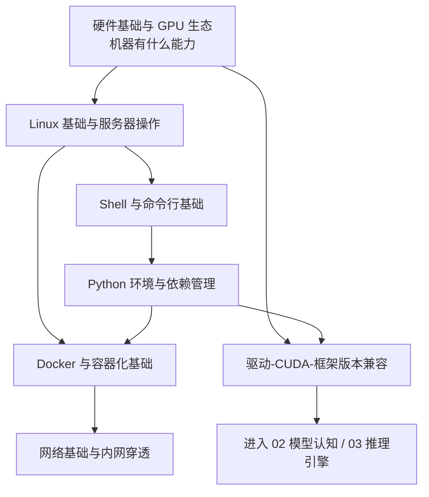

# 基础底座 MOC

> [!abstract] 一句话讲清楚
> 这是「01-基础底座」的入口：7 篇笔记回答一个前置问题——一台机器凭什么能跑大模型、出了问题该从哪一层开始查。这一层不直接产出交付物，但决定了你到客户现场能不能 10 分钟内摸清状况、说清配置。

## 这个领域是什么

- **定位**：整个技能栈的地基。上游是 [[技能栈总览 MOC]] 给的全局地图，下游是 [[模型认知 MOC]]（模型本身）和 [[推理引擎 MOC]]（怎么把模型跑起来）。
- **学它解决什么**：不是让你转行做运维，而是做到三件事——接手陌生机器能快速盘点、照着教程能把环境装对、服务跑不起来时知道从哪层查。
- **它是最省钱的领域**：部署故障里相当一部分是磁盘满、端口被占、依赖冲突、显存不够这类基础问题。会查就能自己解决，不会查就只能一次次重装。

## 推荐阅读顺序

按「先认识机器 → 再操作机器 → 再装软件 → 再打包 → 再联网 → 最后集中排雷」：

| 顺序 | 笔记 | 解决的问题 | 难度 | 建议投入 |
|---|---|---|---|---|
| ① | [[硬件基础与 GPU 生态]] | 这台机器算什么水平、能跑多大模型 | 入门 | 2~3 小时 |
| ② | [[Linux 基础与服务器操作]] | 登录上去以后，文件、权限、进程、服务、日志怎么看 | 入门 | 3~4 小时 |
| ③ | [[Shell 与命令行基础]] | 命令怎么组合、任务怎么挂后台、Windows 和 Linux 差在哪 | 入门 | 2~3 小时 |
| ④ | [[Python 环境与依赖管理]] | 框架和依赖怎么装才不互相打架 | 入门 | 3~4 小时 |
| ⑤ | [[Docker 与容器化基础]] | 怎么把「我这能跑」变成「客户那也能跑」 | 进阶 | 3~4 小时 |
| ⑥ | [[网络基础与内网穿透]] | 服务怎么让客户电脑打开，怎么安全地对外 | 进阶 | 3~4 小时 |
| ⑦ | [[驱动-CUDA-框架版本兼容]] | 高频报错的集中排查手册，长期回查 | 进阶 | 2~3 小时 + 长期回查 |

> [!tip] 顺序说明
> ⑦ 放最后不是因为它不重要，而是它需要前面几篇的背景才看得懂；真到实战里，它是你回头翻得最多的一篇。

## 领域地图

## 每篇一句话

- [[硬件基础与 GPU 生态]]：先搞懂显存、带宽、精度这三件事，你才有资格回答「这机器能跑多大模型」。
- [[Linux 基础与服务器操作]]：文件在哪、谁能改、服务谁托管、日志去哪看——接手服务器后的四连问。
- [[Shell 与命令行基础]]：管道和重定向让你用一堆小工具拼出大动作，长任务也不会因为 SSH 断开就死。
- [[Python 环境与依赖管理]]：依赖地狱的根源是「全局只有一个版本」，解法是隔离 + 锁版本。
- [[Docker 与容器化基础]]：把运行环境连同版本一起封成镜像，交付才可复现；容器不是虚拟机，这点必须分清。
- [[网络基础与内网穿透]]：能不能访问就三件事——监听地址、防火墙、有没有路进去。
- [[驱动-CUDA-框架版本兼容]]：一条自上而下的排查链，把「玄学报错」变成可执行的检查顺序。

## 与其他领域的衔接

| 领域 | 这里打的地基 | 什么时候会回头翻 |
|---|---|---|
| 02-模型认知 | 显存估算、精度、量化 | 算「多大模型能跑」时先来这边确认硬件口径 |
| 03-推理引擎 | Python 环境、Docker、驱动 | 装 [[vLLM]] 报错、[[Ollama]] 起不来时 |
| 04-部署实战 | 三平台流程的基础动作 | 写 [[部署检查清单]] 时直接引用这里的检查项 |
| 05-应用集成 | 网络、端口、反向代理 | 配 [[RAG 原理与全链路]] 的服务地址时 |
| 06-生成式多媒体 | 显存、容器 | 跑 [[ComfyUI 核心概念]] 遇到显存不足时 |
| 07-微调训练 | Python 依赖、GPU 显存与算力 | 装 [[微调框架生态]]、调训练参数时 |
| 08-工程化交付 | Docker、网络、端口 | 做 [[容器化部署]] 和 [[远程交付与远程运维]] 时 |

## 学完怎么算过关

- [ ] 拿到一台陌生服务器，能按固定顺序把 CPU / 内存 / 磁盘 / 显卡 / 系统版本 / 占用端口摸一遍。
- [ ] 能解释「127.0.0.1 和 0.0.0.0 的区别」，并说清为什么服务明明在跑、外面却连不上。
- [ ] 能在一台干净机器上建出独立 Python 环境，并说清为什么不用系统自带环境。
- [ ] 能解释容器和虚拟机的区别，以及容器里为什么不需要装显卡驱动。
- [ ] 看到 `CUDA out of memory`、`no kernel image` 这类报错，知道先查什么、不先怀疑什么。
- [ ] 能给客户用两句话讲清「你这台机器能跑多大的模型，大概几个人同时用会卡」。

## 常见误区

- **把这一层当运维课**：不需要背命令，需要的是排错的顺序感。命令忘了可以查，顺序错了会白折腾几小时。
- **跳过硬件直接学部署**：不先搞清楚显存和带宽，后面所有「为什么这么慢」的问题都会变成玄学。
- **一上来就装全套**：Docker、CUDA、各种框架一次装完，出问题时分不清是谁的锅。按顺序一层层装、一层层验证。

## 相关笔记

- 返回总览：[[技能栈总览 MOC]]
- 起点：[[README 从这里开始]]
- 路线：[[学习路线图]]
- 查词：[[术语总表]]
- 下游：[[模型认知 MOC]]
- 下游：[[推理引擎 MOC]]
- 验收：[[能力自检清单]]

## 交付视角（对客户怎么讲）

- 客户问「我这台机器够不够」：不问型号先问显存和用途（几个人用、要不要上传文档、上下文多长），按「够用 / 舒服 / 宽裕」三档报，不承诺跑分。
- 客户问「为什么装个模型这么麻烦」：一句话——模型只是一堆权重文件，难的是让它跑起来的整套环境和驱动，这层地基就是干这个的。
- 客户问「为什么不能直接在我自己的电脑上跑」：讲清显存和带宽限制，给出「本机轻量试用」和「服务器稳定交付」两种方案及各自代价。
