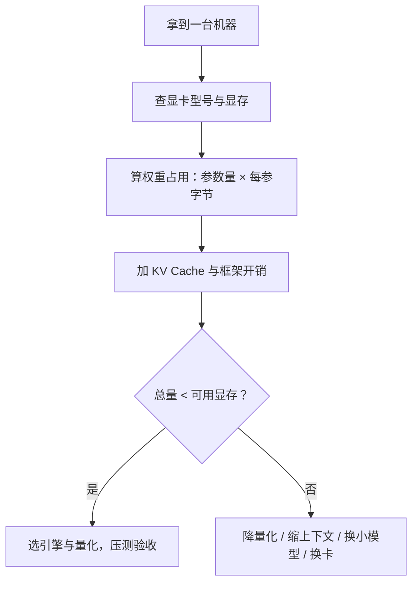

# 硬件基础与 GPU 生态

> [!abstract] 一句话讲清楚
> 跑本地大模型，卡你脖子的就两个数：显存够不够装下模型，带宽够不够把模型喂得动；选卡就是在这两个数、你的预算、和你实际使用的操作系统生态之间做取舍。

## 为什么重要

- 客户第一个问题几乎永远是"我这台机器能跑多大的模型"，答错一次就丢信任。
- 同一张卡，跑 FP16 和跑 4bit 量化能跑的模型差一倍以上；不知道精度和显存的关系，报价和方案都会错。
- 很多人只看显存容量，结果买回来出字慢得没法用——瓶颈其实是带宽。
- N 卡、A 卡、Mac、CPU 四套生态成熟度差很多，选错平台后面每个工具都要重新踩坑。
- 接单视角：硬件判断是交付方案的第一块砖，方案错了，后面所有工作都在错误的地基上。

## 核心名词全解

| 名词 | 英文/缩写 | 大白话解释 | 容易混淆/注意 |
|---|---|---|---|
| 处理器 | CPU | 电脑的大脑，擅长串行、逻辑复杂的活 | 大模型主力是 GPU，CPU 只做兜底 |
| 图形处理器 | GPU | 几千个小核并行的计算器，擅长重复的乘法加法 | 游戏卡和计算卡架构同源，用途不同 |
| 显存 | VRAM | 显卡自己的内存，模型权重必须先装进去 | 不是系统内存，装不下就爆显存 |
| 显存带宽 | VRAM bandwidth | 显卡每秒能从显存里搬多少数据 | 决定生成速度，比算力更容易成为瓶颈 |
| 算力 | Compute (FLOPS) | 单位时间能做多少次运算 | 主要影响"读 prompt"的速度 |
| 精度 | FP32 / FP16 / BF16 / FP8 / INT8 / INT4 | 每个数字用多少位来存，位越少越省显存 | 精度降低可能丢质量，不是无脑选最低 |
| 张量核心 | Tensor Core | 专门加速矩阵乘法的硬件单元 | 新卡才有，老卡没有会明显慢 |
| 位宽 | Bit width | 数据被压缩到几比特 | INT4 约等于每个参数半个字节 |
| 高速总线 | PCIe | CPU 和显卡之间的通道 | 代际和通道数影响多卡和加载速度 |
| 显卡互联 | NVLink | 高端卡之间的专用高速通道 | 消费卡基本没有，多卡通信走 PCIe |
| 统一内存 | Unified Memory | CPU 和 GPU 共用一块内存（如 Mac） | 看着很大，但带宽通常不如独立显卡 |
| 计算平台 | CUDA | NVIDIA 的 GPU 编程生态 | 绝大多数推理框架优先支持它 |
| 计算平台 | ROCm | AMD 的 GPU 编程生态 | 支持面窄，工具链成熟度不如 CUDA |
| 计算平台 | Metal | Apple 的 GPU 编程接口 | Mac 上生态靠框架适配 |
| 消费卡 / 专业卡 | Consumer / Pro GPU | 消费卡便宜显存小，专业卡贵显存大 | 消费卡通常没有 ECC 显存 |
| 纠错内存 | ECC | 显存自带纠错，长时间训练更稳 | 推理场景一般不是硬要求 |
| 功耗 | TDP | 显卡满负荷吃多少电 | 决定电源和散热怎么选 |

## 原理与机制

### 直觉版

- GPU 像一间有几千个小学生的教室：每个小学生只会算简单的加减乘，但人多，一起算就快。
- 显存是每个学生面前的课桌，模型权重必须先摆到桌上，桌子不够大就摆不下。
- 带宽是"从书包往桌上拿书的平均速度"，拿得慢，学生再快也得干等。
- 所以判断能不能跑，先看桌子多大（显存），再看发书速度（带宽），最后才看学生多聪明（算力）。

### 拆解版

**1. 推理分两个阶段，瓶颈完全不同**

- 预填阶段（prefill）：把用户整段 prompt 一次性算完。这一步是大量矩阵运算，吃的是算力。
- 解码阶段（decode）：一个 token 一个 token 往外蹦。每蹦一个，都要把模型权重从头读一遍。
- 由此得出一条重要经验：**读 prompt 慢多半是算力或显存带宽问题，出字慢多半是带宽问题。**

**2. 出字速度的上限怎么估**

- 核心近似：每生成一个 token，要把模型权重读进计算单元一次。
- 所以速度上限大约等于：显存带宽 ÷ 每个 token 需要读的权重字节数。
- 权重越大、量化越少 → 每 token 读得越多 → 出字越慢。
- 这是为什么"同显存下，小模型 + 低比特量化"能明显更快。

**3. 精度与显存的关系**

- 每个参数占多少字节：FP16 约 2 字节，INT8 约 1 字节，INT4 约 0.5 字节。
- 权重显存 ≈ 参数量 × 每参字节数。
- 7B 模型 FP16 约 14GB 量级，INT4 约 4GB 量级；70B 量级则要大一个数量级。
- 量化不是白给的：位越低，质量损失和对特定任务的敏感度风险越高，要实测。

**4. 显存估算公式（够用的版本）**

- 总显存需求 ≈ 权重 + KV Cache + 框架开销。
- 权重 = 参数量 × 每参字节数。
- KV Cache 跟上下文长度、并发数、模型结构有关，长上下文场景能占到很大比例。
- 框架开销按 10%~20% 预留。
- KV Cache 随"上下文 × 并发"增长，这是很多"能装下但一聊天就爆"的根因。

**5. 为什么多卡不是白捡性能**

- 模型能切成多卡，但卡之间要频繁通信。
- 通信走 PCIe 时带宽有限，卡越多通信开销占比越高，加速比越低。
- 消费级主板的 PCIe 通道数有限，插两张卡可能各自降速。
- 所以"单卡大显存"通常比"多张小卡"更省心、更快。

### 后果

- 只看显存不看带宽 → 模型装得下但慢到无法交付。
- 忽视 KV Cache 与并发 → 单条测试正常，多用户一来直接爆显存。
- 选错平台生态 → 框架不支持、工具链缺失，只能自己写适配，工期失控。
- 电源/散热留余量不足 → 高负载时掉卡、降频，表现为"跑着跑着变慢或报错"。

## 分类与对比

### N 卡 / A 卡 / Mac 统一内存 / 纯 CPU

| 维度 | NVIDIA | AMD | Apple（统一内存） | CPU |
|---|---|---|---|---|
| 生态成熟度 | 最好，框架优先支持 | 一般，部分框架需专门适配 | 中等，靠框架专门优化 | 能跑，但极慢 |
| 代表工具 | CUDA 系推理框架 | ROCm 系 | Metal 系推理框架 | 各种 CPU 推理后端 |
| 显存特点 | 独立显存，容量与带宽都强 | 独立显存，部分卡性价比高 | 与系统内存共享，容量大但带宽一般 | 系统内存，容量大但带宽最低 |
| 适合场景 | 交付、生产、几乎所有场景 | 预算敏感、愿意折腾 | 个人开发、轻量使用 | 兜底、极小模型、验证流程 |
| 主要坑 | 驱动/版本匹配 | 框架支持不全、报错偏门 | 内存被系统占用、并发差 | 速度不达标 |

### 消费卡 / 专业卡 / 数据中心卡

| 类型 | 显存 | 价格量级 | 适合 | 注意 |
|---|---|---|---|---|
| 消费卡 | 中等（常见十几到二十几 G） | 低 | 个人开发、小规模交付 | 无 ECC、多卡受限、散热吃机箱 |
| 专业卡 | 较大 | 中高 | 中小团队、稳定长跑 | 性价比一般，但更省心 |
| 数据中心卡 | 大 | 高 | 多用户、高并发、训练 | 整机配套要求高，噪音与功耗大 |

### 一张图看清"能不能跑"

- 图里的顺序是固定的：先看硬件，再算占用，不行就降配置，而不是反过来先挑模型。

## 完整流程：判断一台机器到底能跑多大

### 第 1 步：查清显卡与显存

- **做什么**：`nvidia-smi` 看型号、显存总量、当前占用、驱动版本。
- **为什么**：这是所有估算的起点，显存总量是硬上限。
- **验收标准**：拿到准确显存数字与显卡型号。
- **失败表现**：命令不存在 → 驱动没装或不是 N 卡，先解决驱动问题。

### 第 2 步：查显存带宽

- **做什么**：查官方规格里的显存带宽，看是几百 GB/s 还是几 TB/s 量级。
- **为什么**：决定出字速度，也决定同一个模型换卡后体验差多少。
- **验收标准**：能说出带宽量级。
- **失败表现**：只记了显存容量，后面估速度全靠猜。

### 第 3 步：算权重占用

- **做什么**：参数量 × 每参字节数（FP16 约 2 / INT8 约 1 / INT4 约 0.5）。
- **为什么**：这是显存里最大的一块，先抠出来。
- **验收标准**：得到权重占用的量级。
- **失败表现**：用参数量直接当 GB 数，结果差一倍。

### 第 4 步：算 KV Cache 与上下文需求

- **做什么**：按目标上下文长度和并发数估 KV Cache，长上下文场景要特别留余量。
- **为什么**：这是"能装下但一用就爆"的主要原因。
- **验收标准**：给出"最大上下文 × 最大并发"的组合上限。
- **失败表现**：单条对话正常，多人同时用立刻 OOM。

### 第 5 步：留框架开销

- **做什么**：在总量上再加 10%~20%。
- **为什么**：框架、CUDA 上下文、碎片化都会吃显存。
- **验收标准**：最终数字明显低于总显存，留出安全边界。
- **失败表现**：理论刚好装下，实测一直爆。

### 第 6 步：选量化与推理引擎

- **做什么**：按上面算出的空间选精度和引擎，参考 [[量化技术]] 与 [[推理引擎选型决策树]]。
- **为什么**：同样的显存，选对引擎和量化能多跑一个量级的模型。
- **验收标准**：模型能加载、能生成、质量可接受。
- **失败表现**：选了个不擅长该硬件的引擎，白瞎了卡。

### 第 7 步：压测并写进交付报告

- **做什么**：测单条延迟、并发吞吐、长时间稳定性、显存峰值。
- **为什么**：客户只认实测数字，你的估算只是内部参考。
- **验收标准**：报告里写明硬件、模型、量化、上下文、并发及对应指标。
- **失败表现**：只测了一条对话就宣布完成，客户一上量就崩。

## 决策点

- **岔路口 1：买卡还是租卡？** 长期稳定、涉及客户数据 → 买；短期试验、学习 → 租。代价：租灵活但长期成本高，买省心但要维护。
- **岔路口 2：24G 级消费卡还是 48G 级专业卡？** 目标是 7B~14B 量化推理、预算有限 → 消费卡；要跑更大模型、要稳定多用户 → 专业卡。代价：专业卡贵不少。
- **岔路口 3：单卡大显存还是多卡小显存？** 能做单卡就单卡，省掉通信和适配问题。代价：单卡大显存的卡通常更贵。
- **岔路口 4：新卡还是二手？** 追求性价比可以二手，但来源和保修风险要自己扛；交付客户一定要新卡或可追溯的卡。代价：二手卡翻车成本高。
- **岔路口 5：整机电源留多少余量？** 至少给显卡满载功耗留出明显余量，还要算 CPU 和硬盘。代价：电源小了会掉卡，现象很随机。
- **岔路口 6：Intel/AMD 平台还是服务器平台？** 单卡工作站用普通平台够；多卡要服务器平台或专门主板。代价：服务器平台噪音大、贵。
- **岔路口 7：要不要上 ECC 显存？** 推理一般不需要；长时间训练、金融医疗等场景更倾向专业卡。代价：专业卡价格高。

## 参数与配置说明

| 参数 | 看它干什么 | 参考判断 |
|---|---|---|
| 显存容量 | 决定能装多大模型 | 越大越好，是第一硬指标 |
| 显存带宽 | 决定出字速度 | 同一档位内优先高带宽 |
| 支持的精度 | 能否跑低比特量化 | 新架构支持更全 |
| PCIe 版本与通道数 | 多卡通信、模型加载速度 | 多卡必须注意通道分配 |
| 电源功率与接口 | 能否稳定点亮满载 | 按整机峰值留足余量 |
| 机箱长度与散热 | 装不装得下、压不压得住 | 大卡普遍又长又厚 |
| 系统内存 | 加载模型、KV Cache 换出 | 一般建议不小于显存的数倍 |
| 功耗上限设置 | 性能与噪音平衡 | 降功耗会掉性能，但更安静 |

## 常见坑与误区

| 现象 | 原因 | 对策 |
|---|---|---|
| 模型能加载，但出字慢到不能用 | 只看显存没看带宽 | 按带宽估速度上限，必要时换卡或降精度 |
| 任务管理器显示的显存比卡本身大 | 系统把共享内存也算进"可用显存"了 | 以显卡规格和 `nvidia-smi` 为准 |
| 单条对话正常，多人用就爆显存 | 没算 KV Cache 和并发 | 限制最大上下文与并发，或加卡 |
| 插了两张卡速度没提升甚至更慢 | PCIe 通道不足、多卡通信开销大 | 优先单卡；要多卡用服务器平台 |
| 高负载时黑屏、掉卡、重启 | 电源不够或散热压不住 | 换电源、改善风道、限功耗 |
| Mac 统一内存很大，但跑得慢 | 统一内存带宽低于独立显卡 | 用它做开发，生产交付慎重 |
| `nvidia-smi` 正常，框架却说没有 GPU | 装的是 CPU 版框架或驱动太旧 | 见 [[驱动-CUDA-框架版本兼容]] |
| 新买的卡跑不动某个框架 | 生态还没适配新架构 | 查框架支持矩阵，别硬试 |
| 机箱装不下、温度飙高 | 卡太长太厚，风道不合理 | 买之前量尺寸，选大机箱 |

## 自检问题

- [ ] 能说清显存和带宽各自决定什么吗？
- [ ] 7B 模型 FP16 大概要多少显存？INT4 呢？为什么是量级而不是精确值？
- [ ] 什么是 KV Cache？为什么长上下文会更吃显存？
- [ ] 为什么多卡不一定比单卡快？
- [ ] N 卡、A 卡、Mac 各自的优势和坑是什么？
- [ ] 一台机器给你，你怎么按步骤判断能跑多大的模型？
- [ ] 为什么交付时实测压测比理论估算重要？

## 自检问题参考答案

> [!success]- 1. 显存和带宽各自决定什么
> 显存决定上限：模型权重、KV Cache、框架开销都得先装进显存，装不下就直接爆显存，再好的卡也用不了。带宽决定速度：解码阶段每生成一个 token 都要把权重读进计算单元一遍，出字速度上限大约等于显存带宽除以每个 token 要读的权重字节数。所以选卡时先看显存够不够装，再看带宽够不够快。

> [!success]- 2. 7B 模型要多少显存、为什么给量级
> 7B 模型 FP16 大约 14GB 量级，INT4 大约 4GB 量级。依据是权重显存约等于参数量乘每参字节数：FP16 每参约 2 字节、INT4 约 0.5 字节。只给量级是因为实际占用还受模型结构、KV Cache、上下文长度、框架开销影响，精确值要按具体实现和实测来，估完还要再留 10%~20% 余量。

> [!success]- 3. 什么是 KV Cache、为何吃显存
> 模型生成每个 token 时，都要用到之前所有 token 的 Key/Value 中间结果，KV Cache 就是把它们缓存下来，避免每次重算。上下文越长，缓存的历史越多；并发越高，要同时保留的份数越多。它跟上下文长度、并发数、模型结构都相关，长上下文场景能占到很大比例，这也是"能装下但一聊天就爆"的根因，对策是限制最大上下文与并发。

> [!success]- 4. 多卡为什么不一定更快
> 模型可以切到多张卡上，但卡之间要频繁通信，通信走 PCIe 时带宽有限，卡越多通信开销占比越高，加速比就越低。消费级主板的 PCIe 通道数有限，插两张卡可能各自降速。而解码阶段本来就是带宽瓶颈，多卡切分并不能凭空变出带宽。所以"单卡大显存"通常比"多张小卡"更省心也更快。

> [!success]- 5. N 卡、A 卡、Mac 各自优劣
> N 卡生态最好，绝大多数推理框架优先支持，是交付和生产场景的首选，坑主要在驱动和版本匹配。A 卡性价比高，但部分框架需要专门适配，支持面窄、报错偏门。Mac 统一内存容量大、适合个人开发和轻量使用，但内存会被系统占用、带宽通常低于独立显卡、并发能力差，生产交付要慎重。纯 CPU 只能兜底和验证流程。

> [!success]- 6. 怎么一步步判断能跑多大模型
> 按固定顺序走：先 `nvidia-smi` 查型号、显存总量、当前占用和驱动；再查显存带宽量级；然后算权重占用（参数量乘每参字节）；接着按目标上下文和并发估 KV Cache；再加 10%~20% 框架开销；根据剩下的空间选量化和推理引擎；最后压测并把结果写进交付报告。顺序不能反，先算需求再挑模型。

> [!success]- 7. 为什么交付要看实测压测
> 理论估算只是你内部参考，客户只认实测数字。单条延迟、并发吞吐、长时间稳定性、显存峰值这些只有压测才拿得到，而且实际表现还受驱动、框架实现、并发和上下文影响，估算容易偏乐观。不压测就宣布完成，客户一上量就崩；报告里写清硬件、模型、量化、上下文、并发和对应指标，既是验收证据，也是后续扩容的依据。

## 相关笔记

- [[基础底座 MOC]]
- [[驱动-CUDA-框架版本兼容]]
- [[参数量与显存估算]]
- [[量化技术]]
- [[推理引擎选型决策树]]
- [[N卡 A卡 Mac 平台适配]]
- [[低显存工作流优化]]

## 交付视角

- 对客户怎么讲："能不能跑取决于显存够不够装模型、带宽够不够出字快，我们用你的机器实测给你们看数据。"
- 客户常问"我这台游戏本能不能跑"：先看显存量级，再明确告诉他适合多大的模型、什么量化、大概什么速度，别只回"能跑"。
- 客户问"要不要买新卡"：给出"够用/不够用"的判断和预算区间选项，别硬推销顶配。
- 客户问"为什么大模型这么吃显存"：用"权重 + 缓存 + 框架开销"三块解释，客户能听懂。
- 报价里把"硬件评估 + 压测报告"单列，这是最能体现你专业度、也最容易让客户签单的一项。
