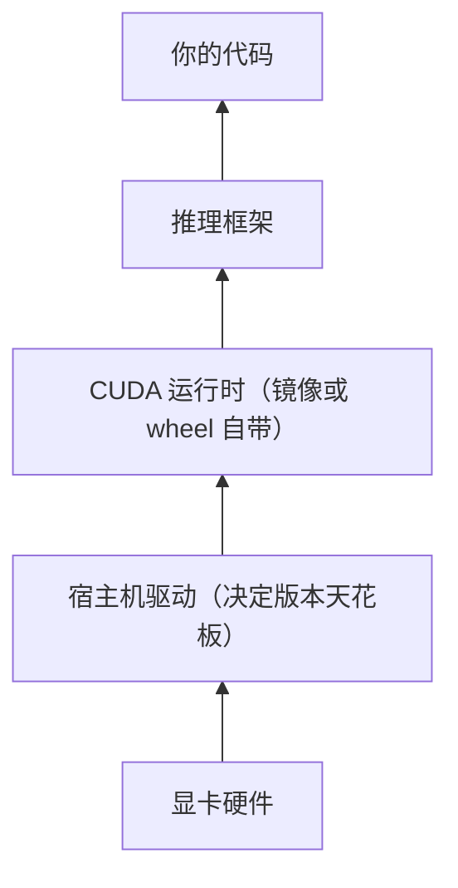

# 驱动-CUDA-框架版本兼容

> [!abstract] 一句话讲清楚
> 显卡能用，靠的是一条"驱动 → CUDA 运行时 → 框架"的版本链；本地部署里绝大多数"有卡却用不上"的报错，都是这条链上某一环对不上。

## 为什么重要

- 这是本地部署最高频的故障源：`nvidia-smi` 正常，一行 Python 却报 GPU 不可用。
- 报错文本看起来都很像，但对策完全不同——升驱动、换框架版本、换镜像，选错就是白折腾几个小时。
- 客户生产机往往不能随便重启、不能随便升级驱动，你必须在"改最小的地方"这个约束下解决问题。
- 容器交付时，这一块是"为什么在我这跑、在你这不跑"的核心差异。
- 接单视角：能在不重装系统、不动驱动的前提下把 GPU 跑起来，是最值钱的基本功。

## 核心名词全解

| 名词 | 英文/缩写 | 大白话解释 | 容易混淆/注意 |
|---|---|---|---|
| 显卡驱动 | Driver | 操作系统和显卡之间的翻译官 | 只能装在宿主机，容器里装驱动无效 |
| CUDA 工具包 | CUDA Toolkit | 写 GPU 程序用的一整套开发工具 | 装它不等于会用上 GPU，推理通常不需要 |
| CUDA 运行时 | CUDA Runtime | 程序真正运行时依赖的那部分库 | 框架自带的 wheel 里通常已经包含 |
| 驱动 API | Driver API | 程序通过驱动问显卡能力的接口 | 新旧程度决定能不能加载新 runtime |
| 深度神经网络库 | cuDNN | 神经网络算子的加速库 | 版本和 CUDA 版本强绑定 |
| 矩阵计算库 | cuBLAS | 基础矩阵运算加速库 | 很多框架依赖它，报错常指向它 |
| 多卡通信库 | NCCL | 多卡之间通信的库 | 单卡不需要，多卡场景才涉及 |
| 框架的 cu 后缀 | cuXXX | PyTorch wheel 名里的 CUDA 编译版本 | 只是编译目标，不等于宿主机必须装同版本 |
| 计算能力 | Compute capability / sm_XX | 显卡架构的代号 | 新架构配旧 wheel 会报没有可用内核 |
| 向后兼容 | Backward compatibility | 新驱动能跑旧程序 | 反向不成立，旧驱动跑不了新程序 |
| 版本查看命令 | nvidia-smi | 显示驱动和"驱动支持的最高 CUDA 版本" | 那个 CUDA Version 不是已安装的版本 |
| 编译器命令 | nvcc | 编译 CUDA 程序的命令 | 没有它也能跑推理，别被吓到 |
| 设备可见性变量 | CUDA_VISIBLE_DEVICES | 控制程序能看到哪几张卡 | 设错会"有卡却只看到一张" |
| 容器 GPU 工具 | NVIDIA Container Toolkit | 让容器能看到显卡的桥 | 容器报没有 GPU 时优先查它 |
| AMD 对应生态 | ROCm / HIP | A 卡版的"CUDA / 类 CUDA 写法" | 支持面窄，框架适配参差不齐 |

## 原理与机制

### 直觉版

- 把整条链想成一串转接头：显卡 → 驱动 → CUDA 运行时 → 框架 → 你的代码。
- 每个转接头只保证"往下一级能插上"，不保证"往上一级能插上"。
- 驱动是最底下那一段，装好之后往上兼容旧版本，但不会向上支持比它还新的东西。
- 所以报错时先想：是下面接不上（驱动太旧），还是上面没接（框架装成 CPU 版）。

- 图从下往上读：下层是上层的地基，上层的版本不能超过下层能支持的范围。
- 所以排查永远是"从下往上"：先证明驱动这层没问题，再往上看框架。

### 拆解版

**1. 分层看这条栈**

- 底层：显卡硬件与驱动。
- 中间：CUDA 运行时（以及 cuDNN、cuBLAS 等加速库）。
- 上层：框架（PyTorch 等）和推理引擎。
- 最上层：你的代码，只看到"张量"和"设备"。
- 问题几乎都发生在相邻两层之间，所以从下往上逐层验证最快。

**2. 驱动向后兼容，不向前兼容**

- 新驱动能跑基于旧 CUDA 运行时编译的程序，这是向上兼容。
- 反过来，旧驱动无法加载基于更新 CUDA 运行时编译的程序。
- 报错常见文本是"驱动版本不足"一类，看到它就说明：要么升驱动，要么把框架换成更老的 CUDA 版本。
- 关键结论：**驱动版本是天花板，框架的 CUDA 版本不能超过它。**

**3. nvidia-smi 右上角的 CUDA Version 到底是什么**

- 它表示"当前驱动最多支持到哪个 CUDA 运行时版本"，是一个能力上限。
- 它不是"你已经安装的 CUDA 版本"，也和你没装过 CUDA 无关。
- 很多人拿这个数字去判断"我装了 CUDA 吗"，越判断越乱。
- 想知道实际运行时版本，要看框架自己报告的版本，或 `nvcc -V`（如果有装工具包）。

**4. nvcc 只反映工具包，不影响单纯推理**

- `nvcc` 存在，说明这台机器装了 CUDA 工具包，用来编译 GPU 程序。
- 不装工具包，照样能跑现成的推理框架——因为 wheel 里自带运行时。
- 只有你要编译自定义算子、自己写 CUDA 扩展时，工具包才变成必需。
- 所以"没有 nvcc"不是故障，别为了它去乱装。

**5. 框架 wheel 自带运行时**

- 装 PyTorch 时那个带 cu 后缀的包，里面已经包含对应版本的运行时库。
- 宿主机只要驱动版本够，就能跑；不需要额外安装 CUDA 工具包。
- 装错了 CPU 版 wheel，会表现为"驱动正常、框架却说没有 GPU"。
- 这是最高频的假故障之一：装包时没指定 GPU 版本索引。

**6. 容器里为什么不用装驱动**

- 容器与宿主共享内核，驱动的内核态部分在宿主机。
- 容器里通过 NVIDIA Container Toolkit 拿到设备节点和用户态驱动库。
- 镜像里自带 CUDA 运行时，所以容器只要求"宿主驱动足够新"。
- 这就是容器交付的最大优势：把运行时版本锁死在镜像里。

**7. 算力架构不匹配会报什么**

- 框架 wheel 是针对某些显卡架构编译的，超出支持范围就会提示没有可用内核。
- 典型文本是"no kernel image is available"一类。
- 对策不是调参数，而是换到支持该架构的框架版本，或换官方镜像。

### 后果

- 强行升驱动 → 客户生产机可能起不来，或者把别的业务搞坏，风险极高。
- 分辨不出"CPU 版 wheel" → 反复重装驱动，问题当然不会好。
- 宿主机装了多个 CUDA 版本、PATH 指错 → 编译或运行时报的文件找不到。
- 容器没加 GPU 参数或没装 toolkit → 容器里永远看不到卡，误判成框架问题。

## 分类与对比

### CUDA 运行时装在哪：四种方式的取舍

| 方式 | 运行时来源 | 优点 | 缺点 |
|---|---|---|---|
| pip 装框架 | wheel 自带 | 最省事，一条命令 | 版本受 wheel 限制 |
| conda 环境 | conda 包提供运行时 | 能隔离、能挑版本 | 环境大，路径容易乱 |
| 框架官方镜像 | 镜像内置 | 组合被验证过，最稳 | 镜像大，要会 Docker |
| 自己装工具包 | 手动安装 | 能编译自定义算子 | 最容易把系统搞乱 |

### 报错对照：看到这句话先想什么

| 报错/现象 | 人话翻译 | 优先怀疑 |
|---|---|---|
| 驱动版本不足类提示 | 驱动比框架要求的旧 | 升驱动，或换更老的框架 wheel |
| 框架说没有可用 GPU | 装的是 CPU 版，或卡没暴露 | 查 wheel 类型与设备可见性 |
| 找不到可用内核 | 框架不支持这张卡的架构 | 换新版本框架或官方镜像 |
| 显存不足 | 模型太大或并发太高 | 降精度、缩上下文、换卡 |
| 找不到运行时库文件 | 运行时版本和框架不匹配 | 卸载重装或直接用容器 |
| 容器里看不到显卡 | 没加 GPU 参数或没装 toolkit | 检查 toolkit 与启动参数 |

## 完整流程：GPU 用不上的六步排查

### 第 1 步：确认宿主机自己能不能看见卡

- **做什么**：执行 `nvidia-smi`，看型号、显存、驱动版本，以及右上角的 CUDA 版本上限。
- **为什么**：宿主机都看不见，容器和框架更不可能看见。
- **验收标准**：命令有正常输出，能读到驱动版本号。
- **失败表现**：命令不存在 → 驱动没装或装坏了，先处理这一层。

### 第 2 步：核对框架要求的版本

- **做什么**：查这个框架版本要求的最低 CUDA 版本和最低驱动版本（以官方文档为准）。
- **为什么**：这一步决定"能不能升驱动解决"，还是"只能换框架"。
- **验收标准**：拿到两个下限数字，和 `nvidia-smi` 的数字做比较。
- **失败表现**：不看要求直接升级驱动，结果客户机器点不亮。

### 第 3 步：容器先验证一遍 GPU 通路

- **做什么**：用官方 CUDA 镜像跑 `docker run --gpus all 镜像 nvidia-smi`。
- **为什么**：这一步同时验证驱动、toolkit 和启动参数，是排查容器问题最快的办法。
- **验收标准**：容器里能看到和宿主机一样的显卡信息。
- **失败表现**：报设备不存在 → toolkit 没装好或没加 `--gpus`。

### 第 4 步：在框架里自检

- **做什么**：检查框架自己的设备可用性判断，并看它报告的 CUDA 版本和驱动版本。
- **为什么**：区分"驱动链路问题"和"框架安装问题"。
- **验收标准**：可用性为真，且框架报告的版本与预期一致。
- **失败表现**：可用性为假 → 多半是 CPU 版安装包。

### 第 5 步：按报错文本定类型

- **做什么**：把报错文本对上面那张对照表，判断属于驱动旧、架构不支持、显存不够还是缺库。
- **为什么**：同类问题长得像，但对策完全相反。
- **验收标准**：能一句话说出问题类型。
- **失败表现**：不看错误、盲目重装，越修越乱。

### 第 6 步：对症处理并验证

- **做什么**：驱动旧 → 升驱动（生产机慎重、要安排窗口）；框架不匹配 → 换 wheel 或换镜像；容器问题 → 检查 toolkit 与参数；显存不够 → 调整模型与上下文。
- **为什么**：只有在最小改动下修好，客户环境才可维护。
- **验收标准**：完整跑通一次推理，并记录修改前后版本。
- **失败表现**：修好了但没记录，下次换台机器又重来一遍。

## 决策点

- **岔路口 1：升驱动还是换框架版本？** 优先换框架 wheel 或换镜像。只有必须用新特性、且客户同意停机时，才升驱动。代价：换框架可能缺功能，升驱动可能需要重启和回滚准备。
- **岔路口 2：宿主机装工具包还是用容器？** 只是推理 → 容器或框架 wheel 就够，不在宿主机装工具包。要编译自定义算子 → 再装工具包。代价：容器多一层运维，工具包可能污染系统。
- **岔路口 3：多版本 CUDA 怎么共存？** 靠环境变量切换路径，或直接每个项目一个容器。代价：路径管理容易出错，容器最干净。
- **岔路口 4：内网离线交付怎么带版本？** 带镜像 + 匹配的驱动安装包 + 一份版本矩阵说明。代价：包大、要提前验证目标机。
- **岔路口 5：Windows 还是 Linux 部署？** 生产交付优先 Linux，驱动和容器生态更稳；Windows 适合单机演示。代价：客户环境通常不可选。
- **岔路口 6：A 卡遇到框架不支持怎么办？** 换支持 ROCm/CPU 的框架，或降级目标，别硬改框架源码。代价：可选框架明显变少。

## 参数与配置说明

| 参数 / 命令 | 作用 | 关键点 |
|---|---|---|
| `nvidia-smi` | 看驱动版本与 CUDA 版本上限 | 右上角数字是上限，不是已安装版本 |
| `nvcc -V` | 看工具包版本 | 只反映工具包，与能否推理无关 |
| `CUDA_VISIBLE_DEVICES=0` | 指定可见显卡 | 用逗号分隔多卡，设空字符串可隐藏全部 |
| `CUDA_HOME` / `PATH` | 指定运行时与工具路径 | 多版本共存时最关键的两个变量 |
| `PYTORCH_CUDA_ALLOC_CONF` | 调整显存分配策略 | 碎片化导致 OOM 时值得试 |
| `NVIDIA_DRIVER_CAPABILITIES` | 容器内暴露驱动能力 | 需要计算能力时写 `compute,utility` |
| `--gpus all` | 把显卡给容器 | 和 `NVIDIA_VISIBLE_DEVICES` 配合使用 |
| 框架的设备可用性判断 | 快速确认 GPU 是否被识别 | 为假时先怀疑安装包类型 |
| 框架的 CUDA 版本属性 | 看运行时实际版本 | 与 `nvidia-smi` 的上限做比较 |
| `TF32` 相关开关 | 控制精度与速度权衡 | 影响数值精度，交付前评估 |

## 常见坑与误区

| 现象 | 原因 | 对策 |
|---|---|---|
| `nvidia-smi` 正常，框架却说没有 GPU | 装成了 CPU 版安装包 | 卸载后按官方 GPU 索引重装，或直接用容器 |
| 报驱动版本不足 | 驱动比框架要求的旧 | 换兼容的框架版本，或按窗口期升驱动 |
| 报没有可用内核 | 框架版本不支持这张卡的架构 | 换新版本框架或官方镜像 |
| 把右上角版本当成"已安装 CUDA 版本" | 概念混淆 | 记住它是驱动支持上限；实际版本看框架或工具包 |
| 容器里没有显卡 | 没加参数或没装 toolkit | 先 `nvidia-smi` 验证通路，再补参数 |
| 升驱动后客户生产机异常 | 驱动变更影响其他业务 | 生产机慎升级，升级前备份并安排回滚 |
| 多版本 CUDA 相互干扰 | PATH 或 `CUDA_HOME` 指错 | 用容器隔离，或写清切换脚本 |
| 把显存不足当成版本问题 | 现象相似，原因不同 | 先看报错里有没有"内存"字样，再按量调参 |
| 在容器里装驱动 | 以为容器要自己装 | 驱动只在宿主机装，容器用 toolkit 接 |

## 自检问题

- [ ] 能画出"驱动 → CUDA 运行时 → 框架"这条链并解释依赖方向吗？
- [x] `nvidia-smi` 右上角的数字代表什么？它等于已安装的 CUDA 版本吗？
- [x] 为什么宿主机不装 CUDA 工具包也能跑推理？
- [ ] 框架报"没有 GPU"时，你第一件怀疑的事是什么？
- [ ] 容器里 GPU 不可用，你会按什么顺序排查？
- [ ] 为什么在客户生产机上"升驱动"要特别谨慎？
- [ ] 遇到新旧架构不匹配的报错，你会怎么处理？

## 相关笔记

- [[基础底座 MOC]]
- [[硬件基础与 GPU 生态]]
- [[Python 环境与依赖管理]]
- [[Docker 与容器化基础]]
- [[推理引擎选型决策树]]
- [[排错方法论]]
- [[N卡 A卡 Mac 平台适配]]

## 交付视角

- 对客户怎么讲："我们不动你们的系统驱动，用容器把运行环境固定下来，只要求宿主机驱动达到一个最低版本。"
- 客户 IT 最关心"要不要重装/重启"：先给"不需要"的方案；确实需要升驱动时，说明影响范围、时间窗口和回滚方式。
- 客户问"以后换显卡还能不能用"：给一份版本矩阵说明当前镜像支持的驱动区间，让他们换卡后按文档自查。
- 交付文档里必须记下：驱动版本、框架版本、运行时版本、镜像 tag、验证命令和期望输出——这四样能省掉大量售后。
- 报价时把"环境适配与版本管理"列成服务项，这是在客户环境里最容易消耗工时、也最容易被低估的部分。
