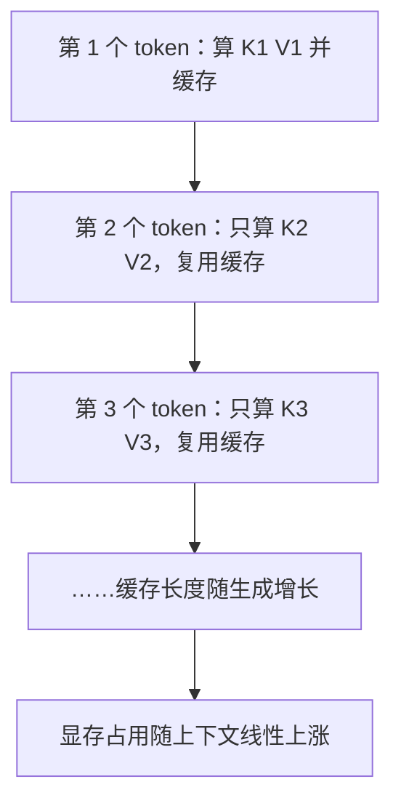

# Attention 与 KV Cache

> [!abstract] 一句话讲清楚
> 注意力让每个 token 去"翻前面所有 token 的笔记"，决定该听谁的；KV Cache 是把这些笔记缓存下来，避免每生成一个字都从头再翻一遍。**缓存省了算力，但吃了显存——这就是长上下文真正的成本来源。**

## 为什么重要

- 它是理解"**为什么长上下文吃显存、为什么并发上不去**"的唯一途径。看懂这篇，[[参数量与显存估算]] 里的 KV Cache 那一项你才能自己推。
- 交付里三个高频问题都直接指向它：
  - "我这卡能开多长上下文？"——取决于 KV Cache 有多大。
  - "为什么人一多就变慢/爆显存？"——每个并发请求都有一份自己的 KV Cache。
  - "为什么模型支持 128K，实际用起来还是卡？"——KV Cache 随长度**线性增加**，不是白送的。
- 这一节只需要两个公式，不用写代码。

## 核心名词全解

| 名词 | 英文 / 缩写 | 大白话解释 | 容易混淆 / 注意 |
|---|---|---|---|
| Q / 查询 | Query | 当前 token 发出的"我想找什么信息"的提问。 | 直觉是"我在搜什么"。 |
| K / 键 | Key | 每个 token 身上贴的"我是什么信息"的标签。 | 用来和 Q 匹配算相关性。 |
| V / 值 | Value | 每个 token 携带的"实际内容"，匹配上之后就把内容取走。 | 直觉是"搜到之后读到的正文"。 |
| 注意力分数 | Attention Score | Q 和 K 算出来的相似度，决定"看谁多一点"。 | 是 QK 点积，不是语义相似度的精确度量。 |
| 因果掩码 | Causal Mask | 生成时禁止模型"偷看"后面的 token，只能看前面。 | 训练时才需要显式加；少加就是数据泄露，指标虚高。 |
| 多头注意力 | Multi-Head Attention | 同时用多组 Q/K/V 从不同角度并行看，再把结果拼起来。 | 头数多不等于更聪明；头数受 hidden size 约束。 |
| 多头变体 | MHA / MQA / GQA | 多个 Q 共享不同数量的 K/V，用来省 KV Cache。 | 这是**省显存的架构手段**，和量化无关。 |
| KV Cache | KV Cache | 把算过的 K 和 V 存起来，生成下一个 token 时直接复用。 | 只缓存 K/V，不缓存 Q；长度越长占得越多。 |
| 预填充 | Prefill | 一次性把整段提示词算完、建好缓存的阶段。 | 这阶段是并行的，所以"首字时间"主要看它。 |
| 解码 | Decode | 一个 token 一个 token 往后生成的阶段。 | 这阶段串行、利用率低，所以"吐字速度"主要看它。 |
| FlashAttention | FlashAttention | 一种更省显存、更快的注意力计算实现方式，分块算、少落地。 | 是**实现优化**，不改变模型结构、不改变结果量级。 |
| 滑动窗口注意力 | Sliding Window / SWA | 只看最近的固定窗口，不回头看全部历史。 | 能压 KV Cache，但会"忘"远处信息。 |

## 原理与机制

### 直觉：图书馆查资料

把注意力想成去图书馆查资料：

- 你手上有个**问题**（Q）；
- 书架每本书侧面有个**标签**（K）；
- 你拿问题和所有标签比对，越像的越值得拿；
- 最后把匹配度当权重，把书的**正文**（V）按比例混合起来读。

一句话：**用 Q 去匹配 K，按匹配度加权取 V**。

### 一个 token 的注意力怎么算

简化成四步（只讲逻辑，不推导）：

1. 当前 token 的向量分别乘三个矩阵，得到它的 Q、K、V。
2. 当前 Q 和**前面每个 token 的 K** 做点积 → 得到一串分数。
3. 分数除以一个缩放系数 → 过 softmax → 变成加起来等于 1 的权重。
4. 用这些权重对前面所有 token 的 V 加权求和 → 得到这一层的输出。

写成一句话公式：

```
输出 = softmax(Q·Kᵀ / √d) · V
```

> [!tip] 关键在 Q·Kᵀ 这一项
> 当前 token 要和**前面每一个** token 算一次。所以上下文长度翻倍，注意力的计算量和需要的中间数据都跟着涨——这是"长上下文贵"的源头。

### 因果掩码：不许偷看答案

训练时是一次性喂一整段文本的，如果不遮挡，模型算第 3 个字时就能看到第 10 个字，等于考试抄答案。

所以加一个**下三角掩码**：第 i 个位置只能看第 1~i 个位置，后面的全设成负无穷（softmax 后变 0）。

后果有两个：

- 训练必须遮挡，否则模型上线就废。
- 生成时天然只能看前面——这正好是自回归需要的行为。

### KV Cache：省算力，但不省显存

**问题**：每生成一个新 token，都要重新算它和前面所有 token 的注意力。前面那些 token 的 K 和 V 其实**没变过**，每次重算纯浪费。

**解决**：把它们存下来。这就是 KV Cache。



**必须记住的账**：

- 缓存的是**每一层**的 K 和 V，不是只在最外层存一份。层数越多，缓存越大。
- 缓存的长度 = **输入提示词 + 已生成内容**，是持续增长的。
- 每个并发请求都有**独立一份**缓存。并发数 × 上下文长度，就是显存压力。

### KV Cache 显存公式（心算版）

```
KV Cache 显存 ≈ 2 × 层数 × 序列长度 × KV 头数 × 每头维度 × 每元素字节数
```

心算可以简化成：

```
KV 每 token 字节数 ≈ 层数 × hidden_size × 2（K 和 V）× 每元素字节数 ÷ 分组倍数
```

举个量级例子（数字是量级示意，实际以模型卡为准）：

- 一个 7B 级别的模型，hidden size 几千、层数几十。
- 不分组（MHA）+ fp16 时，每 1K token 的 KV Cache 大概在**几百 MB 量级**。
- 用 GQA 把 KV 头数砍到 1/4~1/8，缓存也跟着降到 1/4~1/8。
- 如果上下文开到 128K，**KV Cache 能到几十 GB 量级**——比模型权重还大。

> [!warning] KV Cache 才是长上下文的真正杀手
> 很多人算 7B 模型"14G 权重，24G 卡够用"，然后开 32K 上下文、并发 4 个，结果直接 OOM。原因就是权重只是起步价，**KV Cache 是随长度和并发翻倍的变量**。详细算账见 [[参数量与显存估算]]。

### GQA / MQA：用"共享"换显存

MHA 的问题是每个 Q 头都配一套 K/V。变体思路是让多个 Q 头**共享**同一套 K/V：

| 结构 | 全称 | K/V 头数 | 显存 | 效果 |
|---|---|---|---|---|
| MHA | Multi-Head Attention | 和 Q 头数一样多 | 最贵 | 经典，表达最充分 |
| GQA | Grouped-Query Attention | 分组共享，Q 头数 : KV 头数 = 4:1 或 8:1 量级 | 明显下降 | **现在的主流**，质量和成本平衡好 |
| MQA | Multi-Query Attention | 只有 1 组 KV | 最省 | 省到极致，质量有损失，用得少 |

结论：看到模型卡写 "GQA，KV 头数较少"，说明它**对长上下文和并发更友好**，这是可以讲给客户的卖点。

### FlashAttention：不算结构，算的是"不要来回搬运"

注意力的中间矩阵（序列长度 × 序列长度）非常大，如果整体写进显存再读出来，带宽全耗在搬运上。

FlashAttention 的做法是**分块计算，边算边合并**，不把大矩阵完整落地。结果是：

- 显存占用明显下降（不需要存巨大的注意力矩阵）；
- 速度更快（少读写）；
- **数学结果和标准注意力基本等价**，不改变模型能力。

要点：它优化的是"计算过程"，**不能减少 KV Cache 本身的体积**。别把"上了 FlashAttention"当成"长上下文不费显存了"。

## 分类与对比

按"怎么省显存"分三条路线：

| 路线 | 手段 | 省在哪 | 代价 |
|---|---|---|---|
| 结构层 | MQA / GQA / 滑动窗口 | 直接减少 KV 头数或窗口长度 | 质量/长距离信息有损 |
| 实现层 | FlashAttention / PagedAttention | 减少中间开销、减少碎片 | 不改模型，但省不了 KV 本体 |
| 外部层 | 量化 KV Cache、上下文压缩、摘要 | 降精度或降长度 | 精度损失/信息丢失 |

交付中最常用的组合是：**GQA 模型 + PagedAttention（vLLM）+ KV Cache 量化**。见 [[vLLM]]。

## 决策点

- **岔路口 1：客户要长上下文，先看什么？**
  - 判断依据：模型是不是 GQA、KV 头数多少、引擎支不支持 KV 量化、并发多少。
  - 推荐选择：**优先选 GQA 模型 + 支持分页 KV 的引擎**，再考虑把上下文按需裁剪。
  - 代价：换模型有迁移成本；但比堆显卡便宜得多。

- **岔路口 2：上下文要多长就开多长？**
  - 判断依据：真正需要的信息有多少。
  - 推荐选择：**按需求开，不要默认拉满**。大多数 RAG 场景 8K~16K 就够；纯"塞整本书"才考虑 32K 以上。
  - 代价：开小了可能漏信息；开大了显存和延迟都上去。

- **岔路口 3：并发上不去，先动哪？**
  - 判断依据：看是显存不够还是算力不够。
  - 推荐选择：显存不够 → 降上下文、降量化、开 KV 量化、换 GQA 模型；算力不够 → 换引擎（[[llama.cpp 与 GGUF]] → [[vLLM]]）、加卡。
  - 代价：降精度会掉质量，需要拿业务用例复测。

## 参数与配置说明

| 参数 | 作用 | 调大/调小的影响 | 常见取值 |
|---|---|---|---|
| num_attention_heads | Q 头数 | 影响并行视角数量 | 8~64 |
| num_key_value_heads | K/V 头数 | 越小 KV Cache 越小，越小质量越可能降 | 等于 Q 头数（MHA）或 1/4~1/8 |
| head_dim | 每个头的维度 | 一般固定，和 hidden size 联动 | 通常 64~128 |
| max_position_embeddings / 上下文长度 | 最长能塞多少 token | 直接线性增加 KV Cache | 8K / 32K / 128K |
| KV Cache 数据类型 | 缓存用 fp16 还是 int8/fp8 | 降精度能省近一半，但可能掉质量 | fp16 保守；int8/fp8 需实测 |
| max_num_seqs / 并发数 | 同时处理几个请求 | 每个请求一份 KV，线性吃显存 | 视显卡而定，vLLM 里很关键 |
| gpu_memory_utilization | 引擎可占显存比例 | 调高多塞请求，调高有 OOM 风险 | 引擎默认值附近微调 |

## 常见坑与误区

| 现象 | 原因 | 对策 |
|---|---|---|
| 24G 卡跑 7B 模型，开 32K 会话就 OOM | 只算了权重，没算 KV Cache 和并发 | 按 [[参数量与显存估算]] 四项拆解算一遍，再压上下文 |
| 以为"模型支持 128K，显存占用和 8K 差不多" | KV Cache 随长度线性增长 | 把上下文长度当"变量"，不是常量 |
| 开了 FlashAttention 就以为长上下文免费 | FlashAttention 省的是中间矩阵，不是 KV 本体 | KV 该多大还多大，继续按长度算 |
| 多轮对话越聊越慢 | 历史全拼进提示词，prefill 越来越长 | 做历史裁剪/摘要，或只保留关键几轮 |
| 推理明明没变，但并发一多就崩 | 每请求独立 KV，并发数 × 长度爆显存 | 限制并发、开 PagedAttention、量化 KV |
| 拿 MHA 和 GQA 的模型直接比"同样上下文谁快" | 结构不同，KV 开销完全不同 | 比之前先看 num_key_value_heads |
| 把 KV Cache 当"磁盘缓存"可以无限开 | 它在显存里，是硬上限 | 显存放不下就必须降长度或降精度 |

## 自检问题

- [ ] 能用"图书馆查资料"解释 Q、K、V 各自对应什么。
- [ ] 能说清因果掩码是干什么的，不加会出什么问题。
- [ ] 能解释 KV Cache 为什么能加速，以及它为什么吃显存。
- [ ] 能手写出 KV Cache 显存的心算公式，并说明每个因子。
- [ ] 能说清 MHA / GQA / MQA 的区别，以及 GQA 为什么成了主流。
- [ ] 能解释 FlashAttention 优化了什么、**没有**优化什么。
- [ ] 客户说"人多就爆显存"，你知道该改哪几个参数。
- [ ] 能解释 prefill 和 decode 两个阶段各卡在哪。

## 自检问题参考答案

> [!success]- 1. 用"图书馆查资料"怎么解释 Q、K、V？
> 你手上那张写着问题的便签就是 **Q（Query）**，也就是"我在搜什么"；书架每本书侧面贴的标签是 **K（Key）**，也就是"这本书是什么"；书的正文是 **V（Value）**，也就是搜中之后真正读到的内容。
> 流程是：拿 Q 和所有书的 K 比对算相似度，过 softmax 变成一组加起来等于 1 的权重，再按权重把各本书的 V 混合起来读。
> 一句话概括：**用 Q 匹配 K，按匹配度加权取 V**。放到模型里，"书"就是前面所有 token，所以上下文越长要翻的越多。

> [!success]- 2. 因果掩码是干什么的，不加会出什么问题？
> 训练时是一整段文本一次性喂进去的，如果什么都不挡，模型算第 3 个字的时候就能看到第 10 个字，等于考试抄答案。
> 所以要加**下三角掩码**：第 i 个位置只能看第 1~i 个位置，后面的分数设成负无穷，过 softmax 后自然变成 0。
> 不加的后果很实在：训练指标看着漂亮，模型上线后却不会正常预测，因为它在训练阶段就没被逼着"根据前文猜后文"。生成阶段天然只能看前面，正好符合自回归的要求，不需要额外处理。

> [!success]- 3. KV Cache 为什么能加速？为什么又吃显存？
> 因为每生成一个新 token，都要拿它和前面所有 token 算注意力，可前面那些 token 的 K 和 V **根本没变过**，每次重算纯属浪费。
> KV Cache 就是把每一层算过的 K、V 存下来，下一步只算新 token 的 K、V，再和缓存里的拼起来用——省掉的是重复计算。
> 吃显存的原因有三条：缓存是**每一层**都存一份；缓存长度 = 提示词 + 已生成内容，一直在涨；每个并发请求都有**独立一份**。所以它是典型的"省算力、不省显存"。

> [!success]- 4. 手写 KV Cache 的心算公式，各因子什么意思？
> 精确版：`KV Cache ≈ 2 × 层数 × 序列长度 × KV 头数 × 每头维度 × 每元素字节数`。心算版可以合并成 `层数 × hidden_size × 2 × 每元素字节数 ÷ 分组倍数`。
> 各因子对应：`2` 是 K 和 V 两份；层数越深缓存越大；序列长度是输入加已生成的总长；KV 头数在 GQA/MQA 下比 Q 头数少很多；每元素字节数 fp16 是 2、int8 是 1。
> 量级参考：7B 级模型不分组 + fp16，每 1K token 大约几百 MB；用 GQA 砍到 1/4~1/8，缓存跟着降；上下文开到 128K，能到几十 GB，比权重还大。

> [!success]- 5. MHA / GQA / MQA 差在哪，为什么 GQA 成了主流？
> MHA 是每个 Q 头都配一套自己的 K/V，表达最充分也最贵；MQA 是全部 Q 头共用**一组** K/V，最省显存但质量损失明显，现在用得少。
> GQA 是中间路线：把 Q 头分组，组内共享一套 K/V，Q 与 KV 的头数比常见在 4:1~8:1 量级，显存明显下降，质量基本守得住。
> 它成为主流就因为**长上下文和高并发都友好**：模型卡上写"GQA、KV 头数少"是可以直接讲给客户的工程卖点，不是营销话术。

> [!success]- 6. FlashAttention 优化了什么，没优化什么？
> 优化的是**计算过程**：注意力的中间矩阵是"序列长度 × 序列长度"，大得离谱，整体写进显存再读出来，带宽全耗在搬运上；FlashAttention 分块计算、边算边合并，不把大矩阵整体落地，所以显存占用降、速度还更快。
> 它的数学结果和标准注意力基本等价，**不改变模型能力**。
> 它**没有**优化的是 KV Cache 本身体积——缓存该多大还多大。别把"上了 FlashAttention"理解成"长上下文不费显存了"，这是交付里最常见的误读。

> [!success]- 7. 客户说"人多就爆显存"，该动哪几个参数？
> 先记住机制：每个并发请求都有独立一份 KV Cache，压力 ≈ 并发数 × 上下文长度。所以先看是显存不够还是算力不够。
> 显存不够时按性价比调：降并发上限（引擎里的 max_num_seqs 一类）、降单次上下文长度、把 KV Cache 从 fp16 量化到 int8/fp8、换 GQA 模型、上支持分页 KV 的引擎。
> 还有一个坑：`gpu_memory_utilization` 调高能让引擎多塞请求，但调太满会更容易 OOM，别为了吞吐把安全余量吃光。

> [!success]- 8. prefill 和 decode 两个阶段各卡在哪？
> **prefill（预填充）**是一次性把整段提示词算完、顺手把 KV Cache 建好。这部分是并行算的，所以它决定"**首字时间**"——提示词越长、走的上下文越长，第一个字出来得越慢。
> **decode（解码）**是一个 token 一个 token 往后生成，严格串行、GPU 利用率低，所以它决定"**吐字速度**"——输出越长总耗时越长。
> 两者的优化方向完全不同：首字慢去压缩输入、裁历史、换更快引擎；吐字慢去换小模型、换量化档、限并发。搞反了就会白花钱换显卡。

## 相关笔记

- 上游：[[Transformer 架构基础]]
- 下游：[[参数量与显存估算]]
- 下游：[[上下文窗口与位置编码]]
- 对照：[[Dense 与 MoE 架构]]
- 引擎：[[vLLM]]（PagedAttention 与连续批处理）
- 调优：[[推理性能指标与调优]]
- 返回：[[模型认知 MOC]]

## 交付视角（对客户怎么讲）

- **客户问"我的卡能支持多少并发"**：别拍脑袋报数字。说"**每个同时进行的长对话都要占一份缓存显存，上下文越长、人越多，占得越厉害**"，然后给方案：限制单次上下文长度、限制并发、上支持分页缓存的引擎。
- **客户要"超长文档一次读完"**：先问清楚"是要它整篇理解，还是只要查到关键段落"。前者要长上下文（贵），后者用 [[RAG 原理与全链路]] 更便宜、更准、更好维护。这是能直接影响报价的岔路口。
- **讲卖点**：模型卡上如果是 GQA 结构、引擎支持 PagedAttention 和 KV 量化，可以明确告诉客户"这套配置在长上下文和高并发下更省显存"，这是可验证的工程优势。
- **别承诺**：不要承诺"支持 128K 就能处理 128K 的合同文档并保证不丢信息"。窗口能塞进去 ≠ 理解质量等比例保持，说清楚这个边界反而显得专业。
