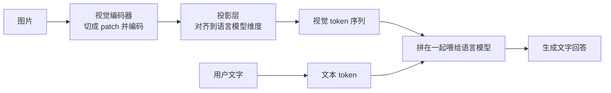

# 多模态模型原理

> [!abstract] 一句话讲清楚
> 多模态模型 = **视觉编码器 + 投影层 + 语言模型**三段。图片先被"翻译"成一串视觉 token，再和文字 token 拼在一起交给语言模型处理。所以**一张图就是一笔额外的 token 账单**，显存和速度都要另算。

## 为什么重要

- 这是现在最热的交付方向：发票识别、合同扫描、截图问答、医疗影像描述、电商图审核。客户张口就是"能不能让它看图"。
- 它有两个必须自己算的账：
  - **显存**：视觉编码器本身要加载，图片会变成大量 token 产生 KV Cache；
  - **速度**：高清图 = 大量视觉 token，prefill 明显变慢。
- 不理解结构，你就解释不了三个高频现象：
  - 为什么同一张图，给不同模型效果差很多；
  - 为什么"图放大一点"就慢了；
  - 为什么"看图能看懂大概，但精确读数字/表格就不行"。

## 核心名词全解

| 名词 | 英文 / 缩写 | 大白话解释 | 容易混淆 / 注意 |
|---|---|---|---|
| 多模态 | Multimodal | 模型能同时处理多种输入，最常见是图 + 文。 | 音频、视频也算多模态，但架构不同。 |
| 视觉语言模型 | VLM | 能看懂图并回答文字问题的模型。 | 和"图像识别模型"不同，VLM 能对话和推理。 |
| 视觉编码器 | Vision Encoder / ViT | 把图片切成小块，编码成一串向量的网络。 | 它不生成文字，只负责"看懂图的结构"。 |
| 图像分块 | Patch | 把图片切成固定大小的小块，每块变成一个 token。 | 分块越小，token 越多，越吃显存。 |
| 投影层 | Projector / Adapter | 把视觉向量"翻译"成语言模型能接受的维度。 | 这是连接两个模型的桥，训练时通常专门调它。 |
| 视觉 token | Visual Tokens | 图片变成的那串 token，长度由图片分辨率和分块决定。 | **这是多模态显存和延迟的核心变量**。 |
| 图文对齐 | Image-Text Alignment | 让"图的表示"和"文字的表示"落在同一个语义空间。 | 对齐做得好，模型才懂"图里的猫"对应"猫"这个词。 |
| 分辨率切图 | Dynamic Resolution / Tiling | 高分辨率图片被切成多块分别编码，再拼起来。 | 越高清 token 越多，OCR 更准但更慢。 |
| 占位符 | Image Token Placeholder | 在文本里插入一个"这里放图"的特殊标记。 | 文本上下文里图片占的位置，是要算进窗口的。 |
| OCR | Optical Character Recognition | 把图片里的文字识别出来。 | VLM 能做 OCR，但密集小字往往不如专用 OCR 引擎。 |
| 视觉问答 | VQA | 给图 + 问题，让模型回答。 | 是最典型的多模态任务。 |
| 跨模态检索 | Cross-modal Retrieval | 用文字搜图片、用图片搜文字。 | 技术上更接近"双塔 embedding"，不是生成式 VLM。 |

## 原理与机制

### 三段式结构（最主流）

逐段解释：

1. **视觉编码器**：把图切成小方格（patch），每格变成一串数字。这一步相当于"把图片理解成一堆特征"。
2. **投影层**：语言模型认识的向量维度是固定的，视觉编码器输出的维度不一样，得翻译一下。这是"桥"。
3. **语言模型**：拿到"图片 token + 文字 token"混合的序列，像读文章一样读，然后生成回答。

关键点：**语言模型本身通常不改结构**，它只是多了一类"图片词"。所以多模态能力本质上是"教语言模型读图"。

### 一张图 = 多少 token

这是最实用的一段。

- 图片被切成 patch，每块对应一个视觉 token；
- **分辨率越高、切得越细，token 越多**；
- 有些模型还会把高清图切成多个子图分别编码（动态分辨率），token 数再翻倍。

量级感受（具体以模型卡为准）：

| 图片类型 | 视觉 token 量级 | 影响 |
|---|---|---|
| 小图 / 缩略图 | 几百 token | 影响不大 |
| 普通照片 | 上千 token | 开始明显吃显存 |
| 高清截图 / 密集表格 | 几千 token | 相当于塞了一篇短文，延迟明显上升 |

**后果**：

- 一张高清图可能顶掉你几千 token 的上下文额度；
- 视觉 token 同样产生 **KV Cache**（见 [[Attention 与 KV Cache]]），所以多模态的长上下文比纯文本更贵；
- 批量处理图片时，吞吐会被视觉 token 拖下来。

> [!warning] 多模态的显存账要单独算
> 除了语言模型权重，还要加上**视觉编码器的权重**（通常几 G 量级，看模型）。所以"7B 文本模型能跑，7B 的多模态版未必能在同一张卡上舒服跑"。

### 图文对齐是怎么学出来的

训练一般分几步（不同厂商细节不同，这里是通用思路）：

1. **对齐阶段**：视觉编码器 + 投影层 + 语言模型一起，用大量"图-文对"训练，让模型学会"这张图对应的描述"。
2. **指令微调**：用"图 + 问题 + 答案"的数据训练，学会按指令回答。
3. **（可选）偏好对齐**：让回答更符合人类偏好。

所以模型能力的来源有两块：

- **视觉编码器认图的能力**（分得清物体、结构、文字）；
- **语言模型推理和表达的能力**。

这解释了一个现象：**同一个视觉编码器，换个更强的语言模型，整体多模态表现会变好**——因为"看懂了但说不清"的问题被语言模型补上了。

### 为什么 OCR 场景容易翻车

OCR 要求"逐字精确"，而视觉 token 是有损压缩：

- 高清扫描件里的小字，缩小后可能只剩几个像素；
- 模型可能"猜"字，看着像就写成别的（数字、金额、编号最容易错）；
- 表格的结构（行列对应关系）在 token 化后容易丢失。

**结论**：

- **"读懂这张图讲了什么"** → VLM 很擅长；
- **"把这张发票的金额和税号精确抄出来"** → 传统 OCR + 规则/文本模型往往更可靠；
- **最佳实践**：OCR 抽文字 → 文本模型做理解和结构化。这是交付里最常见的稳妥方案。

## 分类与对比

### 多模态模型的三类用途

| 类型 | 典型任务 | 适合模型 | 风险点 |
|---|---|---|---|
| 图生文（理解） | 看图问答、截图解释、图表分析 | VLM | 细节/数字不准 |
| 文档理解 | 发票、合同、表单提取 | VLM + OCR 组合 | 精确字段错 |
| 文生图/视频 | 生成图片、视频 | 扩散模型，见 [[扩散模型原理]] | 不是 VLM 的活，别混 |

### VLM vs 专用小模型

| 维度 | VLM | 专用视觉模型（检测/分类/OCR） |
|---|---|---|
| 灵活度 | 高，能对话和推理 | 低，只做固定任务 |
| 精确度 | 一般（有"猜"的成分） | 高（任务专一） |
| 显存 | 大（语言模型 + 视觉编码器） | 小 |
| 部署难度 | 中（需要多模态引擎支持） | 低 |
| 适合 | 开放式理解、问答、分析 | 高精度抽取、批量结构化 |

### 分辨率 vs 精度的取舍

| 分辨率策略 | 效果 | 成本 |
|---|---|---|
| 压缩成小图 | 快、省显存 | 小字看不清 |
| 原生分辨率 | 细节保留好 | token 多，慢 |
| 动态切块（高清图切多块） | OCR/表格最强 | token 最多，显存和延迟最高 |

## 决策点

- **岔路口 1：客户要做"发票/单据字段提取"**
  - 判断依据：字段数量、精度要求、单据版式是否固定。
  - 推荐选择：**版式固定 → 专用 OCR + 模板/规则；版式杂乱 → OCR 抽文本 + 文本模型结构化；只有少量开放式问题 → VLM**。
  - 代价：组合方案工程量大，但准确率稳；纯 VLM 省事但精确字段有风险。

- **岔路口 2：显存有限，还要看图**
  - 判断依据：显存 ≤ 12G~16G。
  - 推荐选择：**小尺寸多模态模型 + int4 + 限制图片分辨率**；必要时把图片预处理成小图。
  - 代价：分辨率限制会削弱 OCR 能力。

- **岔路口 3：该用哪种分辨率设置**
  - 判断依据：任务对细节的要求。
  - 推荐选择：**"图讲了什么"用低分辨率；"读图中的文字/表格"用高分辨率**。不要全局拉最高。
  - 代价：高分辨率延迟和显存上去了。

- **岔路口 4：要不要上"图生视频/文生图"**
  - 判断依据：客户要的是"理解图"还是"生成图"。
  - 推荐选择：理解 → VLM；生成 → 扩散模型家族，见 [[文生图模型生态]]、[[ComfyUI 核心概念]]。两者是完全不同的技术栈。
  - 代价：搞混了会做错方案，白买硬件。

## 参数与配置说明

| 参数 | 作用 | 调大/调小的影响 | 常见取值 |
|---|---|---|---|
| 图片最大分辨率 | 决定视觉 token 数 | 越大越准越慢越吃显存 | 按任务定，OCR 要高 |
| 图片分块策略 | 是否动态切块 | 切块越多细节越好 | 客户端或引擎参数 |
| 每图最大 token 数 | 限制视觉 token 上限 | 限制失控的高清图 | 按显存设上限 |
| 视觉编码器精度 | 视觉部分用 fp16 还是更低 | 影响显存，通常保持较高精度 | 一般 fp16 |
| 最大图片数量 | 单次请求几张图 | 每张都吃 token | 按业务和显存 |
| 多模态上下文长度 | 视觉 + 文本总量 | 影响 KV Cache | 要留足给视觉 token |
| 图像预处理 | 缩放、旋转、增强 | 预处理差会直接拉低准确率 | 保持原质量，别过度压缩 |

## 常见坑与误区

| 现象 | 原因 | 对策 |
|---|---|---|
| 以为"7B 文本模型能跑，7B 多模态也能跑" | 多视觉编码器权重 + 视觉 token KV | 单独算显存，留足余量 |
| 高清图直接喂，结果 OOM 或极慢 | 高清图被切成几千个视觉 token | 限制分辨率/每图 token 数 |
| 发票金额识别错，客户很生气 | VLM 对精确数字/小字会"猜" | OCR 抽字段 + 校验规则，别让 VLM 直接抄 |
| 一次塞 10 张图，效果变差 | 视觉 token 太多，注意力被稀释 | 减少图片数量，或逐张处理再汇总 |
| 把 VLM 当生成模型用 | 它们是理解模型，不生成图 | 生成用扩散模型，见 [[文生图模型生态]] |
| 图片旋转/模糊/低对比度直接输入 | 预处理没做，模型看不清 | 加预处理：纠偏、增强、裁剪 |
| 以为多模态模型能"理解视频" | 需要专门的视频模型/多帧处理 | 抽关键帧当多图处理，或换专门模型 |
| 忽略多模态的许可证 | 视觉编码器可能来自别处，条款不同 | 查模型卡 + LICENSE，见 [[开源许可证与合规]] |

## 自检问题

- [ ] 能用"视觉编码器 → 投影层 → 语言模型"三段式讲清 VLM 结构。
- [ ] 能解释为什么图片会变成 token，以及分辨率如何影响 token 数。
- [ ] 能说清多模态的显存比纯文本多了哪几块。
- [ ] 能解释 OCR 场景为什么容易错，并给出更稳的方案。
- [ ] 能区分"理解图"和"生成图"是两套技术栈。
- [ ] 能给出低显存设备上用多模态的三条限制手段。
- [ ] 能判断发票/表格类需求该不该直接用 VLM。
- [ ] 能说明"图文对齐"是什么、为什么需要投影层。

## 自检问题参考答案

> [!success]- 1. 用三段式讲清 VLM 的结构。
> **视觉编码器**把图片切成小方格（patch），每格编码成一串向量；**投影层**把这些向量的维度"翻译"成语言模型能接受的样子；**语言模型**拿到"视觉 token + 文本 token"拼成的混合序列，像读文章一样读，再生成回答。
> 关键点是语言模型的结构通常不改，它只是多了一类"图片词"。所以多模态能力本质上是"教语言模型读图"。
> 这也决定了能力上限由两块拼起来：视觉编码器认图的能力 + 语言模型推理和表达的能力，哪一块弱都拖后腿。

> [!success]- 2. 图片为什么会变成 token，分辨率怎么影响 token 数？
> 图片被切成固定大小的 patch，每块对应一个视觉 token，所以"图"在模型眼里就是一串 token。分辨率越高、切得越细，token 就越多；有些模型还会把高清图切成多个子图分别编码，token 数再翻倍。
> 量级上：缩略图几百 token，普通照片上千，高清截图或密集表格能到几千——相当于塞进去一篇短文。
> 后果有三个：吃掉上下文额度、产生对应的 KV Cache、让 prefill 明显变慢。所以"图放大一点就卡"不是错觉。

> [!success]- 3. 多模态显存比纯文本多了哪几块？
> 三块：**语言模型权重**（和纯文本一样）、**视觉编码器权重**（通常几 G 量级，看模型）、**视觉 token 产生的 KV Cache**。
> 所以"7B 文本模型能跑，7B 多模态版也能跑"是个常见误判，实际可能要重新算档位、留更多余量。
> 批量处理图片时还要注意吞吐：视觉 token 一多，prefill 被拖长，整体处理速度会明显掉下来。

> [!success]- 4. OCR 为什么容易错，更稳的方案是什么？
> 因为视觉 token 是有损压缩：高清扫描件里的小字缩小后可能只剩几个像素，模型会"猜"字，数字、金额、编号这类看着像就写成别的；表格的行列对应关系在 token 化后也容易丢。
> 更稳的方案是分工：精确字段交给专用 OCR + 校验规则，或者 OCR 抽出文本后交给文本模型做结构化和理解；VLM 只负责"这张图讲了什么"和最后的人工可读汇总。
> 交付里最常用的是"OCR 抄 + 模型懂"，别让 VLM 直接当抄写员。

> [!success]- 5. "理解图"和"生成图"为什么会是两套技术栈？
> 理解图是 VLM 的活：视觉编码器 + 投影层 + 语言模型，输入图、输出文字，任务是问答、分析、抽取；生成图是扩散模型家族，输入文字、输出图片，部署工具和工作流完全不同。
> 两者在架构、显存账、调参方式上都不通用，混在一起谈会做错方案。
> 所以客户说"要 AI 处理图片"时，第一句就要拆开问：是看懂图，还是画图/做视频？这决定了整条技术栈和报价。

> [!success]- 6. 低显存设备上用多模态，三条限制手段是什么？
> 一是**限制分辨率或每图最大 token 数**，别让一张高清图吃掉几千 token；二是用小尺寸多模态模型 + int4 量化，把权重和 KV 都压下来；三是图片预处理——缩小、裁掉无关区域、减少单次图片数量，必要时逐张处理再汇总。
> 代价要提前说清：限制分辨率会直接削弱小字和表格的识别能力，复杂图表可能看错。
> 正确的预期是"够用的看图助手"，不是"廉价 OCR"。

> [!success]- 7. 发票/表格类需求该不该直接用 VLM？
> 分情况：版式固定的单据（固定发票模板、固定表单）用专用 OCR + 模板规则最稳；版式杂乱的用 OCR 抽文本 + 文本模型做结构化；只有"开放式理解"的部分——比如这段合同有没有风险、这张图整体在说什么——才交给 VLM。
> 原因是精确字段要求逐字准确，VLM 天生会猜、有损；而纯 OCR 又处理不了自由问答和语义判断。
> 所以推荐混合方案，别用一种技术硬吃全部需求。

> [!success]- 8. "图文对齐"是什么，为什么需要投影层？
> 图文对齐是让"图的表示"和"文字的表示"落到同一个语义空间里，模型才懂"图里这只猫"对应"猫"这个词，才能用文字提问、用文字回答。
> 投影层就是那座桥：视觉编码器输出的向量维度和语言模型的维度不一样，必须映射过去才能拼进同一个序列；训练的对齐阶段主要就是在调它。
> 对齐做得好，跨模态理解就顺；投影层没训好，典型症状是"看到了但说不出来"，描述含糊、抓不住重点。

## 相关笔记

- 上游：[[Transformer 架构基础]]
- 上游：[[Attention 与 KV Cache]]
- 下游：[[参数量与显存估算]]
- 下游：[[文档解析与切分策略]]（OCR 与文档处理链路）
- 谱系：[[模型谱系 Qwen]]（VL 变体）
- 谱系：[[模型谱系 GLM 与 Gemma]]（端侧多模态）
- 对照：[[扩散模型原理]]（生成方向）
- 返回：[[模型认知 MOC]]

## 交付视角（对客户怎么讲）

- **客户问"能不能让它看图"**：先反问一句——"**你是要它看懂图里讲了什么，还是要它精确抄出图里的字和数字？**" 这两个答案对应完全不同的方案和报价，问清楚能省一半返工。
- **客户问"为什么识别数字错了"**：用"**它是在'理解'这张图，不是在'逐字扫描'，所以会猜**"来解释，然后给方案：OCR 负责抄，模型负责理解和校验。
- **报价要点**：多模态项目要算三块：模型显存（含视觉编码器）、图片预处理、精度验证。**精度验证最容易被低估**——需要标注一批真实图片来测，这是实打实的工时。
- **写进方案**：固定写"支持的图片类型 + 最大分辨率 + 单次图片数 + 精确字段的兜底方案"。
- **别承诺**："OCR 准确率 100%"别说。说"在清晰扫描件、标准版式下实测准确率如何，模糊/倾斜/手写件会下降"。
