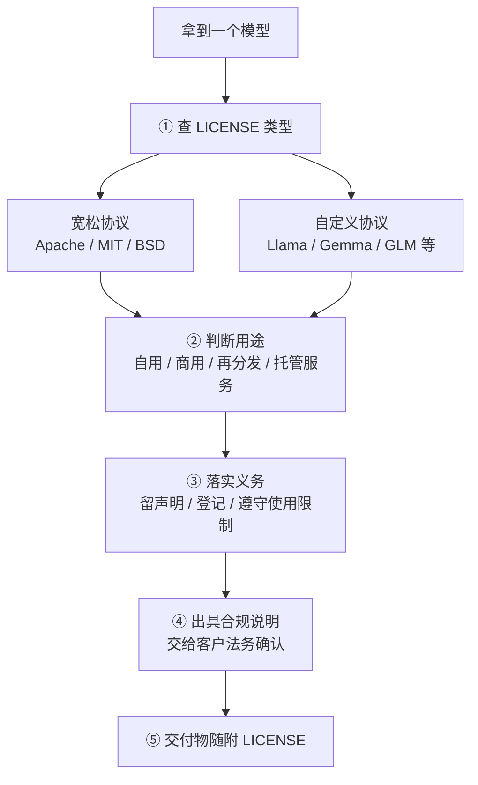

# 开源许可证与合规

> [!abstract] 一句话讲清楚
> 模型能不能下载，和你能不能拿去商用、能不能打包给客户、能不能对外提供服务，是**三个不同的问题**。答案全在 LICENSE 里，不在 README 的一句话里。交付时唯一稳妥的做法：**查协议原文 → 判断用途 → 留声明文件 → 让客户法务确认**。

## 为什么重要

- 这是**唯一一个技术全对、单子也会黄**的环节。部署跑得好好的，法务一句"许可证有风险"就能把项目停掉。
- 典型翻车场景：
  - 客户把模型打包进自己的产品对外卖，而协议不允许这样再分发；
  - 你以为"开源"就是随便用，结果协议要求商用登记/署名/保留声明，全都没做；
  - 拿一个"研究用途"的权重做了商用系统。
- 对交付 agent 来说，这一节的价值不是背条款，而是**知道问什么、留什么、说什么**。
- 所有结论的前提：**以官方 LICENSE 原文为准**。本文只讲类型和套路，不替你判断具体模型。

## 核心名词全解

| 名词 | 英文 / 缩写 | 大白话解释 | 容易混淆 / 注意 |
|---|---|---|---|
| 许可证 | License | 厂商允许你怎么用这份模型的"合同"。 | 下载即视为接受，不是"没人管"。 |
| Apache-2.0 | Apache License 2.0 | 宽松开源协议，可商用、可改、可再分发，要求保留声明和变更说明。 | 最省心的一类，但要去掉商标授权纠纷。 |
| MIT | MIT License | 最宽松的协议之一，几乎什么都能做，只要保留版权声明。 | 极简，但对专利没有明确保护。 |
| BSD | BSD License | 类似 MIT 的宽松协议，分 2/3/4 条款版本。 | 不同版本条款不同，别一并而论。 |
| Llama 社区许可 | Llama Community License | Meta 自定义协议：可商用，但月活超大规模要单独授权，且有使用限制。 | 不是 OSI 开源许可，商用有条件。 |
| 自定义商用条款 | Custom Commercial Terms | 厂商自己写的协议，允许商用但附加义务（登记、声明、限制用途）。 | 每家都不一样，只能逐份看。 |
| 开放权重 | Open Weights | 权重能下载，**不等于**开源许可。 | 交付话术里最容易夸大的一点。 |
| 可商用 | Commercial Use | 允许用于盈利场景。 | 允许商用的同时可能限制"作为服务对外提供"。 |
| 再分发 | Redistribution | 把模型文件/衍生模型再发给别人（含打包进交付物）。 | 给客户部署离线版通常算这个。 |
| 署名/保留声明 | Attribution | 必须保留版权声明和许可文本。 | 删掉 LICENSE 文件是常见违规。 |
| 衍生模型 | Derivative Model | 微调、蒸馏、合并后的模型。 | 许可通常约束衍生模型的发布方式。 |
| 使用限制 | Acceptable Use Policy | 协议里明确禁止的用途（违法、伤害、武器等）。 | 客户使用边界要在交付文档里写明。 |
| 训练数据风险 | Training Data Risk | 训练语料来源可能涉及版权/隐私。 | 模型许可不覆盖数据合规，是另一层风险。 |
| 商用登记 | Registration | 有的协议要求商用前填表/告知厂商。 | 忘了做=流程瑕疵，可以补。 |

## 原理与机制

### 许可证的"三层问题"

给客户解释合规，就按这三层讲，别一上来背条款：

1. **能不能用**：许可是否允许你下载、运行、修改。
2. **能不能商用**：是否允许用于赚钱的业务。
3. **能不能再分发/对外服务**：能否打包进产品给别人、能否做成 API 卖给别人。

这三层是递进的。很多模型第 1、2 层没问题，第 3 层有限制。

### 四类许可证的脾气

| 类别 | 代表 | 商用 | 再分发 | 主要义务 | 交付友好度 |
|---|---|---|---|---|---|
| 宽松开源 | Apache-2.0 / MIT / BSD | 允许 | 允许 | 保留声明、说明修改 | 高 |
| 大厂自定义 | Llama 社区许可类 | 允许（有条件） | 允许（有条件） | 保留声明、遵守使用限制、超规模单独授权 | 中 |
| 厂商自定义 | 部分国产/大厂开源协议 | 通常允许 | 需看条款 | 可能要求登记、保留声明、限制托管服务 | 中低 |
| 研究/非商用 | 研究许可 | 不允许 | 不允许 | 仅研究用途 | 不可用于商用交付 |

### 容易忽略的两个"隐藏风险"

**风险一：训练数据不是模型许可的一部分。**

- 模型许可说"权重你可以用"，但没说"训练数据没版权问题"；
- 如果客户生成的内容涉及他人版权作品，风险在**使用方**，不在模型方；
- 交付时不要承诺"这个模型生成的内容没有版权风险"——没人是这么承诺的。

**风险二：微调后的模型归属。**

- 微调产物是"衍生模型"，发布/交付要遵守原模型许可；
- 有些协议要求：衍生模型名称要带前缀、要保留原声明、要遵守同样的使用限制；
- 客户想"微调后当成自己的模型卖"——这一步必须提前说清。

> [!warning] 一句话原则
> **模型许可管的是"模型"，不管"你的数据""你的输出""你的业务"。** 后三样的合规要单独做。

### 离线交付场景特别容易踩的坑

把模型打包到客户内网服务器上，涉及：

- **复制权重文件** → 属于再分发，要满足再分发条款；
- **删掉 README/LICENSE 只留模型文件** → 违反保留声明义务（很常见！）；
- **模型改名后交付** → 可能违反命名/署名条款；
- **做成对外 API 服务** → 可能触发"托管服务"限制，要单独确认。

**正确做法**：交付包里保留 `LICENSE`、`README`、`模型卡信息`，并在合同附件里写清"模型许可由原厂商提供，乙方不改变其条款"。

## 完整流程：接到项目后的合规动作

1. **列出候选模型**，逐个找到官方 LICENSE 原文（不是二手博客）。
2. **判断类型**：宽松 / 大厂自定义 / 厂商自定义 / 研究用途。
3. **对照用途**：自用、商用、再分发、托管服务，逐项打勾。
4. **列出义务**：保留声明、登记、使用限制、超规模授权。
5. **能落实的落实**（声明文件、登记流程），不能落实的换模型。
6. **写合规说明**一页纸：模型名 + 许可类型 + 用途判断 + 已落实义务 + 风险提示。
7. **交付物随附 LICENSE**，并在合同附件确认。
8. **客户法务签字确认**——这一步别省，是责任的转移点。

## 分类与对比

### 常见用途 × 许可友好度

| 用途 | Apache/MIT | Llama 类自定义 | 厂商自定义 | 研究许可 |
|---|---|---|---|---|
| 公司内部用 | ✅ | ✅ | ✅（看条款） | ⚠️ 有时不行 |
| 做成产品卖给客户（打包） | ✅ | ⚠️ 看再分发条款 | ⚠️ 多半要看 | ❌ |
| 做成对外 API 服务 | ✅ | ⚠️ 有的限制 | ⚠️ 有的限制 | ❌ |
| 改名后当自有模型宣传 | ⚠️ 别改 | ❌ 通常禁止 | ❌ 通常禁止 | ❌ |
| 微调后对外发布 | ✅ 保留声明 | ⚠️ 有命名/声明要求 | ⚠️ 看条款 | ❌ |

### 给客户的三种合规话术强度

| 场景 | 话术 | 适用 |
|---|---|---|
| 宽松协议 | "模型采用 Apache-2.0，可商用、可再分发，保留声明即可。" | 最省心 |
| 自定义协议 | "模型可商用但有附加条款（如保留声明/使用限制），我们随交付附 LICENSE 与合规说明，建议贵司法务确认。" | 大多数情况 |
| 研究许可 | "这个权重只授权研究用途，商用交付不能用，建议换模型。" | 直接劝退 |

## 决策点

- **岔路口 1：客户要"能商用且没麻烦"**
  - 判断依据：客户法务是否愿意逐条审自定义协议。
  - 推荐选择：**优先 Apache-2.0 / MIT 的模型**，把合规成本降到最低。
  - 代价：可选模型范围缩小，可能要接受稍弱的效果。

- **岔路口 2：想用某个自定义协议模型，但客户要打包进产品**
  - 判断依据：协议是否允许再分发、是否要求署名/登记。
  - 推荐选择：**先查再分发条款；能落实就落实（留声明、做登记），不能落实就换模型**。
  - 代价：多花半天做合规动作，但比中途返工便宜。

- **岔路口 3：客户想把微调后的模型对外卖**
  - 判断依据：原协议对衍生模型的规定。
  - 推荐选择：**提前书面说明限制**（命名、声明、使用限制）；必要时改成"交付微调流程而非模型"。
  - 代价：商业模式要调整，但规避了侵权风险。

- **岔路口 4：客户不想看协议，让你"保证没问题"**
  - 判断依据：责任归属。
  - 推荐选择：**拒绝做无限保证**，提供合规说明 + 交付 LICENSE，把法律责任边界写进合同。
  - 代价：客户可能不爽，但这是专业做法。

## 参数与配置说明

| 项 | 作用 | 处理方式 | 备注 |
|---|---|---|---|
| LICENSE 文件 | 授权凭据 | 必须随权重保留 | 别删、别改 |
| README / 模型卡 | 声明与来源 | 保留 | 便于追溯 |
| 商用登记 | 满足协议义务 | 按协议要求做 | 留截图/回执 |
| 合规说明文档 | 给客户法务看 | 一页纸，写清四项 | 交付物之一 |
| 使用限制清单 | 客户使用边界 | 写进交付文档 | 别让客户踩黑名单 |
| 合同附件 | 责任划分 | 明确许可由厂商提供 | 法务确认 |
| 微调前后模型名 | 衍生标识 | 按协议要求命名 | 有的要求带前缀 |
| 版本记录 | 追溯 | 记录用了哪一版 | 协议随版本可能变化 |

## 常见坑与误区

| 现象 | 原因 | 对策 |
|---|---|---|
| 把"开源权重"当成"随便商用" | 混淆开放权重与 OSI 开源 | 一律按"自定义协议"处理，逐份看 |
| 交付包里删掉 LICENSE | 只挑了模型文件复制 | 交付清单固定含 LICENSE/README |
| 以为不赚钱就不算商用 | "商用"定义比想象宽，含对内提效 | 拿不准就当商用处理，走合规 |
| 拿研究许可模型做客户项目 | 没看协议 | 选型第一步就筛协议 |
| 客户承诺"我们内部用不对外"就不做判断 | 内部也可能给别人看/被审计 | 仍要留声明，写清边界 |
| 微调后直接改名发布 | 衍生模型命名有要求 | 按原协议命名，保留原声明 |
| 对客户保证"生成内容无版权风险" | 训练数据风险与模型许可无关 | 明确这是使用方风险，不承诺 |
| 只查中文博客不查原文 | 二手信息常过期 | 以官方仓库 LICENSE 为准 |
| 托管 API 服务没确认"服务条款" | 再分发和托管服务是两回事 | 单独确认是否允许对外提供服务 |

## 案例拆解：一次差点翻车的交付

背景：客户要在内网部署一个开源模型，做内部知识问答，合同已经签了，部署也跑通了，最后验收阶段客户法务问了一句"这个模型我们能商用吗"。

复盘问题出在哪：

1. **选型时没人看 LICENSE**，只看了 README 里一句"可免费商用"。
2. 这个模型的协议其实是自定义条款，允许商用但**要求保留声明、有明确使用限制**，而且客户打算把系统再卖给它自己的子公司用——这一步涉及再分发。
3. 交付包里，实施同事为了"干净"，只复制了模型权重文件，**把 LICENSE 和 README 删了**。
4. 客户内部还有另一个团队打算拿这个模型做对外客服 API——托管服务是否被允许，没人确认过。

补救动作（可以照抄）：

- 立刻从官方仓库补回 LICENSE 原文和模型卡，重新打包交付；
- 写一页合规说明：模型名、许可类型、允许的用途、附加义务、需要客户确认的使用边界；
- 对"再卖给子公司"和"对外提供 API"两件事单独确认协议条款，拿不准的直接换模型；
- 在合同附件里补一句"模型许可由原厂商提供，乙方不改变其条款"，把责任边界划清。

**教训一句话：合规不是部署完再补的手续，是选型时就要过的筛子。** 一个模型的部署成本可能几小时，许可问题可以让项目停几周。

## 自检问题

- [ ] 能说清"能下载 / 能商用 / 能再分发"是三件不同的事。
- [ ] 能大致区分 Apache-2.0、Llama 类自定义协议、研究许可的差别。
- [ ] 知道交付离线包时为什么要保留 LICENSE 和 README。
- [ ] 能列出至少三类模型许可带来的义务（声明、登记、使用限制）。
- [ ] 能解释为什么"模型许可"不覆盖"训练数据"和"生成内容"的风险。
- [ ] 客户要把微调模型对外卖时，你知道要先查什么。
- [ ] 能写出给客户法务的一页纸合规说明包含哪几项。
- [ ] 知道什么时候应该直接劝客户换模型，而不是想办法绕。

## 自检问题参考答案

> [!success]- 1. "能下载 / 能商用 / 能再分发"为什么是三件不同的事？
> 这是三层递进的问题：许可是否允许你**下载运行**、是否允许你**用在赚钱的业务里**、是否允许你**打包给别人或做成 API 对外服务**。
> 很多模型前两层没问题，第三层却有限制——比如允许商用但明确限制托管服务。所以"开源"这个词最多只回答第一层。
> 给客户解释合规就按这三层讲，别一上来背条款：先问清用途，再对号入座，这样客户听得懂、你也说得准。

> [!success]- 2. Apache-2.0、Llama 类自定义、研究许可差别在哪？
> **Apache-2.0** 是宽松开源协议：可商用、可修改、可再分发，义务主要是保留声明和说明修改，交付最省心。
> **Llama 类自定义协议**允许商用但附加条件：保留声明、遵守使用限制、超过一定规模要单独授权，它不是 OSI 意义上的开源许可。
> **研究许可**只授权研究用途，商用交付根本不能用，遇到就直接劝客户换模型。三者的核心差别不是能不能下载，而是**义务和边界有多大**。

> [!success]- 3. 交付离线包为什么要保留 LICENSE 和 README？
> 因为交付本质上就是再分发，协议要求保留版权声明和许可文本；把 LICENSE 删掉本身就是违规，而且这是实际项目里最常见的失误——实施同事为了"干净"，只复制了权重文件。
> README 和模型卡则是来源和版本凭据，出了问题方便追溯；客户法务一旦要审计，看的就是这些原文。
> 所以交付清单里固定包含 LICENSE、README 和模型卡信息，别在整理目录时顺手删。

> [!success]- 4. 列出至少三类许可义务。
> 一是**署名/保留声明**：保留版权声明和许可文本，不改不删；二是**商用登记/告知**：有的协议要求商用前填表或告知厂商，要留好回执；三是**使用限制**：协议里列了禁止用途，交付文档要把客户的使用边界写清楚。
> 此外还可能遇到超规模单独授权、衍生模型命名要求（比如带前缀、保留原声明）等条款。
> 这些义务的共同点是：不落实不一定会当场爆，但被查或审计时就是问题，所以宁可在选型时一次过筛。

> [!success]- 5. 为什么模型许可不覆盖训练数据和生成内容的风险？
> 模型许可管的是"模型使用权"这一件事：它没有承诺训练数据没有版权问题，也不负责你生成出来的内容。
> 训练数据风险（版权、隐私）和使用方输出风险是另外两层，责任通常落在部署方和使用方身上。
> 所以不能对客户承诺"生成内容零版权风险"，没人这么承诺。能做的是把风险讲清、一起定使用规范，敏感场景加人工审核或过滤。

> [!success]- 6. 客户要把微调后的模型对外卖，先查什么？
> 先查原协议对**衍生模型**的规定：是否允许发布和商用衍生模型、命名要不要带前缀、要不要保留原声明、要不要遵守同样的使用限制、超规模是否需要授权。
> 还要看微调数据本身的合规性，模型许可不覆盖这部分。
> 如果条款不允许或拿不准，就改交付形态：卖"微调流程和训练脚本"而不是模型文件，或者换一个宽松协议的模型，别硬卖。

> [!success]- 7. 一页纸合规说明包含哪几项？
> 六项：模型名称（含版本）、许可类型、用途判断（自用/商用/再分发/对外服务）、已落实的义务（声明/登记/使用限制）、风险提示（数据、内容、再分发）、客户确认签字。
> 附上 LICENSE 原文，并在合同附件里写一句"模型许可由原厂商提供，乙方不改变其条款"。
> 这一页纸的意义是**责任的转移点**：客户法务签了字，后面因许可产生的争议就有据可依。

> [!success]- 8. 什么时候该劝客户换模型，而不是想办法绕？
> 两种情况必须直接劝：一是许可类型和用途根本冲突（比如研究许可拿来做商用）；二是义务无法落实又绕不开（不允许再分发，而客户业务必须打包给第三方；或者没有条件做登记）。
> 绕条款的做法——改名、删声明、拆分规避——是给自己埋雷，短期省事，长期赔信任甚至赔钱。
> 正确的替代路径是：换 Apache/MIT 类模型、换条款更宽松的厂商，或者改商业模式（只给接口不打包文件）。给客户讲清代价，比硬撑专业。

## 相关笔记

- 上游：[[模型谱系 Qwen]]（许可证差异最大的谱系之一）
- 上游：[[模型谱系 DeepSeek]]
- 上游：[[模型谱系 GLM 与 Gemma]]（自定义协议代表）
- 下游：[[模型获取与离线搬运]]
- 下游：[[服务化与 API 鉴权]]（对外服务的合规面）
- 相关：[[安全与合规]]
- 相关：[[交付 SOP 与报价]]（合同附件怎么写）
- 返回：[[模型认知 MOC]]

## 交付视角（对客户怎么讲）

- **标准开场**："**这个模型可以商用，但它用的是厂商自定义许可，不是 Apache/MIT 那种通用协议。我把 LICENSE 原文、合规说明、使用限制整理成一页给您，建议法务过一下再定。**"这句话不夸张、不含糊、把责任放对位置。
- **客户问"会不会有版权问题"**：诚实回答——"**模型许可管的是模型使用权；生成内容的版权风险取决于你们怎么用、输入了什么。这一块我们可以一起做使用规范，但不能给'零风险'的保证。**"
- **客户要打包给第三方**：先问一句"**是连模型文件一起给，还是只给服务接口？**"——打包给文件通常触发再分发条款，只给接口看服务条款，两个路径的义务不同。
- **报价要点**：合规动作（查协议、写说明、走登记、法务沟通）要单独列一项工时。这活不值钱但必须干，不列就白干。
- **写进方案**：固定四项——**模型名称 + 许可类型 + 已落实义务 + 风险提示**。这四项写进方案，是专业度的直接体现。
- **红线**：不做无限保证、不删 LICENSE、不帮客户掩盖许可限制。这三条守住，长期口碑没问题。
