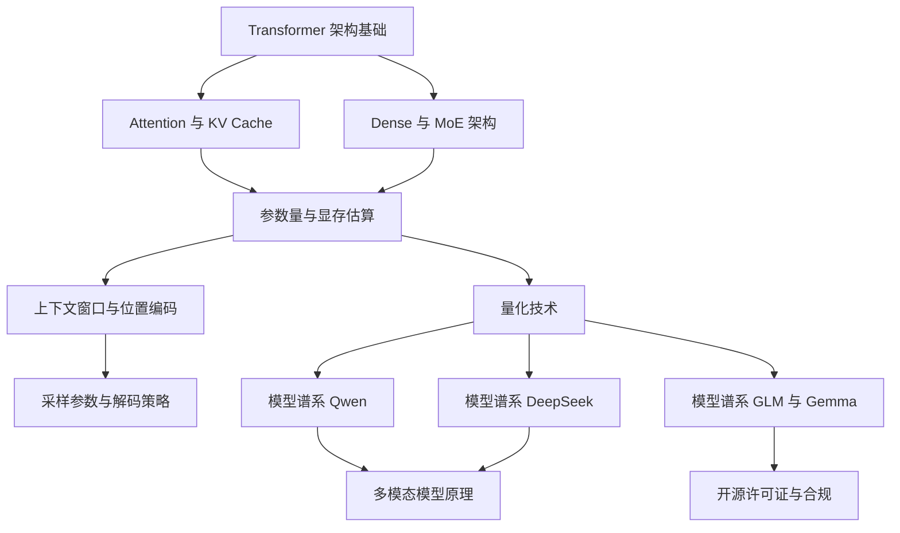

# 模型认知 MOC

> [!abstract] 一句话讲清楚
> 这一层回答两个问题：**模型内部是怎么运作的**，以及**我这台机器到底能不能跑得动它**。选型、算显存、判断"效果差是模型问题还是参数问题"，都从这里出发。

## 为什么先学这一层

- 它是整个技能栈的**地基**：不会算显存账，客户给个 24G 的 4090 你会拍脑袋报"能跑 70B"；不懂量化，你会把 4bit 模型当 fp16 报价。
- 它决定**下游一切选择**：跑什么引擎（[[推理引擎选型决策树]]）、开多长上下文、要不要微调、报价多少。
- 真实场景：客户说"我这台机器想跑个聪明点的模型，顺便能读 100 页 PDF"。你要在 10 分钟内判断——模型量级、量化档位、上下文长度、显存余量，以及"读 100 页"到底该用长上下文还是 [[RAG 原理与全链路]]。
- 这一层几乎**不需要写代码**，要的是概念清楚 + 会套公式。

## 阅读顺序（建议照这个顺序走）

| 顺序 | 笔记 | 一句话作用 | 难度 |
|---|---|---|---|
| 1 | [[Transformer 架构基础]] | 知道 token 怎么变成输出，建立全局模型 | 入门 |
| 2 | [[Attention 与 KV Cache]] | 为什么长上下文吃显存、为什么生成慢 | 进阶 |
| 3 | [[Dense 与 MoE 架构]] | 总参数 ≠ 激活参数，MoE 的显存陷阱 | 进阶 |
| 4 | [[参数量与显存估算]] | **本领域最重要的一篇**：四项拆解 + 各显存档位速查 | 进阶 |
| 5 | [[量化技术]] | 同一个模型，为什么 4bit 能塞进小显存 | 进阶 |
| 6 | [[上下文窗口与位置编码]] | 32K/128K 到底贵在哪，能不能信 | 进阶 |
| 7 | [[采样参数与解码策略]] | 同一个模型，为什么回答忽好忽坏 | 入门 |
| 8 | [[模型谱系 Qwen]] | 主流开源模型怎么分层、怎么挑 | 入门 |
| 9 | [[模型谱系 DeepSeek]] | MoE + 推理模型的典型代表 | 进阶 |
| 10 | [[模型谱系 GLM 与 Gemma]] | 另一条技术路线与许可证差异 | 入门 |
| 11 | [[多模态模型原理]] | 图片是怎么"喂"进语言模型的 | 进阶 |
| 12 | [[开源许可证与合规]] | 能不能商用、能不能交付给客户 | 入门 |

## 全部笔记与一句话定位

### 地基：结构与机制

- [[Transformer 架构基础]]：token → embedding → 多层注意力 + FFN → 下一个 token，自回归生成的完整流水线。
- [[Attention 与 KV Cache]]：Q/K/V 是什么、因果掩码在挡什么、KV Cache 为什么随上下文线性涨、GQA 怎么省显存。
- [[Dense 与 MoE 架构]]：稠密模型每个参数都用，MoE 每次只叫醒一部分专家；"总参数 600B、激活 30B"意味着什么。

### 算账：显存与精度

- [[参数量与显存估算]]：**全库最该背下来的一篇**。权重 + KV Cache + 激活 + 框架开销四项拆解，8G/12G/16G/24G/48G 各档速查。
- [[量化技术]]：FP16/BF16/FP8/INT8/INT4 的取舍，GGUF 的 Q4_K_M 是什么，AWQ/GPTQ 差在哪。
- [[上下文窗口与位置编码]]：RoPE 是什么、外推为什么不等于真支持、长上下文和 RAG 怎么选。

### 使用：怎么让模型好好说话

- [[采样参数与解码策略]]：temperature / top_p / top_k / repeat_penalty 各自管什么，贪心、beam search、投机解码的区别。
- [[模型谱系 Qwen]]：Qwen 系列的命名规则与分层，小/中/大、dense/MoE、VL/Coder/Image 怎么区别。
- [[模型谱系 DeepSeek]]：V3/R1 两条主线，推理模型和通用模型的差别，蒸馏小模型能不能用。
- [[模型谱系 GLM 与 Gemma]]：两条不同出身的产品线，许可证差异对交付的影响。
- [[多模态模型原理]]：视觉编码器 + 投影层 + 语言模型三段式，图片的 token 是怎么烧显存的。
- [[开源许可证与合规]]：Apache-2.0 / MIT / 自定义商用条款，权重能下载不等于能商用。

## 领域知识关系图

## 这一层的"三个必背"

1. **显存四项拆解公式**（权重 + KV Cache + 激活 + 框架开销）——见 [[参数量与显存估算]]。
2. **参数量 × 每参数字节数 = 权重显存**，fp16 是 2，int8 是 1，int4 约 0.5，再加 10%~20% 余量。
3. **"总参数大不等于吃显存多"**，MoE 是典型反例——但**权重全都要装进显存**，激活少只影响计算速度。

## 学完这一层你应该能回答

- 24G 显存的卡，跑 Qwen 系列里哪个量级的模型最舒服？用什么量化？
- 客户要 128K 上下文，除了模型支持，还要多花多少显存？值不值？
- 同样 7B 模型，Q4_K_M 和 fp16 差在哪？回答质量差多少、速度差多少？
- 一个"600B 总参数、激活 30B"的 MoE 模型，24G 显卡能不能跑？为什么？
- 商用交付时，哪些模型可以直接打包进客户机器，哪些必须先看 LICENSE？

## 和其他领域的关系

- 上游：[[硬件基础与 GPU 生态]]（卡和显存）、[[驱动-CUDA-框架版本兼容]]（能不能跑起来）、[[Python 环境与依赖管理]]
- 下游：[[推理引擎选型决策树]]（用 Ollama / llama.cpp / vLLM 哪个跑）、[[本地部署全流程]]（部署）、[[微调决策与 RAG 取舍]]（改模型还是改外挂）
- 横向：[[术语总表]] 收录本领域所有黑话的速查版

## 相关笔记

- 返回：[[技能栈总览 MOC]]
- 上游：[[硬件基础与 GPU 生态]]
- 下游：[[推理引擎选型决策树]]
- 对照：[[学习路线图]]
- 速查：[[术语总表]]
- 自检：[[能力自检清单]]
