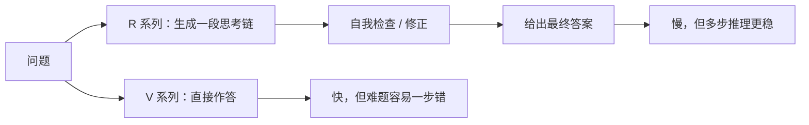

# 模型谱系 DeepSeek

> [!abstract] 一句话讲清楚
> DeepSeek 系列有两条主线：**V 系列**是通用大模型（MoE 结构、日常对话和任务），**R 系列**是推理模型（先想一大段再回答）。它们还放出了蒸馏小模型，让小显存机器也能沾一点"推理能力"，但**蒸馏不等于原版**。

## 为什么重要

- 它是"**开源模型也能打**"的代表，直接把很多闭源模型的性价比按在地上摩擦。本地部署客户几乎一定会问："能不能上 DeepSeek？"
- 但它有两个极容易踩的坑：
  1. **满血版是超大 MoE**——总参数很大，本地消费级显卡基本装不下。网上说的"DeepSeek 能跑在 24G 卡上"，大多说的是**蒸馏小模型**，不是原版。
  2. **推理模型出字多、延迟高**——拿它做客服，客户会等到怀疑人生。
- 看懂这条线，你就掌握了"总参数 vs 激活参数"和"推理模型 vs 通用模型"两个最值钱的概念，见 [[Dense 与 MoE 架构]]。

## 核心名词全解

| 名词 | 英文 / 缩写 | 大白话解释 | 容易混淆 / 注意 |
|---|---|---|---|
| V 系列 | DeepSeek-V | 通用主线，日常对话、写作、代码、Agent 都能干。 | 名字里的 V 是版本序号，不是"Vision"，**不能看图**。 |
| R 系列 | DeepSeek-R | 推理主线，先输出一段思考再给答案。 | R 不是"Reasoning 版 V"，训练方式和行为都不同。 |
| 满血版 | Full / 原版 | 官方发布的完整大模型权重。 | 文件动辄几百 G 级，个人机器基本跑不动。 |
| 蒸馏版 | Distill | 官方用大模型"教"出来的小模型，基于其他开源模型继续训练。 | 参数小很多，能力也小很多，**不要拿它冒充原版效果**。 |
| 推理模型 | Reasoning Model | 会先做长链思考再作答的模型。 | 输出 token 数可能是普通模型的几倍，延迟和成本都高。 |
| 思考链 | CoT / Thinking | 模型在答案前生成的那段推理过程。 | 不是每次都值得看，但对排错和理解模型行为有帮助。 |
| MoE | Mixture of Experts | 稀疏结构，总参数大、激活参数小，见 [[Dense 与 MoE 架构]]。 | 显存按总参数装。 |
| 激活参数 | Active Params | 单 token 计算时真正用到的参数。 | 决定速度，不决定显存。 |
| MLA | Multi-head Latent Attention | 一种把 KV 缓存压缩存储的注意力结构。 | 和 GQA 目的类似（省 KV），不同实现，以模型卡为准。 |
| 混合推理 | Hybrid Reasoning | 同一个模型可切换"想"或"不想"。 | 不同版本默认行为不同，需看文档。 |
| 开源许可 | MIT / 自定义 | 权重使用条款。 | DeepSeek 部分型号用宽松许可，**具体以官方 LICENSE 为准**。 |
| 上下文长度 | Context Length | 一次能处理多长。 | R 系列长思考会吃掉大量上下文。 |

## 原理与机制

### 两条主线：一个"博学"，一个"会想"

可以用两个比喻：

- **V 系列像一位知识面很广的资深工程师**：你问什么它都能聊，反应快，日常够用。
- **R 系列像一位会打草稿的解题高手**：拿过题先列步骤、自我检查，最后给答案。答难题强，但**写草稿很费时间**。

关键差别不在"知识量"，而在**要不要先思考**：

后果：

- R 系列**输出 token 数是普通模型的数倍**，成本、延迟同步翻倍。
- 长思考会吃掉上下文窗口：窗口 8K，思考 3K，你只剩 5K 给正文和答案。
- 简单任务（分类、抽取、客服）用 R 系列是纯浪费。

### V 系列为什么又快又能打：MoE

满血版 V 系列是超大 MoE：总参数非常大，但每 token 只激活一小部分专家。

- **好处**：单 token 计算量小 → 在超大模型里算快的。
- **代价**：权重必须**全装进显存**，所以需要多卡/大显存。
- **结论**：这是"数据中心模型"，不是"消费级显卡模型"。

这一点和 [[模型谱系 Qwen]] 里的 MoE 变体是同一个道理：**别拿激活参数去估显存**。

### MLA 为什么值得单独提一句

注意力的 KV Cache 是长上下文的显存大头（见 [[Attention 与 KV Cache]]）。MLA 的思路是**把 KV 压缩成一个更小的潜在表示**，用的时候再还原。

效果：

- 同等上下文下，KV Cache 明显更小；
- 这意味着**长上下文和并发更友好**；
- 但它是结构级优化，不改"长度越长越贵"的本质。

交付时可以把它当卖点讲："这个结构本身就更省缓存，适合长文本场景"。具体压缩比例、实现细节**以官方技术报告和模型卡为准**。

### 蒸馏版：为什么小模型能"像"推理模型

蒸馏的做法是：用满血版 R 系列生成大量"思考 + 答案"的数据，再拿这些数据去训练小模型（常常是基于其他开源小模型）。

于是小模型学到了：

- **推理的格式和风格**（先分步骤、再给结论）；
- 部分模式化的解题套路。

它学不到的是：

- 原版的知识广度；
- 原版的推理深度；
- 原版在复杂任务上的稳定性。

> [!warning] 交付里最容易说错的一句话
> "我们用的是 DeepSeek 的推理模型"——如果实际是 7B/14B 级别的蒸馏版，这句话对客户是误导。正确说法是"**基于 DeepSeek 蒸馏的 X B 小模型，在你这台机器上跑得动**"。差一个"蒸馏"，性质完全不同。

### 本地部署的现实

| 你要的是什么 | 现实可选 | 说明 |
|---|---|---|
| 体验接近满血版的推理能力 | 基本需要多卡/大显存服务器 | 不是消费级能碰的 |
| 小显存 + 有点推理能力 | 蒸馏小模型（4B~14B 级常见） | 能用，但别按原版预期 |
| 通用对话 / RAG | 蒸馏版或别家中等 Dense | 通常比"硬上推理模型"更划算 |
| 追速度 | V 系列蒸馏版 / 别家 MoE 小型号 | 见 [[量化技术]] |

## 分类与对比

### 通用 vs 推理：怎么选

| 维度 | 通用模型（V 系列 / 别家 Instruct） | 推理模型（R 系列） |
|---|---|---|
| 回答方式 | 直接作答 | 先思考再答 |
| 速度 | 快 | 慢（数倍延迟） |
| 单次成本 | 低 | 高（token 多很多） |
| 强项 | 对话、写作、抽取、RAG、Agent | 数学、逻辑、多步分析、复杂代码 |
| 弱项 | 复杂多步推理容易一步错 | 简单任务浪费；输出啰嗦 |
| 显存需求 | 看尺寸 | 同尺寸差不多，但 KV 吃得多 |
| 适合场景 | 客服、知识库、日常办公 | 分析报告、难题求解、复杂排错 |

### 满血 vs 蒸馏

| 维度 | 满血版 | 蒸馏版 |
|---|---|---|
| 参数量 | 超大（总参数极大） | 小（几 B 到十几 B） |
| 硬件 | 多卡服务器 | 单张消费级卡可能就够 |
| 推理能力 | 完整 | 打折，风格像但深度不够 |
| 显存 | 几百 G 级 | 几 G ~ 十几 G（量化后） |
| 交付定位 | 高预算 / 私有化部署项目 | 中小客户、边缘场景 |

## 决策点

- **岔路口 1：客户说"我要部署 DeepSeek 满血版"**
  - 判断依据：客户硬件和预算能不能到多卡服务器级别。
  - 推荐选择：**先算总参数显存**（见 [[参数量与显存估算]]）。到不了就明确告知，并给两条替代：蒸馏小模型 / 别家中等 Dense。
  - 代价：替代方案效果会降，要提前说清，别等验收才解释。

- **岔路口 2：什么任务值得上推理模型？**
  - 判断依据：任务是否需要多步推理；错误代价是否高。
  - 推荐选择：数学、复杂代码、长链分析 → 值得；客服、分类、抽取 → **不值得**，用通用模型或小模型。
  - 代价：推理模型延迟高，交互式场景体验会明显变差。

- **岔路口 3：蒸馏小模型能不能作为主交付模型？**
  - 判断依据：客户预期是"接近大模型"还是"够用就行"。
  - 推荐选择：**能，但必须提前对齐预期**。给客户看实测对比（蒸馏版 vs 通用中等模型），让他自己选。
  - 代价：有些客户只认"DeepSeek"这块牌子，实际用蒸馏版会失望。

- **岔路口 4：长上下文场景选 R 系列合适吗？**
  - 判断依据：思考链会不会把窗口吃掉。
  - 推荐选择：**要么限思考长度，要么把窗口留足**；否则"思考 6K + 输入 6K"直接超窗。
  - 代价：限制思考会降低推理质量。

## 参数与配置说明

| 参数 | 作用 | 调大/调小的影响 | 常见取值 |
|---|---|---|---|
| 是否启用思考 | 是否输出推理链 | 开启更准、更慢、更贵 | 难题开，简单任务关 |
| 思考长度上限 | 限制思考 token 数 | 太小推理不充分，太大吃窗口和延迟 | 按业务实测 |
| 量化档位 | 权重精度 | 影响显存与质量 | 满血版通常需专门部署方案 |
| 上下文长度 | 可处理长度 | 影响 KV 与延迟 | 长思考场景要预留 |
| max_tokens | 输出上限 | 太小答案被截断 | 推理任务要留足 |
| 采样温度 | 输出风格 | 推理任务建议低温 | 0.3~0.7，推理可更低 |
| 并发数 | 同时请求数 | 推理任务单请求耗资源大 | 比通用任务更保守 |

## 常见坑与误区

| 现象 | 原因 | 对策 |
|---|---|---|
| 以为"DeepSeek 能跑在 24G 卡上" | 把蒸馏版当成了满血版 | 分清满血版与蒸馏版，交付说明写清模型名 |
| 拿激活参数估显存，觉得能塞下 | MoE 权重按总参数装 | 一律按总参数算，见 [[参数量与显存估算]] |
| 用推理模型做客服，客户嫌慢 | 思考链多花数倍 token | 换通用模型；或对简单问题关闭思考 |
| 长思考把上下文窗口吃掉一半 | 思考也占 token | 算总预算：输入 + 思考 + 回答 |
| 以为蒸馏版=原版效果 | 蒸馏主要学风格和套路 | 用业务题实测，按实测能力交付 |
| 拿 R 系列做抽取/JSON 输出 | 推理模型倾向于"多解释" | 用 Instruct 类或低温度 + 格式约束 |
| 忽略许可证细节 | 不同型号许可不同 | 查官方 LICENSE，见 [[开源许可证与合规]] |
| 部署时没算 KV Cache | MLA 省 KV 但不等于不涨 | 长上下文仍要压测 |

## 案例拆解：客户点名要"推理能力强"，但只有一张 24G 卡

这是最常见的错配需求。走一遍判断：

- **客户真实需求往往不是"推理模型"**。先问清楚：是要做数学/代码/逻辑题，还是要做业务问答？多数业务问答用通用模型 + 检索就够了，推理模型反而慢、爱"想太多"。
- **如果确实需要推理能力**，有两条路：
  1. **用满血推理模型**：总参数量很大，一张 24G 卡不可能整模型跑；要么多卡，要么上量化 + offload，速度会很慢。**离线跑单条分析可以，交互式服务基本不现实**。
  2. **用蒸馏小模型**：量级小很多，24G 卡（量化后）能跑，速度可以接受，代价是复杂推理题的正确率明显低于满血版。
- **推荐给客户的说法**：**"你要的推理能力，小卡上只能拿到'七成水平'。如果业务能接受，咱们用小模型 + 结构化提示词；如果不能，我建议把预算放在更大显存或云端调用。"**
- **混合方案**：日常问答走本地小模型，复杂的少量请求走外部大模型 API——这是很多真实项目的落地方式，成本和质量最平衡。

判断顺序记住一句话：**先看"难问题占比"，低于一成，就用小模型兜底。**

## 自检问题

- [ ] 能说清 V 系列和 R 系列分别是什么定位、差在哪。
- [ ] 能解释"满血版"和"蒸馏版"的区别，以及为什么不能混着宣传。
- [ ] 能说明推理模型为什么慢、贵，并给出适合的场景。
- [ ] 能解释为什么超大 MoE 不能靠"激活参数"来判断显存。
- [ ] 能用一两句话说清 MLA 的作用（压缩 KV，长上下文友好）。
- [ ] 能回答"24G 卡能不能跑 DeepSeek"这个问题（分情况）。
- [ ] 能判断某个任务该不该用推理模型。
- [ ] 知道如何查证具体型号的许可证和能力（以模型卡为准）。

## 相关笔记

- 上游：[[Dense 与 MoE 架构]]
- 上游：[[Attention 与 KV Cache]]（MLA 与 KV 压缩）
- 下游：[[参数量与显存估算]]
- 下游：[[量化技术]]
- 对照：[[模型谱系 Qwen]]
- 对照：[[模型谱系 GLM 与 Gemma]]
- 引擎：[[推理引擎选型决策树]]（这类模型在本地怎么落地）
- 返回：[[模型认知 MOC]]

## 交付视角（对客户怎么讲）

- **客户问"能不能上 DeepSeek 满血版"**：直接给结论 + 条件——"**满血版是超大 MoE，需要多卡服务器级别硬件。你这个配置我建议用蒸馏小模型或者别家中等尺寸模型，我把两者实测对比给你看。**" 不绕弯，也不丢单。
- **客户问"为什么这个 DeepSeek 回答慢"**：大概率是用了推理模型。"**它会先写一段思考过程再回答，所以慢是设计如此**。如果你要的是客服速度，我们换成通用模型。"
- **报价要点**：满血版部署是"服务器 + 多卡 + 工程"的大单；蒸馏版是"单机 + 调优"的小单。两者别混着报，否则客户会觉得你在虚报。
- **合规话术**：讲"授权条款以官方 LICENSE 为准"，并明确写进方案附件。不要口头承诺"可以随便商用"，见 [[开源许可证与合规]]。
- **别承诺**：不要说"蒸馏版和满血版效果差不多"。说"蒸馏版在常见问答上表现不错，复杂推理会明显弱一些，我们用你的业务题测给你看"。
