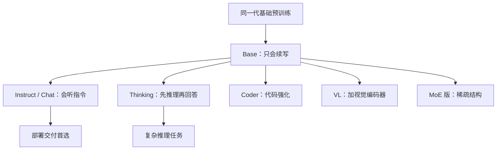

# 模型谱系 Qwen

> [!abstract] 一句话讲清楚
> Qwen 是国内开源生态里**分支最全、尺寸最密**的一条模型线：从零点几 B 的小模型到大几十 B 的 MoE，从纯文本到视觉、代码、图像生成都有对应版本。它的价值是"总有一个尺寸刚好卡在你的显存上"。

## 为什么重要

- 本地部署选型时，Qwen 系列几乎是**默认候选**：尺寸档位密（小到端侧、大到多卡都有）、中英文都强、社区量化版本最全、工具链接入最好。
- 但它的型号也**最容易看花眼**：`Base` / `Instruct` / `Thinking` / `VL` / `Coder` / 各种尺寸后缀混在一起，下错文件是新手日常。
- 交付场景：客户问"用哪个模型"，你能按"显存档位 → 尺寸 → 变体"三步给出具体名字，而不是含糊说"用千问"。
- 这一篇**不报版本号、不报跑分**——模型迭代太快，报了就过时。要讲的是**怎么自己看模型卡、怎么自己压测**。

## 核心名词全解

| 名词 | 英文 / 缩写 | 大白话解释 | 容易混淆 / 注意 |
|---|---|---|---|
| Qwen 系列 | Qwen Series | 阿里开源的通义千问模型线，每一代有多个尺寸和变体。 | 不是一个模型，是一整个家族。 |
| 尺寸档位 | Model Size | 同一代里按参数量分档，如"小/中/大"。 | 不同代的同档位名字可能一样，能力差别很大，要看清是哪一代。 |
| 基础版 | Base | 只做过预训练，会"接着写"，不会"听指令"。 | **不适合直接对话**，但适合自己微调，见 [[LoRA 与 QLoRA 原理]]。 |
| 指令版 | Instruct / Chat | 做过指令微调和对齐，能听懂"帮我做某事"。 | 部署交付优先用这个，别下 Base。 |
| 思考版 | Thinking / Reasoning | 会先输出一段推理过程再给答案。 | 更慢、更费 token；简单任务用它反而不好。 |
| 视觉语言版 | VL | 能看图，输入图像 + 文本。 | 需要额外的视觉编码器显存，见 [[多模态模型原理]]。 |
| 代码版 | Coder | 针对代码任务优化的变体。 | 通用版本也能写代码，Coder 在特定场景更稳。 |
| 稀疏版 | MoE 变体 | 总参数大、激活参数小，速度快。 | 显存按总参数算，见 [[Dense 与 MoE 架构]]。 |
| 上下文长度 | Context Length | 这一代支持多长的输入。 | 同代不同尺寸可能不同，以模型卡为准。 |
| 量化版本 | GGUF / AWQ / GPTQ 版 | 社区或官方提供的压缩版文件。 | 认来源，别随便下不知名量化，见 [[量化技术]]。 |
| 模型卡 | Model Card | 官方仓库里说明结构、训练、用法、许可证的页面。 | **一切以模型卡为准**，不要在二手文章里背数字。 |
| 蒸馏版 | Distill | 用大模型教出来的小模型，主要学"推理风格"。 | 和原版不是一回事，能力上限差很多。 |

## 原理与机制

### 命名规则怎么读

Qwen 的命名大体是"**品牌 + 代际 + 尺寸 + 变体**"的组合，顺序可能略有差异。拆开看：

```
Qwen <代际> <尺寸> <变体>
     ↑        ↑       ↑
   第几代   参数量级   Base / Instruct / VL / Coder / ...
```

**实操读法**：

1. 先找**代际数字**：同尺寸下，新一代通常明显强于老一代，优先选新的。
2. 再找**尺寸**：这是显存账的关键，按 [[参数量与显存估算]] 对档。
3. 最后找**变体**：要对话就找 Instruct/Chat，要图就找 VL，要代码找 Coder，要自己微调找 Base。
4. 看**量化格式**：`GGUF` 配 llama.cpp/Ollama，`AWQ` 配 vLLM。下错格式等于白下。

> [!warning] 最常见的下错文件
> 下来一个 `Base` 模型，发现它只会"续写"不会"回答"；或者下了 `VL` 模型却没有视觉组件，跑起来报错。**先确认变体，再确认格式。**

### 为什么它的尺寸档位这么密

模型提供方会针对不同硬件档位分别训练小、中、大几个尺寸。密档位对部署方是好事：

| 显存档位 | 对应尺寸档位（量级判断） |
|---|---|
| 8G | 1B~4B 级（int4 后更宽裕） |
| 12G | 4B~8B 级（int4/int8 灵活选） |
| 16G | 8B~14B 级 |
| 24G | 14B~32B 级（看量化） |
| 48G | 32B 级以上 / 小 MoE |

具体哪个尺寸合适，永远要按四项拆解算一遍，别按"看起来差不多"拍。

### 变体之间的真实关系

同一代里，不同变体不是"升级关系"，而是"用途分叉"：



要点：

- **Instruct 是交付默认值**，不是最"高级"的。
- **Thinking 不是万能的**：它靠"多花 token 换准确率"，客服、分类这种简单任务用它纯属浪费，延迟会翻几倍。
- **VL 不是"文本模型 + 图片功能"那么简单**，它是独立的模型结构，显存和速度都要另算。

### 怎么自己看模型卡（不背数字的方法）

拿到一个 Qwen 模型，按这个顺序看模型卡，5 分钟能判断能不能用：

1. **参数量 / 总参数 vs 激活参数** → 算权重显存（见 [[参数量与显存估算]]）。
2. **hidden size / 层数 / KV 头数** → 判断 KV Cache 大概多大，是不是 GQA（对长上下文友好）。
3. **训练上下文长度 + 是否做了长度扩展** → 判断长文本能力，见 [[上下文窗口与位置编码]]。
4. **支持的精度/量化格式** → 决定用 fp16 还是 4bit，用什么引擎。
5. **许可证** → 能不能商用、有没有额外条款，见 [[开源许可证与合规]]。
6. **推荐推理配置** → 官方一般会给"多少卡、什么精度、什么框架"，这是免费的经验背书。

> [!tip] 为什么不要背版本号
> 模型几个月迭代一次，版本号背下来三个月就废。**会读模型卡 + 会压测**才是可复用的能力。

## 分类与对比

### 按用途选变体

| 需求 | 优先变体 | 说明 |
|---|---|---|
| 通用对话 / 客服 | Instruct / Chat | 最稳的选择，直接可交付 |
| 复杂推理、数学、长链任务 | Thinking 类 | 值得多花延迟换质量，但要实测性价比 |
| 图片理解 / 截图问答 / OCR | VL | 需要单独估显存，见 [[多模态模型原理]] |
| 代码补全 / 重构 | Coder | 也可先用通用版试试，差距不大的话省事 |
| 自己微调 | Base | 指令版也能微调，但 Base 更"干净" |
| 小显存轻量任务 | 最小尺寸档 | 4B 级以下 + int4，8G 卡可用 |
| 追速度又追能力 | MoE 版 | 前提是总参数装得下 |

### Qwen vs 其他开源线（粗粒度）

| 维度 | Qwen 系列 | DeepSeek 系列 | GLM / Gemma 系列 |
|---|---|---|---|
| 尺寸覆盖 | **最密**，小到端侧 | 偏中大型 | 中等覆盖 |
| 强项 | 中英双语、生态全、档位多 | 复杂推理、MoE | GLM 中文场景；Gemma 轻量+多模态 |
| 小显存友好度 | 好 | 一般 | Gemma 好 |
| 社区量化资源 | **最多** | 多 | 中等 |
| 许可证友好度 | 多数宽松 | 部分很宽松 | 各有自定义条款 |

具体选型建议见 [[模型谱系 DeepSeek]]、[[模型谱系 GLM 与 Gemma]]。

## 决策点

- **岔路口 1：客户显存 24G，要一个"通用、稳、中文好"的模型**
  - 判断依据：并发、上下文、是否需要看图。
  - 推荐选择：**Qwen 系列 14B~32B 档的 Instruct 或 Thinking 版**（用 int4/int8 拼装到 24G 内），单并发 8K 上下文。
  - 代价：追更大尺寸就得降量化或砍上下文。

- **岔路口 2：该不该用 Thinking 版？**
  - 判断依据：任务是否真的需要多步推理；延迟预算是否够。
  - 推荐选择：**先拿 Instruct 跑业务样例，不达标再上 Thinking**；不要默认用 Thinking。
  - 代价：Thinking 出字多、延迟高、成本涨，简单任务上还可能"想太多反而错"。

- **岔路口 3：下载哪个格式？**
  - 判断依据：用什么引擎。
  - 推荐选择：**Ollama / llama.cpp / LM Studio → GGUF；vLLM 服务化 → AWQ/GPTQ/fp8；Mac → MLX 版**。
  - 代价：格式错了要重下，几十 G 的流量和时间。

- **岔路口 4：客户要"最新最强"，但显存不够**
  - 判断依据：显存硬上限 vs 对能力的需求。
  - 推荐选择：**旧一代的大尺寸 往往优于新一代的小尺寸**（尤其在有业务数据实测的情况下）。先测再定。
  - 代价：老模型社区支持会变少。

## 参数与配置说明

| 参数 | 作用 | 调大/调小的影响 | 常见取值 |
|---|---|---|---|
| 尺寸档位 | 参数量级 | 越大越强越吃显存 | 按显存算，见速查表 |
| 变体（Instruct/Thinking/VL/Coder） | 决定能力和模态 | 选错会用不了或浪费 | 交付默认 Instruct |
| 量化档位 | 文件精度 | 影响显存与质量 | int4 / int8 / fp16 |
| 上下文长度 | 单次可处理长度 | 影响 KV Cache 与延迟 | 按业务定，别拉满 |
| 是否启用思考模式 | 推理前是否先输出推理链 | 开启更准更慢 | 复杂任务开，简单任务关 |
| 视觉输入分辨率 | 图片切成多少 token | 越高越准越吃显存 | 按 OCR/理解需求调 |
| 采样参数 | 输出风格 | 见 [[采样参数与解码策略]] | 业务任务 0.3~0.7 |

## 常见坑与误区

| 现象 | 原因 | 对策 |
|---|---|---|
| 下了 Base 版，发现不会回答问题 | Base 只做预训练，不会听指令 | 交付一律下 Instruct/Chat 版 |
| 同尺寸不同代际混着比，结论失真 | 代际差异很大 | 明确写清"哪一代的哪个尺寸"再比 |
| 以为"尺寸越大越好"，结果卡跑不动 | 只看能力没看显存 | 先算四项再选尺寸 |
| 下载了 AWQ 文件却往 Ollama 里塞 | 格式与引擎不匹配 | GGUF→llama.cpp 系，AWQ→vLLM 系 |
| 用 Thinking 版做客服，客户嫌慢 | 思考链多花大量 token | 简单任务换 Instruct，或限制思考长度 |
| 拿二手文章的跑分做交付承诺 | 跑分环境、量化档位、采样参数都不同 | 自己在业务数据上压测，以模型卡为准 |
| 忽略模型卡里的许可证 | 不同版本许可证可能不同 | 交付前查 LICENSE，见 [[开源许可证与合规]] |
| 以为"VL 就是文本模型加个插件" | 它是独立模型，显存和速度都要另算 | 单独估显存、单独压测 |

## 案例拆解：一次真实选型（中文客服 + 一台 16G 显卡）

背景：客户要一个中文客服助手，机器是单卡 16G，要求能私有化部署、能接自己的知识库。走一遍思路：

1. **先定能力范围**：客服主要是"理解问题 + 按知识库回答 + 语气礼貌"，不需要深度推理。所以优先看中等偏小的通用模型，而不是推理模型。
2. **定尺寸档位**：16G 显存扣掉框架开销，留给权重的量级大概在 10G 上下。7B~14B 量级用 int4 量化能塞下；更大的档位只能靠量化硬压，速度会受影响。
3. **定变体**：不需要看图，就不用 VL 版；中文客服不需要代码能力，Coder 版没必要。**变体越多，加载越大，别给自己加负担**。
4. **定量化档**：先用 int4 的常用档跑通，再对比 int8/更高精度，看质量差多少。客服场景对"语气"敏感，量化掉太多会变得死板。
5. **压测**：拿 30~50 条真实客服问题测三件事——答得对不对、语气像不像人、并发两三个请求时延迟能不能接受。
6. **留退路**：如果 16G 效果不达标，给客户的选项是"换更大显存的机器"或"换更小的模型 + 更好的检索"，别硬压。

这个思路可以套到任何谱系上：**先定档位，再定变体，再定量化，最后压测**。反过来做（先挑个最火的模型再想硬件）十有八九要返工。

## 自检问题

- [ ] 能说出 Qwen 命名四段式（品牌/代际/尺寸/变体），并读懂一个随机型号。
- [ ] 能区分 Base、Instruct、Thinking、VL、Coder 各自适合什么。
- [ ] 能按显存档位报出对应的尺寸档位（量级即可）。
- [ ] 能说出"为什么不要背版本号"，并给出替代的模型卡阅读方法。
- [ ] 能判断某个 Qwen 变体该配 GGUF 还是 AWQ。
- [ ] 能解释 Thinking 版不是万能的原因（成本换质量）。
- [ ] 能说出至少三条"下错文件"的常见情形。
- [ ] 客户问"哪个千问最好"，你能给出"先问显存和任务"的回答框架。

## 相关笔记

- 上游：[[Dense 与 MoE 架构]]
- 上游：[[参数量与显存估算]]
- 下游：[[量化技术]]
- 下游：[[Ollama]]
- 对照：[[模型谱系 DeepSeek]]
- 对照：[[模型谱系 GLM 与 Gemma]]
- 多模态：[[多模态模型原理]]
- 返回：[[模型认知 MOC]]

## 交付视角（对客户怎么讲）

- **客户说"我要用千问"**：别直接答应，先问三件事——**显存多大、要不要看图、要几个人同时用**。然后给出"具体哪个尺寸 + 哪个变体 + 什么量化档"的组合，客户会觉得你专业。
- **客户问"是不是最新版最好"**：说"**新版同尺寸通常更强，但我建议先拿你的业务样本测一轮，有时候老一代大尺寸比新一代小尺寸更合适**"。这句能避免很多返工。
- **报价要点**：模型尺寸直接决定硬件档位，变体决定工时（VL/Coder/Thinking 都要额外压测）。把"选型 + 压测"作为独立工时项报出来，比打包进"部署费"更清晰。
- **写进方案**：固定写清"模型全名 + 量化档位 + 上下文上限 + 并发上限"，别写"Qwen 千问模型"这种含糊表述。
- **别承诺**：不要说"这是最新最强所以一定满足需求"。说"这是在你硬件上实测效果最好的组合"。
