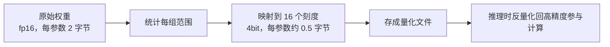

# 量化技术

> [!abstract] 一句话讲清楚
> 量化就是**用更少的位数存模型权重**：原本每个参数 fp16 占 2 字节，压到 4bit 就只占约 0.5 字节，显存直接降到 1/4。代价是模型"变糊"了一点，而且不同量化方法、不同档位，损失差得很远。

## 为什么重要

- 它是**消费级显卡能跑大模型的唯一现实手段**。没有量化，24G 卡只能玩 14B 以下；有了 Q4，32B 甚至更大才敢碰。
- 它直接连着钱和体验：
  - 量化选低了 → 显存不够，跑不起来；
  - 量化选高了 → 效果掉，客户觉得"这模型不行"；
  - 量化方法选错 → 同样的 4bit，别人好好的，你这套答案开始胡说。
- 交付中必须能讲清楚一句话：**"我给你的是 4bit 量化版，质量比原版略降，但速度快、显存省，具体差多少我们实测过。"** 这句话背后就是本篇内容。

## 核心名词全解

| 名词 | 英文 / 缩写 | 大白话解释 | 容易混淆 / 注意 |
|---|---|---|---|
| 浮点精度 | FP32 / FP16 / BF16 | 用不同位数表示小数。位数越少越省，精度越低。 | BF16 和 FP16 都是 2 字节，但 BF16 范围大、精度粗，训练更稳。 |
| FP8 | 8 位浮点 | 新卡（较新的数据中心卡）支持，1 字节。 | 需要硬件支持，不是所有卡都能用。 |
| INT8 / INT4 | 8 位 / 4 位整数 | 用整数加缩放系数表示权重，最常用。 | INT4 是"理论 0.5 字节"，实际文件会更大一点。 |
| 量化粒度 | Granularity | 按多大范围算一个缩放系数：整层、每通道、每分组。 | 粒度越细，质量越好、开销略高。 |
| 分组量化 | Group-wise / Group Size | 每 N 个权重共用一个缩放系数，N 常取 32/64/128。 | 组越小越精细；这是 GGUF 各档位差异的核心。 |
| GGUF | GGUF | llama.cpp 生态的模型文件格式，里面带各种量化档位（Q4_K_M 等）。 | 是**格式 + 量化方案**的打包，不是单一算法。 |
| Q4_K_M | Q4_K_M | GGUF 里最常用的 4bit 档：大部分权重 4bit，关键部分保留更高精度。 | "K" 是分块量化，"M" 是中等混合档；同系列还有 Q4_K_S、Q5_K_M 等。 |
| AWQ | Activation-aware Weight Quantization | 一种考虑"哪些权重更重要"的 4bit 量化方法。 | 常用于 GPU 推理，质量通常优于朴素量化。 |
| GPTQ | GPTQ | 逐层做误差补偿的 4bit 量化方法，生态成熟。 | 老牌方案，兼容性好；不同校准数据会影响结果。 |
| EXL2 | EXL2 | 可按"每权重平均比特数"细调的量化格式，常用于 ExLlama 系引擎。 | 灵活但生态比 GGUF/AWQ 窄。 |
| 校准数据 | Calibration Data | 量化时用来观察"哪些权重重要"的样本文本。 | 校准数据分布和业务接近，效果更好。 |
| 量化感知训练 | QAT | 训练时就模拟量化，让模型适应低精度。 | 成本高，开源权重基本是"训练后量化"（PTQ）。 |
| 反量化 | Dequantization | 计算时把低精度权重还原成高精度再算。 | 所以量化主要省的是**显存和带宽**，不是直接省算力。 |

## 原理与机制

### 直觉：把"精确小数"换成"刻度尺"

原版权重是精确到小数点后很多位的数字，占 2 字节甚至 4 字节。

量化的做法是：

1. 找一把"刻度尺"（缩放系数 scale），比如把一组数映射到 -8~7 这 16 个整数刻度上；
2. 存的时候只存"第几个刻度"（4bit 就能表示 16 个位置）；
3. 算的时候再按刻度尺"还原"成近似的浮点数。

一句话：**用"离哪个刻度最近"代替"精确值"**。省了空间，丢了细节。

### 为什么"分组"能救质量

如果整层共用一个刻度尺，一个特别大的权重会把尺度拉爆，其他小权重全挤在 0 附近，细节全丢。

所以现代量化都做**分组**：每 32 或 128 个权重用一个刻度尺。组越小，越能贴合局部数值分布，质量越好。

**这就是 GGUF 档位的主要区别**：Q4_0 是较粗的方案，Q4_K_M 用了更细的分块和混合精度，所以同样 4bit 左右，Q4_K_M 质量更好、文件略大。

### 混合量化：重要的地方别省

模型的权重不是同等重要：

- **embedding 层、输出层、归一化层**：对结果影响大，通常保留较高精度；
- **大部分中间层 FFN 权重**：可以压到 4bit；
- **注意力和某些敏感层**：有的方案保留 5~6bit。

"混合"就是**哪里敏感哪里多给比特**。GGUF 的 `_K_M` 里的 M 就是 medium 混合档的意思（具体比例以工具文档为准）。

### 4bit 到底掉多少质量

不能给精确分数（会随模型、任务、方法变化），但可以给**量级判断**：

| 档位 | 相对 fp16 的质量 | 适用判断 |
|---|---|---|
| FP16/BF16 | 基准 | 有显存就用，别犹豫 |
| FP8 / INT8 | 几乎无感（多数任务） | 显存够就应该用，性价比最高 |
| Q5 / 5bit | 轻微差异 | 4bit 不稳时的下一档，显存多 25% 左右 |
| Q4（Q4_K_M / AWQ 4bit） | 有差异但通常可接受 | **消费级默认档**，交付前必须实测 |
| Q3 / 3bit | 明显变糊 | 只在"装不下但又想跑"时用 |
| Q2 / 2bit | 经常胡言乱语 | 基本不要用于交付，除非只是玩 |

> [!warning] 小模型比大模型更怕量化
> 同样压到 4bit，一个 7B 模型掉的"能力"往往比 70B 更明显——参数本来就少，再糊一层就没余量了。所以经验是：**小模型尽量用高一点的量化档，大模型可以更激进。**
> MoE 模型也要更小心：每个专家参数少，低比特更伤，见 [[Dense 与 MoE 架构]]。

### 量化对速度的影响：别想得太美

量化主要省两样：**显存容量**和**显存带宽**。

- **解码阶段**（一个字一个字生成）：几乎全程都在读权重，所以"权重变小 → 读得快 → 出字更快"是成立的，4bit 通常比 fp16 快不少。
- **预填充阶段**（一次读长提示词）：更多是算力瓶颈，量化带来的加速没那么大。
- **反量化本身有开销**：要把整数还原成浮点再算，所以实际加速不是"4 倍"那么理想。

**结论**：量化是"显存优先、速度顺带收益"，不是"免费加速器"。

## 分类与对比

### 格式/方法怎么选

| 方案 | 典型生态 | 优点 | 缺点 | 推荐场景 |
|---|---|---|---|---|
| **GGUF**（Q4_K_M 等） | llama.cpp / Ollama / LM Studio | 通用、CPU/GPU 混合友好、档位丰富、单文件 | GPU 高并发不如 vLLM 系 | 单机、本地、消费级显卡、Mac，见 [[llama.cpp 与 GGUF]] |
| **AWQ** | vLLM / 一些 GPU 引擎 | 质量通常较好、GPU 推理效率高 | 需要预量化模型文件，档位选择少 | GPU 服务化、高并发，见 [[vLLM]] |
| **GPTQ** | 多种 GPU 引擎 | 生态老、模型覆盖广 | 质量与校准数据相关，参差不齐 | 找不到 AWQ 版本时的备选 |
| **EXL2** | ExLlama 系 | 比特数可细调，长上下文友好 | 生态窄、迁移成本高 | 特定工具链用户 |
| **FP8** | 较新 GPU + vLLM 等 | 质量接近 fp16，无需复杂校准 | 老卡不支持 | 显存紧张但想要质量 |
| **原生 INT8**（部分模型直接发布） | 各引擎 | 简单、稳 | 档位不灵活 | 追求稳的场景 |

### 常见 GGUF 档位速查

| 档位 | 每参数约字节 | 7B 文件大小量级 | 说明 |
|---|---|---|---|
| Q8_0 | 约 1.0 | 约 7~8G | 几乎无损，显存够就用 |
| Q6_K | 约 0.8 | 约 6G | 高保真 |
| Q5_K_M | 约 0.7 | 约 5G | 质量与体积平衡点 |
| **Q4_K_M** | 约 0.6 | 约 4~4.5G | **默认首选**，大多数场景够用 |
| Q4_K_S | 约 0.55 | 约 4G | 更省一点点，质量略降 |
| Q3_K_M | 约 0.45 | 约 3G | 应急档 |
| Q2_K | 约 0.35 | 约 2.5G | 不推荐交付 |

> 文件大小以实际下载为准，不同模型结构不同；上表是"量级感"。

## 决策点

- **岔路口 1：显存允许的话，选哪一档？**
  - 判断依据：先按 [[参数量与显存估算]] 算出"权重 + KV + 开销"。
  - 推荐选择：**能 int8/fp8 就 int8/fp8；装不下再 Q4_K_M；Q4 还装不下才考虑 Q3**。别一上来就 Q4，质量是白掉的。
  - 代价：档位越高越吃显存，要牺牲上下文或并发。

- **岔路口 2：用 GGUF 还是 AWQ？**
  - 判断依据：单机自用还是对外服务、有没有并发。
  - 推荐选择：**单机/桌面/混合 CPU 推理 → GGUF**；**GPU 服务化、多并发 → AWQ（vLLM）**。
  - 代价：换引擎意味着重做部署和压测，迁移成本要算进报价。

- **岔路口 3：客户要求"效果必须和原版一致"**
  - 判断依据：客户能接受多少质量差。
  - 推荐选择：**用 int8/fp8 或直接 fp16**，把硬件要求提高；不要试图用 Q4 硬扛。
  - 代价：硬件成本上升，这要提前讲，别等验收才说。

- **岔路口 4：量化后效果明显变差，怎么办？**
  - 判断依据：是"整体变糊"还是"某些任务变差"。
  - 推荐选择：先升一档（Q4→Q5/Q6 或 int8）；再换量化方法（GGUF→AWQ）；仍不行则换更大的模型（大模型低比特往往优于小模型高比特）。
  - 代价：升量化吃显存，换模型吃硬件。

## 参数与配置说明

| 参数 | 作用 | 调大/调小的影响 | 常见取值 |
|---|---|---|---|
| 量化比特数 | 每参数位数 | 越低越省显存、质量越差 | 4（主力）/ 5 / 8 |
| 分组大小 group_size | 多少权重共用一个 scale | 越小越精细、文件略大 | 32 / 64 / 128 |
| 是否量化 embedding / 输出层 | 决定这两层精度 | 保留高精度更稳，占空间 | 通常保留 |
| KV Cache 量化 | 单独压缩 KV 缓存 | 省长上下文显存，可能掉质量 | fp16 保守 / int8 / fp8 |
| 校准数据集 | 决定 AWQ/GPTQ 的量化策略 | 越贴近业务越好 | 通用语料或业务样本 |
| 计算精度 | 反量化后用什么精度算 | 影响速度与数值稳定性 | 通常 fp16 |

## 常见坑与误区

| 现象 | 原因 | 对策 |
|---|---|---|
| 以为 Q4 文件大小是"参数量 ÷ 4" | 实际系数约 0.6，且 embedding 等保留高精度 | 按"参数量 × 0.6"估，别按 0.25 估 |
| 同一模型各家的 Q4 效果差很多 | 量化方法、校准数据、混合策略不同 | 认来源（官方/知名量化方），别随便下 |
| 量化后模型开始重复、胡言乱语 | 压得太狠（Q2/Q3）或模型本身小 | 升档位；小模型尤其别用 2~3bit |
| 以为量化一定能加速 | 反量化有开销，prefill 阶段加速有限 | 别把"更快"当卖点，以实测为准 |
| 量化后精度任务（数学、代码）掉得最明显 | 精细推理对数值更敏感 | 这类场景优先 int8/fp16，别用 Q4 |
| 换了量化档位但没重新压测 | 显存和速度都变了，原参数不再适用 | 每换一次量化都重跑一遍压测 |
| 把 GGUF 文件塞给 vLLM 用 | 格式与引擎不匹配 | GGUF 配 llama.cpp/Ollama；vLLM 用 AWQ/GPTQ/fp8 |
| 忽略 KV Cache 也需要量化 | 长上下文时 KV 才是大头 | 长上下文场景一定问清楚引擎能否量化 KV |

## 案例拆解：同一张 24G 卡，同一个模型，三种量化档

背景：手上有一张 24G 卡，想跑一个 30B 量级的模型，看能不能上生产。逐个档位算一遍（数字为量级示意）：

| 量化档 | 权重占用 | 剩余给 KV/并发的空间 | 质量感受 | 适用结论 |
|---|---|---|---|---|
| 高精度（16bit 级） | 约 60G 量级 | 塞不下 | — | 单卡不可行 |
| int8 | 约 30G 量级 | 塞不下 | 好 | 单卡仍不可行 |
| int4 常用档 | 约 15~18G 量级 | 剩几个 G，可跑较短上下文、单并发 | 和原模型接近，长文/细节略有下降 | **可跑通，适合单人或低并发** |
| int4 激进档（更小） | 再小一些 | 空间更宽裕 | 明显退步，可能出现重复、答非所问 | 不推荐给生产 |

从这张表能看出三件事：

1. **量化不是"越小越好"**，而是"刚好塞进显存、质量还够用"。跨过某个坎（比如再压一档），质量会断崖式下滑。
2. **权重省出来的空间，要留给 KV Cache 和并发**。算显存不能只算权重，见 [[参数量与显存估算]]。
3. **必须拿业务数据实测**。量化对通用问答的影响可能很小，对数字、代码、格式严格的任务影响很大。

实操建议顺序：先跑 int4 常用档 → 拿业务数据测 → 质量够就定稿；不够就换更小的模型，而不是硬上更高精度（因为显存不够就是不够）。

## 自检问题

- [ ] 能解释量化在做什么（用"刻度尺"类比），以及为什么不是精确值。
- [ ] 能说出 fp16 / int8 / int4 的每参数大致字节数和 7B 模型的权重显存。
- [ ] 能解释"分组量化"为什么能提升质量。
- [ ] 能说清 GGUF 的 Q4_K_M 相比更粗的 4bit 档好在哪里。
- [ ] 能判断 GGUF / AWQ / GPTQ 分别适合什么部署方式。
- [ ] 能解释量化为什么主要省显存和带宽，而不是直接省算力。
- [ ] 能回答"为什么小模型比大模型更怕量化"。
- [ ] 能给出"量化后效果变差"的三层排查顺序。

## 相关笔记

- 上游：[[参数量与显存估算]]
- 上游：[[Dense 与 MoE 架构]]
- 下游：[[llama.cpp 与 GGUF]]
- 下游：[[vLLM]]
- 下游：[[N卡 A卡 Mac 平台适配]]
- 应用：[[模型目录与生态]]
- 决策：[[推理引擎选型决策树]]
- 返回：[[模型认知 MOC]]

## 交付视角（对客户怎么讲）

- **客户问"你怎么给我省显存"**：一句话——"**我把模型权重从 fp16 压到 4bit，显存降到约 1/4，出字还更快；质量比原版略降，我拿你的业务数据实测对比给你看。**" 有数据、有代价、有方案。
- **客户问"会不会变傻"**：别用"几乎无损"这种话。说"**8bit 基本感觉不到；4bit 在通用对话上差异不大，但在数学、代码、严格格式输出上可能更明显**"。然后把这一条写进验收标准里（用 10~20 条业务样例题跑对比）。
- **报价要点**：量化档位是"显存 → 硬件 → 价格"的调节旋钮。同一台机器，Q4 能跑一个更大的模型，Q8 只能跑小一号。给客户两个方案对比，往往能促成更高配置。
- **合规相关**：量化后的权重属于**衍生模型**，许可证条款仍然适用，商用前要看原模型 LICENSE，见 [[开源许可证与合规]]。
- **别承诺**："4bit 完全无损"是错误表述，说了以后被质疑会很难看。
