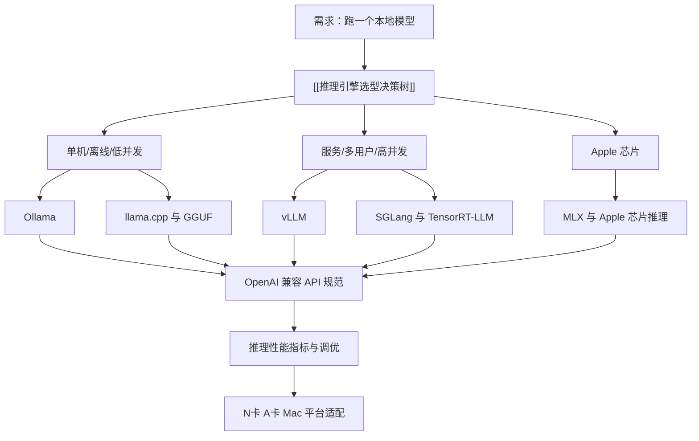

# 推理引擎 MOC

> [!abstract] 一句话讲清楚
> 这个领域只解决一个问题：**手里这台机器、这个模型、这个使用场景，该用哪个引擎跑，参数怎么配，跑不动时该动哪里。**

## 这个领域在技能栈里的位置

- **上游**：[[模型认知 MOC]]——模型结构、量化、显存估算决定"这台机器到底能不能跑"。
- **本层**：把一堆权重文件（safetensors / GGUF）变成能对外服务的 HTTP API。
- **下游**：[[部署实战 MOC]]、[[应用集成 MOC]]——RAG、Dify、编码助手全都不关心引擎，只认一个 OpenAI 兼容地址。
- **说白了**：引擎是"模型文件"和"业务应用"之间唯一的转换层。这一层选错，后面每个环节都在替它还债。

## 阅读顺序（建议按这个顺序看）

| 顺序 | 笔记 | 讲什么 | 难度 |
|---|---|---|---|
| 1 | [[推理引擎选型决策树\|推理引擎选型决策树]] | 先建立"什么条件选什么"的全局判断，别急着装东西 | 入门 |
| 2 | [[Ollama\|Ollama]] | 最省事的入口：模型库 + 常驻服务 + 简单 API | 入门 |
| 3 | [[llama.cpp 与 GGUF\|llama.cpp 与 GGUF]] | 单机推理的地基：GGUF 格式、量化、GPU 层数 offload | 进阶 |
| 4 | [[vLLM\|vLLM]] | 生产服务的分水岭：PagedAttention、连续批处理、显存管理 | 高级 |
| 5 | [[SGLang 与 TensorRT-LLM\|SGLang 与 TensorRT-LLM]] | 再往上一步的两种路线：前缀复用 vs 编译优化 | 高级 |
| 6 | [[MLX 与 Apple 芯片推理\|MLX 与 Apple 芯片推理]] | Mac 这条独立路线：统一内存的甜与坑 | 进阶 |
| 7 | [[OpenAI 兼容 API 规范\|OpenAI 兼容 API 规范]] | 换引擎不改上层代码的"事实标准"接口 | 入门 |
| 8 | [[推理性能指标与调优\|推理性能指标与调优]] | 怎么测、看哪个数、瓶颈在哪、按什么顺序优化 | 进阶 |
| 9 | [[N卡 A卡 Mac 平台适配\|N卡 A卡 Mac 平台适配]] | CUDA / ROCm / Vulkan / Metal 四条路径的现实差异 | 进阶 |

## 三条主线，别混着学

- **主线 A：单机自用 / 演示 / 离线** → Ollama 或 llama.cpp。追求"能用、好装、模型随便换"，不追求高并发。
- **主线 B：对外服务 / 多用户 / 生产** → vLLM（绝大多数情况），特殊场景再上 SGLang 或 TensorRT-LLM。追求吞吐与稳定。
- **主线 C：Mac 生态** → MLX 或 llama.cpp。追求"在一台没有 N 卡的机器上把模型跑起来"。

三条主线之间不是替代关系，是**不同约束下的不同答案**。初学者最常见的错误是拿主线 B 的方案去干主线 A 的活，然后在 8G 显存上跟 vLLM 的 OOM 搏斗一下午。

## 关系图

## 选型速查（30 秒版）

- 一台带 N 卡的 Windows 机器，自己用 / 给客户演示 → **Ollama**。
- 想抠显存、想让老卡/核显/CPU 也能跑、想换量化档位 → **llama.cpp**。
- 要同时服务十几个人、要稳定的 API 吞吐 → **vLLM**，一张卡跑 7B~14B 量级，多卡再加张量并行。
- 大量请求共享同一段长系统提示 / RAG 检索头 / Agent 工具定义 → 先试 **SGLang** 的前缀复用。
- 模型固定、卡固定、并且愿意投入编译和调优 → 再看 **TensorRT-LLM**。
- Mac（尤其统一内存 32G 以上）→ 先试 **MLX**，格式不通或工具链要求高就退回 llama.cpp。
- 不管选哪个，上层统一按 **OpenAI 兼容 API** 写，给自己留换引擎的后路。

## 这一层最容易犯的五个错

- **拿"能载入"当"能服务"**：模型跑起来出了第一个字，不代表 10 个人同时用不崩。
- **只看模型参数量不看量化**：同一个 14B，Q4 和 FP16 的显存差好几倍，能不能跑是量化决定的。
- **上下文拉满**：为了"支持长文档"把上下文设到最大，显存被 KV Cache 吃掉，并发直接降到 1。
- **不给显存留余量**：引擎占满显存后，系统、驱动、其他进程一动就 OOM。
- **在应用层调参数救引擎层的问题**：换温度、改提示词解决不了 OOM 和延迟。

## 自检问题

- [ ] 不看笔记，能不能说出 Ollama / llama.cpp / vLLM 三者的定位差别？
- [ ] 给你一台显存 24G 的机器和一个 14B 模型，能不能估出大概能开多长上下文、几路并发？
- [ ] 你知道"首字延迟"和"每秒出字"分别由哪段计算决定吗？
- [ ] 如果客户只有一张 AMD 卡，你的默认方案是什么？风险点在哪？
- [ ] 什么时候你会劝客户"这台机器跑不了，换模型或换卡"而不是继续调参数？
- [ ] 上层已经写死了 OpenAI SDK，你知道换引擎要改哪几个地方吗？

## 自检问题参考答案

> [!success]- 1. Ollama、llama.cpp、vLLM 三者的定位差别是什么？
> Ollama 是"llama.cpp + 模型库 + 常驻服务"的封装，装完就能用，适合单机自用、演示、离线场景。
> llama.cpp 是裸引擎，能抠显存、换量化档位，适合老卡、核显、CPU，以及想调参的人。
> vLLM 是面向服务的完整框架，靠显存分页与连续批处理扛多用户，适合对外提供 API。
> 一句话：Ollama 求省事，llama.cpp 求可控，vLLM 求并发。

> [!success]- 2. 24G 显存跑 14B，大概能开多长上下文、几路并发？
> 先算权重：14B 在 4bit 量化下约占 7~8G 量级，剩下的一半多留给 KV Cache 和框架开销。
> 按这篇的思路，上下文别拉满、给显存留余量：24G 上 14B 开几千 token 的上下文、并发 2~4 路是常见区间。
> 想开更长上下文或多上几路，就得降量化、缩上下文或加显存。
> 真实上限必须在目标机器上用真实提示压测确认，别照抄。

> [!success]- 3. 首字延迟和每秒出字分别由什么决定？
> 首字延迟看 prefill：输入越长、模型越大，把上下文一次算完的时间越长。
> 出字速度看 decode：每生成一个 token 都要把权重读一遍，所以由模型大小、量化位宽和内存带宽决定。
> 对症下药：缩上下文、开前缀缓存治首字；量化、换小模型治出字。
> 这也是这篇提醒"上下文拉满会吃掉 KV、把并发压到 1"的原因。

> [!success]- 4. 客户只有一张 AMD 卡，默认方案和风险点是什么？
> 默认走 llama.cpp 或 Ollama 的 ROCm / Vulkan 路径，先在目标系统上确认驱动与框架能认出这张卡，再谈量化与速度。
> 风险有三：ROCm 支持的型号和系统有限；生态轮子少，装环境容易卡住；vLLM 这类生产框架基本别指望。
> 如果客户要多人服务，先如实说明风险，并给出"换 N 卡"或"退回单机自用"两条路，别硬扛。

> [!success]- 5. 什么时候该劝客户换模型或换卡，而不是继续调参数？
> 当免费动作都做完还不行时：缩短上下文、降量化、调低显存比例、减少并发之后，仍然 OOM 或慢到不可用。
> 或者模型能力本身不够，而换更大模型又装不下。
> 判断标准就一句：在客户能接受的首字延迟和使用人数下跑不起来。
> 这时候继续调参只是消耗时间，换小一号模型或补显存、换卡才是正解。

> [!success]- 6. 上层写死 OpenAI SDK，换引擎要改哪几个地方？
> 改三处：base_url 指向新引擎地址；model 换成新引擎注册的名字；启动脚本里的模型路径与显存、上下文参数。
> 业务代码不用动，因为这一层统一按 OpenAI 兼容接口写，只认一个地址。
> 但要重测流式、超时、max_tokens 默认值和工具调用这些差异点——兼容不等于行为一致。

## 相关笔记

- 上游：[[模型认知 MOC]]
- 上游：[[参数量与显存估算]]
- 下游：[[部署实战 MOC]]
- 对照：[[应用集成 MOC]]
- 返回：[[技能栈总览 MOC]]
- 术语：[[术语总表]]

## 交付视角（对客户怎么讲）

- 客户问"你这个和网上那种一键安装有什么区别"：区别不在装，在**选型和参数**——同样一张卡，引擎和上下文配错，能用的并发差几倍。
- 报价时把"引擎选型 + 压测 + 参数固化"算作交付的一部分，这部分工作量才是专业的体现。
- 永远先问三件事：**什么卡、几个人用、模型和上下文多大**。这三个答案基本就决定了方案，剩下的只是报价。
