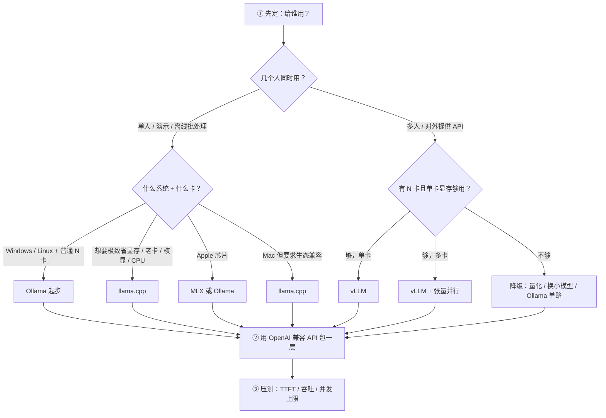
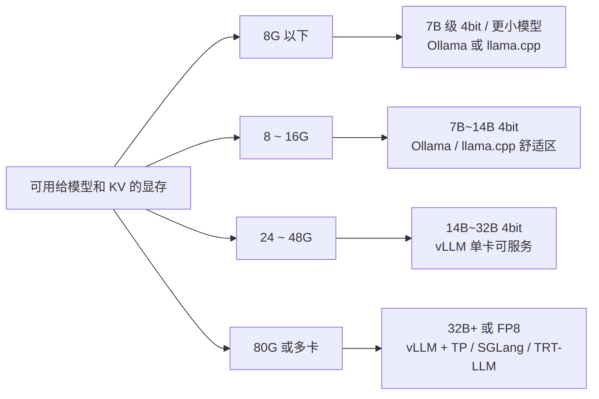

# 推理引擎选型决策树

> [!abstract] 一句话讲清楚
> 选引擎不是选"最强的那个"，而是按 **硬件 → 显存 → 系统 → 并发 → 离线需求** 五个约束逐步排除，最后剩下的那个就是答案。

## 为什么重要

- 引擎是模型文件到业务 API 的转换层。选错引擎，后面的部署、压测、交付都在替它还债。
- 同一个 14B 模型：用 vLLM 在 8G 卡上起不来，用 Ollama 能跑但 3 个人就卡，用 llama.cpp 调好 offload 反而最稳。
- 交付现场最贵的是时间：装错引擎再推倒重来，半天就没了。先花 10 分钟走一遍决策树，比装完再后悔便宜得多。
- 客户不会问"你用哪个引擎"，只会问"能不能用、几个人用、多快"。选型就是把这三个问题翻译成技术参数。

## 核心名词全解

| 名词 | 英文 / 缩写 | 大白话解释 | 容易混淆 / 注意 |
|---|---|---|---|
| 推理引擎 | Inference Engine | 把模型权重加载进显存、接请求、吐 token 的那套程序 | 和"模型框架"（PyTorch）不是一回事，引擎是专门为"推理"优化过的 |
| Prefill | 预填充 | 把整段提示词一次性算完，生成 KV Cache | 长提示词的等待主要耗在这；和"生成"是两段计算 |
| Decode | 解码 | 一个字一个字往外蹦的阶段 | 每步都要读一遍权重，通常是"显存带宽瓶颈" |
| KV Cache | 键值缓存 | 记住前面算过的上下文，避免重复计算 | 它和并发数、上下文长度直接抢显存 |
| 连续批处理 | Continuous Batching | 解码时每步重排批次，谁算完谁走、新请求随时插 | 和"静态批处理"区别很大，是 vLLM 吞吐高的主因 |
| 显存 offload | GPU Layer Offload | 只把一部分层放显存，剩下的留内存/CPU 算 | "层数"不是"参数量比例"，得看模型结构和显存 |
| GGUF | GPT-Generated Unified Format | llama.cpp 系的模型文件格式，量化信息都在里面 | 和 HuggingFace 的 safetensors 是两套格式，不能直接互读 |
| 张量并行 | Tensor Parallel, TP | 一个模型切到多张卡上同时算 | 和"流水线并行"不同；TP 要求卡型一致、通信快 |
| 首字延迟 | TTFT | 从发请求到看见第一个字的时间 | 用户体感最敏感；被排队、prefill、长上下文共同影响 |
| 吞吐 | Throughput | 单位时间总共能吐多少 token | 和单人速度不是一回事，并发拉高才有意义 |
| 显存占用 | VRAM Footprint | 权重 + KV Cache + 计算缓冲 + 框架开销 | 模型体积只是其中一项，KV Cache 常被忽略 |
| 统一内存 | Unified Memory | CPU 和 GPU 共用一块内存（Apple 芯片） | 不等于"显存无限"，带宽和内存压力仍是瓶颈 |

## 原理与机制

### 直觉版

引擎就像餐厅后厨：

- **模型权重**是食材，体积固定，必须常驻工作台（显存）。
- **KV Cache** 是已经做过的半成品，桌上有多少位置就能同时做几道菜。
- **Prefill** 是"一次性把整张单子看完备料"，**Decode** 是"一道一道上菜"。
- 引擎的差别，说到底是**怎么排桌子、怎么插单、怎么让食材少占地**。

### 拆解版：引擎之间到底差在哪

1. **显存管理**：谁决定 KV Cache 怎么分配、能不能复用。vLLM 用分页管理，Ollama/llama.cpp 相对朴素。
2. **调度策略**：静态批处理（攒够一批一起跑）还是连续批处理（随时进出）。这决定高并发下的吞吐。
3. **算子与后端**：CUDA 算子自己写还是调库、支持哪些量化格式、FlashAttention 用哪家实现。
4. **封装程度**：Ollama 是"llama.cpp + 模型仓库 + 服务封装"；llama.cpp 是裸引擎；vLLM 是面向服务的完整框架。

### 后果

- 封装越厚的引擎，上手越快、可调项越少。Ollama 装完就能用，但你想改 batch、改 KV Cache 精度基本没门。
- 调度越强的引擎，低并发时反而不占便宜。vLLM 单请求的速度常常不如调好的 llama.cpp，它的优势在多用户。
- 生态越偏门的引擎，踩坑成本越高。Mac 上 MLX 好用，但换个模型格式就可能卡住。

## 完整流程：五步决策

> 图里的顺序有讲究：先定"并发形态"再定"系统"再定"显存"。反过来先看显存，容易把一台只能单人用的机器按生产方案设计。

## 显存分档与常用组合

> 这里给的是量级，不是承诺。真实边界取决于量化方式、上下文长度、并发数三件事，按 [[参数量与显存估算]] 先估一遍再试。

## 三引擎场景对照表

| 维度 | Ollama | llama.cpp | vLLM |
|---|---|---|---|
| 一句话定位 | 开箱即用的本地模型服务 | 单机推理的地基与终极调参工具 | 面向生产的高吞吐服务框架 |
| 上手成本 | 最低，几乎无感 | 中，要理解量化与 offload | 中高，要理解显存与调度 |
| 自用 / 演示 | ★★★★★ 首选 | ★★★★ 可 | ★★ 大材小用 |
| 生产 / 多用户 | ★★ 并发弱、上限低 | ★ 不适合 | ★★★★★ 主力 |
| 单卡 | ★★★★★ | ★★★★★ | ★★★★（显存要够） |
| 多卡 | 支持有限 | 支持有限、手动分 | ★★★★★ 张量并行成熟 |
| Windows | ★★★★★ 一键安装 | ★★★★ 有预编译包 | ★★★ 需 WSL2 或容器 |
| Linux | ★★★★★ | ★★★★★ | ★★★★★ 主战场 |
| macOS | ★★★★★ 也走 Metal | ★★★★★ | ★ 基本不用 |
| 模型格式 | GGUF（自己拉） | GGUF 原生 | safetensors 系（HF 格式） |
| 可调粒度 | 少（Modelfile） | 中（命令行参数多） | 多（几十个启动参数） |
| 长上下文 | 靠 num_ctx，显存换 | 靠 -c，KV Cache 显式吃显存 | max-model-len，显存池化分配 |
| 典型故障 | 并发上来后排队 / 加载慢 | offload 配错 → OOM 或极慢 | 启动 OOM / 显存利用率打满 |
| 什么时候别用 | 并发 > 个位数、要稳定 API | 要多用户服务、要动态批处理 | 显存不够、只做单机演示 |

## 三个备选引擎什么时候进场

| 引擎 | 什么时候值得上 | 代价 |
|---|---|---|
| SGLang | 大量请求共享长前缀（系统提示、RAG 检索头、Agent 工具定义），或需要强约束的 JSON 输出 | 生态比 vLLM 小，出问题可查资料少 |
| TensorRT-LLM | 模型与卡型固定、追求极致吞吐与延迟、有工程人力做编译调优 | 编译成本高，engine 与卡/驱动绑定，换模型要重来 |
| MLX | 只有 Mac、内存够大、以聊天/本地助手为主 | 量化格式与 GGUF 不通用，并发能力弱 |

## 决策点

- **岔路口 1：单人用 vs 多人用** → 判断依据：是否需要同时接多个请求、是否对外提供 API → 推荐：单人 Ollama/llama.cpp，多人直接 vLLM → 代价：vLLM 学习成本和显存门槛更高，机器小的时候它跑不起来。
- **岔路口 2：显存不够时，降量化还是降上下文？** → 判断依据：质量敏感还是上下文敏感（看任务） → 推荐：先降上下文/并发，再考虑量化档位（Q4 是常见底线） → 代价：降上下文会导致长文档截断，降量化会导致复杂任务变笨。
- **岔路口 3：Windows 上做生产** → 判断依据：客户现场是不是必须 Windows → 推荐：能在 Linux/WSL2 里跑服务就尽量隔离，Windows 只做客户端 → 代价：多一层环境，交付步骤变多。
- **岔路口 4：A 卡机器** → 判断依据：AMD 卡型号与系统 → 推荐：优先 llama.cpp 的 Vulkan/ROCm 路线或 Linux + ROCm，别默认 vLLM → 代价：性能和算子覆盖打折，量化格式选择变少。
- **岔路口 5：要不要上 TensorRT-LLM** → 判断依据：vLLM 是否已经不满足指标、模型是否长期固定 → 推荐：先用 vLLM 压到极限再评估 → 代价：编译和调优是额外工程投入，且每次换模型都重来。

## 参数与配置说明

| 参数 | 作用 | 调大/调小的影响 | 常见取值 |
|---|---|---|---|
| 上下文长度 num_ctx / -c / max-model-len | 单请求最多能塞多少 token | 调大：能吃长文档，但 KV Cache 线性吃显存；调小：省显存、并发能上去 | 4K ~ 32K，按业务真实需求定 |
| GPU 层数 n_gpu_layers / -ngl | 有多少层放显存 | 调大：快，但显存吃紧；调小：能跑，但速度掉到 CPU 水平 | 显卡够就全放，不够就逐层试 |
| 显存利用率 gpu-memory-utilization | vLLM 预占多少比例显存 | 调大：KV 池更大、并发更高，但没给系统留余量；调小：安全但浪费 | 0.80 ~ 0.90 |
| 最大并发 / 批大小 | 同时处理多少请求 | 调大：吞吐上去了，TTFT 变长；调小：单人快，多用户排队 | 按压测结果定，留 20% 余量 |
| 量化档位 | 权重位宽 | 调低：省显存、变快，但复杂任务掉质量 | 4bit（Q4_K_M 等）为常见平衡点 |
| 张量并行 TP | 模型切到几张卡 | 调大：能装下更大模型；代价是通信开销、卡数必须整除 | 2 / 4 / 8，尽量同型号 |
| 最大输出 token | 单次回复上限 | 调大：回复完整，但长回复拖慢整体；调小：快但可能被截断 | 512 ~ 4096，按场景 |
| 并发进程数 OLLAMA_NUM_PARALLEL | Ollama 同时处理几路 | 调大：并发上来，显存按倍增加 | 1 ~ 4，超过 4 基本该换引擎 |

## 常见坑与误区

| 现象 | 原因 | 对策 |
|---|---|---|
| 用 Ollama 做了个"内部问答站"，结果 3 个人同时问就排队几十秒 | Ollama 默认并发很低，且单进程调度能力有限 | 明确并发需求。> 4 个并发就从一开始选 vLLM，别等上线再换 |
| vLLM 在小机器上启动直接 OOM | 它的显存策略是"先预占再分配"，gpu-memory-utilization 默认偏高，max-model-len 默认偏大 | 下调 gpu-memory-utilization 与 max-model-len，先能起来再谈性能 |
| 同一张卡昨天能跑，今天报显存不足 | 昨天其他进程/桌面环境占了显存，或者模型分片没清理 | 起服务前先看 nvidia-smi，把残留进程清掉，显存留 1~2G 余量 |
| 觉得"量化到 Q2 速度更快所以更好" | 位宽太低时精度塌得厉害，推理还可能出现退化输出 | 质量优先用 Q4 及以上；Q2/Q3 只适合"能跑就行"的场景 |
| 以为"Mac 内存 64G 就能跑 64G 的模型" | 统一内存要和系统、应用共享，还要留 KV Cache 与缓冲 | 按可用内存的 60%~70% 估算模型体量，并单独留 KV 空间 |
| 多卡机器上直接开 vLLM 发现只用了一张卡 | 没设张量并行，或者模型一张卡放得下就不切 | 显式设 TP 卡数；TP 卡数要能整除注意力头数 |
| 用 OpenAI 兼容 API 接上层，换引擎后工具调用突然失效 | 各引擎对 tools / json mode 的支持程度不同 | 选型时就把上层依赖的能力列出来，换引擎前先跑兼容性自测 |

## 一套可复用的选型问诊表

上门或电话沟通时，按这个顺序问，五个问题问完方案基本就定了：

| 序号 | 问什么 | 为什么 |
|---|---|---|
| 1 | 这台机器现在是什么配置？显卡是哪张、显存多大？ | 决定"能不能跑"的硬边界 |
| 2 | 系统是 Windows、Linux 还是 Mac？ | 决定可用的技术路线与坑 |
| 3 | 几个人用？是否需要同时用？ | 决定引擎类型（轻量 vs 生产） |
| 4 | 模型多大？单次要处理多长的内容？ | 决定显存分配（权重 vs KV） |
| 5 | 能联网吗？还是必须纯离线？ | 决定模型获取方式与依赖安装策略 |

追问两个容易被忽略的问题：

- **"最慢能接受多少秒出第一句？"**——这个数字直接决定你能不能接受部分 offload。
- **"以后会不会加人、加文档、换模型？"**——预留扩容路径，比一次做满更便宜。
- **"离线环境要拷多少文件进去？"**——很多时候卡点不是模型，是依赖包和驱动包带不进去。
- **"谁以后维护这套东西？"**——维护者的水平决定该选轻引擎还是重引擎。

## 选型的五个反直觉结论

- **不是越专业越好**：单机演示上 vLLM，调半天显存换来一个"能跑"，不如 Ollama 十分钟交付。
- **不是越便宜越好**：省下显卡钱，往往要用"任务做不完/用户等太久"还回去，交付前算总账。
- **吞吐高不等于体验好**：高并发下吞吐好看，但单个人等首字的时间可能更长，要看业务在意哪个。
- **参数不是越多越好**：可调参数多的引擎也意味着更多配置错误的机会，交付要固化配置。
- **选型结论会变**：需求（人数、模型、文档长度）一变，今天的结论就失效，交付文档里要写清前提条件。

## 自检问题

- [ ] 给你四个条件（卡型、显存、系统、并发数），你能 30 秒内说出选哪个引擎吗？
- [ ] 为什么 vLLM 单请求速度可能不如 llama.cpp，却更适合生产？
- [ ] "显存不够"时，你的处理顺序是什么？为什么先动上下文和并发？
- [ ] 一台 Mac 和一台同价位的 N 卡机器，选型结论会差在哪？
- [ ] 什么情况下你会主动说"这台机器不适合做这个需求"？
- [ ] 三个引擎各自最容易踩的坑，你能各说一个吗？
- [ ] 换引擎时，上层应用最少需要改什么？

## 自检问题参考答案

> [!success]- 1. 给四个条件，怎么 30 秒定引擎？
> 顺序是"并发 → 系统 → 显存"：先问几个人同时用。
> 单人/演示/离线批处理：Windows 或 Linux 加普通 N 卡走 Ollama 起步；要极致省显存、老卡、核显、纯 CPU 走 llama.cpp；Apple 芯片走 MLX 或 Ollama。
> 多人或对外 API：有 N 卡且单卡显存够就 vLLM（多卡再加 TP）；不够就降级——量化、换小模型、或 Ollama 单路先顶着。
> 先定并发形态，别一上来先看显存，容易把单人机器按生产方案设计。

> [!success]- 2. vLLM 单请求不如 llama.cpp，为什么还适合生产？
> 因为生产看的是多人同时用时的总吞吐和稳定性，不是单请求快慢。
> vLLM 分页管理 KV、连续批处理，高并发下吞吐远高、排队短、波动小；llama.cpp 单请求调好可能更快，但调度朴素，并发一多就排队。
> 所以选型要按目标负载选，单请求速度不是生产指标。

> [!success]- 3. 显存不够时处理顺序是什么？
> 先降上下文，再降并发，然后才降量化档位或换小模型，最后才考虑换卡、多卡。
> 前两项不改模型质量、不动权重，只是把 KV Cache 的预留缩回来，用户最容易接受。
> 降量化掉质量，换卡加钱，代价最大，所以放最后。
> 这也是现场最便宜的腾挪空间。

> [!success]- 4. Mac 和同价位的 N 卡机器，选型差在哪？
> Mac 走统一内存：同价位内存大、能装更大的 4bit 模型，但显存带宽有限、并发弱、服务化弱，适合单人/小团队助手，选 MLX 或 Ollama，要生态一致就 llama.cpp。
> 同价位 N 卡：显存小但算力强、生态成熟、能上 vLLM 做生产，Windows/Linux 都顺。
> 所以同样的预算，Mac 偏自用，N 卡偏生产，结论差在"几个人同时用"。

> [!success]- 5. 什么情况主动说"这机器不适合"？
> 约束组合直接撞墙的时候：并发需求明显超过消费级单机能力（十来个人同时用而预算只有一张消费卡）；模型尺寸和上下文需求超出可用显存，任何 offload 都会掉到不可用速度；现场必须 Windows 又不能 WSL2/容器，却要稳定对外服务；离线环境连依赖和驱动都带不进去。
> 早说比交付后翻车便宜，还能顺势给出替代方案和报价。

> [!success]- 6. 三个引擎各最容易踩的坑是什么？
> Ollama：默认并发极低，几个人同时问就排队几十秒 → 并发超过个位数就直接上 vLLM。
> llama.cpp：offload 层数配错，要么 OOM，要么掉到 CPU 速度 → 先按显存估算再逐层试。
> vLLM：小机器上一启动就 OOM，因为它预占显存、max-model-len 默认偏大 → 先调低 gpu-memory-utilization 和 max-model-len。

> [!success]- 7. 换引擎时上层最少要改什么？
> 接口层通常不用改，但要确认三件事：模型注册名对齐、显式传 max_tokens（各家默认值不同）、超时按最坏情况设。
> 然后把依赖能力重测一遍：流式、tools、json mode、默认参数。
> 有适配层的话只改网关；没有的话，至少补一轮兼容性冒烟测试再上线。

## 相关笔记

- 索引：[[推理引擎 MOC]]
- 详解：[[Ollama]]
- 详解：[[llama.cpp 与 GGUF]]
- 详解：[[vLLM]]
- 进阶：[[SGLang 与 TensorRT-LLM]]
- 平台：[[N卡 A卡 Mac 平台适配]]
- 上游：[[参数量与显存估算]]
- 下游：[[部署实战 MOC]]

## 交付视角（对客户怎么讲）

- 客户问"为什么别人 8G 卡能跑，你说不行"：能跑和能用是两回事。8G 卡跑 14B 4bit 是"能出字"，但开不了长上下文、也接不了两个人。
- 讲方案时把选型讲成"约束匹配"：您的卡、您的并发、您的文档长度 → 所以我推荐这个引擎和这组参数。比讲技术名词有说服力。
- 报价里显式加一项"压测与参数固化"，说明依据是实测数据而不是拍脑袋，这既是专业度也是免责。
- 提前给客户一句预期管理：本地部署的瓶颈通常不是模型，是显存和并发形态。这三样不确认，方案就是空中楼阁。
