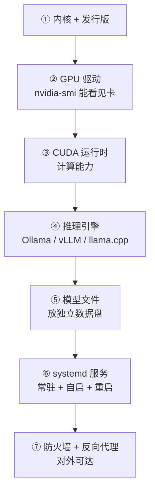

# Linux 部署要点

> [!abstract] 一句话讲清楚
> Linux 是本地大模型部署的"正房"：驱动、服务、并发能力都最靠谱。它的坑集中在**驱动装错、权限不清、服务起不来、防火墙拦截**这四件事上。

## 为什么重要

- **客户的生产服务器几乎都是 Linux**：你要交付的不是"我这台能跑"，而是"客户那台能长期跑"。
- **Linux 上才能真正做服务化**：systemd、端口、日志、权限、开机自启，一整套都是成熟方案。
- **它决定了你后面所有上层都能不能稳**：Linux 这台地基歪了，RAG、Agent、并发全是空话。

对交付来说，Linux 部署做完，你交付的应该是一个"没人管也能活着"的服务，而不是一个"要你在旁边看着"的命令。

## 核心名词全解

| 名词 | 英文 / 缩写 | 大白话解释 | 容易混淆 / 注意 |
|---|---|---|---|
| 发行版 | Distribution | Linux 的不同"套餐"，如 Ubuntu、Debian、Rocky | 不同发行版的包管理和驱动安装方式不一样 |
| 内核 | Kernel | 操作系统最底层，负责和硬件说话 | 内核版本变化可能导致驱动失效 |
| 驱动 | Driver | 让系统认识显卡的软件 | 驱动 ≠ CUDA；装反顺序是最常见错误 |
| CUDA | CUDA | NVIDIA 提供的 GPU 计算平台/运行时 | 分"驱动自带的部分"和"工具包"，别混为一谈 |
| DKMS | Dynamic Kernel Module Support | 内核升级后自动重编驱动的机制 | 不装它，系统一升级驱动就挂 |
| systemd | systemd | Linux 的服务管理器，负责开机自启和进程守护 | 和"手动 `nohup` 挂着"不是一回事 |
| unit 文件 | .service 文件 | 告诉 systemd 怎么启动你的服务 | 路径、用户、环境变量都要写绝对 |
| 防火墙 | firewalld / ufw / iptables | 控制哪些端口能被外面访问 | 服务起来了连不上，八成是它 |
| headless | Headless | 服务器没有图形界面，只能 SSH | 需要图形界面的工具在服务器上跑不起来 |
| ulimit | ulimit | 单进程能打开多少文件、多少连接 | 高并发时"连接数上不去"常是它 |

## 原理与机制

### 分层看：Linux 部署在装什么



**为什么顺序不能乱**：驱动是"系统认识显卡"，CUDA 是"程序能用显卡算"，引擎是"用显卡跑模型"。跳步装的结果是报错信息指向最上层，你却在最下层找问题。

### 驱动这件事，要按"来源唯一"原则处理

- 一台机器上**只保留一套 GPU 驱动**。发行版自带的开源驱动、手动装的最新驱动、容器里又装一遍——三者打架是新手最常见的翻车点。
- 装完驱动，第一步永远是跑显卡工具确认能看到卡和显存，再继续。
- 如果服务器开启了安全启动（Secure Boot），部分驱动加载会被拦，表现是"驱动装了但工具用不了"，需要按发行版文档处理签名或关闭安全启动。

### systemd 为什么是交付分水岭

`systemd` 帮你解决四件事：开机自启、进程崩溃自动重启、标准输出进日志、以指定用户身份运行。这四件事就是"交付级服务"和"玩具"的区别。

一个最小 unit 的结构（关键在前几行，具体字段以发行版文档为准）：

```ini
[Unit]
Description=Local LLM API
After=network-online.target

[Service]
User=llm
ExecStart=/opt/llm/bin/start-server --model /data/models/your-model
Restart=always
RestartSec=10
LimitNOFILE=65535

[Install]
WantedBy=multi-user.target
```

上面这段的关键不是命令本身，而是三点：**用普通用户跑**（不用 root）、**`Restart=always`**（挂了自动起）、**`LimitNOFILE`**（高并发时需要）。写完要 `enable` 才会开机自启，只 `start` 是一次性的。

### 权限与数据盘的现实约束

- **不要用 root 跑推理服务**：一旦被利用就是整机沦陷，而且模型文件会变成 root 所有，后面换个用户就跑不了。
- **模型放独立数据盘**：系统盘通常不大，模型动辄几十 GB，塞满系统盘会导致日志写不进、服务异常退出。
- **多用户场景要提前分目录**：模型、日志、配置各归各的目录，权限按组分配，不要全都 777。

## 完整流程（Linux 版）

| 阶段 | 做什么 | 验收点 |
|---|---|---|
| ① 摸底 | 发行版/内核版本、显卡型号、磁盘分区、是否已有外网 | 能说清系统能不能装对应驱动 |
| ② 定方案 | 裸装 or 容器；模型放哪个盘；服务用哪个用户跑 | 方案里有目录规划和用户规划 |
| ③ 装驱动 | 关掉冲突的开源驱动，装官方驱动，启用 DKMS | `nvidia-smi` 能看到卡和显存 |
| ④ 装运行时与引擎 | CUDA 运行时、Python 或容器、推理引擎 | 能跑一个最小模型 |
| ⑤ 放模型 | 下载/搬运到数据盘，校验 | 引擎加载成功，磁盘还有余量 |
| ⑥ 服务化 | 写 unit 文件，指定用户、环境变量、自启 | 重启机器后服务自动可用 |
| ⑦ 网络 | 监听地址、防火墙放行、需要时加反向代理 | 局域网另一台机器能访问 |
| ⑧ 日志与监控 | 日志落文件、轮转、基本资源监控 | 出问题能翻到当时的日志 |
| ⑨ 验收 | 换机器测、重启测、杀进程测 | 三项都过才算完 |

## 决策点

- **岔路口 1：哪个发行版？**
  现象：客户服务器五花八门。判断依据：**驱动和引擎的官方支持度**。推荐：**新部署优先选主流 LTS 发行版（如 Ubuntu LTS）**，客户已有环境就顺着客户的来。代价：老系统（例如已经停止维护的版本）可能拿不到新驱动，需要提前说清。
- **岔路口 2：裸装还是 Docker？**
  现象：纠结要不要上容器。判断依据：**交付次数、是否要远程维护**。推荐：**一次性自用裸装；要复制到多台/要远程运维就上容器**。代价：容器多一层 GPU 透传配置（`--gpus` 或 runtime），出问题要多查一层。
- **岔路口 3：驱动用系统包还是官方脚本？**
  现象：包管理里也有驱动。判断依据：版本新旧和可控性。推荐：**优先官方渠道/发行版官方仓库里较新的稳定版，保持单一来源**。代价：手动装驱动灵活但容易和内核升级冲突，必须配 DKMS。
- **岔路口 4：服务怎么常驻？**
  现象：`nohup` 挂着算不算常驻？判断依据：要不要重启自恢复、要不要进日志系统。推荐：**一律 systemd（容器则用容器重启策略）**。代价：写 unit 文件比 `nohup` 麻烦几分钟，但省掉后面无数次"服务怎么没了"。
- **岔路口 5：要不要给公网？**
  现象：客户想在外面也能用。判断依据：安全边界。推荐：**默认只给内网；要公网必须加反向代理 + 鉴权 + HTTPS，最好走 VPN/内网穿透**。代价：公网暴露后攻击面立刻变大，日志和限流也要跟上。

## 关键参数与配置

| 配置项 | 作用 | 常见问题 | 常见做法 |
|---|---|---|---|
| 监听地址 | 服务允许谁连 | 只监听本机导致外部连不上 | 内网服务写对外地址 |
| 端口 | 服务入口 | 被占用/被防火墙拦 | 固定一个端口并写进交付文档 |
| 运行用户 | 服务以谁的身份跑 | 用 root 跑，权限失控 | 专用普通用户，模型目录按组授权 |
| 模型目录 | 模型文件位置 | 放系统盘，磁盘写满 | 独立数据盘，路径无中文 |
| `LimitNOFILE` | 最大打开文件数 | 高并发时报连接错误 | 适当调高 |
| `Restart` 策略 | 崩溃后是否重启 | 没配就崩了不动 | `always` + 间隔秒数 |
| 防火墙规则 | 放行哪些端口 | 服务通但访问不了 | 只放行业务端口 + 限定来源网段 |
| 日志轮转 | 防止日志吃满磁盘 | 日志无限增长 | 配置轮转或限制大小 |

### 三种部署形态，选型时先想清楚

客户说"部署在 Linux 服务器上"，其实是三种不同的东西，工作量和维护方式差很远：

| 形态 | 什么样 | 适合 | 代价 |
|---|---|---|---|
| 单机裸装 | 驱动 + 引擎直接装在系统里 | 客户只有一台机器、交付一次 | 换机器要重装，依赖系统状态 |
| 容器化 | 引擎跑在容器里，GPU 透传进去 | 多台部署、要远程维护、要回滚 | 多一层排错，GPU 透传要配置 |
| 多卡/多实例 | 一张卡一个实例或多卡切分 | 并发要求高、模型大 | 调度和端口规划复杂，成本高 |

**判断方法**：问自己"这套东西半年后还要不要碰"。要碰（升级、扩容、换机器）→ 容器化；只是搭一次给人用 → 裸装也能接受，但文档必须写全。

## 上线当天的十分钟流程

配置都做完不等于能交付，上线当天按这个顺序走一遍，每一项都能当场看见结果：

1. **冷启动测试**：重启整台机器，什么都不做，等三分钟直接访问服务。这一步验的是 systemd 和网络配置。
2. **进程守护测试**：手动杀掉推理进程，等十几秒再看是否自动拉起。这一步验的是重启策略。
3. **外部访问测试**：换一台电脑/手机连内网地址，别在自己服务器上用 `curl localhost`。
4. **长任务测试**：让它生成一篇长文，看会不会被超时或缓冲掐断。
5. **错误路径测试**：不带 Key、带错 Key、超长输入，看返回是否是可理解的错误。
6. **资源回落测试**：跑完后看显存/内存有没有正常释放，磁盘有没有被日志吃掉。

六步都过，才算"这台机器可以交给客户"；有一步不过，就回到对应层去修，别急着走。

## 报错现象对照

| 现象 | 最可能的原因 | 先做什么 |
|---|---|---|
| 装驱动后进不了图形界面/黑屏 | 驱动与内核或显示管理器不匹配 | 进恢复模式卸载驱动，改从官方仓库装 |
| 显卡工具报"驱动与内核模块版本不一致" | 内核升级了，驱动没重编 | 启用 DKMS 重装驱动，或回退内核 |
| 服务 systemd 起不来但手动能跑 | 环境变量/路径/用户在 unit 里没写对 | 看服务日志，把路径和变量补绝对 |
| 服务起在本机，别人访问被拒 | 监听地址是 127.0.0.1 | 改成对内网地址监听，再放行防火墙 |
| 连接数一多就报"too many open files" | 文件句柄上限 | 调 `LimitNOFILE` 并重启服务 |
| 跑一段时间后磁盘满、服务挂 | 日志没轮转 | 配日志轮转，加磁盘告警 |
| SSH 断开后服务也没了 | 前台跑在会话里，没做服务化 | 写 unit 文件用 systemd 托管 |

## Linux 与 Windows 服务器，客户该怎么选

客户经常问"我们本来就有一台 Windows 服务器，为什么还要 Linux"。用这张表回答：

| 维度 | Windows Server/工作站 | Linux 服务器 |
|---|---|---|
| 部署生态 | 推理引擎支持参差 | 引擎、容器、驱动支持最全 |
| 长期无人值守 | 更新、重启策略干扰多 | 稳定，适合 7×24 |
| 权限与隔离 | 桌面思维，细粒度弱 | 用户/组/服务隔离成熟 |
| 远程运维 | 远程桌面，会话易受影响 | SSH，断连不影响服务 |
| 迁移成本 | 已有系统难迁移 | 新部署成本低 |

结论不是"Windows 不行"，而是"**能选的时候优先 Linux**；客户只有 Windows 就在 Windows 上做到最好，但要把限制讲清楚"。

## 常见坑与误区

| 现象 | 原因 | 对策 |
|---|---|---|
| `nvidia-smi` 报错或找不到卡 | 开源驱动占用、驱动没装好、安全启动拦截 | 先卸载冲突驱动，再按官方文档装，检查安全启动 |
| 重启后驱动突然不能用 | 内核升级了，驱动没跟着重编 | 启用 DKMS，升级后验证；生产环境谨慎自动升级 |
| 服务手动能起，systemd 起不来 | 环境变量、路径、用户不对 | unit 里写绝对路径和完整环境变量，看 journal 日志 |
| 服务起来了，外部访问不了 | 监听地址 + 防火墙 | 先本机验证，再查监听，再放行端口 |
| 换了用户跑，模型加载失败 | 模型文件权限属于上一个用户 | 统一目录权限，按组授权 |
| 跑一段时间就挂 | 磁盘满 / 日志撑爆 / 内存不够被系统杀 | 加磁盘监控、日志轮转、限制并发 |
| 高并发时连接被拒 | 文件句柄或并发参数太小 | 调 `LimitNOFILE` 和引擎并发参数 |
| 中文日志乱码、时间不对 | 缺少 locale、时区没配 | 设置 UTF-8 locale 和正确时区 |

## 自检问题

- [ ] 驱动、CUDA、引擎三层各管什么？为什么驱动装完要先验证再往上装？
- [ ] 为什么不能 root 跑服务？会带来哪两类后果？
- [ ] 怎么验证一个服务"真的"能开机自启？
- [ ] 服务起来但外部连不上，你的排查顺序是什么？
- [ ] 内核自动升级对驱动意味着什么？怎么防？
- [ ] 裸装和 Docker 部署，在远程运维上差在哪？
- [ ] 交付一台 Linux 服务器，你要留下哪些东西（服务、日志、文档、脚本）？

## 相关笔记

- 上游：[[Linux 基础与服务器操作]]
- 上游：[[驱动-CUDA-框架版本兼容]]
- 下游：[[服务化与 API 鉴权]]
- 下游：[[容器化部署]]
- 对照：[[Windows 部署要点]]
- 跨领域：[[监控与日志]]
- 跨领域：[[远程交付与远程运维]]
- 返回：[[部署实战 MOC]]

## 交付视角（对客户怎么讲）

- 客户问"为什么不用 Windows 服务器"：直接说 Linux 上驱动和并发方案成熟、长期无人值守更稳，Windows 更适合单机自用。
- 客户问"重启会不会要重新弄"：把"开机自启 + 崩溃自动重启"这两条当卖点讲，这是他们最关心的可靠性。
- 客户问"安全吗"：说清边界——默认只在内网、带鉴权、只开必要端口；要公网就加一层。
- 报价提示：Linux 交付的价值在"可维护"，把 systemd、日志、监控、文档算进工作量，不要只报"装驱动 + 跑模型"。
