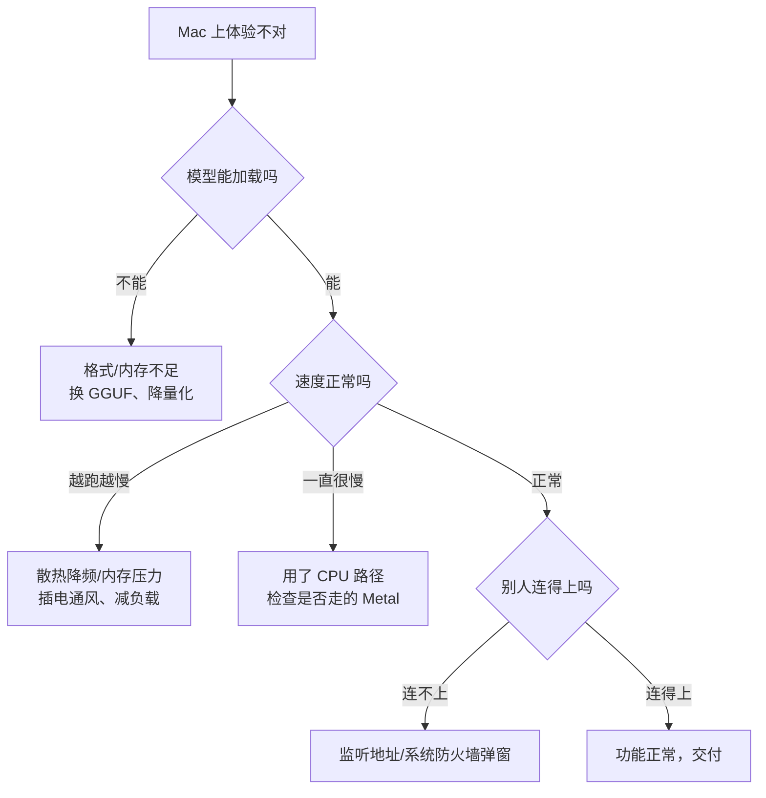

# Mac 部署要点

> [!abstract] 一句话讲清楚
> Mac 跑大模型靠的是"统一内存"这一条：**内存有多大，模型就能有多大**，不需要独立显卡。但它是给个人和小团队用的，别指望拿它接高并发。

## 为什么重要

- **很多个人客户和小工作室只有 Mac**：设计师、剪辑师、写作者，机器是好机器，但没有 N 卡。
- **Mac 的硬件逻辑和 PC 完全不同**：你按"显存"的思路去算会错得离谱，要按"内存"算。
- **它决定你能不能接这类单**：知道 Mac 的上限在哪，才不会承诺了做不到的事。

如果客户说"我们办公室都是 Mac"，这篇就是你判断能不能干的依据。

## 核心名词全解

| 名词 | 英文 / 缩写 | 大白话解释 | 容易混淆 / 注意 |
|---|---|---|---|
| Apple Silicon | Apple Silicon | 苹果自研芯片（M 系列），CPU 和 GPU 做在同一块芯片上 | 和 Intel 版 Mac 是两个世界，别混着讲 |
| 统一内存 | Unified Memory | CPU 和 GPU 共用同一块内存，不用来回拷数据 | 不是"显存"，但模型跑起来时确实当显存用 |
| 内存带宽 | Memory Bandwidth | 内存每秒能搬多少数据，M 系列分普通版和 Pro/Max/Ultra 档位 | 生成速度主要看它，不只看算力 |
| Metal | Metal | 苹果的图形/计算接口，相当于 Windows 上的 DirectX + CUDA | 是 Mac 上跑 GPU 计算的正路 |
| MPS | Metal Performance Shaders | Metal 里的高性能计算库，PyTorch 通过它用 GPU | 有些框架的 Mac 支持就靠它，不是所有算子都齐 |
| MLX | MLX | 苹果开源的机器学习框架，专门为统一内存设计 | 只在 Mac 上跑得好，别指望搬到 Linux |
| Ollama | Ollama | 一键拉模型、起服务的工具，Mac 上体验最好 | 底层可能是 llama.cpp 或 MLX，具体看版本 |
| GGUF | GGUF | llama.cpp 系的模型格式，Mac 上支持最成熟 | 别的量化格式不一定能跑 |
| 内存压力 | Memory Pressure | macOS 判断内存够不够用的指标 | 看"已用多少"没用，要看压力和 swap |
| 内存交换 | Swap | 内存不够时用硬盘顶替，速度暴跌 | 一旦大量 swap，模型基本没法用 |

## 原理与机制

### 统一内存：好处和代价

传统 PC 上，模型权重要先在内存里，再拷进显存。Mac 的 CPU/GPU 共用一块内存，**省掉了拷贝这步**，所以同样的模型文件，Mac 上"装得进去就能跑"。

代价有两个：

1. **系统和模型抢同一块内存**。你买了 16GB，不是 16GB 全给模型，系统、浏览器、IDE 都要吃。真实可用大概是总内存的**一半到三分之二**，越激进越容易 swap。
2. **内存不能加**。买定离手，所以"选配置"比"调参数"重要得多。

### 为什么生成速度主要看带宽

模型每生成一个 token，都要把权重过一遍。权重在内存里，搬得越快生成越快。所以：

- 同样的模型，M 系列里 **Pro/Max/Ultra 档位**（带宽高）明显快于普通版；
- 这解释了为什么"CPU 核数多"不等于"跑模型快"；
- MacBook Air 没有风扇，**长时间满载会降频**，速度先快后慢。

### Mac 上跑模型的三条路线

| 路线 | 适合谁 | 优点 | 限制 |
|---|---|---|---|
| Ollama | 新手、只想快点用 | 装完就能用，模型管理简单 | 参数控制不如底层引擎细 |
| llama.cpp（Metal 后端） | 要控参数、要 GGUF | 支持面广、可调项多 | 要自己编译或找预编译包 |
| MLX（含 mlx-lm） | 想在 Mac 上榨性能 | 专为统一内存优化，部分场景更快 | 生态相对独立，模型转换要额外步骤 |

**不建议**在 Mac 上用 Docker 跑推理：容器里用不到 Metal 加速，速度会掉到 CPU 水平，等于白瞎了这块芯片。

## 完整流程（Mac 版）

| 阶段 | 做什么 | 验收点 |
|---|---|---|
| ① 确认芯片 | 看是 Apple Silicon 还是 Intel、内存多大 | Intel Mac 基本只能 CPU 慢跑，提前说清 |
| ② 算内存档位 | 总内存 × 可用比例 → 模型大小 × 量化字节 | 算出来的模型"放得下还有余量" |
| ③ 选路线 | Ollama / llama.cpp / MLX | 知道为什么不用另外两个 |
| ④ 装引擎 | 装到用户目录，别用 sudo 乱装 | 能启动、能看到帮助信息 |
| ⑤ 拉模型 | 优先 GGUF 格式 | 加载成功，能出字 |
| ⑥ 起服务 | 本机端口 + 局域网访问（如果要） | 别的设备能连上 |
| ⑦ 常驻 | 用 launchd 或工具自带后台能力 | 关终端/重启后还能用 |
| ⑧ 压测 | 单并发测速度，多并发看它怎么崩 | 得出一句"最多几个人同时用" |
| ⑨ 验收 | 换设备访问 + 长任务不中断 | 客户能自己用 |

## 决策点

- **岔路口 1：这台 Mac 到底能不能接？**
  现象：客户只有 Mac。判断依据：**是个人用还是团队并发**。推荐：**个人/两三人用，Mac 很合适；要 10 人以上并发，老实说不行**。代价：硬接会交付一个天天被吐槽"慢"的服务。
- **岔路口 2：Ollama 还是 MLX？**
  现象：纠结要不要折腾 MLX。判断依据：**要不要榨极限性能**。推荐：**先用 Ollama 跑通交付，确认客户在意速度再单独试 MLX 对比**。代价：MLX 模型转换和排错成本高，不一定值得。
- **岔路口 3：内存档位怎么选？**
  现象：想买/已买机器，纠结够不够。判断依据：**要跑的模型大小 × 量化字节**。推荐：**先定模型再定机器；买机器时宁可内存高一档**。代价：内存买小了无法补救，只能换机。
- **岔路口 4：模型放内置盘还是外接硬盘？**
  现象：内置盘不够。判断依据：**是否长期高频加载**。推荐：**能内置就内置；外接盘只放不常用的模型**。代价：外接盘加载慢、接口带宽有限，体验打折。
- **岔路口 5：要不要用 Docker？**
  现象：习惯容器化。判断依据：**容器里能不能用上 Metal**。推荐：**Mac 上推理别走 Docker**；要可复制性，用配置脚本而不是容器。代价：失去了容器的一致性，得靠文档补。

## 关键参数与配置

| 配置项 | 作用 | 调大/调小的影响 | 常见做法 |
|---|---|---|---|
| 模型参数量 | 决定能力上限 | 越大越聪明、越吃内存、越慢 | 按内存档位选，别顶格 |
| 量化等级 | 决定每参数字节 | 量化越低越省内存，质量略降 | 内存紧张时降量化，优先保上下文 |
| 上下文长度 | 一次能塞多少 token | 大会吃掉不少内存 | 按实际材料长度设，别默认拉满 |
| 并行请求数 | 同时处理多少请求 | Mac 上并行收益很低，反而拖慢 | 基本保持 1，用队列而不是并发 |
| 内存占用上限 | 限制模型吃多少内存 | 不限制会拖垮系统 | 留出系统和日常应用的余量 |
| 后台常驻方式 | 关终端后服务是否活着 | — | launchd 或工具自带后台模式 |
| 电源/散热设置 | 影响长时间速度 | 省电模式会降频 | 插电、通风、避免长时间满载 |

### 三种典型场景，别用一套配置

| 场景 | 典型客户 | 推荐路线 | 能承诺什么 |
|---|---|---|---|
| 个人自用 | 自由职业者、老板本人 | Ollama 一键装，GGUF 模型 | "你自己用很顺，换设备也能连" |
| 小工作室共享（2~5 人） | 设计/剪辑/文案工作室 | Ollama 或 llama.cpp 起服务 + 局域网访问 | "几个人轮流用没问题，同时用会排队" |
| 内容生产 | 要跑图、要跑视频、要批量生成 | ComfyUI + 本地模型，Mac 只当调度机 | "能出活，但大批量任务建议上独显机器" |

判断口诀：**Mac 的定位是"个人生产力"，不是"部门服务器"**。客户要的是"我这台机器上能用"，这单就成立；客户要的是"给全公司提供接口"，就得换硬件，这不是你技术不行，是架构不匹配。

### 速度预期怎么估：看带宽，不看核数

Mac 上生成速度的核心是**模型权重要从统一内存里读一遍才算一个 token**，所以带宽决定上限。给客户做预期时，按这个思路说，不要说具体数字：

1. 模型越小、量化越低，单次读取的量越少，速度越快；
2. 同样的模型，Pro/Max/Ultra 这类高带宽档位明显快过普通档；
3. 上下文越长、并行越多，占用越大，速度会被进一步摊薄；
4. 无风扇机型长时间满载会降频，**前几分钟的速度不代表持续速度**。

所以报价前的标准动作是：**在客户的机器上，用客户的真实问题，跑五分钟**，把"首字大概多久、一句话大概多久"记下来。这比任何参数表都准。

## 排错速查：Mac 上的问题通常只有四类

## 报错与现象对照

| 现象 | 最可能的原因 | 先做什么 |
|---|---|---|
| 装完启动就退出 | 模型格式不被支持或文件损坏 | 换官方 GGUF，校验文件完整性 |
| 加载时系统整体卡死 | 内存不够，开始大量 swap | 降量化或换更小模型，关掉占内存的应用 |
| 回答速度明显像 CPU | 引擎没走 Metal，或装了不支持 Metal 的版本 | 换官方原生版本，确认日志里有 Metal 相关输出 |
| 局域网设备连不上 | 只听本机，或首次启动时防火墙弹窗被拒 | 改监听地址，系统设置里允许该程序接收入站 |
| 合盖后服务消失 | 睡眠挂起进程 | 改电源设置，或用工具的后台常驻模式 |
| 长时间生成后变慢 | 散热降频 | 插电、垫高、避免无风扇机型跑长任务 |
| 外接硬盘加载特别慢 | 接口带宽和磁盘速度限制 | 常用模型放内置盘 |

## Mac 交付的边界清单

交付前和客户把这几条说清楚，能避免 90% 的后期扯皮：

- [ ] 这台机器**是给个人用还是团队用**，团队用的话最多几个人
- [ ] 模型放在**内置盘**，外接盘只放不常用的
- [ ] 明确"**合盖/睡眠/关机后服务不可用**"，这是笔记本不是服务器
- [ ] 明确"**不能加内存**"，模型档位买定离手
- [ ] 明确"**不承诺并发**"，多人同时用会排队
- [ ] 交付方式：访问地址、模型名、启动方式、出问题找谁
- [ ] 不承诺"和在线大模型一样聪明"，只承诺"在你们自己的机器上能跑、数据不出门"

## Mac 还是独显机器，怎么帮客户选

| 需求 | 更适合 Mac | 更适合带独显的机器 |
|---|---|---|
| 一个人用，随时带着走 | ✅ 便携、安静、即开即用 | 笨重，要配电源 |
| 2~5 人轮流用 | ✅ 够用，但要排队 | 更稳，能配并发 |
| 10 人以上同时调用 | ❌ 架构不适合 | ✅ 加卡或换服务器 |
| 大批量生成图片/视频 | 能出活但慢 | ✅ 显存大、吞吐高 |
| 数据敏感、要求离线 | ✅ 天然离线 | ✅ 一样可以 |
| 预算有限、已有 Mac | ✅ 省钱 | 要新采购 |

跟客户讲的时候别贬低 Mac，也别夸大它：**"你这台机器做个人助手完全够，做团队服务就得加一台服务器"**，这句话最容易让人接受。

## 常见坑与误区

| 现象 | 原因 | 对策 |
|---|---|---|
| 以为 16GB 就能跑 16GB 的模型 | 系统和应用也吃同一块内存 | 按总内存的一半到三分之二估可用 |
| 跑着跑着整个系统卡死 | 内存不够开始大量 swap | 换更小模型/更低量化，留足余量 |
| 前几分钟快，后面越来越慢 | 笔记本散热降频 | 插电、垫高通风；重活别用无风扇机型 |
| 容器里跑模型特别慢 | Docker 用不到 Metal 加速 | Mac 上直接装引擎，不走容器 |
| 模型加载失败或效果异常 | 用了 Mac 支持不好的量化格式 | 优先 GGUF；换格式重试 |
| 手机/平板连不上服务 | 只监听本机、或防火墙提示没点允许 | 监听对外地址，系统弹窗要点允许 |
| 合盖后服务断了 | 睡眠导致进程挂起 | 设定不睡眠，或说明这是使用限制 |
| 拿 Mac 接 10 人并发 | 统一内存架构不适合高并发 | 提前定边界，并发需求改用带独显的机器 |

## 自检问题

- [ ] 为什么 Mac 上"内存"约等于"显存"？有哪两个代价？
- [ ] 为什么生成速度主要看内存带宽而不是 CPU 核数？
- [ ] 一台 32GB 的 Mac，你会推荐跑多大参数、什么量化的模型？
- [ ] Mac 上为什么别用 Docker 跑推理？
- [ ] Ollama、llama.cpp、MLX 三条路线，各自适合什么场景？
- [ ] 客户说"办公室里 8 个人同时用"，你怎么回答？
- [ ] MacBook Air 和 Mac Studio 在长时间跑模型上的差别是什么？
- [ ] 客户问"前几分钟挺快，怎么后来越来越慢"，你怎么解释、怎么缓解？

## 自检问题参考答案

> [!success]- 1. 为什么 Mac 的内存能当显存用？代价是什么？
> 因为 Apple Silicon 把 CPU 和 GPU 的内存合成了一块统一内存，模型权重不用先放内存再拷进显存，"装得进去就能跑"。
> 代价有两个：一是系统和浏览器、IDE 都吃这块内存，真实可用大概只有总内存的一半到三分之二；二是内存买定离手，后面加不了，选配置比调参数重要。

> [!success]- 2. 生成速度为什么主要看内存带宽？
> 每生成一个 token，都要把模型权重在内存里完整过一遍，搬得越快、出字越快，所以带宽决定上限。
> 这也解释了为什么 CPU 核数多不等于跑模型快：核多解决的是算得快，而这里的瓶颈是数据搬得慢。

> [!success]- 3. 32GB 的 Mac 该跑多大的模型？
> 按"总内存的一半到三分之二"估可用内存，32GB 大概能留给模型十几到二十 GB 的量级。
> 在这个预算里，十几 B 参数配较低量化的 GGUF 比较稳；三十 B 量级就要谨慎，容易挤掉系统余量。塞满的后果不是报错，而是整机开始 swap、卡死。

> [!success]- 4. Mac 上为什么别用 Docker 跑推理？
> 因为容器里拿不到 Metal 加速，GPU 那部分用不上，推理会掉回 CPU 水平，等于白瞎了这块芯片。
> 想要"可复制"别靠容器：把安装步骤、模型版本、启动命令写成配置脚本和文档，同样能复现。

> [!success]- 5. Ollama、llama.cpp、MLX 怎么选？
> 只想快点用、不想折腾：Ollama，装完拉模型就能起服务；要控参数、要跑 GGUF：llama.cpp 的 Metal 后端，可调项多；想在 Mac 上榨极限性能：MLX，但它生态相对独立，模型转换和排错成本高。
> 交付顺序建议先用 Ollama 跑通，客户真的在意速度再单独对比 MLX。

> [!success]- 6. 客户说"8 个人同时用"怎么答？
> 先讲边界：Mac 的定位是个人生产力，不是部门服务器，8 个人同时用会排队，压测最多只能给出"几个人能稳"的结论。
> 给两条路：接受"轮流用、偶尔排队"就继续用这台 Mac；要真并发，就加一台带独显的机器，这不是技术问题，是架构不匹配。

> [!success]- 7. MacBook Air 和 Studio 差在哪？
> 核心差别是持续性能：Air 没有风扇，满载几分钟后开始降频，速度先快后慢；Studio 有主动散热、内存带宽也高一档，能长时间满载跑。
> 所以给客户做预期时，Air 只承诺"个人短时间用"，长时间批量任务、多人共享要选 Studio 这类机器。

> [!success]- 8. 前几分钟快、后面越来越慢怎么办？
> 先分清是散热还是内存：看机身温度和内存压力，如果 swap 在涨，是模型太大；如果只是热，是降频。
> 缓解：插电、垫高通风、关掉吃内存的应用、降低上下文和并行；长期方案是换更小模型或换有风扇的机器。这也是笔记本和服务器定位的差别。

## 相关笔记

- 上游：[[MLX 与 Apple 芯片推理]]
- 上游：[[参数量与显存估算]]
- 上游：[[量化技术]]
- 下游：[[服务化与 API 鉴权]]
- 对照：[[Windows 部署要点]]
- 跨领域：[[N卡 A卡 Mac 平台适配]]
- 跨领域：[[模型获取与离线搬运]]
- 返回：[[部署实战 MOC]]

## 交付视角（对客户怎么讲）

- 客户问"我这台 Mac 能跑吗"：先问芯片和内存，直接给"能跑到什么模型、大概什么速度量级、几个人能用"三句话。
- 客户问"为什么没有独显也能跑"：用"苹果把 CPU 和 GPU 的内存合在一起了，模型能直接放进去"来解释，别讲架构。
- 客户问"能不能给全公司用"：明确说 Mac 适合个人和小团队；人多就上带独显的服务器，这是边界不是缺陷。
- 客户问"能支持十几个人同时用吗"：别拍胸脯，说"先压测，结果可能是排队但不出错"，把预期交给数据。
- 报价提示：Mac 部署工作量小、门槛低，价格空间也小；适合当"轻交付"入口，后续靠接入知识库、工作流这些增值服务赚钱。
