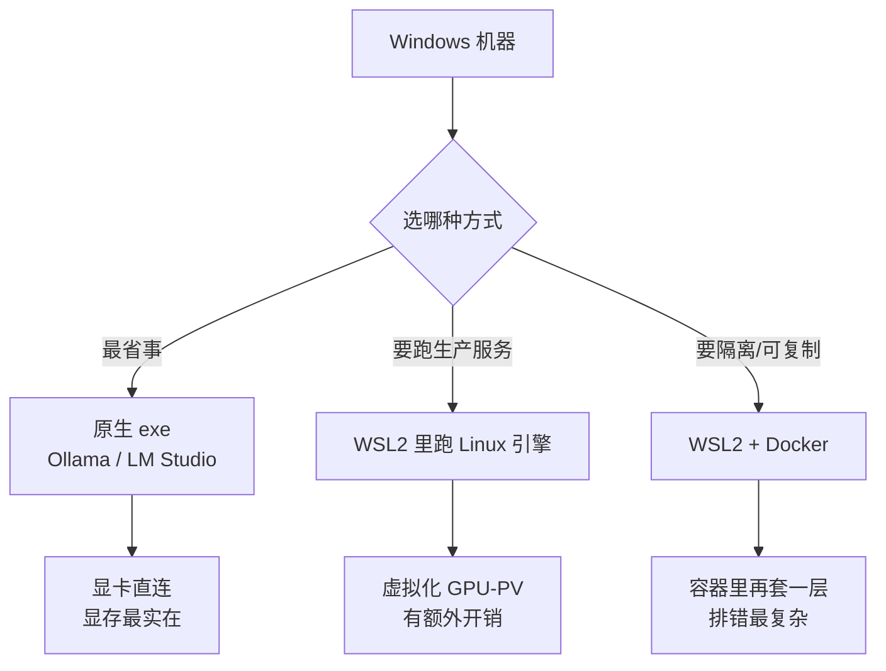
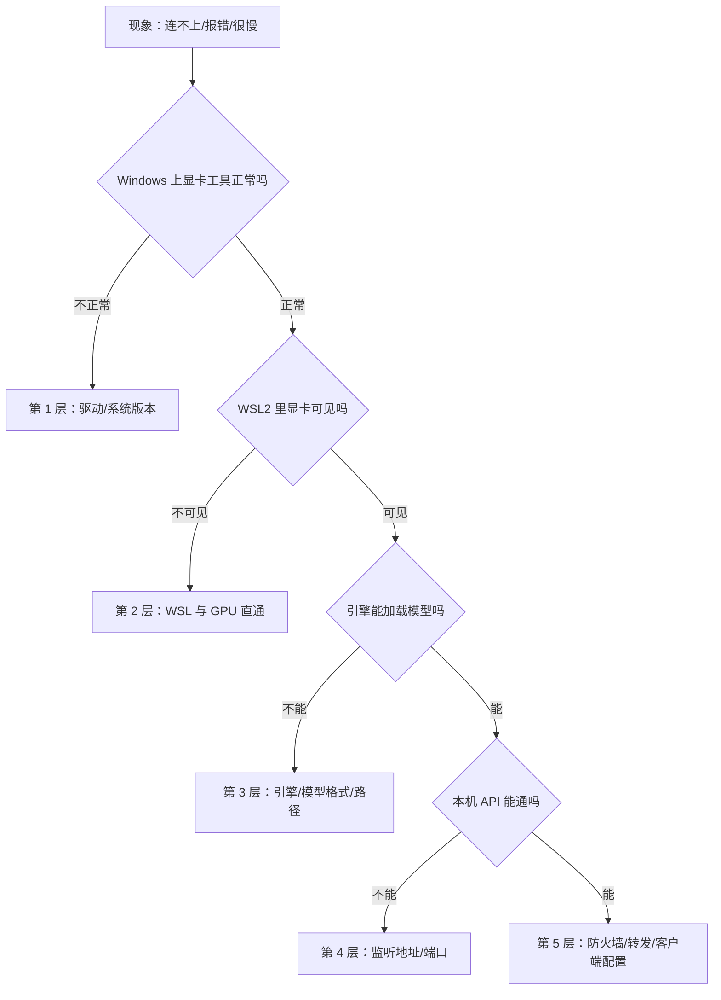

# Windows 部署要点

> [!abstract] 一句话讲清楚
> Windows 上跑本地大模型，麻烦不在"装不装得上"，而在**显卡能不能被看见、模型放哪里、服务怎么活过重启**。这篇把这三件事和你一定会遇到的报错讲透。

## 为什么重要

- **大多数客户的第一台机器是 Windows**：个人用户、小公司、设计师工作站、游戏本，全是 Windows。你躲不开它。
- **Windows 的坑和 Linux 完全不一样**：不是权限问题，而是**虚拟化层、路径、编码、自启动**四类问题。
- **搞清楚边界才能报价**：同一台机器，Windows 原生跑和 WSL2 跑、能不能 7×24 常驻，方案差很多。

这台机器通常不是"专业 AI 服务器"，你要在它上面做出一个**能交付**的结果。

## 核心名词全解

| 名词 | 英文 / 缩写 | 大白话解释 | 容易混淆 / 注意 |
|---|---|---|---|
| WSL2 | Windows Subsystem for Linux 2 | Windows 里跑的一个真 Linux 虚拟机，微软官方支持 | 不是模拟器，但也不是"原生 Linux"；它有自己的内存和磁盘 |
| 虚拟化平台 | Hyper-V / Virtual Machine Platform | 让 Windows 能跑虚拟机的底层组件 | WSL2 依赖它；开它可能和部分旧虚拟化软件冲突 |
| GPU 直通 | GPU Passthrough / GPU-PV | 把宿主机的显卡"分"给 WSL2 用 | 只支持较新的驱动和系统，旧卡/旧系统可能根本看不到显卡 |
| 原生部署 | Native | 直接在 Windows 上装 exe，不经过 WSL | 最省事，但部分引擎/工具链在 Windows 上支持不全 |
| 环境变量 | Environment Variable | 系统级/用户级的配置项，程序启动时读取 | 改了要重开终端才生效，很多人在这上面浪费半小时 |
| 模型目录 | Model Directory | 模型文件实际存放的文件夹 | Windows 上很容易被默认塞进 C 盘用户目录，撑爆系统盘 |
| 端口转发 | Port Proxy | 把外部请求转进 WSL2 的服务 | WSL2 的 IP 每次重启可能变，别把它写死 |
| 自启动 | Auto-start | 开机后服务自动起来 | 和"登录后启动"不是一回事：没人登录时服务也得活 |
| 长路径 | Long Path | Windows 默认路径长度限制的老问题 | 模型分片文件名长，嵌套深时可能触发 |
| 编码 | Code Page / UTF-8 | 文本的字符编码方式 | 中文日志乱码、脚本报错多半是这里 |

## 原理与机制

### Windows 上其实有两条路

- **原生 exe**：程序直接跑在 Windows 上，显卡驱动直接用。适合单人用、快速验证。缺点是很多服务端工具（systemd、部分 Python 编译依赖）在 Windows 上水土不服。
- **WSL2**：本质是一个轻量虚拟机，你得到的是**几乎完整的 Linux 体验**。显卡通过微软的虚拟化方案透传进去。适合你要用 Linux 生态的推理服务、要用 systemd 管服务、要跟客户 Linux 服务器保持一致的场景。
- **WSL2 + Docker**：在 WSL2 里再跑容器。好处是环境可复制、和交付到 Linux 服务器一致；坏处是多一层，出问题要判断"是容器、是 WSL、还是 Windows"。

一句话记法：**原生最快，WSL2 最像生产，容器最可复制但排错最绕**。

### 显存与内存在 WSL2 里是被"分割"的

WSL2 默认会占用宿主机一大块内存（通常按物理内存比例分配），这部分内存**用完不会立刻还给 Windows**。后果：

- 跑完大模型，Windows 整体变卡，任务管理器里 `Vmmem` 进程吃内存。
- 模型文件如果放在 Windows 盘符下（`/mnt/c/...`），WSL2 读写要走跨系统文件层，**加载模型会明显变慢**。

所以正确姿势是：**模型放 WSL2 自己的文件系统里（如 `~/models`），内存上限用配置文件显式限制。** 具体的配置文件名和写法以微软官方文档为准。

### GPU 可见性的判断方法

判断顺序永远是"先看到卡，再谈模型"：

1. Windows 上装**显卡厂商的 Windows 驱动**（不是 Linux 驱动！WSL2 共享宿主驱动）。
2. 进 WSL2 执行显卡工具命令（NVIDIA 就是 `nvidia-smi`）。
3. 能看到卡、显存正常，才算通。

如果第 2 步看不到卡：先怀疑驱动太旧或系统版本不满足支持条件，**不要急着改模型参数**。

## 完整流程（Windows 版）

| 阶段 | 做什么 | 关键判断 |
|---|---|---|
| ① 体检 | 看系统版本、显卡型号、显存、磁盘剩余 | 系统太老或显卡太旧，可能压根不支持 GPU 直通 |
| ② 选路线 | 原生 / WSL2 / 容器 | 自己玩 → 原生；要交付、要常驻 → WSL2 |
| ③ 装驱动 | 只装 Windows 显卡驱动，别在 WSL 里重复装 | 驱动版本要支持直通 |
| ④ 装 WSL2 | 启用虚拟化组件，装发行版 | 首次要重启；BIOS 里虚拟化要开 |
| ⑤ 迁移模型目录 | 把模型放到 WSL2 内部盘位或非系统盘 | 别放在 `C:\Users\...` 深处 |
| ⑥ 跑通最小样例 | 先跑小模型验证整条链 | 能出字就算环境通了 |
| ⑦ 服务化 | WSL 里配 systemd 服务，或 Windows 侧配计划任务 | 必须验证"重启后自动活" |
| ⑧ 对外可达 | 局域网访问要过防火墙和端口转发 | 先确认监听地址，再改防火墙 |
| ⑨ 验收 | 换一台电脑连进来试 | 只有本机能连 = 没交付 |

## 决策点

- **岔路口 1：WSL2 还是原生？**
  现象：不确定该装哪种。判断依据：**是"自己用"还是"给别人用/要长期跑"**。推荐：**自用/试模型选原生，交付/常驻选 WSL2**。代价：WSL2 多一层虚拟化，显存管理和排错更复杂，但换来 Linux 生态和可控的服务化。
- **岔路口 2：模型放 C 盘还是别的盘？**
  现象：默认安装把模型放进了用户目录。判断依据：模型体积通常是几个 GB 到几十 GB。推荐：**一开始就用环境变量把模型目录指到大容量非系统盘**。代价：改配置要重开终端/服务，迁移已有模型要拷文件。
- **岔路口 3：Docker Desktop 还是 WSL2 里直接装 Docker？**
  现象：想用容器但不确定用哪个。判断依据：只是本地测试 → Docker Desktop 省事；要贴近客户 Linux 环境 → WSL2 里直接装。推荐：**面向交付的部署，优先和客户服务器保持一致的方式**。代价：Docker Desktop 有授权和资源占用问题，WSL2 内装更"干净"但要自己维护。
- **岔路口 4：服务怎么自启动？**
  现象：关掉窗口服务就死。判断依据：是"需要开机即用"还是"临时用一下"。推荐：**WSL 内 systemd 服务 + 开启 systemd 支持**；纯 Windows 程序用计划任务（不是"启动文件夹"）。代价：服务化配置比双击 exe 麻烦，但这是交付的基本盘。
- **岔路口 5：局域网访问不通，改哪？**
  现象：本机能访问，同事连不上。判断依据：先看监听地址，再看防火墙，最后看 WSL 端口转发。推荐：**按这个顺序排查，别一上来关防火墙**。代价：关防火墙能立刻"通了"，但你把交付标准降成了"裸奔"。

## 关键参数与配置

| 配置项 | 作用 | 注意 | 常见做法 |
|---|---|---|---|
| 模型目录环境变量 | 指定模型文件位置 | 改完要重启服务/终端 | 指到大容量盘，路径不含中文和空格 |
| WSL2 内存上限 | 限制 WSL 吃多少宿主机内存 | 设太小模型加载失败，设太大 Windows 卡死 | 给模型留够，给 Windows 留足 |
| WSL2 处理器数量 | 限制 WSL 用几个核 | 和宿主机抢 CPU 会整体变卡 | 按物理核数留出余量 |
| 监听地址 | 允许谁连进来 | `127.0.0.1` 只本机 | 局域网服务写对外地址 |
| 防火墙入站规则 | 放行端口 | 只放行需要的端口，别整个放行 | 按端口 + 内网网段限制 |
| 计划任务"不管用户是否登录" | 保证没人登录也启动 | 默认选项不勾会失效 | 交付场景必须勾 |
| 文件系统位置 | 模型/数据放哪 | 跨 `/mnt/c` 读写慢 | 放 WSL 内部路径 |
| 编码设置 | 控制台/脚本中文显示 | 乱码不一定影响运行，但排查很痛苦 | 统一用 UTF-8 |

### 两种典型场景，做法完全不同

同样是 Windows，个人自用和团队共享是两套方案，别用一套配置硬套。

| 维度 | 场景 A：个人工作站 | 场景 B：小团队共享（3~10 人） |
|---|---|---|
| 典型客户 | 老板自己的电脑、设计师工作站 | 一台放在办公室的工作站/服务器 |
| 路线 | 原生 exe + GGUF | WSL2 + Linux 引擎 + 反向代理 |
| 模型管理 | 工具自带，一键拉 | 目录固定 + 版本清单 |
| 服务化 | 计划任务，"登录后启动"可接受 | 必须"不管用户是否登录也启动" |
| 网络 | 本机访问为主 | 固定内网地址 + 防火墙只放业务端口 |
| 鉴权 | 可以不要 | 每人一个 Key，能单独吊销 |
| 能承诺什么 | "你自己用够了" | "X 个人同时提问不卡"（要压测才敢说） |

**判断口诀**：只要出现"别人也要用"，就走场景 B——它多花半天配置，但省掉后面所有"你电脑关了我就用不了"的扯皮。

## 排错：按现象分层，别跨层猜

Windows 上的报错最难的地方是**现象和原因隔着一层虚拟化**。固定按这个顺序查，一次只动一层：

排错的纪律：**上一层没确认通过，绝不动下一层**。新手最常见的浪费是把驱动问题当成模型问题，反复换量化、换参数，越换越乱。

## 报错现象对照

Windows 上有些现象几乎总是指向同一个原因，可以先按这个表快速定位：

| 现象 | 最可能的原因 | 先做什么 |
|---|---|---|
| 安装 WSL 时报"需要启用虚拟机平台" | 虚拟化组件没开或 BIOS 虚拟化关闭 | 开组件、进 BIOS 确认虚拟化已启用，再重启 |
| WSL 启动报虚拟化相关错误 | 系统版本不满足，或和旧虚拟化软件冲突 | 查系统版本；临时卸载冲突软件试 |
| `nvidia-smi` 找不到命令 | 在 WSL 里装了 Linux 驱动，覆盖/冲突 | 卸载 WSL 内驱动，只保留宿主的 Windows 驱动 |
| 显卡工具能看到卡，但引擎说不支持 GPU | 引擎版本/后端不支持该卡或该驱动 | 换引擎版本或后端，先跑官方最小样例 |
| 模型加载到一半失败 | 磁盘空间不足或模型路径不可读 | 看剩余空间、看路径权限 |
| 同一问题本机正常、别人报错 | 对方用的是另一个地址或没带 Key | 让对方截图请求地址和返回码 |
| 服务过几小时就失联 | 睡眠/休眠/网络切换 | 改电源策略，检查无线网卡休眠 |

## 交付前预检单（Windows 专用）

交付当天照着勾，别到客户面前才发现少配了一样：

- [ ] 系统版本与虚拟化状态已确认
- [ ] 只有一套宿主显卡驱动，WSL 内没有重复安装
- [ ] 模型目录在非系统盘、路径纯英文
- [ ] WSL 内存/CPU 上限已按机器配置设定
- [ ] 服务已设为开机自启，且验证过"无人登录也启动"
- [ ] 已重启机器一次，服务自动恢复
- [ ] 已换另一台电脑访问成功
- [ ] 电源策略为不睡眠，或已书面说明这是限制
- [ ] 交付文档里写清：地址、端口、Key、启动/停止方式、找谁

## 和 Linux 服务器比，Windows 差在哪

给客户解释"为什么建议上服务器"时，用这张表，比说"Windows 不行"有说服力：

| 维度 | Windows 工作站 | Linux 服务器 |
|---|---|---|
| 常驻稳定性 | 会睡眠、会更新重启 | 专为长期运行设计 |
| 多用户与权限 | 桌面系统思路，隔离弱 | 用户/组/权限成熟 |
| 远程维护 | 远程桌面，断开可能影响会话 | SSH，断连不影响服务 |
| 并发能力 | 家用硬件 + 桌面系统，上限低 | 可上多卡、可调内核参数 |
| 成本 | 现有机器可复用 | 要单独采购 |

结论：**Windows 适合"先跑起来"，Linux 适合"长期跑下去"**。交付时把这句话说在前面，预期就不会错。

## 常见坑与误区

| 现象 | 原因 | 对策 |
|---|---|---|
| WSL 里 `nvidia-smi` 找不到命令 | 在 WSL 里又装了一遍 Linux 驱动，或宿主驱动太旧 | 只装 Windows 宿主驱动；确认系统和显卡在支持范围内 |
| 模型加载特别慢，几十 GB 要等很久 | 模型放在 `/mnt/c` 这类跨系统路径 | 迁移到 WSL2 内部文件系统 |
| 跑完模型 Windows 整体卡顿 | WSL2 占用的内存没释放 | 限制 WSL 内存上限；必要时重启 WSL |
| 中文路径 / 中文用户名导致各种诡异报错 | 路径编码和转义问题 | 统一用英文路径；模型目录单独新建英文目录 |
| 关掉终端服务就没了 | 前台运行，没做服务化 | 配 systemd 或计划任务，并验证重启后可用 |
| 同事连不上，自己在浏览器里正常 | 只监听本机 / 防火墙拦 / WSL 端口没转发 | 按监听 → 防火墙 → 转发的顺序排查 |
| 中文日志乱码看不懂 | 编码不一致 | 统一 UTF-8；日志落文件而不是只看控制台 |
| 电脑睡眠后服务连不上 | 系统休眠，服务断了 | 交付时把电源策略设为不睡眠，或说明限制 |

## 自检问题

- [ ] WSL2 和"装了个 Linux 虚拟机"有什么区别？为什么显存要单独确认？
- [ ] 为什么模型不能放在 Windows 盘符下？会慢在哪一步？
- [ ] 你怎么验证"服务重启后能自动活"？
- [ ] 局域网同事连不上，你的排查顺序是什么？
- [ ] 什么时候你会选原生 Windows 而不是 WSL2？
- [ ] 虚拟化没开会在哪一步报错、报什么现象？
- [ ] 交付一台 Windows 机器，你要额外跟客户交代哪几条限制？

## 自检问题参考答案

> [!success]- 1. WSL2 和普通虚拟机差在哪？
> WSL2 是微软官方支持的轻量虚拟机，不是模拟器，也不是原生 Linux，它有自己的内存和磁盘占用。
> 显卡不是自动就有的：要靠宿主 Windows 驱动加虚拟化 GPU 方案透传进来，所以必须先确认 WSL 里能看到卡，再谈跑模型。

> [!success]- 2. 模型为什么不能放 Windows 盘？
> 放在 `/mnt/c/...` 这类路径时，WSL2 读写要经过跨系统文件层，加载几十 GB 模型会明显变慢，慢在"读权重"这一步。
> 正确做法是放 WSL2 自己的文件系统里，比如家目录下的模型目录，同时别塞进系统盘。

> [!success]- 3. 怎么验证"服务重启后能自动活"？
> 真的重启机器，不登录，等几分钟后从另一台电脑访问服务，能连上才算。
> 顺手把电源策略设成不睡眠，并确认启动方式不是"启动文件夹"那种登录后才跑的东西；两条都过才算真自启。

> [!success]- 4. 局域网同事连不上，排查顺序是什么？
> 先看监听地址是不是只写了本机，再看 Windows 防火墙入站规则有没有放行端口，最后查 WSL 的端口转发是否有效。
> 三层顺序别反，更别一上来就关防火墙——那只是把问题藏起来，还把交付标准降成了裸奔。

> [!success]- 5. 什么时候选原生 Windows 而不是 WSL2？
> 单人自用、快速验证、只要一个聊天界面时选原生，exe 装上就能跑，显卡直接可见。
> 一旦出现"别人也要用、要长期常驻、要用 Linux 生态工具"，就该切 WSL2，否则服务化和排错都会很难受。

> [!success]- 6. 虚拟化没开会在哪一步报错、什么现象？
> 装 WSL 时会直接提示需要启用虚拟机平台，或者启动 WSL 时报虚拟化相关的错误。
> 处理是启用组件并在 BIOS 里确认虚拟化已开启，然后重启；这一步没过，后面所有步骤都不用试。

> [!success]- 7. 交付 Windows 机器要额外交代哪些限制？
> 三条：会睡眠、会更新，服务可能半夜中断；家用硬件并发上限低；没有真正的多用户权限隔离。
> 再加上模型目录在哪、怎么启停、出问题找谁，把这些边界写进确认单，避免后期扯皮。

## 相关笔记

- 上游：[[Linux 部署要点]]
- 上游：[[驱动-CUDA-框架版本兼容]]
- 下游：[[服务化与 API 鉴权]]
- 下游：[[部署检查清单]]
- 对照：[[Mac 部署要点]]
- 跨领域：[[网络基础与内网穿透]]
- 跨领域：[[Docker 与容器化基础]]
- 返回：[[部署实战 MOC]]

## 交付视角（对客户怎么讲）

- 客户问"我这台游戏本能不能跑"：先问显卡型号和显存，再给"能跑但只能单人用"的结论，别承诺并发。
- 客户问"为什么装了个 WSL"：用"Windows 上跑 AI 服务生态不全，WSL 是官方给的 Linux 环境，跟服务器上一样"来解释，别讲技术细节。
- 客户问"关机怎么办"：提前说明——家用机不是服务器，7×24 需要改用服务器或工作站，这是约定边界而不是能力不行。
- 报价提示：Windows 交付要多算一块"环境排错"的时间，因为坑比 Linux 多；把"远程协助 + 使用说明"写进交付物。
