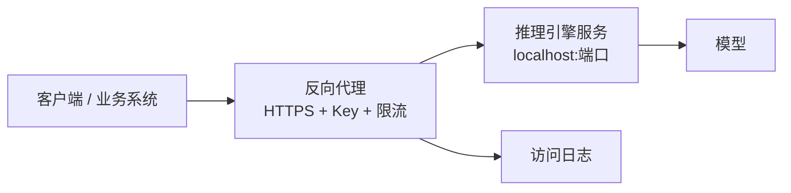

# 服务化与 API 鉴权

> [!abstract] 一句话讲清楚
> "模型能问答"只是玩具，"别人能安全、稳定地调用它"才是服务。这一层要解决四件事：**常驻、入口、身份、边界**。

## 为什么重要

- 交付的核心矛盾是**别人要用你的模型，但不能随便用**。没有鉴权，等于把机器贡献给整个内网甚至公网。
- 客户不会只用一个客户端：今天网页聊，明天接知识库，后天接企业微信。**统一入口**是省掉后面无数次重复配置的关键。
- 有了鉴权、限流、日志，你才能回答客户三个问题：谁在用、用了多少、出问题怎么查。

这一篇是"部署"到"产品"的那一步，也是最容易被新手跳过、被客户追着问的一步。

## 核心名词全解

| 名词 | 英文 / 缩写 | 大白话解释 | 容易混淆 / 注意 |
|---|---|---|---|
| 常驻服务 | Daemon / Service | 后台一直活着、开机自动起、崩了自动重启的进程 | 和"开着终端跑"是两回事 |
| 监听地址 | Bind / Listen | 服务愿意接受哪个网卡上的请求 | `127.0.0.1` 只有本机能连 |
| 反向代理 | Reverse Proxy | 挡在服务前面的"门卫"，负责转发、加密、限流、记日志 | 它不提升模型效果，只解决入口问题 |
| API Key | API Key / Token | 调用接口时带的一串密钥，用来识别"你是谁" | 明文写在前端代码里等于没有 |
| 限流 | Rate Limit | 限制单位时间内的请求数/并发数 | 限太松没意义，限太紧客户会投诉 |
| 健康检查 | Health Check | 一个固定接口，用来判断服务"活着"还是"能用" | "进程活着"和"能推理"是两种状态 |
| 就绪 vs 存活 | Liveness / Readiness | 存活=没死，就绪=可以接请求 | 模型还在加载时算"存活但不就绪" |
| 流式响应 | Streaming / SSE | 回答一个字一个字往外推，而不是等全部生成完 | 反代超时和缓冲会把它掐断 |
| 审计日志 | Audit Log | 记录谁在什么时候调用了什么 | 记录对话内容本身有隐私合规风险 |
| CORS | Cross-Origin Resource Sharing | 浏览器跨域访问的许可 | 前端连不上很常见是它，不是服务坏了 |

## 原理与机制

### 服务化之后的请求路径



四个角色的分工：

- **推理引擎**只负责"算"，它一般对鉴权支持很弱（很多引擎只有一个总 key，甚至没有）；
- **反向代理**负责它不擅长的一切：多 key、限流、HTTPS、统一入口、日志；
- **客户端**只认一个地址和一个 key；
- **日志**是你在客户现场排错的唯一证据。

**所以"要不要加反代"不是一个审美问题**：只要你需要多个 key、需要限流、需要 HTTPS，就必须有这一层。

### 鉴权的三种粗糙程度

| 做法 | 安全性 | 工作量 | 适合场景 |
|---|---|---|---|
| 不给鉴权，只在内网 | 低（内网也不安全） | 零 | 绝不推荐用于交付 |
| 引擎自带单一 API Key | 中 | 低 | 单人/内部试用 |
| 反代层多 Key + 限流 + IP 限制 | 高 | 中 | 正式交付 |
| 再往上接企业 SSO/网关 | 很高 | 高 | 大企业合规场景 |

新手常问"能不能在网页端做个密码框就够了"——**不算**。前端密码只是挡住界面，直接调 API 照样能用。鉴权必须发生在**服务端**。

### 限流和并发是两回事

- **限流**：单位时间内允许多少次请求（比如每分钟 60 次）。防的是刷接口、防跑飞。
- **并发**：同一时刻有多少个请求在算。防的是显存爆掉、所有人一起变慢。

交付时两个都要设，而且要和压测结论对齐：**压测说 8 并发稳，限流就按 8 来**，别让第 9 个请求把整个服务拖垮。

### 日志怎么记才既有用又不惹麻烦

- **必须记**：时间、来源 IP、请求路径、状态码、耗时、用的哪个 key、是否调用成功。
- **谨慎记**：请求和响应正文。里面可能有客户业务数据，涉及隐私和合规。
- **推荐做法**：默认不落全文；需要排查时临时开，排查完关掉；或者在文档里明确告知客户"会记录内容"，取得同意。

## 完整流程

| 阶段 | 输入 | 动作 | 输出 | 验收标准 |
|---|---|---|---|---|
| ① 服务常驻 | 跑通的引擎 | 配 systemd/容器/launchd，监听本机地址 | 常驻进程 | 重启机器后自动可用 |
| ② 健康检查 | 服务地址 | 固定一个探活接口，区分存活/就绪 | 探活地址 | 模型加载中返回"未就绪"而不是假装正常 |
| ③ 反向代理 | 域名/内网 IP | 配转发 + HTTPS（内网也建议） | 统一入口 | 外部只看到反代端口，看不到引擎端口 |
| ④ 鉴权 | 使用者清单 | 每个使用方一个 Key，能单独吊销 | Key 清单 | 不带 Key 的请求被拒 |
| ⑤ 限流 | 压测结论 | 按 key/IP 设频率和并发上限 | 限流规则 | 超限返回明确的错误码而不是排队卡死 |
| ⑥ 多用户 | 使用方名单 | 分配 Key、记录归属、必要时分模型 | 用户/Key 对照表 | 能说出每个 Key 是谁在用 |
| ⑦ 日志 | 全部流量 | 访问日志落盘 + 轮转 | 日志文件 | 能查到任意一次调用的时间、状态、耗时 |
| ⑧ 安全收口 | 部署环境 | 关掉不必要的端口，限制来源网段 | 暴露面清单 | 除反代端口外无其他对外端口 |
| ⑨ 验证 | 全部配置 | 无 Key、错 Key、超频、断网各试一遍 | 验证记录 | 失败场景都符合预期 |

一个最小反代配置的核心就三件事（具体写法以代理软件文档为准）：

```nginx
location /v1/ {
    proxy_pass http://127.0.0.1:11434;   # 转发到本机引擎
    proxy_buffering off;                  # 流式响应关键：关掉缓冲
    proxy_read_timeout 300s;              # 长回答需要更长超时
}
```

这三行解释了为什么很多人"接了反代之后回答不流式、长回答就断"：**缓冲和超时**默认值是为普通网页设计的，不适合流式生成。

## 决策点

- **岔路口 1：要不要上反向代理？**
  现象：客户就几个人用。判断依据：**是否需要多 Key、限流、HTTPS、统一入口**。推荐：**只要不是纯本机自用，就上**。代价：多一层配置和排错点，但省掉以后每接一个客户端就改一次引擎的麻烦。
- **岔路口 2：鉴权做在哪一层？**
  现象：引擎只有一个总 key，多人共用不放心。判断依据：**需要几个人/几方使用**。推荐：**多使用方就做在反代层，一个使用方一个 Key**。代价：要维护 Key 清单和吊销流程。
- **岔路口 3：多人共用一个服务，还是每人一个实例？**
  现象：客户部门之间数据敏感。判断依据：**是否需要隔离数据和配额**。推荐：**一般共用服务 + 不同 Key 就够了；真需要数据隔离再拆实例**。代价：拆实例吃显存，成本翻倍。
- **岔路口 4：要不要开公网？**
  现象：客户想在外面用。判断依据：**合规和攻击面**。推荐：**默认内网；要外面用优先 VPN/内网穿透，最后才考虑公网 + HTTPS + 强鉴权**。代价：公网必须配套限流、日志、密钥轮换，运维成本明显上升。
- **岔路口 5：日志要不要记对话内容？**
  现象：客户抱怨某次回答不对，需要复现。判断依据：**数据敏感程度**。推荐：**默认不记内容，需要时临时开并告知**。代价：不记内容就难复现，靠"现象 + 时间点"反推。

## 关键参数与配置

| 参数 | 作用 | 调大/调小的影响 | 常见做法 |
|---|---|---|---|
| 监听地址 | 服务对谁开放 | 写本机则外部不可达 | 引擎只听本机，由反代对外 |
| 反向代理超时 | 等后端多久算失败 | 太短长回答被掐断 | 明显大于最长回答耗时 |
| 缓冲开关 | 是否攒够再转发 | 开启会破坏流式体验 | 流式接口关掉 |
| 单 Key 频率上限 | 防刷 | 太松无意义，太紧影响使用 | 按压测结论 + 使用习惯设 |
| 并发上限 | 防显存打爆 | 超了会排队或报错 | 和压测结论一致 |
| 请求体大小上限 | 防超长输入 | 太小正常长文被拒 | 按业务材料长度设 |
| Key 轮换周期 | 降低泄露损失 | 太频繁影响客户 | 交付时约定，泄露立刻吊销 |
| 日志保留期 | 磁盘占用 + 合规 | 太长占磁盘，太短没法查 | 按客户要求，配合轮转 |

### 四种常见客户端，接法不一样

交付时客户不会只用网页，先想清楚"谁在调"，配置才不会来回改：

| 客户端 | 怎么接 | 注意 |
|---|---|---|
| 网页聊天界面 | 浏览器直接调后端接口 | 前端不放 Key，由后端中转 |
| 业务系统（OA/CRM/工单） | 后端服务调用 API | 要给对方模型名、地址、Key、示例请求 |
| 企业微信/钉钉类机器人 | 平台回调 → 你的中间层 → 模型 | 平台通常要求公网可达或走内网穿透 |
| 脚本/自动化 | 命令行或脚本直接调 | 适合内部工具，Key 要放配置文件别硬编码 |

**原则**：所有客户端只认"一个统一入口 + 一个 Key"，引擎的真实地址只有你自己知道。这样换模型、换引擎、加限流，客户端都不用改。

### Key 管理：交付后最容易乱的地方

一个小团队也要有 Key 台账，否则三个月后没人说得清谁在用：

- 每个使用方一个 Key，**一个 Key 对应一个人或一个系统**，不要共用；
- 台账写清：Key 名称、使用方、联系人、分配日期、用途；
- 有人离职/系统下线 → 单独吊销那个 Key，不影响其他人；
- Key 泄露 → 立刻吊销 + 换新 + 查日志确认有没有异常调用；
- 交付时约定轮换周期，别等出事才想。

### 公网暴露的三道闸

客户说"想在外面也能用"时，按这个顺序加闸，别一步到位直接开公网：

1. **第一道：能不开就不开**。优先 VPN 或内网穿透，只让授权设备进来。
2. **第二道：必须公网就上 HTTPS + 强 Key + 限流**，并且只暴露反代端口。
3. **第三道：加监控和告警**，异常调用量、异常来源要能第一时间发现。

三道闸都装好，再和客户确认"谁有权访问、数据会经过哪里、出事怎么止损"。这三句话写进交付文档，比装十个安全软件都管用。

## 上线后第一周看什么

交付不是结束，第一周是问题暴露最集中的时候，盯住五个数：

1. **调用量**：有没有人在用、用在什么时段。没人用要主动问，而不是等客户说"不好用"。
2. **错误率**：401/429/5xx 各占多少。401 多说明 Key 给错了，429 多说明限流太紧。
3. **P95 延迟**：平均值好看没用，尾部延迟才决定体验。
4. **显存与内存曲线**：是否随时间上涨。持续上涨说明可能有泄漏，要提前处理。
5. **日志里的异常输入**：超长、乱码、空问题，往往是客户使用方式的问题，可以据此写使用说明。

第一周结束给客户发一份"运行小结"：用了多少次、平均多快、出过什么问题、怎么解决的。这份小结比任何营销话术都更能带来复购。

## 常见坑与误区

| 现象 | 原因 | 对策 |
|---|---|---|
| 接了反代后回答不流式、一大段才出来 | 反代默认开启缓冲 | 关掉缓冲，确认后端支持流式 |
| 长回答总在固定时间断掉 | 反代/客户端超时太短 | 调大读取超时，客户端同步调 |
| 前端能连，浏览器报跨域错误 | CORS 没配 | 在反代层加跨域许可，别改引擎 |
| Key 写在前端代码里 | 以为是"加密"，其实全暴露 | 前端不存 Key；由后端中转或至少限制来源 |
| 轮换 Key 后客户全挂了 | 没有 Key 清单，不知道谁在用 | 交付时建清单：Key → 使用方 → 联系人 |
| 健康检查永远返回正常 | 检查的是根路径，跟推理无关 | 用能验证模型加载状态的就绪接口 |
| 日志把客户数据全记下来了 | 为了排错开了全量记录 | 默认不记内容，需要时临时开并告知 |
| 每接一个新客户端就要改一次配置 | 没有统一入口 | 所有客户端只认反代地址，引擎不对业务开放 |

## 自检问题

- [ ] 常驻服务和"开着终端跑"差哪四件事？
- [ ] 为什么鉴权不能做在前端？
- [ ] 限流和并发分别防什么？怎么和压测结论对上？
- [ ] 流式回答被"憋住"，你会先查哪两个配置？
- [ ] 你怎么区分"服务活着"和"服务能用"？
- [ ] 多用户场景，怎么做到"谁的用量能查出来"？
- [ ] 客户要开公网，你要加哪几道防线？

## 相关笔记

- 上游：[[OpenAI 兼容 API 规范]]
- 上游：[[本地部署全流程]]
- 下游：[[部署检查清单]]
- 下游：[[监控与日志]]
- 对照：[[Docker 与容器化基础]]
- 跨领域：[[安全与合规]]
- 跨领域：[[客户端 UI 工具]]
- 返回：[[部署实战 MOC]]

## 交付视角（对客户怎么讲）

- 客户问"为什么还要输密钥"：说清"让每个人用自己的密钥，出了问题能查到人，谁离职了单独关掉就行"——这是管理需求，不是技术偏好。
- 客户问"能不能直接给个网址大家用"：可以，但要说明"给的是带登录鉴权的入口，不是裸奔的接口"。
- 客户问"会不会把我数据传出去"：直接讲架构——模型跑在客户自己的机器上，服务不向外发请求，日志默认不记对话内容。
- 报价提示：服务化是交付里最容易被低估的部分（常驻、鉴权、限流、日志），把它单列成"服务化与安全配置"，客户才看得见价值。
