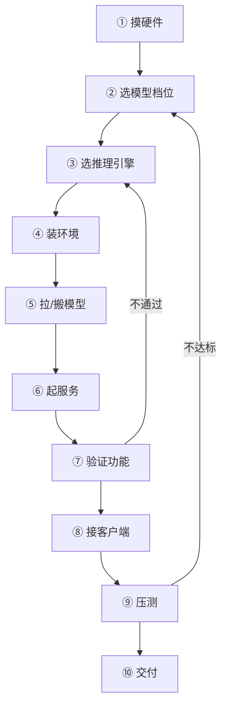

# 本地部署全流程

> [!abstract] 一句话讲清楚
> 这是一张"从裸机到交付"的施工图：十个步骤，每一步都写清楚输入什么、做什么、为什么做、产出什么、怎么算过关、做错了会看到什么。照着走，第一次也不会乱。

## 为什么重要

- **不知道整条链路，就会在错误的地方用力**：花两天调参数，其实是模型档位一开始就选大了。
- **没有验收标准，就会无限返工**：客户说"有点慢"，你说"能跑"，两边永远对不上。
- **部署是交付的地基**：后面接 RAG、Agent、ComfyUI，全都要先有一个"稳定、可被调用"的模型服务。

一句话：这篇是 04 文件夹的**主干**，其他 7 篇都是从这里岔出去的细节。

## 核心名词全解

| 名词 | 英文 / 缩写 | 大白话解释 | 容易混淆 / 注意 |
|---|---|---|---|
| 显存 | VRAM | 显卡上那块专用内存，模型权重和运行时的缓存都住这 | 和"内存/内存条"不是一回事；显存不够会直接报错退出 |
| 量化 | Quantization | 把模型权重从高精度压成低精度，省显存，代价是一点质量 | 不是越压越好，低比特在小模型上掉点更明显 |
| GGUF | GGUF | llama.cpp 系专用的单文件模型格式，一个文件包含权重和元信息 | 和 HuggingFace 原版 safetensors 目录不是一回事，别混放 |
| safetensors | safetensors | HuggingFace 生态主流的权重文件格式，通常是多文件 + 配置目录 | 有些仓库是"分片"的，只拷一部分会加载失败 |
| 推理引擎 | Inference Engine | 真正"跑"模型的程序，如 Ollama、llama.cpp、vLLM | 引擎 ≠ 模型；同一个模型可以给不同引擎用不同格式 |
| OpenAI 兼容 API | OpenAI-compatible API | 一套大家都照着实现的 HTTP 接口，`/v1/chat/completions` 最典型 | 兼容是"接口兼容"，不是"效果一样" |
| 上下文长度 | Context Length | 一次请求最多能塞多少 token（提问+历史+回答） | 设太大吃显存且变慢，设太小长文档直接被截断 |
| 并发 | Concurrency | 同一时刻有多少个请求在被处理 | 并发不是"同时在线人数"，一个人连发两条也算两个请求 |
| Token 吞吐 | tokens/s | 每秒生成多少 token，衡量"快不快" | 首字延迟（TTFT）和生成速度是两个指标 |
| 服务化 | Serving | 把模型变成常驻后台、带端口和鉴权、可重启自恢复的服务 | 和"打开一个聊天窗口玩一玩"完全是两个状态 |

## 整条链路全景

三条线要同时盯：**算力线**（硬件→模型档位→量化）、**模型线**（来源→搬运→校验）、**服务线**（引擎→端口→鉴权→验证）。新手常犯的错是只盯模型线，结果服务线一塌糊涂。

下面每一步都用同一套六段式：**输入 → 动作 → 为什么 → 输出 → 验收标准 → 失败表现**。

## 十步六段式详解

### 第 1 步：摸硬件

| 环节 | 内容 |
|---|---|
| 输入 | 一台（或将要买的）机器，客户只说"我们有台服务器" |
| 动作 | 拿不到机器就先问配置：什么卡、多少显存、内存多大、系统哪个、有没有外网、谁会用。拿到机器就开终端看 `nvidia-smi`、`free -h`、磁盘剩余、系统版本 |
| 为什么 | 后面所有选择都建立在这张"体检单"上。**先确认能力上限，再谈方案**，否则全是空谈 |
| 输出 | 一张硬件清单：GPU 型号/显存、内存、可用磁盘、系统与版本、网络条件 |
| 验收标准 | 能回答"最大能跑多大参数的模型、什么量化等级"，并且磁盘至少留出模型体积 2 倍空间 |
| 失败表现 | 抄了别人的命令，服务起不来或直接 OOM；或者客户说"我们有显卡"结果是一张亮机卡 |

### 第 2 步：选模型档位

| 环节 | 内容 |
|---|---|
| 输入 | 硬件清单 + 用途（聊天/写代码/RAG 问答/多模态） |
| 动作 | 按"显存能放下权重 + 留出 KV Cache"倒推模型大小，再定量化等级。用 [[参数量与显存估算]] 的公式粗算，别背具体数字 |
| 为什么 | 模型档位是**性价比的总开关**：选大了跑不动或慢到没人用，选小了答非所问，返工代价比部署本身还大 |
| 输出 | 一句话的模型方案：模型族 + 参数量 + 量化等级 + 推理格式（如 GGUF / safetensors） |
| 验收标准 | 方案里的数字能对着硬件清单解释"为什么是它"；同时准备一个降级档（小一号） |
| 失败表现 | 只追参数最大，结果 8G 显存硬上大模型，速度慢到无法交付；或只看跑分忽略中文/行业语料表现 |

### 第 3 步：选推理引擎

| 环节 | 内容 |
|---|---|
| 输入 | 模型方案 + 硬件 + 使用场景（单人用 / 多并发 / 要图形界面） |
| 动作 | 单人本机试用优先 Ollama；要榨性能、要量化格式自由选 llama.cpp；要**多并发生产服务**选 vLLM；Mac 看 MLX。按 [[推理引擎选型决策树]] 走一遍 |
| 为什么 | 引擎决定了模型格式、启动参数、并发能力和运维方式。**换引擎等于换一套工作流**，中途换成本高 |
| 输出 | 明确的引擎 + 模型格式 + 启动方式（命令行 / 容器 / 系统服务） |
| 验收标准 | 能用一句话解释"为什么不是另一个引擎"，并知道这个引擎的并发上限大概在哪 |
| 失败表现 | 用 Ollama 招呼 20 人并发，排队排到超时，然后回来骂模型慢 |

### 第 4 步：装环境

| 环节 | 内容 |
|---|---|
| 输入 | 引擎选择 + 机器系统 |
| 动作 | 顺序是：驱动 → 运行时（CUDA/ROCm/Metal 由系统自带）→ Python/容器 → 引擎本身。先用最小样例确认"显卡能被看见" |
| 为什么 | 90% 的"跑不起来"死在这一步：驱动与运行时版本对不上、Python 环境互相污染、容器里看不到 GPU |
| 输出 | 一个能跑 `nvidia-smi`（或对应工具）并成功加载模型的最小环境 |
| 验收标准 | 跑通一个最小模型/最小样例，且重启后环境仍然可用（不是靠某个临时终端变量） |
| 失败表现 | 报显存不足其实是根本没识别到 GPU；各种 `CUDA error`、`libcudart` 找不到；换个终端就失效 |

### 第 5 步：拉模型 / 搬模型

| 环节 | 内容 |
|---|---|
| 输入 | 模型标识（仓库名/文件） + 网络条件 |
| 动作 | 有外网直接拉；内网机器用"另一台机器下载 → 校验 → 拷进去"的方式。断点续传要开着，大文件别用浏览器下 |
| 为什么 | 模型是几个 GB 到几十 GB 的文件，**下载中断和损坏极其常见**；没有校验就不知道是模型坏了还是环境坏了 |
| 输出 | 完整模型目录/文件 + 一份记录（来源、版本、日期、校验值） |
| 验收标准 | 校验值一致；引擎能加载成功；记录能让你一周后说清"当时用的哪个版本" |
| 失败表现 | 加载时报文件缺失/格式错误；同一个模型两次部署效果不一致，谁也说不清原因 |

### 第 6 步：起服务

| 环节 | 内容 |
|---|---|
| 输入 | 环境 + 模型 + 启动方式 |
| 动作 | 先用前台命令跑通（能看见日志），再改成常驻服务（systemd / 计划任务 / 容器）。配置端口、监听地址、上下文长度、显存占用比例 |
| 为什么 | 前台跑通是排错用，常驻才是交付形态。**先能看日志，再谈自启动**，否则出问题两眼一抹黑 |
| 输出 | 一个常驻进程：有端口、有日志文件、开机自启、异常能自动重启 |
| 验收标准 | 杀掉进程后能自动拉起；重启机器后服务自动可用；日志里能看出加载了哪个模型 |
| 失败表现 | 关掉终端服务就没了；端口只监听 127.0.0.1 导致局域网访问不了；日志没落盘，出事无法追溯 |

### 第 7 步：验证功能

| 环节 | 内容 |
|---|---|
| 输入 | 跑起来的服务地址 |
| 动作 | 三层验证：① 健康检查接口通 ② 用 curl 发一条最简单的对话请求 ③ 用客户端发一条真实业务问题，看格式和内容是否合理 |
| 为什么 | "进程活着"不等于"能用"。**必须绕过 UI、直接用 API 验证**，因为客户最终接的是 API |
| 输出 | 三条验证记录：状态码、返回结构、一个真实问答样例 |
| 验收标准 | 返回是标准 JSON/流式格式；中文不乱码；上下文多轮能记住；错误输入有明确报错而不是直接崩 |
| 失败表现 | 网页客户端能聊，但 API 请求 404；返回被截断；多轮对话失忆；中文变乱码 |

### 第 8 步：接客户端

| 环节 | 内容 |
|---|---|
| 输入 | 已验证的服务地址 + 使用者场景 |
| 动作 | 接一个真实客户端：聊天 UI、编码助手、或客户自己的系统。重点配三样：API 地址、模型名、超时时间 |
| 为什么 | 这是第一次"模型离开终端"的检验。客户的使用习惯会把前面藏着的问题（网络、跨域、超时、鉴权）全暴露出来 |
| 输出 | 客户能自己点开用、且知道怎么用的入口 |
| 验收标准 | 客户端在**客户自己的电脑**上能连上（不是只有你这台能连）；长回答不中断 |
| 失败表现 | 你在本机好好的，客户那边连不上；回答超过一定长度就断流；模型名对不上报 404 |

### 第 9 步：压测

| 环节 | 内容 |
|---|---|
| 输入 | 目标使用人数 + 业务场景 |
| 动作 | 模拟真实并发发请求，记录首字延迟、生成速度、失败率；观察显存和 CPU 占用，逐步加压直到开始明显变慢 |
| 为什么 | 要回答"**多少人同时用会崩**"。这个数字既决定客户满意度，也决定你报价里要不要加机器 |
| 输出 | 一张压测结论：在 X 并发下，首字延迟和速度大概是什么量级，失败率多少 |
| 验收标准 | 结论能对应到客户的真实使用场景（比如 10 个人同时提问不排队到离谱） |
| 失败表现 | 没压测就上线，第二天同事一起用直接超时；或者加了并发参数但显存爆了 |

### 第 10 步：交付

| 环节 | 内容 |
|---|---|
| 输入 | 服务 + 文档 + 压测结论 |
| 动作 | 交四样东西：能用的服务、[[部署检查清单]] 验收单、一页使用说明（地址/Key/怎么问）、排错入口。当面或远程走一遍验收 |
| 为什么 | 交付的本质是**把"我会用"变成"你会用、坏了能找我"**。没有验收单，后面所有问题都会变成扯皮 |
| 输出 | 客户签字/确认的验收单 + 使用文档 + 服务访问方式 |
| 验收标准 | 客户能独立完成一次完整使用；双方对"已交付"的定义一致；有明确的服务边界（支持什么、不支持什么） |
| 失败表现 | 客户说"我以为还能做 XX"；尾款拖；小事都找你，因为你没给使用说明 |

## 决策点

- **岔路口 1：模型选多大？**
  现象：客户说"要效果最好的"。判断依据：先看显存，再看延迟容忍度。推荐：**在显存允许的范围内选"能接受速度"的最大档，并准备小一号降级方案**。代价：大模型单次响应更慢、并发更差。
- **岔路口 2：Ollama 还是 vLLM？**
  现象：不知道选哪个引擎。判断依据：单人/小团队本机 → Ollama；多人并发、要统一网关 → vLLM。推荐：**先 Ollama 跑通证明能跑，再按并发需求决定要不要换 vLLM**。代价：换引擎要重做模型格式和启动脚本。
- **岔路口 3：量化等级怎么定？**
  现象：显存刚好卡在边界。判断依据：能不能"放得下 + 留够上下文"。推荐：**优先保证上下文长度够用，再考虑更高精度**。代价：量化越低，复杂推理/代码任务掉点越明显。
- **岔路口 4：要不要做反向代理和鉴权？**
  现象：客户就几个人用。判断依据：是否跨网段访问、是否有多个使用方。推荐：**只要不是"就在本机自己用"，就加鉴权 + 反代**。代价：多一层配置和排错点。
- **岔路口 5：压测不达标怎么办？**
  现象：并发一上来就慢。判断依据：瓶颈是显存、计算还是排队。推荐：**先调并发/上下文参数，再考虑换引擎，最后才加卡**。代价：加卡是最贵的选择。

## 关键参数与配置

| 参数 | 作用 | 调大/调小的影响 | 常见取值 |
|---|---|---|---|
| 监听地址 host | 服务允许谁连进来 | 只写本机则局域网连不上；写全部则暴露面变大 | 内网服务用 `0.0.0.0`，本机调试用 `127.0.0.1` |
| 端口 port | 服务对外入口 | 冲突就起不来 | 选不常用端口，记录在交付文档里 |
| 上下文长度 num_ctx / max-model-len | 一次能处理多少 token | 调大更吃显存、更慢；调小长文档会被截断 | 按客户材料长度定，通常 8K 起步够用 |
| 显存占用比例 gpu-memory-utilization | 允许引擎占用多少显存 | 调高能放更多并发，但容易 OOM | 生产环境留 10% 余量 |
| 最大并发 max-num-seqs / parallel | 同时处理多少请求 | 调大吞吐上去、单请求变慢 | 按压测结果设，别直接拉满 |
| 上下文并发组合 | 上下文 × 并发 = 主要显存开销 | 两个一起调大最容易爆 | 先定上下文，再算并发 |
| 生成温度 temperature | 回答的随机程度 | 高更发散、低更稳定 | 客服/知识问答用低值，创作类用中高值 |
| 超时 timeout | 客户端等多久算失败 | 太短长回答被掐断；太长无响应时白等 | 要大于"最长可能的回答时间" |

## 常见坑与误区

| 现象 | 原因 | 对策 |
|---|---|---|
| 服务起不来，报显存不足但任务管理器显示显存没满 | 上一轮残留进程占着显存，或实际没识别到 GPU | 先查占用进程、确认 GPU 可见性，再谈参数 |
| 本机能用，客户局域网连不上 | 只监听了 127.0.0.1，或被防火墙拦了 | 改成对外监听 + 放行端口；先把网络链路验证通 |
| 聊几句就开始变慢、甚至卡死 | 上下文越堆越长，KV Cache 把显存吃满 | 限制历史轮数/上下文上限，定期开新会话 |
| 长回答中途断掉 | 客户端超时时间太短，或流式没开 | 调大超时，确认服务端和客户端都用流式 |
| 关机重开，服务没了 | 只在前台跑，没做自启动 | 配成系统服务/容器，重启后自动拉起 |
| 两个人同时用就排队很久 | 引擎并发配置太小，或模型档位本来就撑不住 | 调并发参数 + 压测，必要时换引擎或降档 |
| 同样的模型，两次部署效果不一样 | 模型版本/量化等级/采样参数不一致 | 记录模型来源、校验值和启动参数，写进交付文档 |

## 自检问题

- [ ] 能不能不看笔记，把十步按顺序说出来，并说出每步"卡住会怎样"？
- [ ] 拿到一台陌生机器，你能在 10 分钟内说出它能跑多大模型吗？
- [ ] 为什么"网页能聊"不能证明"部署完成"？至少说三条理由。
- [ ] 客户说"慢"，你会先查哪几个指标？顺序是什么？
- [ ] 断网环境下，你怎么把模型完整搬进客户内网？
- [ ] 什么情况下必须从 Ollama 换到 vLLM？不换会怎样？
- [ ] 交付时你要给客户哪四样东西？
- [ ] 压测结论怎么转化成对客户说的一句话？

## 自检问题参考答案

> [!success]- 1. 十步怎么记，各步卡住会怎样？
> 顺序是：摸硬件 → 选模型档位 → 选推理引擎 → 装环境 → 拉/搬模型 → 起服务 → 验证 → 接客户端 → 压测 → 交付。
> 卡住的典型表现：硬件没摸清就选模型，第 2 步就错；环境没通就调参数，90% 的"跑不起来"死在第 4 步；没验证就接客户端，网页能聊但 API 404；没压测就上线，第二天集体超时。

> [!success]- 2. 陌生机器怎么在十分钟内判断能跑多大模型？
> 先看三样：卡和显存、内存、磁盘余量，再确认系统与网络；有了显存数，按"权重 + KV Cache + 框架开销"倒推参数量与量化等级。
> 判断标准不是"能不能加载"，而是"留足余量后还能给多长上下文、多少并发"，最后一定要准备一个小一号的降级档。

> [!success]- 3. 为什么"网页能聊"不能证明部署完成？
> 网页能聊只证明模型能出字；客户最终接的是 API，所以要再看返回结构合不合标准、状态码对不对。
> 其次它没验证常驻：关掉终端、重启机器后服务还在不在；也没有鉴权和限流，等于把模型免费开放。
> 最后没验证并发和稳定性：几个人同时问会不会排队、长回答会不会断，这些才是真实的交付边界。

> [!success]- 4. 客户说"慢"，先查哪几个指标？
> 先分开看首字延迟和生成速度，再看显存是否吃满、有没有开始 swap，然后看上下文是不是越堆越长。
> 顺序上先排除"参数用错"（上下文和并发拉满），再怀疑引擎或模型档位，最后才谈加硬件——前两件事几乎不花钱。

> [!success]- 5. 断网环境怎么把模型完整搬进去？
> 在能上网的机器上下载，记下来源、版本、日期并算好校验值，然后按整目录拷贝，别只挑几个大文件。
> 搬进内网先校验再加载；介质注意文件系统格式和单文件大小限制，分片模型要一起搬全。校验对不上就重搬，别赌它能加载。

> [!success]- 6. 什么情况下必须从 Ollama 换到 vLLM？
> 当场景从"一个人本机用"变成"多人并发、要统一入口和鉴权"时就得换，vLLM 这类引擎的并发调度和生产特性更完整。
> 不换的后果是排队排到超时：Ollama 适合快速跑通，撑不住几十人同时打，客户会以为是模型慢，其实是引擎选错了。

> [!success]- 7. 交付时给客户哪四样东西？
> 能用的服务（地址、模型名、Key）、检查清单式的验收单、一页使用说明（怎么问、能问什么、不能问什么、出问题找谁）、排错入口。
> 四样缺一样后期就多一堆咨询：没说明客户拿它当搜索引擎用，没验收单双方对"做完没有"各说各话，尾款和口碑都难受。

> [!success]- 8. 压测结论怎么变成对客户的一句话？
> 用"在你们这个用法下，几个人同时提问大概不排队，超过会明显变慢或排队"这种句式，别只报每秒多少 token。
> 结论要能对上真实场景，并且写进确认单——它既是客户满意度的来源，也是你报价时判断"要不要加机器"的依据。

## 相关笔记

- 上游：[[推理引擎选型决策树]]
- 上游：[[参数量与显存估算]]
- 上游：[[硬件基础与 GPU 生态]]
- 下游：[[部署检查清单]]
- 下游：[[服务化与 API 鉴权]]
- 对照：[[Windows 部署要点]]
- 跨领域：[[交付 SOP 与报价]]
- 返回：[[部署实战 MOC]]

## 交付视角（对客户怎么讲）

- **客户问"需要多久"**：不要报时间，先给三步：摸底 → 试跑 → 正式部署。每一段都有可见产出，客户心里才有底。
- **客户问"为什么不能直接装个软件"**：用"装软件是打开就能用，部署是让它 7×24 小时等着别人来用"来解释服务化这层。
- **客户问"卡不卡"**：把"快不快"拆成首字延迟和生成速度，再用压测结论给他一个"多少人同时用没问题"的答案。
- **报价要点**：把"部署"和"压测/验收/文档"拆成两段报。第二段最容易被砍价，但也最能证明你和"随便装装"不一样。
