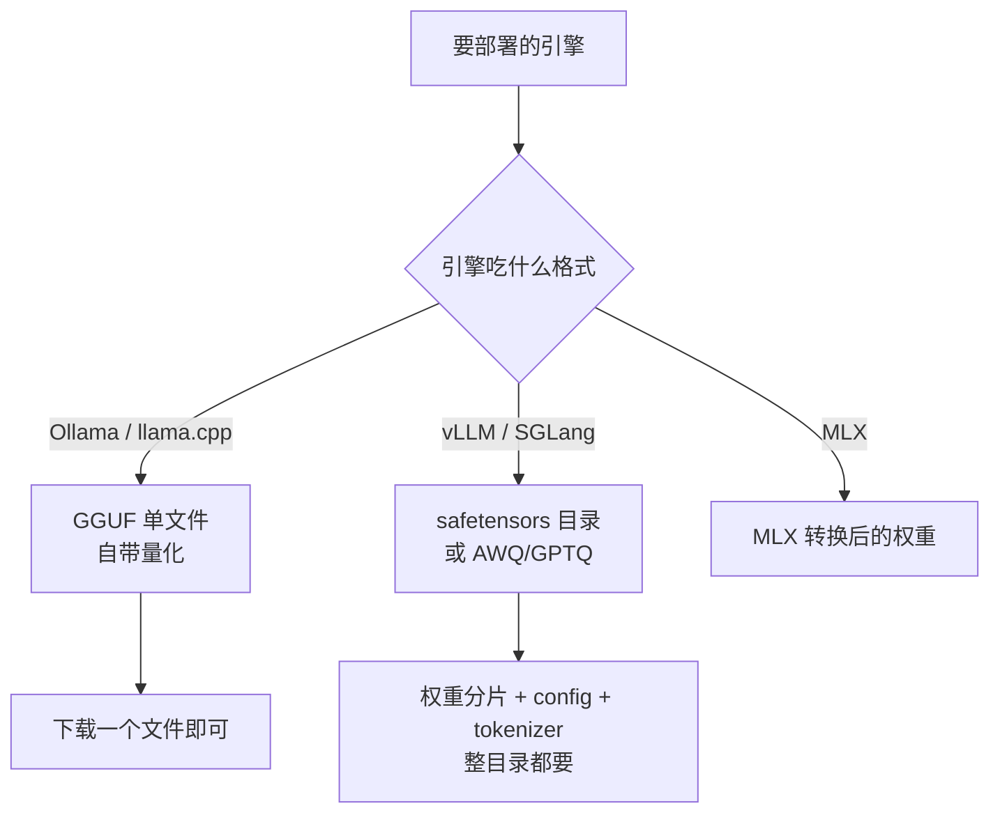

# 模型获取与离线搬运

> [!abstract] 一句话讲清楚
> 部署的第一步不是装软件，是**把几十 GB 的模型完整、可追溯地弄到目标机器上**。这件事在客户内网里往往比装环境还难，而且错了极难发现。

## 为什么重要

- 模型是"数据的重量级资产"：几个 GB 到几十 GB，**下载中断、只下了半个分片、格式用错**都非常常见。
- 客户环境经常**没有外网**：银行、医院、制造业内网，只能靠"外网机器下载 → 校验 → 搬进去"。
- 出了效果问题，第一个要回答的是"**你用的是哪个版本、什么量化**"。没有记录，就等于没法排查。

一句话：拿模型的规范程度，直接决定你后面排错时是"有据可查"还是"瞎猜"。

## 核心名词全解

| 名词 | 英文 / 缩写 | 大白话解释 | 容易混淆 / 注意 |
|---|---|---|---|
| 模型仓库 | Model Hub | 存放模型的网站，如 HuggingFace、ModelScope（魔搭） | 两个站是独立生态，同一模型可能有不同版本 |
| safetensors | safetensors | 一种安全的权重文件格式，HuggingFace 生态主流 | 通常是**多文件 + 配置目录**，不是单个文件 |
| 分片 | Shard | 大模型被切成多个文件存放 | 只拷了部分分片，加载一定失败 |
| 指针文件 | LFS Pointer | Git LFS 的"占位小文件"，真正内容在别处 | 看到文件只有几十字节，就是没真正下载 |
| GGUF | GGUF | llama.cpp 系单文件格式，自带量化和元信息 | 一个文件就够，和 safetensors 目录不能互换 |
| 量化等级 | Quant Level | 同一个模型的"压缩档位"，如 4 bit、5 bit、8 bit 之类 | 不同作者同等级的产物质量可能不一样 |
| AWQ / GPTQ | AWQ / GPTQ | 面向 GPU 推理的量化格式，通常给 vLLM 这类引擎用 | 一般需要 GPU 才能跑，Mac 上支持有限 |
| 断点续传 | Resume | 下载中断后接着下，不重新来 | 要工具支持，浏览器直接下大文件不可靠 |
| 校验值 | SHA256 / Hash | 文件的"指纹"，用来确认内容没坏 | 大小对不代表内容对，必须比指纹 |
| 商用条款 | License | 模型的使用许可，决定客户能不能商用 | 开源不等于随便商用，以官方 LICENSE 为准 |

## 原理与机制

### 先搞清"你要的是哪一种模型包"

**新手最容易犯的错**：拿到一个 safetensors 目录，却用 llama.cpp 去加载；或者拿到 GGUF 单文件塞进 vLLM。格式和引擎是绑定的，**先定引擎，再选格式下载**。

### 完整性校验是整套流程的核心

模型文件的"坏"有三种，症状完全不同：

1. **少了文件**——加载时报缺文件或配置错误，最容易发现。
2. **少了下半个分片**——报解析/大小不匹配，也比较明显。
3. **文件大小正常但内容损坏**——加载时报奇怪的解析错误，或者加载成功但效果诡异，最难查。

所以搬运的标准动作是：**算校验值 → 对比 → 引擎加载测试**。前两步确认"文件对"，第三步确认"引擎能读"。

### 为什么大文件下载总是出问题

- 网络抖动导致传输中断，工具不支持续传就得重来；
- 使用浏览器下载时，几十 GB 的文件可能被浏览器自己截断；
- 用 Git 直接 clone 大仓库，容易卡在 LFS 拉取那一步，最后留下指针文件；
- 磁盘格式限制：**FAT32 单文件不能超过 4GB**，很多 U 盘默认就是这个格式，一个大分片都放不下。

### 官方仓库 vs 镜像站，怎么选

| 来源 | 优点 | 风险 |
|---|---|---|
| 官方原始仓库 | 最权威，更新最快 | 国内访问可能慢/不稳 |
| 国内镜像（如 ModelScope） | 下载快，中文模型全 | 版本可能滞后，需对照原始仓库确认 |
| 二手转存的网盘/群文件 | 快、省事 | **来源不明、可能被改过、可能带恶意文件**，交付绝对不用 |
| 引擎自带的模型库 | 一键拉取，格式已适配 | 看不到底层细节，版本控制弱 |

原则：**正式交付只用官方仓库或可信镜像，并记录来源 URL 和下载日期**。

## 完整流程

| 阶段 | 输入 | 动作 | 输出 | 验收标准 |
|---|---|---|---|---|
| ① 定引擎格式 | 引擎选择结果 | 确认要 GGUF 还是 safetensors/AWQ | 一句话的格式需求 | 不会下错格式 |
| ② 查模型卡 | 模型名 | 看参数、上下文、量化选项、许可证 | 选定的具体文件/目录 | 知道商用是否允许 |
| ③ 下载 | 仓库地址 | 用命令行工具下，开续传 | 完整文件 + 下载日志 | 下载工具显示完成无错误 |
| ④ 校验 | 文件 | 算 SHA256、核对文件数/大小 | 校验记录 | 每个文件指纹一致 |
| ⑤ 搬运（离线） | 移动硬盘/内网共享 | 拷贝 → 目标机再校验一次 | 目标机上的完整副本 | 两端指纹一致 |
| ⑥ 加载测试 | 引擎 + 模型 | 起服务跑一句对话 | 成功响应 | 能出字、格式正常 |
| ⑦ 留档 | 全部信息 | 写进交付文档：来源、版本、日期、量化、校验值 | 一张模型清单 | 一周后能复现同一个模型 |

## 决策点

- **岔路口 1：GGUF 还是 safetensors？**
  现象：不知道下哪个。判断依据：**先定引擎**。推荐：**Ollama/llama.cpp → GGUF；vLLM 类生产服务 → safetensors 或 AWQ**。代价：选错格式等于白下载，几十 GB 重来。
- **岔路口 2：官方站还是国内镜像？**
  现象：官方站下载慢或访问不了。判断依据：**交付是否要求可追溯**。推荐：**能上官方就官方；用镜像要记录镜像地址并回官方核对版本**。代价：镜像版本可能滞后，偶有差异。
- **岔路口 3：在线拉还是离线搬？**
  现象：目标机没外网。判断依据：**目标机网络条件 + 模型体积**。推荐：**能在线就命令行拉；内网就"外网机下 → 校验 → 移动硬盘搬 → 目标机再校验"**。代价：搬运要多一轮校验，但这是唯一可靠的办法。
- **岔路口 4：量化等级选哪个？**
  现象：显存紧张。判断依据：**先保证跑得动和上下文够用**。推荐：**从中间档开始试，效果不够再升档/换小模型**。代价：量化越低，复杂任务掉点越明显，而且掉点是不可逆的质量损失。
- **岔路口 5：要不要用别人的"整合包/一键包"？**
  现象：客户图省事。判断依据：**来源可信度**。推荐：**自己按官方流程搭；第三方包只做参考**。代价：慢一点，但出了事你知道每一层是什么。

## 关键参数与配置

| 项 | 说明 | 注意 |
|---|---|---|
| 模型标识 | 仓库名 + 具体文件/分支 | 别只记"那个 7B 模型"，要记完整标识 |
| 量化等级 | 决定体积和精度 | 记录具体档位，不同作者产物不同 |
| 上下文长度 | 模型卡上的上限 | 部署时不一定全开，按需设 |
| 存储位置 | 模型落在哪个盘 | 独立数据盘，剩余空间留足 |
| 校验算法 | SHA256 最常见 | 官方仓库一般提供校验信息 |
| 磁盘格式 | exFAT/NTFS/ext4 | 搬运大文件别用 FAT32 |
| 许可证 | 官方 LICENSE 与商用条款 | 客户商用前必须确认 |

### 三条获取路径，成本差在哪

| 路径 | 做法 | 优点 | 代价 | 什么时候用 |
|---|---|---|---|---|
| 在线拉取 | 目标机直接连外网，用命令行工具下 | 最省事、可断点续传 | 内网不可用，大文件受网络影响 | 目标机能上外网 |
| 镜像站 | 用国内镜像替代原始仓库 | 快、中文模型全 | 版本可能滞后 | 官方站慢或不通 |
| 离线搬运 | 外网机下载 → 校验 → 移动硬盘 → 内网机再校验 | 唯一能给纯内网交付的办法 | 工序最多、耗时长 | 银行/医院/制造业内网 |

三条路径的**验收标准完全一样**：目标机上文件指纹一致 + 引擎能加载。路径可以不同，标准不能降。

### 离线搬运的完整工序

离线场景是"进得去出不来"的环境，一步做错就得重新走流程，所以按工序做：

1. **在外网机上下载**，用命令行工具，开续传，保留下载日志。
2. **在外网机上算校验值**，和官方提供的信息核对，记进模型清单。
3. **确认存储介质格式**：移动硬盘/NAS 用 exFAT 或 NTFS，千万别用 FAT32（单文件上限 4GB，大分片根本放不进）。
4. **整目录拷贝**，不要挑文件。权重分片、config、tokenizer、生成配置，一个都不能少。
5. **内网机接收后重新算一遍校验值**，两端一致才算搬成功。
6. **做一次引擎加载测试**，能正常出字才算"到了能用"的状态。
7. **把来源、版本、量化、校验值、搬运日期写进交付文档**，这是以后复现和排错的唯一依据。

如果模型文件特别大，可以在外网机上先按固定大小切分（分卷压缩），搬进去再合并；切分前先算好整体校验值，合并后必须一致。

## 模型清单模板

交付文档里这张表比任何口头描述都重要，客户以后问"你们当时装的是哪个"就靠它：

| 项 | 示例写法（不要写具体数字，按实际情况填） |
|---|---|
| 模型名称与版本 | 仓库名 + 具体版本/分支 |
| 来源地址 | 官方仓库 URL（用镜像的另记一行） |
| 格式 | GGUF / safetensors / AWQ 等 |
| 量化等级 | 具体档位，不同作者产物不同 |
| 文件数量与总大小 | 分片数 + 总体积 |
| 校验值 | 主文件的 SHA256 |
| 下载/搬运日期 | 年月日 |
| 许可证与商用结论 | 允许 / 需确认 / 不允许 |
| 加载验证记录 | 日期 + 引擎版本 + 结果 |

## 报错现象对照

| 现象 | 最可能的原因 | 先做什么 |
|---|---|---|
| 加载提示找不到 config 或 tokenizer | 只拷了权重，漏了配套文件 | 整个目录重新拷，核对文件清单 |
| 加载提示形状/参数不匹配 | 模型和引擎版本不兼容，或格式用错 | 查引擎支持的格式与版本，换对应产物 |
| 加载成功但输出乱码/重复 | 量化文件损坏或下载不完整 | 重算校验值，重新下载 |
| 提示显存不足但文件不大 | 上下文或并发参数开太大 | 先降上下文和并发，再判断是不是模型太大 |
| 校验值怎么都对不上 | 下的是另一版本/另一量化 | 回仓库页确认文件名和版本号 |
| 搬运后权限报错 | 目标机用户对目录无读权限 | 统一目录属主，用普通用户可读 |

## 三个必须留下的证据

模型这事，做完之后别人（包括三个月后的你）只能通过文件来判断，所以三样东西必须留：

1. **来源记录**：从哪个地址、哪个版本、哪天拿的。没有来源，出问题连"是不是下错了"都判断不了。
2. **校验记录**：每个文件的校验值，以及和官方信息核对的结果。它是"文件没坏"的唯一证明。
3. **加载记录**：用什么引擎、什么参数、加载成功的截图或日志。它是"能用"的唯一证明。

这三样合起来就是一页"模型清单"。交付时把它和检查清单一起归档，客户以后升级、扩容、迁移，都能照着复现。

## 常见坑与误区

| 现象 | 原因 | 对策 |
|---|---|---|
| 加载报"缺文件/配置错误" | 只拷了权重分片，漏了 config/tokenizer 等 | 整个模型目录一起拷，别挑文件 |
| 文件只有几十字节 | Git LFS 只拉到了指针文件 | 用专门的下载工具，或执行 LFS 拉取 |
| 下载"完成"但加载报解析错误 | 传输中断导致文件内容坏了 | 必须比校验值，不能只看大小 |
| 一个文件都放不进 U 盘 | U 盘是 FAT32，单文件超 4GB | 格式化成 exFAT/NTFS 再搬 |
| 同一模型两次部署效果不一样 | 版本/量化/来源不一致 | 记录来源 URL、日期、量化等级、校验值 |
| 拷贝后权限/路径出错 | 目标机路径含中文/空格或用户不同 | 用纯英文路径，统一目录归属 |
| 模型能加载但答得很怪 | 下错量化版本，或格式和引擎不匹配 | 先换官方推荐格式，再考虑参数问题 |
| 商用被卡 | 没看许可证条款 | 交付前确认 LICENSE，写进风险说明 |

## 自检问题

- [ ] 为什么"先定引擎再定模型格式"？举一个下错的例子。
- [ ] safetensors 目录里一般有哪些必需文件？
- [ ] 完整搬运一个模型，你要做哪三次确认？
- [ ] 客户内网没外网，你的搬运方案是什么？
- [ ] 为什么不能只看文件大小判断下载完整？
- [ ] 交付文档里"模型清单"要写哪几项？
- [ ] 许可证这关你会怎么跟客户确认？

## 相关笔记

- 上游：[[模型谱系 Qwen]]
- 上游：[[量化技术]]
- 下游：[[本地部署全流程]]
- 下游：[[部署检查清单]]
- 对照：[[llama.cpp 与 GGUF]]
- 跨领域：[[开源许可证与合规]]
- 跨领域：[[远程交付与远程运维]]
- 返回：[[部署实战 MOC]]

## 交付视角（对客户怎么讲）

- 客户问"模型怎么装的、是不是网上下个就行"：讲"我们需要确认版本和完整性，交付后会给你一份模型清单"，把可追溯性变成专业感。
- 客户问"能不能用这个网盘里的包"：明确拒绝来源不明的整合包，理由是"无法校验、出了问题查不到源头"，这是保护双方。
- 客户是内网环境：提前问"能不能带外网机器、允不允许移动硬盘进入"，很多项目卡在这个流程上而不是技术。
- 报价提示：离线搬运和校验是"看不见的工作量"，要单独列出来，别白干。
