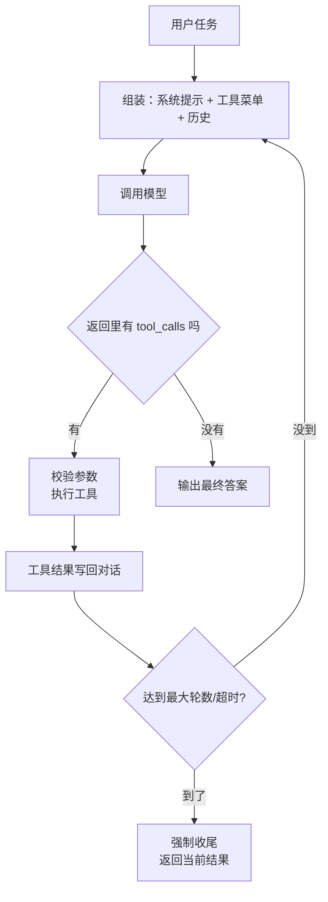

# Agent 与 Function Calling

> [!abstract] 一句话讲清楚
> Agent 就是"会自己决定下一步干什么"的模型：你给它一组工具（查数据库、搜网页、发邮件），它自己判断该调哪个、参数填什么、结果不满意要不要重来。Function Calling 是这套机制的技术协议——模型本身不执行任何东西，它只是**输出一个结构化的"请帮我调这个函数"的请求**，真正的执行由你的代码完成。

---

## 为什么重要

- RAG 是"查资料"，Agent 是"动手办事"。客户真正想要的是后者：自动查订单、自动填表、自动走审批。
- 但这也是**最容易翻车**的地方。RAG 答错一句还能解释，Agent 调错一个函数可能真的改数据、发错邮件。
- 本地模型上做 Agent，难点不在编排框架，在**模型本身的工具调用能力**。小模型、量化模型经常"不按格式输出"或"忘了自己在干什么"。
- 上游：模型能力见 [[模型谱系 Qwen]]、[[量化技术]]；下游：[[MCP 协议]] 是工具接入口标准化，[[本地模型接入编码助手]] 是 Agent 最典型的落地形态。

---

## 核心名词全解

| 名词 | 英文 / 缩写 | 大白话解释 | 容易混淆 / 注意 |
|---|---|---|---|
| Agent | 智能体 | 让模型自己决定调用哪些工具、调几轮 | 不等于"更聪明的聊天机器人"，关键是"能动手" |
| 工具 | Tool / Function | 一个可以调用的能力，如 `query_order(order_id)` | 工具是你写的，模型只是"点菜" |
| 工具定义 | Tool Schema | 用 JSON 描述工具名、干什么、要什么参数 | 描述写得烂，模型就选错工具 |
| Function Calling | 函数调用 | 模型输出结构化调用请求的协议 | 模型没执行能力，执行永远在你的代码里 |
| Tool Calling | 工具调用 | 和 Function Calling 基本同义，后者是新叫法 | 有的模型文档只写其中一个词 |
| ReAct | Reason + Act | 让模型"想一步、做一步、看结果、再想"的提示范式 | 早期靠提示词模拟，现在多用原生工具调用 |
| Agent 循环 | Agent Loop | 思考→调用→拿结果→再思考，直到能回答 | 循环必须有终止条件，否则烧钱到天亮 |
| 参数幻觉 | Parameter Hallucination | 模型编出不存在的参数值，如订单号瞎填 | 最常见的事故来源，必须做参数校验 |
| 规划 | Planning | 把大任务拆成多步并排顺序 | 小模型的规划能力非常弱 |
| 记忆 | Memory | 短期（对话历史）和长期（外部存储） | 长对话的上下文膨胀是主要成本来源 |
| 多 Agent | Multi-Agent | 多个 Agent 分工协作 | 大多数项目不需要，加了只会更难调 |
| 编排 | Orchestration | 用代码/框架控制 Agent 的执行流程 | 编排框架不解决模型能力问题 |
| 护栏 | Guardrail | 对输入输出做检查，拦住危险操作 | 高危操作必须人工确认，不能全自动 |
| MCP | Model Context Protocol | 标准化的工具接入协议 | 解决"工具怎么给模型"的接口统一问题 |

---

## 原理与机制

### 直觉：给模型配一个"点菜员"和一套"后厨"

模型像一个只会说话不会动手的顾问。你给它一张菜单（工具定义），它说"给我来一份：查订单，订单号 12345"。后厨（你的代码）真的去查，把结果写纸条递回去："查到了，状态是已发货"。顾问看完纸条继续判断：还需要再查物流吗？还是可以回答了？

关键点：**模型从头到尾只输出文字和结构化请求，从来没有真正执行过任何东西。** 这既是安全边界，也是理解 Agent 的钥匙。

### 机制一：一次工具调用的完整协议

以 OpenAI 兼容的 chat completions 为例，一轮调用是这样的：

1. 你发请求，带上 `tools` 数组（每个工具一张"菜单卡"）。
2. 模型返回的 message 里带 `tool_calls`，说明它要调哪个工具、参数是什么。
3. 你的代码执行函数，把结果作为一条 `role: "tool"` 的消息追加进对话。
4. 再发一次请求，模型基于工具结果继续（可能再调工具，也可能给最终答案）。

```json
// 工具定义（菜单卡）：名字、用途、参数结构，缺一不可
{"type": "function", "function": {
  "name": "query_order",
  "description": "按订单号查询订单状态。用户问订单相关问题时使用。",
  "parameters": {"type": "object",
    "properties": {"order_id": {"type": "string", "description": "订单号，形如 SO 开头"}},
    "required": ["order_id"]}}}
```

模型返回的调用请求大概是这个形状（不是文本，是结构化的字段）：

```json
{"role": "assistant", "tool_calls": [
  {"id": "call_1", "type": "function",
   "function": {"name": "query_order", "arguments": "{\"order_id\": \"SO2024001\"}"}}]}
```

> [!warning] 两个必须做的动作
> 1. **参数校验**：`arguments` 是模型生成的字符串，必须 JSON 解析 + 类型校验 + 业务校验，解析失败要让它重试或直接报错。
> 2. **执行超时与幂等**：工具可能卡住或被重复调用，写操作必须幂等，否则一笔订单扣两次款。

### 机制二：Agent 循环长什么样



循环的三条铁律：

- **必须有最大轮数**（比如 8~10 轮）。没有上限的 Agent 遇到一个总是失败的工具会无限重试。
- **必须能中断**：用户要能点"停"，服务端要有超时。
- **写操作要确认**：删数据、发邮件、付款这类动作，要么二次确认，要么只生成"待执行建议"。

### 机制三：ReAct 和原生工具调用不是一回事

| | ReAct（提示词范式） | 原生 Function Calling |
|---|---|---|
| 实现方式 | 用提示词让模型按 "Thought/Action/Observation" 格式输出文本，程序再解析 | 模型原生输出结构化 `tool_calls` 字段 |
| 稳定性 | 低，解析靠正则，模型容易跑格式 | 高，服务端保证结构 |
| 依赖 | 任何模型都能试 | 需要模型和推理框架支持工具调用模板 |
| 适合 | 老模型、无工具调用能力的模型 | 现代模型，生产首选 |

> [!tip] 实践建议
> 能原生就原生。ReAct 只在"模型不支持工具调用、但你又必须让它调工具"时作为兜底方案，而且要在解析层写很厚的容错。

### 机制四：为什么小模型和量化模型工具调用能力差

这是本地部署最常踩的坑，必须讲透。原因不是一条，而是叠了五六条：

1. **结构化输出依赖强指令遵循能力**。工具调用要求模型严格按 schema 输出 JSON，参数类型、必填项都不能错。这个能力随参数量下降得很快——7B 以下的模型经常输出半截 JSON，或者干脆用自然语言说"我来帮你查订单"。
2. **多步一致性会放大误差**。Agent 要连续多轮保持"目标—已做—未做"的一致性。假设每步 95% 正确，5 步下来只剩约 77%。小模型的单步正确率本来就低，多步就崩了。
3. **工具定义本身很占上下文**。十几个工具的描述、参数、示例可能占掉几千 token，小模型上下文窗口小、注意力弱，工具一多就开始张冠李戴：要查订单却调了查物流。
4. **chat template 未必训练过工具调用格式**。工具调用能力需要模型在训练时见过特定格式（比如特殊的工具调用标记）。有些小模型的模板里根本没这些标记，推理框架即使"支持"工具调用，也只是把 schema 拼进提示词，模型并不真的懂。
5. **量化对格式的伤害大于对知识的伤害**。4bit 量化后模型还能答对知识性问题，但输出严格 JSON、保持特殊标记、数括号这些"精细活"更容易出错。2bit/3bit 时格式崩坏更明显。
6. **中英文混用**。工具名和参数名常是英文，指令是中文，小模型容易把英文照抄进参数值，或把中文填进英文枚举。

> [!important] 结论
> **本地部署做 Agent，量化程度和模型规模要留余量**。用 4bit 跑 7B 做演示可以，做生产要往上加。判断方法很简单：写 20 条必须调工具的测试问句，统计"正确调用了正确工具且参数全对"的比例，低于 80% 就不适合上生产。

### 机制五：上下文膨胀——Agent 的隐形成本

每一轮的工具结果都会追加进对话历史。查一次数据库返回 3KB、搜一次网页返回 10KB，五轮下来上下文就爆了。后果是：变慢、变贵、**模型注意力被大量无关结果稀释，开始答非所问**。

常用处理：

- **工具结果裁剪**：只回填模型需要的字段，别把整个 JSON 塞回去。
- **结果摘要**：长结果先用一次小模型调用压成要点。
- **滑动窗口**：只保留最近几轮完整内容，更早的压缩成一句结论。
- **外部记忆**：把中间结果写进文件/数据库，需要时按需取。

---

## 完整流程：从零搭一个能用的 Agent

1. **输入**：业务任务（比如"客服查订单+查物流+改地址"）。
   **动作**：列出所需工具，写清输入输出、失败情况、是否是写操作。
   **输出**：工具清单。**验收**：每个工具都有明确的触发场景描述。
2. **输入**：工具清单。
   **动作**：用 JSON Schema 定义每个工具，描述里写"什么时候用它、什么时候不要用"，参数加约束和示例。
   **输出**：tools 数组。**验收**：贴给同事看，他能说清什么场景调哪个。
3. **输入**：tools。
   **动作**：写系统提示：角色、目标、可用工具、禁止事项、终答格式。
   **输出**：system prompt。**验收**：包含"工具调用失败怎么办"和"不确定时怎么办"。
4. **输入**：模型 + tools + prompt。
   **动作**：跑 20 条测试问句，统计工具选择正确率、参数正确率、最终答案正确率。
   **输出**：三组数字。**验收**：工具选择 ≥80%，参数正确 ≥90%（不达标先别上）。
5. **输入**：通过的模型配置。
   **动作**：实现执行层：JSON 解析、参数校验、超时、重试、幂等、日志。
   **输出**：可靠的工具执行器。**验收**：故意传错参数，程序能拦住并给模型可读的错误信息。
6. **输入**：可执行循环。
   **动作**：加最大轮数、超时、中断、写操作确认。
   **输出**：可控的 Agent。**验收**：让工具一直失败，Agent 会在限定轮数内停下来。
7. **输入**：跑通的 Agent。
   **动作**：加日志与回放：每轮保存 prompt、tool_calls、结果、耗时。
   **输出**：可排查的链路。**验收**：用户投诉时能完整回放那次执行。

---

## 分类与对比：该用 Agent 还是工作流

| 维度 | 固定工作流 | Agent |
|---|---|---|
| 流程是否确定 | 确定，事先画好 | 不确定，模型临场决定 |
| 可预测性 | 高 | 低 |
| 调试难度 | 低，逐节点看 | 高，要看每轮决策 |
| 模型能力要求 | 低（能按格式输出即可） | 高（要会选工具、会规划） |
| 出错代价 | 可控 | 可能很贵 |
| 适合 | 客服、表单处理、审批流 | 开放式研究、多系统联动、编码助手 |
| 推荐度 | **交付场景默认选它** | 流程真不确定时才用 |

> [!important] 顺序判断
> 先用"能不能画出流程图"来筛：**能画出来 → 工作流；画不出来且步骤数不定 → Agent**。很多所谓的 Agent 需求，拆开看其实是工作流。

---

## 决策点

- **岔路口 1：这个需求要不要 Agent？**
  判断依据：流程能不能提前画出来、失败代价大不大。
  → **推荐**：默认工作流。只有"步骤数随情况变化、必须模型临场判断"时才上 Agent。**别用 Agent 做本来能写成 if-else 的事。**

- **岔路口 2：本地模型跑 Agent，模型怎么选？**
  判断依据：20 条测试问句下的工具调用正确率。
  → **推荐**：先用候选模型实测，优先选"指令遵循好、明确支持工具调用、有对应 chat template"的型号；量化至少留 4bit 以上，生产环境尽量不量化到更低。

- **岔路口 3：工具给几个？**
  判断依据：模型稳定选对的工具数量上限。
  → **推荐**：**能少则少**，5~10 个以内最稳。工具多就分组：先让模型选"哪一类能力"，再给那一类的细分工具（两段式），比一次给 30 个工具准得多。

- **岔路口 4：写操作用不用？**
  判断依据：误操作的后果是否可逆。
  → **推荐**：删除、转账、对外发送这类操作**默认不自动执行**，改成"生成待确认动作"。演示时要主动说这条，客户会立刻放心。

- **岔路口 5：要不要上多 Agent / 框架？**
  判断依据：是否真的存在"不同角色需要不同上下文"的问题。
  → **推荐**：单 Agent 能跑就别上多 Agent。框架（LangGraph 之类）解决的是编排，不解决模型能力，**先确认模型能调对工具，再上框架**。

- **岔路口 6：上下文怎么控？**
  判断依据：单次工具结果大小、平均轮数。
  → **推荐**：工具结果裁剪到模型真正需要的字段；超过 5 轮就加摘要压缩；总 token 控制在窗口的一半以内。

---

## 参数与配置说明

| 参数 | 作用 | 调大/调小的影响 | 常见取值 |
|---|---|---|---|
| temperature | 决策随机性 | 高→乱选工具、乱填参数 | 0~0.2（工具调用场景要低） |
| max_iterations | 最大循环轮数 | 大→更可能完成但费钱/可能死循环 | 5~10 |
| tool_choice | 是否强制调用工具 | 强制→一定调，auto→模型决定 | 一般 auto，必要时强制 |
| 工具数量 | 一次暴露的候选工具 | 多→选择准确率下降、token 涨 | 5~10 个 |
| 工具描述长度 | 每个工具说明多少字 | 太长占上下文，太短模型误解 | 一到两句 + 何时不用 |
| 单次执行超时 | 工具执行上限 | 短→易失败，长→卡住整个循环 | 5~30 秒，按工具定 |
| 重试次数 | 工具失败重试 | 多→更稳但可能重复副作用 | 1~2 次（写操作要幂等） |
| 上下文预算 | 历史 + 工具结果总 token | 大→慢且注意力稀释 | 不超过窗口一半 |
| 并行工具调用 | 一次返回多个调用 | 开→快，但有些模型/框架不支持 | 看框架与模型支持 |

---

## 工具设计原则与工具数量控制

工具定义写得好不好，直接决定模型能不能用对。这经常不是模型的问题，是接口设计的问题。

**五条原则**：

1. **一个工具只干一件事**。`do_everything(action=...)` 这种万能工具，模型几乎必错。
2. **名字就是说明书**。`search_docs` 比 `ds_v2` 好懂十倍，模型靠名字判断用途。
3. **描述里写清"什么时候用"**，不只是"是什么"。写"用于查询订单状态，需要订单号"，比写"订单查询接口"有用得多。
4. **参数尽量少、类型尽量简单**。嵌套两层以上的对象参数，小模型基本填不对；能用枚举就别用自由文本。
5. **失败信息要可读**。返回 `error: field 'order_id' invalid`，模型下一轮还能改；返回一串堆栈，它只能干瞪眼。

**工具太多怎么办**：经验上，一次暴露给模型的工具超过十来个，选择准确率就会明显下降。对策：

| 手段 | 做法 | 适合 |
|---|---|---|
| 分组暴露 | 按场景只给相关工具，比如"查物流"场景只给物流类 | 场景边界清晰 |
| 工具检索 | 先让模型选"哪一类工具"，再给那一类的定义 | 工具几十个以上 |
| 分层调用 | 一个入口工具 + 内部路由，模型只看得见入口 | 内部实现复杂 |
| 合并同类 | 查询类参数化成同一个工具 | 多个接口只是参数不同 |

> [!tip] 排错顺序
> 模型选错工具时，先看工具名和描述——**八成是描述写得像、名字分不清**，而不是模型笨。改完描述再测，别急着换模型。

### 一个最小可用的工具集

做编码类 Agent，先从这五个工具开始：**读文件、列目录、搜关键词、写文件、跑命令**。这五个能覆盖大部分任务，也最容易把工具调用链路调通。

再加工具时守住一条：**新工具和老工具的职责不重叠**。两个都能"查代码"，模型就会随机挑一个，然后时对时错，排错排到崩溃。

## 常见坑与误区

| 现象 | 原因 | 对策 |
|---|---|---|
| 模型只回文本，死活不调工具 | 模型不支持工具调用、chat template 不匹配、或 tools 没正确传 | 先看原始返回有没有 `tool_calls` 字段；换明确支持工具调用的模型 |
| JSON 解析失败 | 量化后格式能力下降、温度太高、模型不支持严格 JSON 模式 | 降温度、加"仅输出 JSON"约束、用支持结构化输出的框架、加解析重试 |
| 工具总是选错 | 工具太多、描述含糊、名字太像 | 合并/分组工具，描述里写清"什么时候用/不用"，名字用动词+对象 |
| 参数填错（订单号瞎编） | 模型在补全不存在的值 | 参数校验 + 缺失时反问用户 + 在提示里要求"未知参数必须询问" |
| 死循环，一直重试同一个失败工具 | 没有最大轮数，或错误信息不可读导致模型无法修正 | 设 max_iterations；把错误信息格式化成人类可读的提示反馈给模型 |
| 跑几轮后开始答非所问 | 上下文被工具结果塞满、注意力被稀释 | 裁剪工具结果、摘要压缩、限制轮数 |
| 演示时好好的，上线后时好时坏 | 线上并发高、温度高、模型负载高导致输出漂移 | 固定温度、加超时与降级、记录每次调用回放 |
| Agent 自作主张执行了危险操作 | 没有护栏、写操作自动化 | 高危工具只生成"待确认"，加权限与审计日志 |

---

## 自检问题

- [ ] 模型在工具调用里到底"执行"了什么？没执行什么？
- [ ] 画出 Agent 循环，并说出三条铁律是什么。
- [ ] ReAct 和原生 function calling 的实现差异在哪？为什么生产优先选后者？
- [ ] 为什么小模型工具调用能力差？至少说出四条原因。
- [ ] 量化对"知识问答"和"工具调用"的伤害一样吗？为什么？
- [ ] 工具一多就选错，你会怎么改工具设计？
- [ ] Agent 上下文膨胀怎么控制？三种手段各有什么代价？
- [ ] 怎么判断一个本地模型能不能上生产做 Agent？

---

## 自检问题参考答案

> [!success]- 1. 模型在工具调用里到底"执行"了什么？没执行什么？
> 它只输出一段**结构化请求**：要调哪个工具、参数是什么（`tool_calls` 里的名字和 arguments 字符串），从头到尾没有真正执行任何东西。真正的执行永远在你的代码里。
> 所以安全边界在你这边：参数校验、JSON 解析、超时、幂等、写操作确认都得自己做。模型干的活是"点菜"，不是"下厨"。

> [!success]- 2. 画出 Agent 循环，并说出三条铁律是什么？
> 组装（系统提示 + 工具菜单 + 历史）→ 调模型 → 有 `tool_calls` 就校验参数、执行工具 → 结果写回对话 → 没到上限就回到组装再问，到了上限强制收尾；没有 `tool_calls` 就直接出最终答案。
> 三条铁律：**必须有最大轮数**（8~10 轮）、**必须能中断**（用户可停 + 服务端超时）、**写操作要确认**。没有轮数上限，遇到一直失败的工具就会无限重试。

> [!success]- 3. ReAct 和原生 function calling 的实现差异在哪？为什么生产优先选后者？
> ReAct 靠提示词让模型按 Thought/Action/Observation 输出**文本**，程序再用正则解析，模型一跑格式链路就崩，容错层要写得很厚；原生 function calling 由模型直接输出结构化 `tool_calls` 字段，服务端保证结构，稳定得多。
> 所以能原生就原生。ReAct 只在"模型不支持工具调用、但业务又必须让它调工具"时当兜底。

> [!success]- 4. 为什么小模型工具调用能力差？至少说出四条原因。
> ① 结构化输出依赖强指令遵循，7B 以下经常输出半截 JSON；② 多步一致性放大误差，单步 95% 正确、五步就只剩约 77%；③ 工具定义本身占上下文，小窗口注意力弱，工具一多就"要查订单却调了查物流"；④ chat template 未必训练过工具调用格式，框架所谓"支持"往往只是把 schema 拼进提示词。
> 另外还有量化伤格式、中英文混用两条。

> [!success]- 5. 量化对"知识问答"和"工具调用"的伤害一样吗？为什么？
> 不一样。量化主要伤**格式**，不伤知识：4bit 后模型照样能答对知识题，但严格输出 JSON、保持特殊标记、数括号这类精细活更容易出错，2bit/3bit 时格式崩坏更明显。
> 结论很实际：**"能聊天"不代表"能调工具"**，工具调用能力必须单独测，不能拿知识问答的表现代替。

> [!success]- 6. 工具一多就选错，你会怎么改工具设计？
> 先别换模型，先改接口：把工具**合并归类、压到 5~10 个**；名字用"动词 + 对象"（`search_docs` 比 `ds_v2` 好懂）；描述里写清"什么时候用、什么时候不用"；参数尽量少而简单，能用枚举就别开放自由文本；错误信息要格式化成人话。
> 工具几十个就分组暴露，或先让模型选"哪一类"再给细分工具。八成选错是描述写得太像，不是模型笨。

> [!success]- 7. Agent 上下文膨胀怎么控制？三种手段各有什么代价？
> ① **工具结果裁剪**：只回填模型需要的字段——代价是可能丢信息；② **结果摘要**：长结果先小模型压成要点——代价是多一次调用、可能丢细节；③ **滑动窗口**：只留最近几轮、更早的压成一句结论——代价是早期信息丢失。
> 还有外部记忆：中间结果写文件/数据库、按需取，代价是链路更复杂。总原则是总 token 不超过窗口一半、轮数控制在 5~10。

> [!success]- 8. 怎么判断一个本地模型能不能上生产做 Agent？
> 拿**你要交付的那套工具**写 20 条必须调工具的问句，统计"调对工具且参数全对"的比例：低于 80% 先别上生产，参数正确率另算要到 90% 左右。
> 还要确认模型明确支持工具调用、有对应的 chat template、量化别低于 4bit。看榜单没用，必须用自己的工具集和业务问句实测。

## 相关笔记

- 上游：[[量化技术]]、[[模型谱系 Qwen]]、[[采样参数与解码策略]]
- 下游：[[MCP 协议]]、[[本地模型接入编码助手]]
- 对照：[[Dify 平台与工作流]]（工作流 vs Agent 的分界）
- 安全：[[安全与合规]]
- 返回：[[应用集成 MOC]]

---

## 交付视角（对客户怎么讲）

- **大白话解释**："它就像一个能打电话的助手。遇到要查数据的情况，它会自己打个电话去问，拿到结果再继续。但它不会自己去改您系统里的数据——涉及到改东西的动作，我们会做成'它先写好、您确认了才执行'。"
- **客户最常问**："它会不会乱来？" 明确说清三件事：只读操作可以自动、写操作要确认、每步都有日志可回放。这三句话是 Agent 类项目能签单的前提。
- **报价拆项**：工具开发（按个数/复杂度）、Agent 编排（一次性）、模型能力测试与调优（按轮次）、护栏与审计（一次性）。**工具开发是大头**，客户常以为是"配置一下"，要把"每个工具都要写接口、校验、异常处理"讲清楚。
- **风险话术**：直说 Agent 在本地小模型上的稳定性不如工作流，建议**核心流程用工作流、只在边角用 Agent**。这样既降风险，也显得你是按实际情况推荐方案。
