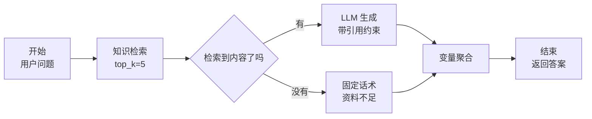

# Dify 平台与工作流

> [!abstract] 一句话讲清楚
> Dify 是一个开源的可视化 LLM 应用平台：把"接模型、建知识库、串节点、发 API"这几件事从写代码变成拖拽配置。它最大的价值不是技术先进，而是**让一个 RAG 问答应用在半天内跑起来**，代价是深度定制能力受限。

---

## 为什么重要

- 交付场景里，客户往往先要"看得见的 demo"。Dify 的界面、引用展示、知识库管理能让客户立刻理解产品形态。
- 它把很多标准接口做好了：OpenAI 兼容 API 接入、文档解析、分段、检索、会话记忆、API 发布、日志。自研这些至少要一两周。
- 但要清楚它的边界：复杂的检索策略、特殊的权限模型、非标准业务逻辑，平台会让你难受。
- 上游：[[OpenAI 兼容 API 规范]] 决定了本地模型怎么接进去；下游：[[容器化部署]] 负责把 Dify 私有化打包给客户。相关：[[RAG 原理与全链路]] 是它内部跑的链路。

---

## 核心名词全解

| 名词 | 英文 / 缩写 | 大白话解释 | 容易混淆 / 注意 |
|---|---|---|---|
| LLMOps 平台 | LLMOps Platform | 管模型、管提示词、管知识库、管发布的平台 | 不是模型本身，它自己不产模型 |
| 模型供应商 | Model Provider | 平台里"接进来的一路模型"，可填 base_url 和 key | 本地模型通过 OpenAI 兼容方式接入最常见 |
| 应用 | App | 在平台上建的一个成品，如聊天助手、工作流 | 一个应用可以有多份发布配置 |
| 应用类型 | App Type | 聊天助手 / 文本生成 / Agent / 工作流 | 选错了后面很难改，开工前想清楚 |
| 知识库 | Knowledge Base | 平台托管的文档 + 分段 + 向量索引 | 它的分段策略比自研弱一些 |
| 分段 | Segment / Chunk | 平台把文档切成的小块 | 平台默认分段很粗糙，往往要手动调 |
| 工作流 | Workflow | 用节点组成的执行图 | 不是"对话"，是一次输入到一次输出的处理链路 |
| 节点 | Node | 工作流里一步操作，如 LLM、知识检索、代码、条件分支 | 节点间的数据靠变量传递 |
| 变量 | Variable | 节点之间传递数据的容器 | 有会话变量、环境变量、节点输出变量，作用域不同 |
| 条件分支 | IF/ELSE Node | 按变量值走不同路径 | 调试时最容易在这里走错分支 |
| 变量聚合 | Variable Aggregator | 把多条分支的输出统一成一个变量 | 分支多了不加聚合会报"变量未定义" |
| 发布 API | Publish as API | 把应用暴露成 HTTP 接口给业务系统调 | 平台自带 key 鉴权，生产环境要额外做网关 |
| 私有化部署 | Self-hosted | 用 Docker Compose 把平台整套部署到客户内网 | 组件不少，交付时要评估资源 |
| 插件 | Plugin | 平台提供的模型/工具扩展机制 | 版本差异大，以官方文档为准 |

---

## 原理与机制

### 直觉：把 RAG 变成"流程图 + 配置表"

自研 RAG 是写一堆代码；Dify 是给你一张画布：左边拖一个"知识检索"节点，右边拖一个"LLM"节点，中间连线，然后在每个节点上填参数。

它把下面这些东西变成了配置项：

- **模型接入**：填 base_url、模型名、key，就能把本地 vLLM/Ollama 里跑的任何模型加进来。
- **知识库**：上传文档 → 平台自动解析和分段 → 选 embedding 模型 → 建索引。
- **检索参数**：top_k、分数阈值、是否 rerank，都在界面上。
- **会话记忆**：自动维护多轮上下文。
- **发布**：一键变成 API，或者嵌一个聊天窗口到客户网站。

### 机制一：四种应用类型，选错很痛

| 类型 | 适合什么 | 长什么样 | 改造成本 |
|---|---|---|---|
| 聊天助手 | 单轮/多轮问答、知识库客服 | 一个对话框 + 知识库 | 低 |
| 文本生成 | 一次输入一次输出，如摘要、改写 | 表单进、文本出 | 低 |
| Agent | 需要模型自己决定调用哪些工具 | 模型自主循环 | 中（受平台限制） |
| 工作流 | 流程固定、步骤明确、要控每一环 | 节点图，可控性最强 | 中~高（节点多） |

> [!important] 一句话选择法
> **要"可预测"用工作流，要"灵活"用 Agent，只做问答用聊天助手。** 交付项目里 90% 的需求其实是工作流，别一上来就上 Agent——Agent 每一轮都可能选错工具，客户现场演示一次翻车就很难挽回信任。

### 机制二：工作流是 DAG，变量是血脉

工作流的执行本质是有向无环图：

- 节点按依赖顺序执行，上游输出通过**变量引用**交给下游。
- 分支节点会让图分叉，分叉后需要"变量聚合"把结果合回一个变量，否则后面的节点拿不到值。
- 循环节点有但少用，容易调不通。
- 会话变量在整个会话期间保留（比如"用户所在部门"），环境变量全局共享（比如 API 地址）。



### 机制三：它的知识库有多"够用"

平台自带的分段通常只有"通用分段"和"父子分段"几档，能调块大小和分隔符，但**做不了高度定制的版面解析和业务化切分**。所以：

- **标准文档（Word、文字版 PDF、内部 wiki）**：平台分段够用，省事。
- **扫描件多、表格多、格式怪**：要么先在外部把文档处理成干净的 Markdown/TXT 再上传，要么改用自研链路。
- 这是一个非常实用的折中：**用外部脚本做解析清洗，把干净文本喂给 Dify**，兼顾效率和效果。

### 机制四：平台 vs 自研，本质是"控制权"的取舍

| 维度 | Dify 这类平台 | 自研链路 |
|---|---|---|
| 上手速度 | 半天出 demo | 一到两周 |
| 切分/检索定制 | 受界面限制 | 完全自由 |
| 业务系统集成 | 通过 API，够用 | 可深度嵌入 |
| 多租户/权限 | 平台级，较粗 | 按客户模型定制 |
| 运维复杂度 | 一套平台 + 数据库 + 向量库 | 组件自己拼，但可裁剪 |
| 交付可控性 | 依赖开源项目节奏，升级要谨慎 | 全在自己手里 |
| 报价方式 | 平台搭建费 + 定制费 | 开发工作量 |

> [!tip] 最实用的组合拳
> **平台做原型和客户沟通，自研做最终交付**；或者**平台做轻量应用，自研做核心链路，两者用 API 串起来**。别为了"纯自研"多花两周，也别为了"省事"把深度需求硬塞进平台。

---

## 完整流程：用 Dify 搭一个本地知识库问答

1. **输入**：客户资料 + 本地模型的 API 地址。
   **动作**：私有化部署平台（Docker Compose），确认能访问内网模型端口。
   **输出**：平台可用。**验收**：浏览器打开正常，无外网依赖报错。
2. **输入**：模型 API。
   **动作**：在"模型供应商"里加 OpenAI 兼容方式，填 base_url、模型名、key；测试连通。
   **输出**：可选的模型。**验收**：在平台里直接和模型对话能出字。
3. **输入**：文档。
   **动作**：新建知识库，上传文档；选分段方式、chunk 大小、重叠；选 embedding 模型（必须是本地可跑的）。
   **输出**：已索引知识库。**验收**：平台内"召回测试"能命中正确段落。
4. **输入**：知识库 + 模型。
   **动作**：新建应用（聊天助手或工作流），挂知识库，配 top_k、阈值、是否 rerank。
   **输出**：可对话的应用。**验收**：问 10 个真实问题，里面对 7 个以上且带引用。
5. **输入**：跑通的应用。
   **动作**：编排细节——系统提示词、拒答话术、引用展示、分支逻辑。
   **输出**：像样的 demo。**验收**：问文档外的问题会说"资料中没有"。
6. **输入**：demo 认可。
   **动作**：发布为 API，拿 API key；在业务系统或 [[客户端 UI 工具]] 里对接。
   **输出**：可集成的服务。**验收**：外部调用返回正常，错误码清晰。
7. **输入**：上线版本。
   **动作**：日志、备份、升级策略。平台升级前先在测试环境验证。
   **输出**：可运维状态。**验收**：重启后配置与知识库不丢。

```yaml
# 私有化部署的环境变量关键项（示意，具体项以官方文档为准）
APP_WEB_API_BASE_URL: "http://<内网IP>:5001"   # 前端访问后端用的地址，配错会导致页面白屏
VECTOR_STORE: "qdrant"                          # 向量库选型，决定知识库性能
DB_USERNAME: "dify"                             # 元数据库，别用默认密码
```

> [!warning] 私有化部署最常见的一步错
> `APP_WEB_API_BASE_URL` 这类"对外可访问地址"必须填**客户能访问到的内网 IP**，不能填 `localhost`。填 localhost 时服务器自己没问题，但客户电脑上打开就是白屏。这个坑几乎每次都有人踩。

---

## 决策点

- **岔路口 1：要不要用 Dify？**
  判断依据：需求是否标准化、上线时间紧不紧、团队有没有开发人力。
  → **推荐**：标准问答/工作流类需求并且要快速出 demo → 用；需要自定义切分、复杂权限、深度嵌入客户系统 → 自研核心链路或混合方案。

- **岔路口 2：选哪种应用类型？**
  判断依据：流程是不是固定的。
  → **推荐**：流程能画出来就用工作流；只有"要模型自己判断下一步"时才用 Agent 应用。**演示型交付优先工作流，稳。**

- **岔路口 3：知识库放平台里还是外部自建？**
  判断依据：文档复杂度、是否需要与其他系统共用向量库。
  → **推荐**：文档干净、量不大 → 放平台里，省事；文档脏/量大/已有多套业务 → 外部处理 + 外部向量库，平台通过 API 或自定义工具调用。

- **岔路口 4：embedding 和 rerank 用谁的？**
  判断依据：能不能出网。
  → **推荐**：内网交付**一律本地部署**，通过 OpenAI 兼容接口或平台支持的本地方式接入。能力上先用现成开源模型，效果不够再考虑换。

- **岔路口 5：发布方式？**
  判断依据：客户要用网页、嵌系统、还是给机器人。
  → **推荐**：先用平台自带的聊天页演示；正式交付走 API + 自建前端或 [[客户端 UI 工具]]；给飞书/钉钉/微信则走对应的机器人对接，注意公网/内网可达性。

- **岔路口 6：平台要不要升级？**
  判断依据：现版本是否有必须的 bug 修复或功能。
  → **推荐**：**交付现场不要升级**。平台大版本之间数据结构常有变化，升级前在测试环境备份数据库和向量库再验。

---

## 参数与配置说明

| 参数 | 作用 | 调大/调小的影响 | 常见取值 |
|---|---|---|---|
| 分段长度 | 每个 chunk 字符数 | 大→上下文全但检索糊 | 中文 300~600 字 |
| 分段重叠 | 相邻块重叠 | 大→防切断但冗余 | 10%~20% |
| 分段标识符 | 按什么切 | 影响句子完整性 | 换行/句号/标题 |
| top_k | 送进模型的片段数 | 大→噪声多 | 3~8 |
| score 阈值 | 检索分数下限 | 高→更保守但易说不知道 | 按实测 |
| rerank 开关 | 是否精排 | 开→准但慢 | 有 GPU 就开 |
| 温度 | 输出随机性 | 高→自由发挥 | 0~0.3 |
| 最大 token | 单次回复长度 | 大→贵且慢 | 按业务定 |
| 记忆轮数 | 携带几轮历史 | 大→上下文膨胀 | 3~10 轮 |

---

## 节点类型速查

工作流本质是把下面这些节点用线连起来。用之前先清楚每个节点会不会消耗模型调用。

| 节点 | 干什么 | 是否调模型 | 常见用法 |
|---|---|---|---|
| 开始 | 定义输入变量 | 否 | 表单式输入、API 入参 |
| LLM | 调一次模型 | 是 | 分类、抽取、生成、改写 |
| 知识检索 | 走知识库召回 | 否（可能调 embedding/rerank） | 先查再答 |
| 代码执行 | 跑一小段脚本 | 否 | 清洗字符串、算分、拼 JSON |
| HTTP 请求 | 调外部接口 | 否 | 查订单、查天气、对接自家系统 |
| 条件分支 | 按变量走不同路 | 否 | 分类后分流 |
| 迭代 / 循环 | 对列表逐项处理 | 可能 | 逐条清洗、逐份文档处理 |
| 变量聚合 | 多条路汇合 | 否 | 两条分支都汇到同一个下游 |
| 参数提取 | 从文本抽结构化字段 | 是 | 抽日期、金额、编号 |
| 直接回复 | 结束并输出 | 否 | 固定格式的输出，不需要模型加工 |

> [!important] 一个常见设计失误
> 能用代码节点和 HTTP 节点确定性完成的事，别交给 LLM 节点。**LLM 适合"判断"和"表达"，不适合"精确转换"。** 算金额、拼 URL、格式化日期这类，写代码节点又快又稳。

## 调试工作流的方法

1. **单节点试跑**：每个 LLM 节点都能单独运行，先保证它在固定输入下输出符合预期。
2. **看变量实值**：跑一次后检查每个节点的输入输出变量到底填了什么。**八成的错是变量名写错或取到空值。**
3. **固定输入复现**：把出问题的输入存成测试用例，改完再跑，别用新输入验证。
4. **二分定位**：把工作流从中间断开，前半段固定为已知正确值，看后半段是否正常，快速缩小范围。
5. **看耗时分布**：哪个节点慢就先优化它——通常是一个 LLM 节点被循环调用了几十次。

## 发布与集成的几条正路

做完的工作流要能用起来，常见四种方式：

| 方式 | 适合谁 | 要准备什么 | 注意 |
|---|---|---|---|
| 网页应用 | 直接给业务人员用 | 访问地址与权限 | 对外暴露前先加鉴权 |
| 后端服务 API | 给自家系统调 | 生成 key、约定入参出参 | 内部调用也要限流 |
| 嵌入网页组件 | 嵌到客户现有系统页面 | 域名与样式配置 | 跨域与混合内容容易踩坑 |
| 定时 / 事件触发 | 批处理任务 | 调度配置 | 失败重试与告警要配 |

交付时提醒客户三件事：**知识库内容更新后要更新索引才生效；工作流改版要发新版本而不是直接覆盖线上；API key 按系统分配而不是人手一个。**

### 私有化部署的检查点

| 检查点 | 说明 | 不做会怎样 |
|---|---|---|
| 数据卷 | 上传文件、知识库、日志都要持久化 | 升级后数据全丢 |
| 对外访问地址 | 配成客户端能访问到的地址 | 页面白屏、上传失败 |
| 模型接入 | 在系统设置里加 OpenAI 兼容服务并测通 | 所有应用都跑不起来 |
| 账号与权限 | 建管理员账号，关掉开放注册 | 谁都能进 |
| 备份 | 数据库与文件目录一起备 | 部分恢复导致引用断裂 |
| 升级策略 | 小版本可跟，大版本先上测试环境 | 生产直接被升级搞挂 |

## 常见坑与误区

| 现象 | 原因 | 对策 |
|---|---|---|
| 平台里模型连不上 | base_url 填了 `localhost` 或漏了 `/v1` | 用内网 IP，路径按 [[OpenAI 兼容 API 规范]] 填；先 curl 测通再填进平台 |
| 知识库召回总是不对 | 用了默认分段，chunk 太大或按错误分隔符切 | 手动调分段方式与大小，用"召回测试"反复验 |
| 本地模型不支持工具调用，Agent 应用不可用 | 平台 Agent 依赖 function calling 能力 | 换支持工具调用的模型，或改用工作流编排，见 [[Agent 与 Function Calling]] |
| 变量未定义报错 | 分支没做变量聚合，或节点引用错层 | 每个分支的输出都汇到一个聚合节点；命名统一 |
| 私有化部署后页面白屏 | `APP_WEB_API_BASE_URL` 等对外地址填错 | 填客户可访问的内网 IP:端口 |
| 升级平台后知识库检索异常 | 版本升级改了索引结构或分段逻辑 | 升级前备份，测试环境先验；必要时重建索引 |
| 演示时并发一高就卡死 | 本地模型并发能力有限，平台把请求都打过去了 | 平台侧限流；模型侧加队列；按 [[推理性能指标与调优]] 做并发压测 |
| 客户问"能不能按部门隔离知识库" | 平台权限模型较粗 | 拆多知识库 + 应用分流，或自研权限层 |

---

## 自检问题

- [ ] Dify 的四类应用各自适合什么场景？为什么优先推荐工作流？
- [ ] 工作流里变量有哪几种作用域？分支为什么要做变量聚合？
- [ ] 平台自带知识库的短板在哪？你会怎么绕开？
- [ ] 本地模型接入平台的常见失败原因有哪些？
- [ ] 私有化部署最容易填错的一个配置是什么？错了会有什么现象？
- [ ] 什么样的需求你不该用平台做？
- [ ] 平台发布 API 后，生产环境还需要补什么？
- [ ] 交付现场为什么不要随便升级平台？

---

## 相关笔记

- 上游：[[OpenAI 兼容 API 规范]]、[[服务化与 API 鉴权]]
- 下游：[[客户端 UI 工具]]、[[容器化部署]]
- 依赖：[[RAG 原理与全链路]]、[[检索与 Rerank]]
- 对照：[[Agent 与 Function Calling]]（平台 Agent 的能力边界）
- 返回：[[应用集成 MOC]]

---

## 交付视角（对客户怎么讲）

- **大白话解释**："这是我们的应用搭建台，可以在可视化界面上把'查资料—整理—回答'这套流程连起来，接的是您机房里的模型。搭好之后会生成一个接口，您的业务系统、网站、企业微信都能调用。"
- **客户最常问**："这套东西是不是开源的？以后你们不做了我能不能自己维护？" 老实答：平台是开源的，可以自主部署；但**你们的定制部分（提示词、工作流、数据）我们都会交付文档**，换人也能接。这种坦诚反而更容易签单。
- **报价拆项**：平台私有化部署（一次性）、知识库搭建（按文档量）、工作流定制（按节点/复杂度）、培训与文档（一次性）、运维（按月）。**培训费一定要报**，客户的人不会用，最后全找你。
