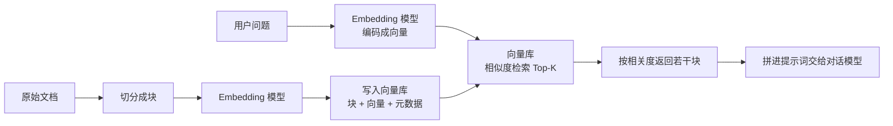

# Embedding 与向量数据库

> [!abstract] 一句话讲清楚
> Embedding 是把文字压成一串数字（向量），意思相近的文字压出来的数字也相近；向量数据库就是专门存这些数字、并能在几百万条里瞬间找出"最像的几条"的仓库。这两件事合起来，就是 RAG 的"检索"底座。

---

## 为什么重要

- 它是 RAG 能不能"找得到"的技术底座。切分决定进什么货，embedding 和向量库决定能不能取出来。
- 选错 embedding 模型 = 整个库白建（换模型必须重建库，代价很大），所以这一步要在开工前定好。
- 向量库选型影响交付形态：单机 demo 用 Chroma 五分钟能跑；客户要千万级、要权限过滤、要 HA，就得上 Milvus / Qdrant / pgvector。
- 上游：[[文档解析与切分策略]] 产出 chunk；下游：[[检索与 Rerank]] 消费向量库的结果。原理铺垫见 [[Transformer 架构基础]]。

---

## 核心名词全解

| 名词 | 英文 / 缩写 | 大白话解释 | 容易混淆 / 注意 |
|---|---|---|---|
| embedding | 嵌入 / 向量化 | 把一段文字变成一个固定长度的数字数组 | 英文原文里既指"向量"也指"这个过程" |
| 向量 | Vector | 那串数字本身，比如 1024 个浮点数 | 维度由模型决定，不同模型不能混用 |
| 维度 | Dimension | 向量里数字的个数 | 维度高不等于效果好，但占存储 |
| 相似度 | Similarity | 两个向量"有多像"的数值 | 不同度量方式结果不可直接比较 |
| 余弦相似度 | Cosine Similarity | 看两个向量夹角的余弦，只比方向不比长度 | 文本检索最常用；向量归一化后与内积等价 |
| 内积 | Dot Product / IP | 向量逐位相乘再求和 | 归一化后与余弦一致，速度更快 |
| 欧氏距离 | L2 Distance | 空间里的直线距离 | 距离越小越像，方向和相似度相反 |
| 归一化 | Normalization | 把向量长度缩放为 1 | 归一化后用内积就够了，省一次除法 |
| 稠密向量 | Dense Vector | 每个维度都有值，语义压缩程度高 | 与稀疏向量相对 |
| 稀疏向量 | Sparse Vector | 大部分维度是 0，近似"词权重表" | BM25 类检索常用，对专有名词友好 |
| 对称检索 | Symmetric Search | query 和文档都是"短句"，比如相似问题推荐 | 和下面的非对称要分开看 |
| 非对称检索 | Asymmetric Search | 短 query 找长文档，RAG 就是这种 | 有些模型要加 query/passage 前缀，加错会掉效果 |
| 向量库 | Vector DB | 存向量 + 原文 + 元数据，并支持快速近邻查询 | 不是关系库的替代品，常常和业务库并存 |
| ANN | 近似最近邻 | 不保证找全局最像的，但快几个数量级 | 生产环境几乎都用 ANN，不用精确暴力扫描 |
| HNSW | 分层可导航小世界图 | 一种主流的 ANN 索引，用图找近邻 | 查询快、内存吃得多 |
| 元数据过滤 | Metadata Filtering | 先按"部门/年份/权限"筛，再算相似度 | 过滤太狠会导致召回不够 |

---

## 原理与机制

### 直觉：把每句话放到一个"语义地图"上

想象一个巨大的空间，每段文字是空间里的一个点。**意思越接近的点，离得越近。** "如何申请报销"和"报销流程是什么"会挨在一起，和"服务器硬盘满了"离得很远。

embedding 模型干的事，就是把这个"语义地图"的坐标算出来。这个坐标是模型在大量文本上学到的，不是人手工定的。

RAG 检索时：把用户问题也变成地图上的一个点，然后找离它最近的几个文档点。

### 机制一：相似度怎么算，以及为什么必须统一

三种常用度量：

- **余弦相似度**：只看方向。文本检索默认选它，因为文本向量的"长度"往往反映的是词多少，不是语义强弱。
- **内积**：向量归一化之后，内积 = 余弦，而且少一步除法，所以很多向量库推荐"归一化 + 内积"。
- **欧氏距离**：看绝对距离，对未归一化的向量更敏感。

关键结论：**查询端和入库端必须用同一套预处理**。要么两边都归一化后用内积，要么两边都不归一化用余弦。混着用会出现"明明该命中却排到后面"的鬼故事。

```python
# 归一化后，余弦相似度 = 内积，向量库配置更简单
v = v / np.linalg.norm(v)        # 入库前归一化
q = q / np.linalg.norm(q)        # 查询前同样归一化
score = float(np.dot(q, v))      # 相似度，越接近 1 越像
```

> [!warning] 最常见的低级错误
> 库里存的是归一化向量，查询时忘了归一化。结果不是完全错乱，而是"大部分还行、个别很怪"——这种问题最难查。写代码时**把归一化放进统一的 encode 函数里**，不要让调用方自己记得。

### 机制二：ANN 索引——为什么能在几百万条里瞬间找到

精确找最近邻要把库里所有向量都算一遍，100 万条 × 1024 维就是十亿级乘加，太慢。实际用 ANN（近似最近邻）索引，牺牲一点点精度换几百倍速度：

| 索引类型 | 原理直觉 | 优点 | 缺点 |
|---|---|---|---|
| HNSW | 建多层"高速公路图"，先从稀疏高层跳，再逐层细化 | 查询快、召回高、支持增量 | 吃内存，建索引慢 |
| IVF | 先把向量聚类成若干桶，查询只扫最近的几个桶 | 省内存、可配 | 需要训练，边界附近易漏 |
| PQ | 把向量切成段压缩编码，用码本近似 | 省内存几个量级 | 精度有损，常和 IVF 组合成 IVF-PQ |
| 暴力扫描 | 全算一遍，保证精确 | 结果准、实现简单 | 只适合几万条以内 |

选型逻辑很直白：**数据量小就用暴力扫（Chroma 默认就够），中等规模用 HNSW，超大规模且内存紧张用 IVF-PQ。**

### 机制三：embedding 模型选型的真实标准

不要只看排行榜。实际要看的四件事：

1. **中文效果**：很多英文强模型在中文专有名词、简称、行业词上明显弱。中文场景优先测中文语料训练的模型。
2. **最大输入长度**：模型有"一次最多处理多少 token"的限制，超过会被截断。你的 chunk 长度必须 ≤ 这个限制，否则后面的字白切。
3. **是否需要前缀指令**：有些模型要求 query 加"为这个句子生成表示以用于检索："这类前缀，文档类不加。**用错前缀会稳定掉效果**，一定要看模型卡。
4. **能不能本地跑**：客户内网不能出网时，embedding 模型也必须是本地的；它的显存需求通常比 LLM 小很多，一张消费级卡就够。

生态里常见的中文向选择有 BGE 系列、M3E 系列、GTE 系列等，具体版本和分数以官方模型卡为准，别背数字。**建议做法**：拿 100 条真实问题 + 正确文档，跑几款候选模型看命中率，比看榜单可靠。

### 机制四：向量库到底存了什么

一条记录通常长这样：

| 字段 | 内容 | 用途 |
|---|---|---|
| id | 唯一标识 | 更新/删除 |
| vector | 1024 维浮点数组 | 相似度检索 |
| text | chunk 原文 | 拼提示词、展示引用 |
| source / page / section | 来源、页码、章节 | 引用展示 |
| dept / year / version | 业务字段 | 元数据过滤 |
| hash | 内容指纹 | 增量更新去重 |

> [!important] 元数据是"隐形功能"的地基
> 引用、权限隔离、按年份过滤、增量更新，全都依赖元数据。**入库时没写，事后只能整库重来。**

### 机制五：建库与查询是两条对称的支路

建库和查询各走一条路，中间的对称性直接决定检索质量：



> [!important] 为什么这条链必须对称
> 查询和文档**必须用同一个 embedding 模型**编码。上图的左右两条支路看着对称，实际最容易出错的地方是：换模型时只重建了一半，或者把两家模型的向量混在一个库里。**不对称的向量空间里做相似度，结果毫无意义。**

---

## 完整流程：从选模型到能查

1. **输入**：一批干净 chunk（来自 [[文档解析与切分策略]]）。
   **动作**：选 2~3 个候选 embedding 模型，各向量化一小批。
   **输出**：候选模型对比。**验收**：用真实问题测命中率，选出 1 个。
2. **输入**：确定的模型。
   **动作**：确认输入长度上限、是否要加前缀、归一化方式。写死在统一 encode 函数里。
   **输出**：encode 函数。**验收**：库里任何地方调用都走这个函数，没有旁路。
3. **输入**：向量库选型结论。
   **动作**：建 collection（定义维度、距离度量、索引类型、元数据字段）。
   **输出**：可写入的 collection。**验收**：维度与模型一致，距离度量与归一化方案匹配。
4. **输入**：全部 chunk。
   **动作**：分批向量化并写入，带全部元数据。
   **输出**：可查询的库。**验收**：条数与 chunk 数一致，随机抽查向量非全零。
5. **输入**：用户的真实问题。
   **动作**：encode → 检索 top_k → 看原文。
   **输出**：召回列表。**验收**：问题对应的正确 chunk 出现在前几名。
6. **输入**：稳定后的库。
   **动作**：加增量更新（文件 hash 变化才重切）、加删除逻辑（作废文档要真删）。
   **输出**：可维护的库。**验收**：删掉一份文档，相关 chunk 检索不到了。

---

## 分类与对比：向量库怎么选

| 向量库 | 形态 | 部署难度 | 适合规模 | 亮点 | 短板 |
|---|---|---|---|---|---|
| Chroma | 嵌入式/客户端-服务端 | 极低 | 万级~十万级 | 装完就能用，写 demo 最快 | 大规模与并发能力一般 |
| FAISS | 纯库，不是数据库 | 低（但自己写存储） | 百万级 | 索引算法全、性能强 | 没有元数据过滤、没有持久化服务 |
| Qdrant | 独立服务 | 低（Docker 一条） | 百万~千万级 | 过滤能力强、Rust 实现省资源 | 生态相对年轻 |
| Milvus | 分布式系统 | 中~高 | 千万~十亿级 | 工业级、分片副本齐全 | 组件多，小项目显得重 |
| pgvector | PostgreSQL 插件 | 低（已有 PG 就装扩展） | 百万级 | 向量和业务数据同库、事务友好 | 超大规模性能不如专用库 |
| Weaviate | 独立服务 | 中 | 百万级 | 内置多模态与混合检索 | 资源占用偏高 |

> [!tip] 一个非常实用的默认答案
> **已经有 PostgreSQL 的客户 → pgvector 起步**，省一套运维；**纯本地 demo → Chroma**；**要交付独立服务 → Qdrant**；**客户明确要求大规模/已有大数据团队 → Milvus**。别为了"先进"上分布式，小项目上 Milvus 是给自己找运维。

---

## 决策点

- **岔路口 1：embedding 用本地模型还是 API？**
  判断依据：数据能不能出内网、文档量多大、要不要长期免费。
  → **推荐**：本地化交付**一律用本地 embedding 模型**。API embedding 只在做原型、或客户明确允许出网时用。本地模型小、跑得动，是这一行最划算的选择。

- **岔路口 2：稠密检索够不够，要不要加稀疏/BM25？**
  判断依据：文档里是不是有很多型号、编号、条款号、人名。
  → **推荐**：只要出现大量精确字符串，就上混合检索。纯向量对"XH-2000 这个型号"这类硬匹配经常不灵，见 [[检索与 Rerank]]。

- **岔路口 3：维度挑大的还是小的？**
  判断依据：存储成本、查询延迟 vs 精度。
  → **推荐**：先按模型原生维度来。真要压缩，可用 PQ / 降维，但必须在评测集上验证掉点可接受。别为了省存储拍脑袋降维。

- **岔路口 4：库要不要和业务数据分开？**
  判断依据：是否需要事务一致性、是否需要 JOIN 业务表。
  → **推荐**：业务逻辑强（订单、工单、权限）→ pgvector 同库更好；纯检索服务 → 专用向量库。**拆两个库就要处理"数据不一致"这个额外的坑**。

- **岔路口 5：换 embedding 模型怎么办？**
  判断依据：新模型在评测集上是否显著更好。
  → **推荐**：换模型 = **新建 collection + 全量重建 + 双跑对比 + 切换**。绝对不要在一个 collection 里混不同模型的向量。

---

## 参数与配置说明

| 参数 | 作用 | 调大/调小的影响 | 常见取值 |
|---|---|---|---|
| dim | 向量维度 | 大→表达力强但慢、占内存；小→省资源但可能掉精度 | 与模型一致，常见 512/768/1024 |
| distance | 相似度度量 | 影响排序结果 | cosine 或 ip（配归一化） |
| batch_size | 每批向量化条数 | 大批次快但吃显存，太大 OOM | 16~128，按显存调 |
| HNSW M | 每个节点的连边数 | 大→召回高、内存大 | 16~64 |
| HNSW ef_construction | 建索引时的搜索宽度 | 大→索引质量高、建库慢 | 100~500 |
| HNSW ef_search | 查询时搜索宽度 | 大→召回高、查询慢 | 50~200，可运行时调 |
| IVF nlist | 聚类桶数 | 大→更细但训练慢 | 数据量的平方根量级 |
| IVF nprobe | 查询扫几个桶 | 大→召回高、更慢 | nlist 的 1%~10% |
| top_k | 返回条数 | 大→召回高但下游处理重 | 20~50（给 rerank 用） |

---

## 向量库上线前要定的五件事

| 要定的事 | 选项 | 怎么选 |
|---|---|---|
| 距离度量 | 余弦 / 内积 / 欧氏 | 向量归一化后用余弦或内积基本等价；不归一化就统一用余弦 |
| 向量维度 | 由 embedding 模型决定 | **换模型 = 换维度 = 必须重建索引**，一开始就想清楚 |
| 是否归一化 | 写入前做 / 不做 | 做。能省掉一堆距离度量上的坑 |
| 索引类型 | 暴力 / HNSW / IVF / PQ | 几千块暴力就够；十万级以上上 HNSW |
| 元数据字段 | 文档名、来源、章节、时间、权限标签 | 决定以后能不能过滤和追溯，**后补很痛** |
| 持久化路径 | 内存 / 磁盘 / 服务端存储 | 只为试跑可以内存，要上线必须落盘 |
| 备份策略 | 定期快照 / 可重建 | 最稳的是"原始文档在 + 可一键重建索引" |

> [!important] 维度不一致是最常见的低级事故
> 换了 embedding 模型忘了清库，轻则写入报维度不匹配，重则库里混着两代向量——检索结果看着正常，其实全错。**换模型必须清库重建，没有捷径。**

## Embedding 模型质量怎么快速验

不用等整套 RAG 搭完，十分钟就能验：

1. 准备 20 对"问题 → 正确段落"，再配几段明显不相关的当干扰。
2. 离线算相似度，看正确段落的排名。
3. 关键看**前 3 名里有没有正确答案**，而不是看绝对分数——不同模型分数尺度不一样，没法直接比。

排名普遍很差，先换 embedding 模型，再谈切分和 rerank。另外多语言场景一定要测中文：很多英文榜单好看的模型，中文检索差一截。

## 数据更新与重建策略

| 场景 | 做法 | 注意 |
|---|---|---|
| 新增文档 | 增量写入，按 doc_id 记录 | 要防重复灌入，最好带幂等键 |
| 修改文档 | 先删该 doc_id 的全部块，再重写 | 只更新变化的部分会残留旧块 |
| 删除文档 | 按 doc_id 批量删块 + 清理元数据 | 别只删文件，向量库里还留着 |
| 换 embedding 模型 | 全量重建，旧库并行保留一段时间 | 双写过渡，避免检索中断 |
| 数据量大 | 分批灌入并落盘持久化 | 内存里跑完就消失的库只能试跑 |

> [!tip] 交付时的一句话
> "这套索引恢复不需要备份，原始文档在，跑一次重建脚本就能恢复。" 这比让客户天天备份向量库现实得多。

## 选型时最容易忽略的五点

| 忽略点 | 后果 | 做法 |
|---|---|---|
| 中文效果 | 英文榜单好看，中文检索差一截 | 用自家中文样本自测，别只看榜单 |
| 向量维度与成本 | 维度越大存储和计算越贵 | 够用就行，别盲目上最大维度 |
| 单条文本上限 | 超长会被截断，后半段信息丢失 | 块长别超过模型上限 |
| 维护与更新 | 模型停更、接口下线 | 选有社区持续维护的 |
| 许可证 | 商用受限 | 部署前确认许可条款 |

还有一点值得提前算账：**换 embedding 模型意味着全量重建索引**。所以一开始就选一个能撑两年的模型，比后面换来换去省事得多。

## 常见坑与误区

| 现象 | 原因 | 对策 |
|---|---|---|
| 换 embedding 模型后效果反而变差 | 旧向量没重建，或查询端与入库端模型不一致 | 换模型必须整库重建，并在代码里只留一个 encode 入口 |
| 相似度分数都在 0.7 左右，分不出好坏 | 同质文本多、chunk 太大、或模型对该领域区分力弱 | 缩小 chunk、换模型、上 rerank，别只看阈值 |
| 中文专有名词检索不灵 | 纯稠密向量对精确字符串不敏感 | 加 BM25/稀疏向量做混合检索 |
| 实际相似度排序和预期不符 | 一边归一化一边没归一化，或 distance 配错 | 统一预处理 + 统一 distance 配置，写进文档 |
| 重建库时服务挂了 | 批量向量化把显存打满 / 写库并发太高 | 分批 + 限速 + 失败重试，重建走新 collection 再切流量 |
| 删了文档还能检索到 | 只删了业务表，向量库没同步删 | 以"文档 id"为前缀批量删除，删除流程写进 SOP |
| 内存被 HNSW 吃穿 | HNSW 把图放在内存，规模一大就爆 | 控制 M/ef、降维、或换 IVF-PQ/磁盘索引 |
| 不同部门的人搜到不该看的资料 | 没有元数据权限过滤 | 入库时写 dept/权限标签，检索时强制带过滤条件 |

---

## 自检问题

- [ ] 能不能用一句话解释 embedding 在做什么？
- [ ] 余弦相似度、内积、欧氏距离三者什么关系？什么时候可以互相替换？
- [ ] 为什么说"换 embedding 模型必须重建整个库"？
- [ ] HNSW 和 IVF-PQ 各适合什么场景？各自的主要代价是什么？
- [ ] 选 embedding 模型时，除了榜单分数还要看哪四件事？
- [ ] 向量库里的元数据都用来干什么？列出至少四种用途。
- [ ] 什么情况下应该选 pgvector 而不是 Milvus？
- [ ] 归一化没做一致会导致什么现象？为什么难查？

---

## 相关笔记

- 上游：[[文档解析与切分策略]]、[[Transformer 架构基础]]
- 下游：[[检索与 Rerank]]、[[RAG 评估与调优]]
- 部署：[[Docker 与容器化基础]]、[[容器化部署]]
- 对照：[[上下文窗口与位置编码]]（长上下文能替代一部分检索，但不能替代全部）
- 返回：[[应用集成 MOC]]

---

## 交付视角（对客户怎么讲）

- **大白话解释**："我们把这堆资料变成了一种计算机能比对的'指纹'。您提问时，系统先把问题变成指纹，再去找最像的几段资料。整个过程在您自己的服务器上完成，资料一个字都不出内网。"
- **客户最常问**："上千万页能不能扛？" 能，但要换向量库和硬件配置，报价要跟着变。**先问清数据量再报方案**，别先承诺再发现要上分布式。
- **报价拆项**：embedding 与向量库搭建（一次性）、索引重建/更新（按次）、存储与算力（按年或按服务器）。重建库属于"数据搬运"，容易被客户当成免费维护，要提前说清。
