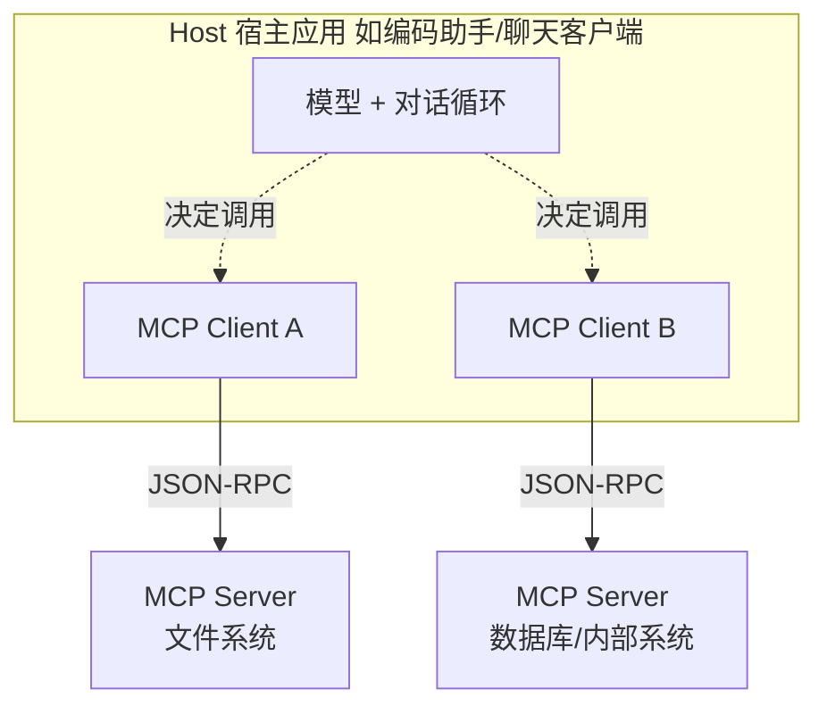

# MCP 协议

> [!abstract] 一句话讲清楚
> MCP 是给"模型怎么连工具和数据"定的一套标准接口，像 USB-C 一样：工具方按标准做一个服务端，客户端（编辑器、聊天工具、Agent 框架）按标准接上去，就不用为每个工具单独写对接代码。它解决的是**接口碎片化**，不是模型能力问题。

---

## 为什么重要

- 在 MCP 之前，每个编码助手/Agent 框架对接每个工具（数据库、Git、文件系统、公司内部系统）都要单独适配。MCP 把这层统一了，工具做一次，多个客户端都能用。
- 对交付的影响很直接：客户内部系统只要包一层 MCP Server，就能同时被编码助手、聊天客户端、自研 Agent 使用，**减少了大量"重复对接"的工作量**。
- 但要清楚它不是银弹：MCP 让"接得上"，不保证"模型会用"。模型能力不行，接了 MCP 照样调错。见 [[Agent 与 Function Calling]]。
- 上游：[[Agent 与 Function Calling]] 的工具调用机制；下游：[[本地模型接入编码助手]]、[[客户端 UI 工具]] 都在逐步支持 MCP。

---

## 核心名词全解

| 名词 | 英文 / 缩写 | 大白话解释 | 容易混淆 / 注意 |
|---|---|---|---|
| MCP | Model Context Protocol | 模型连接外部工具/数据的标准协议 | 是协议规范，不是某个软件 |
| 宿主 | Host | 最终用户用的那个应用，比如编辑器、聊天客户端 | Host 内部启动并管理客户端 |
| 客户端 | Client | Host 内部负责和某个 Server 通信的组件 | 一个 Host 可以同时连多个 Server |
| 服务端 | Server | 提供具体能力的一端，比如"文件系统服务" | 可以是本地进程，也可以是远程 HTTP 服务 |
| 工具 | Tools | 让模型"执行动作"的能力，有入参和结果 | 和 resources 的区别：tools 是动作，resources 是数据 |
| 资源 | Resources | 让模型"读取"的数据，如文件、记录 | 一般是只读的、按 URI 定位 |
| 提示模板 | Prompts | 由服务端预置的提示词模板 | 方便把"复杂用法"固化下来给用户选 |
| JSON-RPC | JSON-RPC 2.0 | 一种用 JSON 表示"请求-响应"的轻量协议 | 消息有 id、method、params，做请求与响应配对 |
| 传输层 | Transport | 消息怎么在两个进程间传 | 常见 stdio（本地子进程）和 HTTP/SSE（远程） |
| 能力协商 | Capability Negotiation | 握手时双方声明"我会什么" | 不支持的能力不会强行用 |
| 采样 | Sampling | 服务端反过来请求 Host 帮忙调一次模型 | 高级能力，实现和权限要谨慎 |
| 根目录 | Roots | 告诉服务端"你能访问的范围" | 相当于权限边界 |
| 工具白名单 | Allowlist | 只允许调用指定的工具 | 生产环境必备，防止乱执行 |

---

## 原理与机制

### 直觉：USB-C 和"打印机驱动"

以前装打印机，每台电脑每个系统都要装对应驱动。后来有了标准接口，插上就能用。MCP 干的就是这件事：**工具只写一次 MCP Server，所有支持 MCP 的客户端都能用。**

它的另一个类比是 **LSP（语言服务器协议）**：编辑器不用为每种语言内置语法分析，只要实现 LSP 客户端，各语言各写一个 LSP 服务端即可。MCP 是把同一套思路从"语言服务"搬到"模型工具"上。

### 机制一：三层结构



- **Host**：用户看到的那个软件。它负责启动 Client、把 Server 提供的工具转成模型能理解的形式。
- **Client**：一个 Host 里可以有多个，每个对应一个 Server 连接。
- **Server**：真正干活的一端。本地可以是 `stdio` 子进程，远程可以是 HTTP 服务。

这个结构的关键好处是：**模型和工具彻底解耦**。换模型不影响工具，加工具不影响模型。

### 机制二：三种原语，别混

| 原语 | 谁主动 | 干什么 | 例子 |
|---|---|---|---|
| Tools | 模型决定调用 | 执行动作、返回结果 | 查数据库、创建文件、发请求 |
| Resources | 客户端/用户选择或模型读取 | 提供只读数据 | 读某个文件、拉一条配置记录 |
| Prompts | 用户选择 | 预置的提示词模板 | "帮我审查这个 PR"的完整指令 |

一句话区分：**Tools 是"做"，Resources 是"读"，Prompts 是"说"**。早期很多实现只做 Tools，那也够用；Resources 和 Prompts 是加分项。

### 机制三：消息长什么样

协议是 JSON-RPC，一条请求 + 一条响应对应：

- 请求：有 `method`（方法名，如列工具、调工具）、`params`（参数）、`id`（配对用）。
- 响应：同一个 `id`，带 `result` 或 `error`。

> [!tip] 这对排错很有用
> 出问题时，**打开客户端的 MCP 日志看原始的 JSON-RPC 消息**。能立刻分清是"客户端没发起调用"、"服务端报错"还是"响应格式不对"。别靠猜。

### 机制四：为什么它突然火起来

三个条件凑齐了：

1. **工具调用（function calling）成了模型标配**，但每个客户端的工具接入方式各不相同，痛点明确。
2. **大厂背书 + 开源生态**，短时间内出现了大量现成的 Server（文件系统、Git、浏览器、数据库等）。
3. **本地部署场景刚好需要**：客户内网里的大量系统没有对外 API，包一层 MCP Server 就能被 AI 工具统一访问，而且数据不出内网。

### 机制五：安全边界必须自己想清楚

MCP 只解决"怎么连"，不解决"该不该连"。Server 一旦被接上，模型就能通过它做实际动作。风险点：

- 本地 Server 常常以**当前用户权限**运行，能读的都能读、能删的都能删。
- 远程 Server 可能把数据带出内网（尤其是外部提供的 Server）。
- 恶意/不可信的 Server 可以返回诱导性内容，影响模型行为（提示注入）。

所以生产环境要做到：**只接可信 Server、工具白名单、危险工具二次确认、操作审计日志**。参考 [[安全与合规]]。

---

## 完整流程：把一个内部系统接进编码助手

1. **输入**：客户内部系统（比如工单系统）+ 一个支持 MCP 的编码助手。
   **动作**：确认编码助手是否支持 MCP、支持哪种传输方式。
   **输出**：技术可行性结论。**验收**：文档里能查到配置位置和传输方式。
2. **输入**：系统接口。
   **动作**：写一个 MCP Server，暴露 3~5 个工具（查工单、改状态、加评论）。
   **输出**：可运行的 Server。**验收**：用官方提供的调试工具能列出工具并手动调用成功。
3. **输入**：Server。
   **动作**：在 Host 配置里登记 Server（本地进程填命令+参数，远程填 URL）。
   **输出**：连接成功。**验收**：Host 里能看到工具列表。
4. **输入**：连上的工具。
   **动作**：用真实问题测试：模型会不会选、参数填得对不对、结果能不能用。
   **输出**：测试记录。**验收**：简单任务 10 次里至少 8 次走对。
5. **输入**：测试结果。
   **动作**：收权限——白名单、只读优先、写操作确认、日志。
   **输出**：受控的接入。**验收**：故意让模型尝试危险操作，能被拦住。
6. **输入**：稳定版本。
   **动作**：写交接文档（Server 怎么启动、工具怎么改、日志在哪）。
   **输出**：可维护交付物。**验收**：客户的技术人员能自己启动并新增一个工具。

```json
// Host 侧登记 Server 的典型配置形态（字段名随客户端不同，以官方文档为准）
{
  "mcpServers": {
    "ticket": {
      "command": "python",
      "args": ["mcp_ticket_server.py"],
      "env": {"TICKET_API_BASE": "http://内网地址/api"}
    }
  }
}
```

> [!warning] 路径与环境变量是第一批坑
> `command` 走的是 Host 的启动环境，**PATH 未必和你在终端里一样**。找不到解释器就把绝对路径写全，环境变量显式写进 `env`，别指望它继承你的 shell 配置。

---

## 分类与对比：MCP 和别的东西到底什么关系

| 对比对象 | 关系 | 关键差异 |
|---|---|---|
| Function Calling | 互补，不是替代 | Function Calling 是"模型怎么表达调用意图"，MCP 是"工具怎么被标准化提供" |
| REST API | 层次不同 | REST 给人和程序用；MCP 给模型用，多了"工具描述、能力协商"这类元数据 |
| 插件（Plugin） | 定位相似 | 插件通常是某平台私有格式；MCP 是跨平台开放协议 |
| LSP | 思路同源 | LSP 标准化编辑器与语言服务；MCP 标准化模型应用与工具服务 |
| Agent 框架 | 无关但常混用 | 框架管"怎么编排"，MCP 管"怎么接工具" |

| 传输方式 | 适合 | 优点 | 注意 |
|---|---|---|---|
| stdio | 本地工具、单机 | 简单、快、不占端口 | 生命周期绑定 Host，调试要另开客户端 |
| HTTP / SSE | 远程、多用户共享 | 可复用、可跨机器 | 要处理鉴权、网络、并发 |

---

## 决策点

- **岔路口 1：这个项目要不要用 MCP？**
  判断依据：工具数量、是否多个客户端要共用、团队是否愿意维护一层 Server。
  → **推荐**：工具多 + 要被多个 AI 客户端复用 → 值得上；只有一两个工具、只给一个应用用 → **直接 function calling 更省事**，别为了时髦加一层。

- **岔路口 2：stdio 还是 HTTP？**
  判断依据：工具是在本机还是内网某台服务器上、要不要多人共用。
  → **推荐**：编码助手的本地工具用 stdio；企业内部共享服务用 HTTP，并加鉴权。

- **岔路口 3：用现成 Server 还是自己写？**
  判断依据：官方/社区是否已有可信实现。
  → **推荐**：通用能力（文件系统、Git、浏览器）优先用成熟实现；**涉及客户业务数据和写操作的一律自己写**，别拿不可信的第三方 Server 碰生产数据。

- **岔路口 4：要不要开放写操作？**
  判断依据：误操作后果。
  → **推荐**：默认只读。写操作单独做工具，加二次确认 + 幂等 + 审计。**"能查"和"能改"最好不要放在同一个 Server 的同一权限下**。

- **岔路口 5：本地模型能力不够怎么办？**
  判断依据：模型对工具调用的支持程度。
  → **推荐**：MCP 不解决模型能力。先按 [[Agent 与 Function Calling]] 的标准测模型工具调用正确率；不达标就换模型或改用工作流编排，**别指望加个 MCP 就变聪明**。

---

## 参数与配置说明

| 配置项 | 作用 | 调大/调小的影响 | 常见取值 |
|---|---|---|---|
| command / args | 本地 Server 启动方式 | 写错就连不上 | 用绝对路径最稳 |
| env | 传给 Server 的环境变量 | 缺 API 地址/key 会启动失败 | 显式声明，不依赖继承 |
| transport | stdio 或 HTTP/SSE | 影响部署形态与鉴权方式 | 本地 stdio，共享 HTTP |
| 启动超时 | 等 Server 就绪的时间 | 太短会误报失败 | 按 Server 启动速度设 |
| 工具白名单 | 只允许哪些工具 | 越窄越安全 | 按最小必要原则 |
| 调用超时 | 单次工具执行上限 | 短→易超时 | 按操作耗时设 |
| 日志级别 | 记录多少调试信息 | 越详细越容易排错也越大 | 调试期全开，上线收紧 |
| 权限范围 | Server 能访问的目录/接口 | 越大越方便也越危险 | 只给必需路径 |

---

## 三种"给模型加能力"的方式怎么区分

| 方式 | 是什么 | 谁定义接口 | 复用性 | 适合 |
|---|---|---|---|---|
| Function Calling | 模型输出结构化调用意图，你的代码去执行 | 你在每次请求里定义 | 低，绑在应用里 | 自家系统内部的几个函数 |
| 插件 / API 集成 | 平台内置的对接方式 | 平台定义 | 中 | 用某个平台生态内的服务 |
| MCP | 标准协议，工具跑在独立进程/服务里 | 工具提供方自己声明 | 高，换客户端也能用 | 一次写好，多个客户端共用 |

判断口诀：**只给自己这一个应用用 → Function Calling；想让编辑器、终端 Agent、各种客户端都能用 → MCP。**

## 自建一个 MCP server 的步骤

1. **选传输方式**：本机工具用 stdio（最简单），要给多个客户端或远程用 HTTP 类传输。
2. **声明能力**：列出 tools（可执行的动作）、resources（可读取的数据）、prompts（可复用的提示模板）。
3. **实现处理逻辑**：收到请求后校验参数、执行、返回结构化结果，并带上可读的错误信息。
4. **本地跑通**：用客户端或调试工具连上去，确认能列出工具、能调用成功。
5. **接进客户端**：在客户端的 MCP 配置里登记启动命令或地址。
6. **收紧权限**：工具只给必要能力，能只读就别给写权限，能限定目录就限定目录。

> [!warning] 三个高频坑
> - **stdio 模式下往标准输出打日志**：stdout 是协议通道，打日志会直接破坏通信。日志一律走 stderr 或写文件。
> - **工具描述写得太笼统**：模型靠描述选工具，描述含糊就会乱调。
> - **一次返回内容过大**：几万字直接撑爆上下文，要分页或截断，让模型按需再取。

### 接 MCP 之前先问三个问题

- 这个工具会改数据吗？（会改 → 必须有确认机制）
- 它能读的范围有多大？（整个磁盘 → 收窄到项目目录）
- 出问题谁来兜底？（有没有日志、能不能一键关掉）

回答不清楚这三个问题，就先别接。

### MCP 当前的落地边界

| 能力 | 客户端支持普遍度 | 建议 |
|---|---|---|
| tools | 高 | 优先做这个，收益最直接 |
| resources | 中 | 作为可选能力，别指望所有客户端都展示 |
| prompts | 低 | 别把关键流程依赖在它上面 |
| 远程传输 | 中 | 内网自建先跑通，再谈公网托管 |

另外两点实话：**不同客户端的 MCP 配置格式并不通用**，换客户端要重新登记；**认证与权限也没有统一方案**，内网自建时靠网络隔离和最小权限兜住，别指望协议本身帮你做安全。跨应用复用是 MCP 最大的价值，也是它现阶段最不成熟的地方。

## 常见坑与误区

| 现象 | 原因 | 对策 |
|---|---|---|
| Host 里看不到任何工具 | Server 启动失败、命令找不到、路径不对 | 先单独在终端跑 Server 看报错；`command` 写绝对路径 |
| 连接显示成功但工具调用报错 | 工具参数 schema 与实现不一致 | 用官方调试工具手调一次，对比 schema 和函数签名 |
| 模型能列出工具但从不调用 | 模型工具调用能力不足、或工具描述太含糊 | 换模型；把描述写成"什么时候用" |
| 远程 Server 返回的数据被塞进上下文后模型跑偏 | 返回内容过大或有诱导性文本 | 裁剪返回、只回填结构化字段、限制返回长度 |
| 本地 Server 能读客户整个磁盘 | 没设权限范围，以当前用户身份运行 | 限定根目录、用低权限账号、工具白名单 |
| 换一个客户端就接不上 | 各家支持的传输方式/配置字段不同 | 交付前按目标客户端实测，别只测一个 |
| Server 日志和 Host 日志混在一起看不清 | stdio 模式下 Server 的输出可能被当成协议消息 | 日志写文件或 stderr，**不要往 stdout 打日志** |
| 升级客户端后 MCP 失效 | 协议/配置格式随版本变化 | 锁版本，升级前在测试环境验，做好回滚 |

---

## 自检问题

- [ ] MCP 解决的是什么问题？它不解决什么问题？
- [ ] Host、Client、Server 三者的关系是什么？一个 Host 能连几个 Server？
- [ ] Tools、Resources、Prompts 三种原语的区别，各举一个例子。
- [ ] 为什么 stdio 模式下 Server 不能往 stdout 打日志？
- [ ] MCP 和 function calling 是替代关系还是互补关系？
- [ ] 接一个内部系统，你会怎么设计权限边界？
- [ ] 本地模型接了 MCP 还是不会调工具，问题在哪？
- [ ] 什么时候不该用 MCP？

---

## 自检问题参考答案

> [!success]- 1. MCP 解决的是什么问题？它不解决什么问题？
> 解决**接口碎片化**：工具按标准做一个 MCP Server，多个客户端都能接上，不用为每个工具单独写对接代码，这就是它"USB-C"比喻的含义。
> 不解决三件事：模型能力（模型不行照样调错）、该不该连的安全判断、以及统一的认证授权方案。安全得靠最小权限、网络隔离和审计自己兜。

> [!success]- 2. Host、Client、Server 三者的关系是什么？一个 Host 能连几个 Server？
> Host 是用户实际用的那个软件（编辑器、聊天客户端），它内部为每个 Server 启动一个 **Client**；Client 用 JSON-RPC 和 Server 通信；**Server** 是真正干活的一端，本地可以是 stdio 子进程，远程可以是 HTTP 服务。
> 一个 Host 可以同时连**多个** Server（一个 Client 对应一个连接）。这样模型和工具彻底解耦：换模型不影响工具，加工具不影响模型。

> [!success]- 3. Tools、Resources、Prompts 三种原语的区别，各举一个例子。
> **Tools 是"做"**：模型决定调用、执行动作，比如查工单、建文件、发请求；**Resources 是"读"**：提供只读数据、按 URI 定位，比如读某个配置文件；**Prompts 是"说"**：服务端预置的提示模板，用户选了就用，比如"帮我审查这个 PR"的整套指令。
> 早期实现只做 Tools 也够用，Resources 和 Prompts 是加分项。

> [!success]- 4. 为什么 stdio 模式下 Server 不能往 stdout 打日志？
> 因为 stdio 传输里 **stdout 就是协议通道**：Host 和 Server 通过标准输入输出互发 JSON-RPC 消息，你打一行日志就混进了协议流，Host 解析失败——现象是"连接看似成功、工具却用不了"。
> 规矩：日志一律写 stderr 或文件。排错时也是看客户端的 MCP 日志里的原始报文，别靠猜。

> [!success]- 5. MCP 和 function calling 是替代关系还是互补关系？
> **互补**：function calling 定的是"模型怎么表达调用意图"（输出 `tool_calls`），MCP 定的是"工具怎么被标准化提供"（Server 声明、能力协商、JSON-RPC 传输）。
> 所以 MCP 底层还是要靠 function calling 把工具转成模型能理解的形式。口诀：只给自家一个应用用 → function calling；想让编码助手、终端 Agent、多个客户端共用 → MCP。

> [!success]- 6. 接一个内部系统，你会怎么设计权限边界？
> ① **工具面收窄**：只暴露必要工具，能只读就别给写；写操作单独做一个工具，加二次确认、幂等和审计。② **访问范围收窄**：用 Roots/目录、接口白名单限定，别让 Server 以当前用户身份读整个磁盘，最好用低权限账号。③ **只接可信 Server**，加白名单和操作日志，第三方 Server 不碰生产数据。
> 三条都落实，才算"受控接入"。

> [!success]- 7. 本地模型接了 MCP 还是不会调工具，问题在哪？
> 不在 MCP、也不在客户端，在**模型自己**：它可能根本不支持工具调用；chat template 没训练过工具格式；结构化输出能力弱、参数填不全；或者工具描述太笼统让它选不准。
> 先看客户端日志里到底有没有发出 `tool_calls`、参数对不对，再按「Agent 与 Function Calling」那套 20 条测试问句测正确率。不达标就换模型或改工作流，加 MCP 加不出能力来。

> [!success]- 8. 什么时候不该用 MCP？
> ① 只有一两个工具、只给一个应用用——直接 function calling 更省事，何必多维护一个进程；② 客户不接受额外组件和运维成本；③ 只是临时演示、工具不会复用；④ 安全边界说不清（要读整个磁盘、要无审计写生产系统）时，先别接，先把边界划出来。
> MCP 的价值在"跨客户端复用"，不满足这一点就不划算。

## 相关笔记

- 上游：[[Agent 与 Function Calling]]
- 下游：[[本地模型接入编码助手]]、[[客户端 UI 工具]]
- 安全：[[安全与合规]]
- 部署：[[Docker 与容器化基础]]（远程 Server 的打包）
- 返回：[[应用集成 MOC]]

---

## 交付视角（对客户怎么讲）

- **大白话解释**："我们给您内部系统做了一层标准接口。以后不管是编码助手还是聊天工具，接上这层接口就能查您系统里的数据，不用每个工具都单独开发一遍。而且它跑在内网，数据不出门。"
- **客户最常问**："这东西安全吗？" 要讲清三层：接口是我们自己写的、只暴露指定操作、危险操作要人工确认且全程有日志。别说"很安全"，要讲**具体拦住了什么**。
- **报价拆项**：MCP Server 开发（按工具数）、权限与审计（一次性）、客户端对接（按客户端数量）、维护（按月）。**按工具数报价最合理**，因为工作量确实和工具数量成正比。
