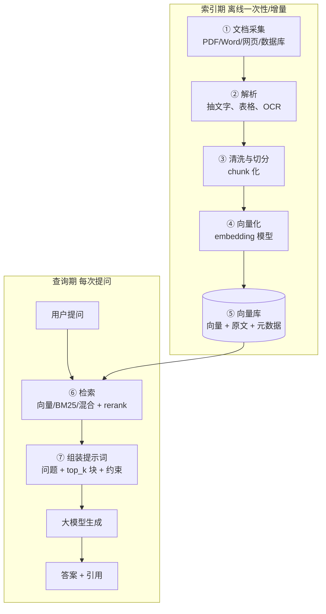
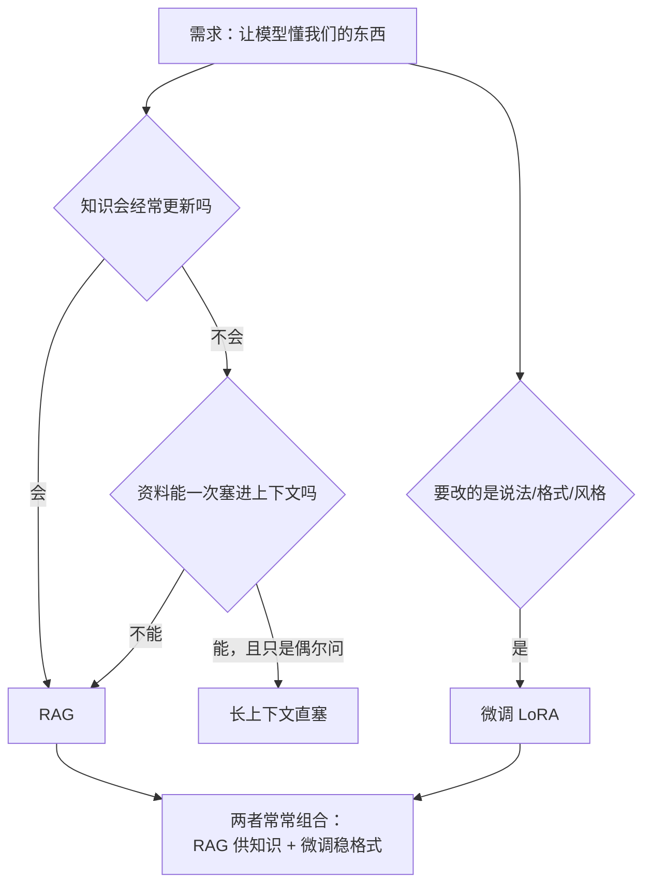

# RAG 原理与全链路

> [!abstract] 一句话讲清楚
> RAG 就是让模型**开卷考试**：回答前先去你的资料库里翻几页，把翻到的原文塞进提示词，再让模型照着答。模型本身没变聪明，但它答的内容从此来自你的文档，而不是它的记忆。

---

## 为什么重要

- 它是本地化交付里**出现频率最高、最容易卖出价**的一项：企业文档不能上传云端，本地模型 + 本地向量库是唯一可行路线。
- 上游：依赖 [[推理引擎 MOC]] 的 OpenAI 兼容 API 和 [[Embedding 与向量数据库]] 的向量化能力；下游：[[Dify 平台与工作流]] 把这条链路产品化，[[RAG 评估与调优]] 负责验收。
- 不知道全链路，排错就是瞎猜。实际现场 80% 的"答得不准"根本不是模型的问题，而是解析、切分、检索环节丢了信息。
- 一个真实场景：客户说"我们买了 Qwen 32B，怎么还不如网页版"。查下来是 PDF 扫描件没 OCR、chunk 切成 200 字、top_k=1。换成 OCR + 父子块 + top_k=8 + rerank，一周内效果就正常了，模型一行没换。

---

## 核心名词全解

| 名词 | 英文 / 缩写 | 大白话解释 | 容易混淆 / 注意 |
|---|---|---|---|
| RAG | Retrieval Augmented Generation | 先检索资料、再让模型带着资料回答 | 不是"给模型联网"，联网只是检索源的一种 |
| 索引期 | Indexing / Offline | 提前把文档洗好、切好、向量化、存进库 | 只在文档更新时跑，一次性的重活 |
| 查询期 | Retrieval / Online | 用户提问时去库里找最相关的几段 | 每次提问都跑，延迟敏感 |
| chunk | 块 / 片段 | 文档被切出来的一段文字，是检索的最小单位 | 不是"一篇文档"，切太大检索不准、太小丢上下文 |
| embedding | 向量化 / 嵌入 | 把一段文字压成一串数字，语义近的数字也近 | 不等于关键词匹配，字面不同但意思近也能命中 |
| 向量库 | Vector DB | 专门存这些数字、并能快速找"最像的"的数据库 | 它不是搜索引擎，通常是"向量检索 + 元数据过滤" |
| top_k | 召回条数 | 取最相似的 k 段塞给模型 | k 太大噪声多、上下文白白被占；k 太小容易漏 |
| rerank | 重排 | 先粗召回 50 段，再用精排模型挑出最相关的 5 段 | 和 embedding 不是一回事，rerank 能看 query 与 chunk 的交互 |
| 上下文窗口 | Context Window | 模型一次最多能读多少 token | RAG 不是"越大越好"，塞满会稀释注意力 |
| 幻觉 | Hallucination | 模型编出资料里没有的内容 | RAG 能降低但**不能消灭**，提示词里必须给"不知道就说不知道"的出口 |
| 引用 | Citation | 答案后面标出"出自第几页/哪段" | 企业客户最看重这个，可核查才敢用 |
| 召回率 | Recall | 该被找到的资料，实际上找到了多少 | 和生成质量是两件事，要分开测（见 [[RAG 评估与调优]]） |
| 忠实度 | Faithfulness | 答案是否只依据检索到的内容 | 低忠实度 = 模型在自由发挥，不是检索的锅 |

---

## 原理与机制

### 先讲直觉：开卷考试

闭卷考试靠记忆，模型参数里存的是"训练时见过的东西"；开卷考试靠翻书，答案从书里抄。RAG 就是给模型发一本书，但这本书是**临时抽出来的几页**——抽得准不准，决定了这次考试的成绩。

所以 RAG 的工程量几乎全在"怎么抽出对的几页"上，而不在模型本身。

### 关键机制：两个阶段、七步链路

RAG 的链路必须分成**索引期**和**查询期**两段来理解。这是全篇最重要的一件事：

- **索引期（离线、可慢、可重跑）**：把原始文档变成"库里能查的块"。这一步跑一次或按更新频率跑。
- **查询期（在线、要快、每次提问都跑）**：用户问题进来，找到块、拼提示词、生成答案。

两段的分界线是**向量库**。索引期往里写，查询期从里读。

> [!warning] 一句话记住这条图
> 索引期决定"库里有没有能用的东西"，查询期决定"能不能把它找出来、用得对"。两段的排错方法完全不同。

### 索引期四步各自在干什么

1. **文档采集**：把客户给的 PDF、Word、Excel、Confluence 导出、内网网页统一收拢。**格式越杂，后面越痛**，所以第一步就要列出"来源清单"。
2. **解析**：把文档抽成纯文本。文字版 PDF 可以直接抽；扫描版必须先 OCR；表格要保留行列结构，不要压成一行；图片里的信息要么 OCR、要么用多模态模型描述成文本。详见 [[文档解析与切分策略]]。
3. **清洗与切分**：去掉页眉页脚、目录、乱码，然后切成 chunk。切分是**对效果影响最大、又最容易被忽略**的一步（同一份文档，切法不同效果能差出一大截）。
4. **向量化与入库**：用 embedding 模型把每个 chunk 压成向量，连同原文、来源文件名、页码、章节等元数据存进向量库。元数据是后面做过滤和引用的基础，**入库时丢了，后面加不回来**。

### 查询期三步各自在干什么

1. **检索**：把用户问题也向量化，去库里找最相似的 k 段。工业上通常不止一种检索：向量检索（同义改写友好）+ 关键词检索（专有名词、编号、型号友好），两路合并去重，再用 rerank 模型精排。细节见 [[检索与 Rerank]]。
2. **组装提示词**：把问题、检索到的片段、系统约束拼成一个完整 prompt。这里的关键不是"塞更多"，而是**指令清楚**：只依据资料回答、资料没有就说没有、尽量给出处。见 [[提示词与上下文工程]]。
3. **生成**：模型输出答案。这一步的失败模式主要是两种：资料里明明有却答错（模型没用好），资料里没有却硬编（约束没给够）。

### 七步全链路速查表

| 步 | 阶段 | 做什么 | 验收标准 | 典型失败表现 |
|---|---|---|---|---|
| ① | 索引 | 采集文档 | 来源清单齐全、有更新机制 | 客户问的文档压根没进库 |
| ② | 索引 | 解析抽取 | 抽样人工核对，文字完整无乱码 | 扫描 PDF 抽出空文本 |
| ③ | 索引 | 清洗切分 | chunk 语义完整、不跨主题 | 一句话被切成两半 |
| ④ | 索引 | 向量化 | 同一 chunk 重跑结果稳定、维度对齐 | 换了 embedding 模型忘了重建库 |
| ⑤ | 索引 | 入库 | 元数据（来源/页码/章节）齐全 | 答出来了但给不出出处 |
| ⑥ | 查询 | 检索+重排 | 评测集命中率达标 | "文档里明明有"却检索不到 |
| ⑦ | 查询 | 生成 | 忠实度达标、能说"不知道" | 编造数字、答非所问 |

---

## 完整流程：从空目录到能演示

这一段按"输入 → 动作 → 输出 → 验收"走一遍，适合当交付 SOP 的骨架：

1. **输入**：客户文档包 + 一份"我们最想问的 20 个问题"。
   **动作**：建来源清单，按格式分类（可解析 / 需 OCR / 需人工整理）。
   **输出**：文档清单表。**验收**：客户确认"这些就是全部资料"。
2. **输入**：文档清单。
   **动作**：批量解析 + 抽样检查前 20 份。
   **输出**：纯文本/结构化文本。**验收**：随机抽 5 段原文，能在解析结果里对上。
3. **输入**：清洗后的文本。
   **动作**：按文档结构切分（先按标题切，再控长度），决定 chunk 大小与重叠。
   **输出**：chunk 列表。**验收**：随机看 10 个 chunk，每个单独拿出来能看懂在说什么。
4. **输入**：chunk。
   **动作**：选 embedding 模型、批量向量化、写库、带元数据。
   **输出**：可查询的向量库。**验收**：随便提一个文档里的名词，能召回正确来源。
5. **输入**：向量库 + 20 个问题。
   **动作**：配检索参数（top_k、阈值、是否 rerank），接生成模型。
   **输出**：可问答的 demo。**验收**：20 个问题里至少 15 个答对且带引用。
6. **输入**：客户补充的刁钻问题。
   **动作**：按 [[RAG 评估与调优]] 的方法分开定位"检索差"和"生成差"，逐项调。
   **输出**：调优记录。**验收**：命中率与忠实度都有数，不靠感觉。
7. **输入**：稳定链路。
   **动作**：加文档更新流程（增量索引）、加日志、加权限。
   **输出**：可运维系统。**验收**：新增一份文档，能在约定时间内被检索到。

> [!tip] 顺序不能反
> 不要先调提示词、先换模型。链路是串联的，**前面漏掉的信息后面补不回来**。先保证索引期干净，再谈查询期花活。

---

## 分类与对比：RAG / 长上下文 / 微调

这三条路线经常被客户混为一谈，其实解决的是不同问题。

| 维度 | RAG | 长上下文直塞 | 微调 |
|---|---|---|---|
| 解决什么 | 知识不在模型里、且会更新 | 资料量不大、一次性任务 | 改变说话方式/格式/领域风格 |
| 知识更新 | 改文档即可，不用重训 | 每次把资料贴进去 | 要重新造数据重训 |
| 事实可靠性 | 高（可引用原文、可核查） | 中（模型仍可能忽略或篡改） | 低（知识进权重就查不到出处） |
| 成本结构 | 一次性建库 + 每次检索 | 每次请求都贵（token 随资料线性涨） | 一次性训练成本 + 推理不变 |
| 延迟 | 多一次检索与重排 | 首 token 慢（要先读完长输入） | 与普通推理一样 |
| 可解释性 | 强，能给出处 | 中 | 弱 |
| 适合场景 | 企业知识库、客服、法规制度 | 单份长文档分析、临时任务 | 固定话术、输出格式、领域口吻 |
| 不适合 | 需要"改变说法风格" | 资料量超窗口、长期反复问 | 知识频繁变、要求可溯源 |

> [!important] 结论先给
> **默认从 RAG 起步**。长上下文适合"临时、单份、一次性的分析"；微调属于"锦上添花"，先有 RAG 再考虑，不要反过来。三者组合的完整取舍见 [[微调决策与 RAG 取舍]]。

---

## 决策点

- **岔路口 1：用 RAG 还是直接把文档贴进上下文？**
  判断依据：文档总量、是否长期反复问、是否需要出处。
  → **推荐**：超过"几份文档、十几页"的量，或者问题会被反复问，就上 RAG。只在单次分析场景用长上下文直塞，因为每次请求都要为整份资料付费。

- **岔路口 2：自己搭链路，还是用 Dify 这类平台？**
  判断依据：是否需要深度定制检索策略、是否要嵌进客户系统、团队会不会写代码。
  → **推荐**：验证期和标准化问答用 [[Dify 平台与工作流]]，快；需要精细控制切分/混合检索/权限/私有化对接时自研。平台做原型、自研做交付，是很常见的组合。

- **岔路口 3：先调检索还是先调生成？**
  判断依据：看评测数据里"检索能不能召回正确原文"。
  → **推荐**：永远先调检索。检索没捞到，生成再强也只能编。定位方法见 [[RAG 评估与调优]]。

- **岔路口 4：要不要上 rerank？**
  判断依据：向量召回 top_20 里正确片段的排名是否靠后。
  → **推荐**：只要本地 GPU 有余量、且对准确率有要求，就上 rerank。它通常比"换更大的生成模型"性价比高得多。

- **岔路口 5：chunk 切大还是切小？**
  判断依据：文档是"条目型"（制度、FAQ）还是"论述型"（报告、合同）。
  → **推荐**：条目型切小（按条目/标题），论述型用父子块（小块检索、大块喂给模型）。详见 [[文档解析与切分策略]]。

---

## 参数与配置说明

| 参数 | 作用 | 调大/调小的影响 | 常见取值 |
|---|---|---|---|
| chunk 大小 | 每个片段的字符/token 数 | 调大保上下文但检索变糊；调小检索准但答案缺上下文 | 中文 300~800 字，条目型更小 |
| chunk 重叠 | 相邻块的重叠长度 | 调大防切断语义，但库变大、重复召回变多 | chunk 的 10%~20% |
| top_k | 送进提示词的片段数 | 调大recall 上升、噪声与 token 也上升 | 初筛 20~50，精排后取 3~8 |
| 相似度阈值 | 低于阈值不送 | 调高更保守（更多"不知道"），调低更容易胡说 | 按 embedding 模型实测，别照抄 |
| rerank 候选数 | 进入重排的条数 | 调大更准但更慢 | 20~50 |
| 生成温度 | 输出随机性 | RAG 场景调高容易偏离资料 | 0~0.3 |
| 最大上下文 | 一次能塞多少 | 塞满会稀释注意力、变慢变贵 | 用到窗口的一半左右为宜 |
| 引用开关 | 是否标注来源 | 企业场景建议常开 | 开 |

---

## 架构变体速查

基础链路通了之后，客户的需求往往会推到几个变体上。先认清是哪种，再动手。

| 变体 | 相比基础 RAG 加了什么 | 解决什么问题 | 成本 | 什么时候值得上 |
|---|---|---|---|---|
| 朴素 RAG | 切块 + 向量检索 + 生成 | 让模型能回答文档里的内容 | 最低 | 文档不多、问题直接 |
| 高级 RAG | 查询改写、混合检索、Rerank、上下文压缩 | 召回不准、问法不匹配 | 中 | 文档上千份、客户抱怨找不到 |
| RAG-Fusion | 一个问题生成多个改写，多路召回后融合 | 单一问法召回不稳 | 中 | 用户问法五花八门 |
| GraphRAG | 先抽实体关系建成图，再按图检索 | 需要跨文档串联、总结性问题 | 高（构建很贵） | 合同、研报、知识网络类资料 |
| Agentic RAG | 由 Agent 决定查什么、查几次、要不要再查 | 复杂多跳问题 | 高（多轮调用慢） | 问题需要拆解和多步查证 |
| 多模态 RAG | 图片/表格也进索引（图生文或图向量） | 扫描件、图表、PPT 为主 | 中高 | 资料以图为主 |

判断口诀：

- 客户说"答得不对" → 先别升级架构，先补 **Rerank**（性价比最高的一步）。
- 客户说"换个问法就找不到" → 上 **查询改写 + 混合检索**。
- 客户说"能不能把好几份文档串起来讲" → 才考虑 **GraphRAG**。
- 客户说"要自己查好几轮才能答对" → 才考虑 **Agentic RAG**。

### 什么时候根本不该用 RAG

- 知识是**稳定且任务明确**的（比如固定格式抽取）→ 提示词 + 少样本可能就够。
- 需要模型**学会一种说话方式或领域风格** → 那是微调要解决的，见 [[微调决策与 RAG 取舍]]。
- 数据在**实时数据库**里 → 该走工具/API 查询，别硬塞进向量库。
- 客户真正要的是**搜索排序**，不是问答 → 用检索系统，别套 RAG 壳。

> [!warning] 别一上来就上高级架构
> 很多"效果差"其实是切分和 Rerank 的问题。直接堆 GraphRAG，等于把一个便宜的问题做成一个贵的坑。**先量基线，再升级。**

## 一页纸速查

演示或交付时最常被问的几件事，按这个顺序答：

| 客户的话 | 先查 | 再看 |
|---|---|---|
| "答得不对" | 检索回来的块对不对 | 生成阶段的提示词 |
| "找不到最新文档" | 索引是什么时候建的 | 重建/增量更新流程 |
| "答得太啰嗦" | 提示词有没有格式约束 | 加一条输出示例 |
| "不知道就该说不知道" | 有没有拒答约束 | 给"未提及"的标准话术 |
| "太慢了" | 检索耗时还是生成耗时 | 模型与硬件配置 |
| "回答没有出处" | 提示词是否要求标来源 | 前端有没有展示引用的位置 |

一句话：**RAG 的故障九成出在"送进去的东西"，一成出在"模型怎么说"。** 所以排错永远先看检索结果，再看提示词。

## 常见坑与误区

| 现象 | 原因 | 对策 |
|---|---|---|
| "文档里明明有，它说没有" | 解析没抽到（扫描件没 OCR）或切分把答案切碎了 | 先查解析文本，再查命中 chunk 原文，见 [[文档解析与切分策略]] |
| 答得很像但数字/条款是编的 | 提示词没约束、温度过高、检索到的是相似但不对的段落 | 给"资料不足就说不知道"的硬约束，温度降到 0.1，加 rerank 提高精度 |
| 换了 embedding 模型后效果崩了 | 旧库是用旧模型建的，向量空间不一致 | 换 embedding 必须**整库重建**，不能只换查询端 |
| 答案有出处但页码对不上 | 入库时元数据没保留或切分后页码错位 | 入库时把来源、页码、章节一起写进 metadata，展示时直接读元数据 |
| 用户问"上个月那个新规定"，答的还是旧版 | 文档更新了但没增量索引，或旧版本没删 | 建立更新流程：新增/覆盖/作废三类操作都要触发索引 |
| 多轮追问第三轮就跑题 | 每轮只拿当前问题检索，丢了前文语境 | 用"上下文改写"把追问改写成独立问题再检索，见 [[提示词与上下文工程]] |
| top_k 拉满，答案反而更糊 | 噪声片段稀释了关键信息，还挤占上下文 | 精排后只留 3~8 条，宁精勿多 |
| 客户拿"没问过的问题"测试，模型硬答 | 没有拒答策略 | 提示词 + 相似度阈值双保险，演示时主动演示"拒答" |

---

## 自检问题

- [ ] 能不能不看笔记，画出索引期和查询期两段链路，并指出两者的分界线是什么？
- [ ] 客户说"答不准"，你的排查顺序是什么？先查哪一步？
- [ ] chunk 大小和 top_k 分别影响什么？它们能互相补偿吗？
- [ ] RAG 和"把文档贴进上下文"的本质区别是什么？成本差在哪？
- [ ] 为什么说微调解决不了"知识会过期"的问题？
- [ ] 引用功能依赖哪些元数据？这些元数据应该在链路的哪一步写入？
- [ ] 同一份资料，你会怎么判断"检索差"还是"生成差"？
- [ ] 如果客户的文档是扫描件 PDF + 大量表格，你的流程要加哪两步？

---

## 自检问题参考答案

> [!success]- 1. 索引期和查询期各含哪几步？两者的分界线是什么？
> 索引期五步：**采集 → 解析 → 清洗切分 → 向量化 → 入库**；查询期三步：**检索（向量/BM25/混合 + rerank）→ 组装提示词 → 生成**。
> 分界线是**向量库**：索引期往里写，查询期从里读。索引期离线、可慢、可重跑；查询期在线、要快、每次提问都跑。

> [!success]- 2. 客户说"答不准"，排查顺序是什么？先查哪一步？
> 从链路后往前倒，先看**送进去的东西**：① 检索回来的块对不对；② 解析有没有抽到（扫描件没 OCR、答案被切碎）；③ 切分有没有把多个主题混在一块；④ 提示词有没有"只依据资料、不知道就说不知道"的约束；⑤ 最后才怀疑模型。
> 九成故障在前四步，模型只占一成——所以永远先看检索结果，再看模型怎么说。

> [!success]- 3. chunk 大小和 top_k 各影响什么？能互相补偿吗？
> chunk 决定检索的最小单位：**太大**向量变"平均脸"、召回糊、挤占上下文；**太小**检索准但答案缺上下文。top_k 是召回条数：大了噪声稀释注意力，小了容易漏。
> **不能互相补偿**。top_k 拉满反而更糊，因为噪声片段既占上下文又干扰判断；该动的是切分质量和 rerank，不是靠加 k 硬堆。

> [!success]- 4. RAG 和"把文档贴进上下文"的本质区别是什么？成本差在哪？
> 本质区别是**知识放哪**：RAG 放在外部库，回答前临时抽几页，改文档就更新，还能引用原文核查；直塞是每次把资料整个贴进提示词，知识从不沉淀。
> 成本差在**每次请求的 token**：直塞为整份资料反复付费、首 token 还慢；RAG 每次只付召回的那几段，建库是一次性成本。

> [!success]- 5. 为什么微调解决不了"知识会过期"的问题？
> 微调是把知识**焊进权重**：知识一更新就得重新造数据、重新训练，训完还查不到出处、没法引用核查。而企业资料是天天变的。
> 所以**知识类需求默认 RAG**；微调只用来改说话方式、输出格式、领域口吻，属于锦上添花，不能当知识库用。

> [!success]- 6. 引用功能依赖哪些元数据？该在链路的哪一步写入？
> 至少需要**来源文件名、页码、章节/小节标题、更新时间或版本、权限标签**。
> 写入时机是索引期第⑤步**入库**：切分完、向量化时和原文、向量一起写进同一条记录。**入库时丢了，后面加不回来**——引用、按部门过滤、旧版本作废全做不了。

> [!success]- 7. 同一份资料，怎么判断是"检索差"还是"生成差"？
> 把两条链路拆开测：先只测检索——看评测问题的正确答案块有没有被召回、排第几；再把**正确的块直接喂给模型**测生成。
> 检索召回不了 → 解析/切分/检索的锅；召回对了但答案还错 → 提示词约束、温度、模型的锅。不拆开就调，等于同时动两个变量，越调越乱。

> [!success]- 8. 客户的资料是扫描件 PDF + 大量表格，流程要加哪两步？
> ① **OCR 通道**：扫描件一律先 OCR 再入库，抽完抽样人工核对，空文本、乱码一律不进库。
> ② **表格结构化**：还原成"列名: 值"的自描述文本，一行一个 chunk、表头随行带上，表格整块不拆行。
> 这两步都在解析环节，做完再谈切分和检索，否则后面怎么调都救不回来。

## 相关笔记

- 上游：[[OpenAI 兼容 API 规范]]、[[上下文窗口与位置编码]]
- 下游：[[文档解析与切分策略]]、[[Embedding 与向量数据库]]、[[检索与 Rerank]]
- 验收：[[RAG 评估与调优]]
- 产品化：[[Dify 平台与工作流]]
- 对照：[[微调决策与 RAG 取舍]]
- 返回：[[应用集成 MOC]]

---

## 交付视角（对客户怎么讲）

- **大白话解释**："我们给模型配了一个你们的资料库。它回答前会先去库里翻，翻到哪几页就照着哪几页答，还会把出处标出来。它不会把资料之外的东西当真。"
- **客户最常问**："能不能保证百分之百准确？" 诚实回答：不能，但可以做到**可核查**——每条答案都有出处，人工扫一眼就知道对不对；同时通过"资料不足就说不知道"降低瞎编率。这两点比"准确率 99%"的承诺更可信。
- **报价拆项**：文档解析与入库（按份数/页数）、检索与问答链路搭建（一次性）、调优与评测（按轮次）、后续文档更新维护（按次/按月）。**别把"知识库"报成一个笼统总价**，否则客户一加文档你就白干。
- **演示技巧**：一定要演示一次"库里没有"的问题，让模型说出"资料中未提及"。这是把"会胡说"的顾虑按下去的最快方式。
