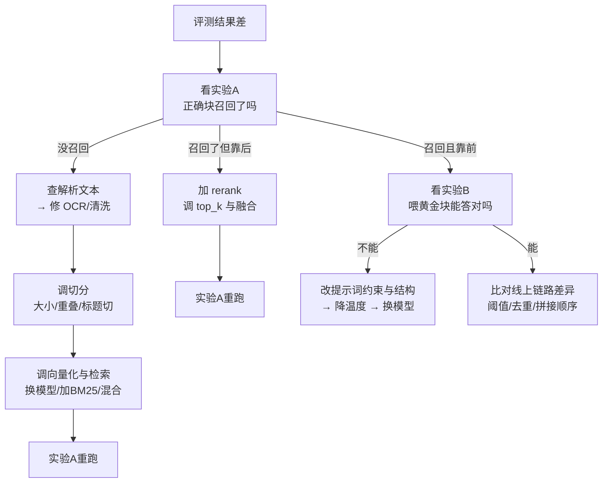

# RAG 评估与调优

> [!abstract] 一句话讲清楚
> RAG 是一条串联链路，答错可能是"没找到"也可能是"找到但没用对"。评估的核心不是打个总分，而是**把链路的每一段单独测一遍，先把责任定位到具体环节**，再动手改。定位错了，所有调优都是白费。

---

## 为什么重要

- 新手最常犯的错：答得不好 → 直接换更大的模型 / 改提示词。**九成情况下问题在检索**，换模型只是烧钱。
- 客户验收时不会说"忠实度 0.82"，他们会说"这个答案不对"。你必须有办法当场判断该改哪里。
- 没有评测集，你的每次"调优"都是靠感觉，今天好明天坏，也没法证明"更好了"。
- 上游：[[检索与 Rerank]]、[[文档解析与切分策略]] 是你要评估的对象；下游：[[Dify 平台与工作流]] 上线前的验收、[[监控与日志]] 里的线上质量跟踪。
- 真实场景：客户说"你们这套不如我直接问 ChatGPT"。跑一遍分阶段评测发现：检索命中率只有 40%（扫描件没 OCR），模型本身没问题。修解析，一天解决。

---

## 核心名词全解

| 名词 | 英文 / 缩写 | 大白话解释 | 容易混淆 / 注意 |
|---|---|---|---|
| 评测集 | Eval Set | 一批"问题 + 标准答案 + 正确出处"的样本 | 不是随便凑，要覆盖真实提问方式 |
| 黄金块 | Gold Chunk | 能回答该问题的那段原文 | 由人标注，是检索评测的判据 |
| 命中率 | Hit Rate | 正确块有没有出现在召回结果里 | 只看"有没有"，不看排第几 |
| 召回率@k | Recall@k | 前 k 条里覆盖了多少该找的信息 | k 要和实际用的 final_k 对齐 |
| MRR | Mean Reciprocal Rank | 正确块排名倒数的平均值，越靠前越高 | 适合衡量"排得够不够前" |
| 上下文精度 | Context Precision | 召回里有多少是真相关的 | 衡量噪声比例 |
| 忠实度 | Faithfulness | 答案是不是只依据了给定的上下文 | 低忠实度 = 模型在自由发挥 |
| 答案相关性 | Answer Relevance | 回答有没有切题 | 和忠实度是两个维度，可以一个高一个低 |
| 端到端评测 | End-to-end Eval | 只看最终回答对不对 | 简单但**无法定位问题** |
| 分阶段评测 | Component Eval | 检索单独测、生成单独测 | 定位问题的唯一实用方法 |
| LLM-as-judge | 模型当裁判 | 用另一个强模型给答案打分 | 便宜但有偏，必须人工抽检校准 |
| 归因 | Attribution / Diagnosis | 把错误定位到具体环节 | 这一篇的核心技能 |
| 回归测试 | Regression Test | 改完一个地方，把评测集重跑一遍 | 防止"修好 A 弄坏 B" |
| 拒答率 | Abstention Rate | 资料不足时会不会老实说不知道 | 企业场景要专门测 |

---

## 原理与机制

### 直觉：串联电路的故障排查

RAG 是一串串联环节：解析 → 切分 → 向量化 → 检索 → 重排 → 拼提示词 → 生成。**任何一环断了，最终答案都是错的**，而且从最终答案上根本看不出是哪一环。

就像家里灯不亮：可能是灯泡、开关、线路、还是总闸？你不能靠"换一个更贵的灯泡"来解决跳闸。

所以评估的第一原则：**先分段测量，再定位，再动手。**

### 机制一：两个必须做的"分离实验"

这是新手最缺、也是最有效的两招：

**实验 A：只测检索，不接生成。**
拿评测集里的问题去检索，看正确块（黄金块）有没有出现在召回结果里，排第几。
- 如果正确块**没出现** → 100% 是检索侧问题（解析/切分/embedding/检索策略）。
- 如果出现了但排很后 → 是检索排序问题，上 rerank / 调参数。

**实验 B：把黄金块直接塞给模型。**
跳过检索，把人工标注的正确原文直接拼进提示词，让模型回答。
- 如果这样**能答对** → 说明模型和提示词没问题，锅在检索。
- 如果这样**还是答错** → 锅在提示词约束或模型能力，与检索无关。

| 实验 A（检索命中） | 实验 B（喂黄金块能答对） | 结论 | 优先改哪里 |
|---|---|---|---|
| 否 | 是 | 检索问题，占大多数 | 解析 → 切分 → 检索策略 |
| 否 | 否 | 两头都有问题 | 先修检索，再修提示词/换模型 |
| 是（但排很后） | 是 | 排序问题 | rerank、top_k、融合策略 |
| 是（且靠前） | 否 | 生成问题 | 提示词约束、温度、上下文排布、换模型 |
| 是 | 是但答案是错的 | 标注/评测集本身有问题 | 复核黄金答案 |

> [!important] 这两招的价值
> 做完 A 和 B，你就能在 10 分钟内把"效果差"归属到检索或生成。**没有这一步，所有讨论都是猜。**

### 机制二：错误的四种类型，分别对应不同改法

| 错误类型 | 表现 | 根因方向 | 改法 |
|---|---|---|---|
| 检索未命中 | 答案在文档里，但没被召回 | 解析丢失 / chunk 太大或太小 / embedding 弱 / 缺关键词那路 | 修解析、改切分、加混合检索 |
| 检索命中但被淹没 | 召回里有，但排在后面被截断 | top_k 太小 / 无 rerank / 噪声多 | 加 rerank、提高初筛、降噪 |
| 上下文正确但答错 | 正确原文在提示词里，模型答偏 | 提示词约束弱 / 指令不清 / 上下文太长 / 模型能力不足 | 改 prompt 结构、缩短上下文、换更强模型 |
| 无据编造 | 资料里根本没有，模型硬编 | 没给拒答出口 / 温度高 / 没有阈值 | 加"资料不足就说不知道"、加阈值、降温度 |

### 机制三：LLM-as-judge 怎么用才不坑

用强模型（本地部署一个够强的就行）当裁判给答案打分，成本低、可批量。但它有明确缺陷：

- **偏好长答案、格式漂亮的答案**，哪怕内容空。
- **对"部分正确"过于宽容**，尤其数字类。
- **裁判模型和生成模型同源时**，会自己偏袒自己。
- **不稳定**：同一份答案换个问法让它评，结论可能不同。

所以正确用法是：**用 judge 做批量初筛和趋势对比，用人工抽检做校准和最终验收。** 关键指标（是否编造数字、是否引用错误页面）必须人工看。裁判 prompt 里要写清评分维度和"不确定就标 unsure"的出口。

### 机制四：调优的正确顺序

链路是串联的，后面的调优补偿不了前面的信息丢失。所以顺序固定：

| 顺序 | 调什么 | 预期收益 | 成本 |
|---|---|---|---|
| 1 | 解析（OCR、清洗、表格） | 大 | 低（主要是人力） |
| 2 | 切分策略 | 大 | 低 |
| 3 | embedding 模型 | 中~大 | 中（要重建库） |
| 4 | 混合检索 + rerank | 中~大 | 中（算力） |
| 5 | top_k / 阈值 / 融合参数 | 中 | 低 |
| 6 | 提示词与上下文排布 | 中 | 低 |
| 7 | 换生成模型 | 小~中 | 高（算力/钱） |

> [!tip] 按这个顺序调
> 换模型排在最后，是因为前面每一项都能白拿收益，而换模型要多占显存、拉高成本。**先把免费的调完再花钱。**

---

## 完整流程：搭一套能用的评测

1. **输入**：客户业务 + 文档。
   **动作**：找 3~5 个最懂业务的人，各出 10 条"我真正会问的问题"，覆盖：简单事实、跨段推理、精确编号、需要拒答、多轮追问。
   **输出**：50 条左右的问题集。**验收**：问题都来自真实场景，不是自己编的。
2. **输入**：问题集。
   **动作**：为每条标"黄金块"（正确原文在哪）和"标准答案"（关键要点即可，不写完整段落）。
   **输出**：带标注的评测集。**验收**：标注人之间对"哪段是正确出处"基本一致。
3. **输入**：评测集。
   **动作**：跑实验 A（只检索），算命中率和 MRR。
   **输出**：检索指标。**验收**：能说出"正确块前 5 命中的比例"。
4. **输入**：评测集。
   **动作**：跑实验 B（喂黄金块），看生成是否正确、是否忠实。
   **输出**：生成指标。**验收**：能区分"答错"和"编造"。
5. **输入**：两份指标。
   **动作**：按前面那张对照表归因，列出问题清单。
   **输出**：待办列表（按预期收益排序）。**验收**：每条待办都对应一个具体环节。
6. **输入**：待办列表。
   **动作**：逐项修改，每次只改一个变量，改完重跑评测集。
   **输出**：指标变化记录。**验收**：每项改动有前后对比，能证明有效或无效。
7. **输入**：稳定版本。
   **动作**：加线上监控——记录每次提问的召回片段、最终答案、用户反馈（点赞/点踩）。
   **输出**：线上质量看板。**验收**：出现新问题时，能从日志里还原当时的检索结果。

---

## 决策点

- **岔路口 1：客户没给评测集，要不要自己造？**
  判断依据：有没有真实用户提问记录。
  → **推荐**：一定要造，30~50 条起步。**没有评测集的交付等于没有验收标准**。让客户业务人员出题，比你自己编强十倍。

- **岔路口 2：用 LLM-as-judge 还是全人工？**
  判断依据：评测规模和精度要求。
  → **推荐**：批量趋势用 judge，最终验收人工抽 20% 校准。**关键指标（数字、引用、条款）必须人工**。

- **岔路口 3：端到端分数够不够，还要不要分阶段？**
  判断依据：是否需要定位问题。
  → **推荐**：**永远要分阶段**。端到端只用来对外汇报和回归，分阶段才是干活用的。

- **岔路口 4：先修检索还是先改提示词？**
  判断依据：实验 A、B 的结论。
  → **推荐**：先修检索。提示词再漂亮，也补不回没召回的原文。

- **岔路口 5：要不要换更强的生成模型？**
  判断依据：实验 B 里喂了正确原文仍答不对，且提示词已优化过。
  → **推荐**：这时才考虑换模型。而且优先考虑"换更擅长遵循指令的模型"，不是"换参数更大的"。

- **岔路口 6：拒答率算不算指标？**
  判断依据：企业场景是否要求"不懂别乱说"。
  → **推荐**：算，而且要单独测。**宁可多拒答，不可多编造**——这是企业交付的信任底线。

---

## 参数与配置说明

| 参数 | 作用 | 调大/调小的影响 | 常见取值 |
|---|---|---|---|
| 评测集规模 | 覆盖多少真实问题 | 太小没统计意义，太大标注成本高 | 30~100 条起步 |
| recall@k 的 k | 评估哪个位置的召回 | 要与线上 final_k 一致 | 与线上一致，另看 k=20 |
| judge 温度 | 裁判模型的随机性 | 高→评分不稳定 | 0 |
| 人工抽检比例 | 校准 judge 的样本量 | 高→更可信但更慢 | 15%~20% |
| 拒答判定阈值 | 什么情况必须拒答 | 高→更保守但漏答 | 与相似度阈值联动 |
| 回归触发条件 | 什么时候重跑评测 | 不设就会漏掉退化 | 每次改切分/模型/提示词 |

> [!warning] 评测集要保密
> 评测集泄露给客户或被用在 prompt 里，就失去意义了。**版本化保存，改一版记一版**，别覆盖。

---

## 评估集怎么造

没有评估集的调优，全是"感觉好像好了点"。造评估集不难，难在肯花那半天。

**来源优先级**：真实用户日志 > 客服记录 > 销售/实施同事常被问的问题 > 自己编。自己编的问题永远太"标准"，测不出真实分布。

**规模与构成**：先 20~30 条就能用。建议这样配：

| 类型 | 占比 | 目的 |
|---|---|---|
| 常见问题 | 一半左右 | 保证主干能力没退化 |
| 边缘/刁钻问题 | 两三成 | 测边界，别只看平均分 |
| 库里没有答案的问题 | 一两成 | 测它会不会老实说"不知道" |
| 多跳/需要串联的问题 | 一两成 | 测检索上限 |

**每条标注什么**：问题、标准答案要点（不用逐字）、正确答案在哪几块/哪份文档。最后一项是能分离"检索差"和"生成差"的关键。

**怎么维护**：线上每出现一次严重错误，就把这条补进去。一周后跑一遍，防止旧问题复发。

> [!important] 评估集是资产
> 它比提示词更值钱，因为换模型、换切分、换引擎它都能复用。交付时一起给客户，后续维护才有依据。

## 上线后盯哪些指标

| 指标 | 看什么 | 异常说明什么 |
|---|---|---|
| 检索命中率 | 正确文档有没有被召回 | 掉 → 数据更新了但索引没重建 |
| 引用率 | 回答里有没有标来源 | 掉 → 提示词被改坏，或模型换了 |
| 拒答率 | 答"不知道"的比例 | 突然升高 → 检索坏了；突然为零 → 在瞎编 |
| 平均延迟 | 端到端耗时 | 涨 → 模型或向量库压力上来了 |
| 人工反馈/差评率 | 用户点踩比例 | 最真实的指标，要能追到具体问题 |
| 索引新鲜度 | 文档更新到可检索的间隔 | 逾期 → 增量更新流程断了 |

这些指标要配合 [[监控与日志]] 一起看。**RAG 的故障常常发生在检索侧，模型服务本身可能一切正常。**

## 调优记录怎么写

| 日期 | 改了什么 | 指标变化 | 结论 |
|---|---|---|---|
| 例：第 1 周 | 块大小从 1000 调到 500 | 命中率略升，答案完整性略降 | 保留，配合上下文头 |
| 例：第 1 周 | 加 Rerank | 前三名命中率明显上升 | 保留 |
| 例：第 2 周 | 换 embedding 模型 | 无变化，重建成本高 | 回滚 |

规则很简单：**一次只改一个变量，没变好就回滚，别留着"反正也没坏处"。** 改动多了互相影响，最后谁也说不清是哪一步起的作用。

## 常见坑与误区

| 现象 | 原因 | 对策 |
|---|---|---|
| 每次调完都"感觉变好了"，客户还是不满意 | 没有固定评测集，靠主观感受 | 建评测集，每次改动跑同一套题，看数字 |
| 修好一个问题，另外三个问题坏了 | 改了切分或检索参数影响了全局 | 每次只改一个变量，改完跑全量回归 |
| 评测分很高，线上却很差 | 评测问题太"标准"，真实用户说话更随意 | 评测集必须包含真实的、口语化的、模糊的提问 |
| judge 说 8 分，人工看是胡说 | judge 偏爱长而流畅的答案 | 人工抽检校准 + 裁判 prompt 明确"无据即 0 分" |
| 检索命中率 90%，但答案还是错 | 只测了"有没有召回"，没测"排第几" | 加 MRR / 引入 rerank 前后对比 |
| 客户拿"文档之外"的问题测，系统硬答 | 没有拒答指标，也没有阈值 | 评测集里固定放 5 条"应该拒答"的题 |
| 换 embedding 后忘了重跑评测 | 流程没固化 | 把"重建库 + 重跑评测"写成交付 SOP 的固定步骤 |
| 线上答错了却复现不出来 | 没记录当次召回内容和提示词 | 日志里保存 query、召回 chunk id、最终 prompt、输出 |

---

## 自检问题

- [ ] 除"端到端准确率"外，你还会测哪两组指标？各自怎么跑？
- [ ] 客户说答得不准，你的前三步动作是什么？
- [ ] 检索命中率 90% 但答案错，最可能是什么问题？
- [ ] 喂了正确原文还是答错，说明什么？下一步改哪？
- [ ] LLM-as-judge 有哪些系统性偏差？怎么校准？
- [ ] 调优顺序为什么是"解析→切分→embedding→检索→rerank→提示词→模型"？
- [ ] 为什么评测集里必须放"应该拒答"的问题？
- [ ] 线上出问题后，日志里至少要保存什么才能复现？

---

## 自检问题参考答案

> [!success]- 1. 除"端到端准确率"外，你还会测哪两组指标？各自怎么跑？
> 两组**分阶段指标**：① **检索组**——跑实验 A（只检索、不接生成），算命中率、Recall@k、MRR，看正确块有没有召回、排第几；② **生成组**——跑实验 B（把黄金块直接塞给模型），看答案是否切题、是否忠实、该拒答时有没有拒。
> 端到端分数只用于对外汇报和回归测试，定位问题靠这两组。

> [!success]- 2. 客户说答得不准，你的前三步动作是什么？
> ① **实验 A**：只跑检索，看正确块（黄金块）召回没有、排第几；② **实验 B**：把黄金块手动塞进提示词，看模型能不能答对；③ 按对照表归因，排出待办清单再动手。
> 顺序的关键是先分清"检索差"还是"生成差"——不拆开就调，等于同时动两个变量。

> [!success]- 3. 检索命中率 90% 但答案错，最可能是什么问题？
> 多半是**排序问题**：正确块召回到了、但排很后被淹掉，或者 final_k 太小把它截断了。所以要测 MRR，不能只测"有没有召回"。
> 对策是加 rerank、调大初筛 top_k、精排后取 3~8 条、去重降噪；如果正确块就在前几名还答错，才轮到查提示词和生成。

> [!success]- 4. 喂了正确原文还是答错，说明什么？下一步改哪？
> 说明锅在**生成侧，与检索无关**：提示词约束太弱、指令不清、上下文太长稀释了注意力、温度偏高，或者模型能力不够。
> 下一步按顺序改：提示词结构（明确"只依据资料回答、给拒答出口"）→ 降温度 → 缩短上下文。这些都试过还不行，才考虑换更擅长遵循指令的模型。

> [!success]- 5. LLM-as-judge 有哪些系统性偏差？怎么校准？
> 四个偏差：**偏爱长而流畅、格式漂亮的答案**；对"部分正确"过于宽容（尤其数字）；和生成模型同源时偏袒自己；同一答案换个问法评分就不稳定。
> 校准：judge 温度设 0、裁判 prompt 写清评分维度和"无据即 0 分"、留 unsure 出口；用人工抽检 15%~20% 对齐，编数字、引用错页这类关键指标必须人工看。

> [!success]- 6. 调优顺序为什么是"解析→切分→embedding→检索→rerank→提示词→模型"？
> 因为链路串联，**后面补不回前面丢的信息**：解析没抽到、切分切碎了，rerank 和提示词都救不回来。
> 同时按成本排：解析和切分收益大、几乎只花人力；embedding 要重建库；检索和 rerank 要算力；提示词便宜；换模型最贵、收益最小。**先把免费的调完，再花钱。**

> [!success]- 7. 为什么评测集里必须放"应该拒答"的问题？
> 因为企业客户最在意"不懂别乱说"，而模型天生倾向于硬答。放一两成"库里没有答案"的问题，才能测出拒答率、验证阈值加提示词的双保险有没有生效。
> 没有这类样本，就发现不了系统在文档外的问题上编造。线上拒答率突然掉到零，往往就是开始瞎编的信号。

> [!success]- 8. 线上出问题后，日志里至少要保存什么才能复现？
> 原始问题、**改写后的 query**、召回的 chunk id 与原文、精排分数、最终拼出的完整 prompt、模型输出、模型名与温度、时间戳。
> 有了召回内容和 prompt 才能离线复现和归因；只存一句最终答案，等于断案没有证据，只能互相猜。

## 相关笔记

- 上游：[[RAG 原理与全链路]]、[[检索与 Rerank]]
- 下游：[[Dify 平台与工作流]]（平台上的评测与发布）、[[监控与日志]]
- 评测对象：[[文档解析与切分策略]]、[[Embedding 与向量数据库]]
- 跨领域：[[训练监控与评估]]（微调的评测思路可对照）
- 返回：[[应用集成 MOC]]

---

## 交付视角（对客户怎么讲）

- **大白话解释**："我们不靠感觉说'效果不错'。上线前会拿您同事真实会问的几十个问题做一套卷子，分两段考：先考'资料找得对不对'，再考'照着资料答得对不对'。哪一段不及格就补哪一段，最后给您一份分数表。"
- **客户最常问**："能不能保证准确率？" 答：不能保证固定数字，但能保证**每一类问题的表现都可测量**，而且问题出现时能定位到具体环节。这比一口价承诺更实在。
- **报价拆项**：评测集共建（按条数/人天）、分阶段评测与归因（按轮次）、调优迭代（按轮次）、上线后质量跟踪（按月）。**评测是重人力活，必须单独计费**，别打包进"搭建费"里。
- **演示技巧**：现场演示一次"先定位再修"的过程——问一个答错的问题，跑检索看命中，然后说"这里没召回，所以我们要调切分"。客户会觉得你专业，而不是在碰运气。
