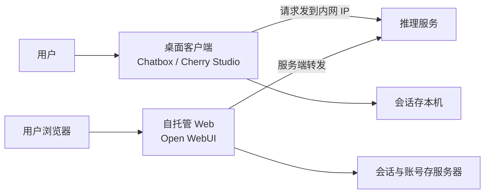

# 客户端 UI 工具

> [!abstract] 一句话讲清楚
> 你部署的模型默认只能靠 `curl` 和代码调用，客户没法用。**客户端就是给模型套一个能聊天、能传文件、能建知识库的界面**——它自己不聪明，聪明的是背后那个 API。这一篇讲清楚 Cherry Studio、Chatbox、Open WebUI、LM Studio 这几类壳怎么选、怎么连、坑在哪。

---

## 为什么重要

- 客户验收模型部署，第一眼看的就是**能不能像 ChatGPT 一样用**。你给他一个 API 文档，他觉得你没交付完。
- 客户端是"演示效果放大器"：同一模型，在一个配好的客户端里看起来专业十倍。也是"事故放大器"：配错一处，客户以为模型不行。
- 桌面客户端和自托管 Web 客户端是两条路线，**单机自用**和**团队共享**的选型完全不同，选错了后面要重来。
- 上游：[[OpenAI 兼容 API 规范]]、[[服务化与 API 鉴权]]；下游交付验收：[[工程化交付 MOC]]。多用户场景要接鉴权与日志，见 [[监控与日志]]。

---

## 核心名词全解

| 名词 | 英文 / 缩写 | 大白话解释 | 容易混淆 / 注意 |
|---|---|---|---|
| 客户端 / 前端 | Client / Frontend / UI | 给模型套的界面软件 | 它不产模型，也不提升模型能力 |
| 服务商 | Provider | 客户端里的"模型来源"配置项 | 选"OpenAI 兼容"那条自定义项 |
| base_url | API 基地址 | 客户端去哪找你的推理服务 | 要填到 `/v1`，别填网页地址 |
| API key | 密钥 | 通行证，本地服务常能随便填 | 很多客户端不允许填空 |
| 模型列表 | Model List | 客户端能选哪些模型 | 拉不到时手填模型 id 即可 |
| 桌面客户端 | Desktop App | 装在 Windows/Mac 上的独立软件 | 数据存在本地，单机用最方便 |
| 自托管 Web | Self-hosted Web | 跑在服务器上、浏览器打开的界面 | 能多人共用，但要配账号与权限 |
| 知识库 | Knowledge Base | 客户端里上传文档后能"问文档" | 背后是 RAG，要单独的 embedding 模型 |
| 向量化模型 | Embedding Model | 把文字变成向量的模型 | 知识库能不能用，取决于它配没配好 |
| 多模型对比 | Multi-model Compare | 同一个问题同时问几个模型 | 翻几倍请求量，也会翻几倍延迟 |
| 助手 / 预设 | Assistant / Preset | 绑定了系统提示词的对话模板 | 换模型后提示词可能不再适配 |
| 会话上下文 | Context | 发给模型的最近若干轮对话 | 客户端自己决定截断，不是模型决定 |
| 流式输出 | Streaming | 一个字一个字冒出来 | 关掉能排查卡死问题 |
| 代理 | Proxy | 客户端走不走系统代理 | 内网地址走代理会直接连不上 |
| 本地存储 | Local Storage | 会话记录存在哪、是否明文 | 私有化场景要能说清数据落盘位置 |

---

## 原理与机制

### 直觉：客户端是遥控器，模型是电视

遥控器再花哨也不能自己放节目。客户端做的事只有三件：

1. **把人和模型之间的话整理好**：拼系统提示词、带历史对话、附上上传的文件内容。
2. **发 HTTP 请求**：按 OpenAI 兼容格式请求你部署的服务。
3. **把结果渲染出来**：Markdown、表格、公式、代码高亮、流式打字机效果。

所以判断一个客户端好不好，不看它界面多漂亮，而看三件事：**连得稳不稳、上下文管得好不好、文件与知识库处理得对不对**。

### 机制一：连上本地服务就是配三个值

所有客户端接本地模型，本质都是填三个值：

| 配置项 | 填什么 | 从哪来 |
|---|---|---|
| 接口类型 | OpenAI 兼容 / OpenAI API | 客户端下拉里选自定义那项 |
| base_url | `http://服务器IP:端口/v1` | 推理服务启动日志或部署文档 |
| API key | 服务端要求的 key，没要求就随便填 | 服务配置；本地服务常见为空 |

模型名有两种给法：能自动拉列表的就点刷新；拉不到的（很多推理服务没实现 `/v1/models`）就**手动输入模型 id**，必须和服务端认的那个字符串一模一样。

### 机制二：桌面壳 vs 自托管 Web——数据在哪，决定了能怎么交付

- **桌面壳**：装了就两个人用（一人一台机器），不需要服务器额外资源，会话在本地。适合单人、演示、给领导试用。
- **自托管 Web**：所有人浏览器访问同一个地址，账号、历史、知识库集中在服务器上。适合团队共享，但要额外运维一个 Web 服务，还得处理登录、权限、备份。

> [!important] 判断口诀
> **一个人用 → 桌面；一群人用 → Web。** 别为了"看起来专业"给单机用户上 Web 服务，多维护一个组件只会多一个故障点。

### 机制三：知识库功能 = 客户端内置了一个 RAG

很多客户端都带"知识库/文档问答"，点几下就能上传 PDF 问问题。要理解它背后其实是：

1. 客户端把你的文档切块；
2. 调**向量化模型**把块变成向量，存到本地或服务端的向量库里；
3. 你提问时先检索相关块，再拼进提示词发给对话模型。

这条链上有三个东西可能没配：**切块参数、embedding 模型、对话模型**。文档问答不准，八成是检索没捞到而不是模型笨。排查思路和自建 RAG 一样，见 [[RAG 评估与调优]]。

> [!warning] 别把客户端知识库当企业级方案
> 客户端的知识库适合个人和小组，文档几十份量级。要权限隔离、要增量更新、要审计、要几千份文档——得上专门平台，见 [[Dify 平台与工作流]]。

### 机制四：上下文是客户端在管

客户端发给模型的不是"全部聊天记录"，而是它自己裁过的最近若干条。所以会出现同一个模型在两个客户端里表现不一样：一个记得住前面，一个转头就忘——往往是客户端的历史条数或上下文预算配得不同。

这也是"换客户端好像换了个模型"的原因之一。调参位置一般在设置里的"上下文消息数 / 历史轮数 / 最大上下文"。

---

## 完整流程：从装软件到能交付

1. **输入**：已跑起来的推理服务。
   **动作**：确认服务地址、端口、模型 id，先 `curl` 一句聊天请求跑通。
   **输出**：可用的连接参数。**验收**：命令行能拿到回复。**这一步不过，别去装客户端。**
2. **输入**：连接参数。
   **动作**：选客户端形态——单人桌面壳，团队用 Web 壳。
   **输出**：装好的客户端。**验收**：软件能正常启动。
3. **输入**：客户端。
   **动作**：新增服务商，接口类型选 OpenAI 兼容，填 base_url / key / 模型 id。
   **输出**：服务商配置。**验收**：能发一句话收到回复。
4. **输入**：能聊天的配置。
   **动作**：测中文、长输出、Markdown 表格、代码块。
   **输出**：渲染正常。**验收**：没有乱码、没有公式炸开、没有半截截断。
5. **输入**：正常聊天。
   **动作**：测上传文件与知识库（如果客户要）。
   **输出**：能基于文档回答。**验收**：问一个文档里明确写着的问题，答案正确。
6. **输入**：单机可用。
   **动作**：如需多人，部署 Web 版，配好账号与局域网访问。
   **输出**：团队可访问地址。**验收**：别人电脑能打开并对话。
7. **输入**：交付清单。
   **动作**：写清配置步骤、截图、常见问题，教客户自己加模型。
   **输出**：使用手册。**验收**：客户能自己完成一次"新增一个模型"的操作。

---

## 分类与对比

| 工具 | 形态 | 平台 | 知识库 | 多模型对比 | 多人共用 | 适合场景 |
|---|---|---|---|---|---|---|
| Cherry Studio | 桌面 App | Windows / Mac / Linux | 有 | 有，界面做得顺 | 否 | 单人日常、演示、多服务商切换 |
| Chatbox | 桌面 App + 简易 Web | 主流桌面平台 | 较弱或需配合 | 有 | 弱 | 极简、只想要个聊天框 |
| Open WebUI | 自托管 Web | Docker 部署，浏览器访问 | 有，支持较完整 | 有 | 是，带账号体系 | 团队共享、内网门户、知识库 |
| LM Studio | 桌面 App（自带推理） | Windows / Mac / Linux | 有 | 有 | 否 | 本地试模型、单机快速验证 |

> [!tip] 一句话选型
> 只想有个聊天框 → Chatbox；要好看好用、经常切模型 → Cherry Studio；团队门户 + 知识库 → Open WebUI；只是自己试试这个模型行不行 → LM Studio。

### 桌面壳与 Web 壳的关键差异

| 维度 | 桌面壳 | 自托管 Web 壳 |
|---|---|---|
| 数据落在哪 | 各自电脑 | 服务器统一 |
| 谁能用 | 装了的机器 | 内网能访问的人 |
| 运维成本 | 几乎为零 | 要跑容器、备份、升级 |
| 权限控制 | 基本没有 | 有账号与角色 |
| 离线可用 | 只要连得上内网就行 | 需要服务器在 |
| 适合交付形态 | 给个人/领导演示 | 给部门做统一入口 |

---

## 决策点

- **岔路口 1：桌面壳还是 Web 壳？**
  判断依据：使用人数、是否需要统一入口、是否需要权限。
  → **推荐**：1~2 人用桌面壳；5 人以上、要统一入口就上 Web 壳。**代价**：Web 壳多一个要维护的组件，出问题时要多查一层。
- **岔路口 2：用客户端自带知识库，还是接 Dify/自建 RAG？**
  判断依据：文档数量、是否要权限隔离、是否要增量更新。
  → **推荐**：几十份文档、个人用，客户端自带够；上百份、要多人共用和权限，上专业平台。**代价**：平台方案部署与调优成本更高。
- **岔路口 3：要不要给客户装多个客户端？**
  判断依据：客户技术水平、演示时长。
  → **推荐**：**只装一个，配好，教会他用。** 装三个的结果是每个都半懂，出问题说不清。
- **岔路口 4：会话数据怎么存？**
  判断依据：客户对数据落地的要求。
  → **推荐**：私有化场景默认桌面壳本地存 + 明确告知；有合规要求时用 Web 壳集中存并做备份与清理策略，见 [[安全与合规]]。
- **岔路口 5：模型列表拉不到怎么办？**
  判断依据：服务端有没有实现 `/v1/models`。
  → **推荐**：直接手动填模型 id，这是最常见也最省事的解法。**别因为拉不到列表就判断服务连不上。**
- **岔路口 6：客户端卡顿/输出慢，怪谁？**
  判断依据：先看服务端日志与 GPU 占用。
  → **推荐**：先用 `curl` 测同一问题，命令行快而客户端慢，就是客户端的问题（渲染、代理、插件）；命令行也慢，才是服务端。**先分离，再归因。**

---

## 参数与配置说明

| 配置项 | 作用 | 填错的表现 | 常见值 |
|---|---|---|---|
| 接口类型 | 决定请求格式 | 选错全盘不可用 | OpenAI 兼容 |
| base_url | 服务地址 | 404 / 连不上 | `http://内网IP:端口/v1` |
| API key | 鉴权 | 401 | 服务端要求则必填 |
| 模型 id | 选哪个模型 | 模型不存在 | 照抄服务端名字 |
| 上下文消息数 | 带几轮历史 | 太小→忘前文；太大→慢且爆窗口 | 10~20 轮 |
| 温度 | 随机性 | 高→胡说 | 0.3~0.7 聊天，0~0.2 干活 |
| 最大输出 | 单次长度 | 太小→话说一半 | 2048~4096 |
| 流式输出 | 打字机效果 | 关掉可排卡死 | 开 |
| 代理 | 是否走系统代理 | 内网地址走代理→连不上 | 内网直连 |
| embedding 模型 | 知识库向量化 | 知识库建不起来/检索不准 | 选服务端有的向量模型 |
| 切块大小 | 知识库分块 | 太小→断章；太大→不准 | 一般几百字级别 |

> [!note] 端口要写对
> 推理服务端口、Web 客户端端口、反向代理端口是三个不同的东西。交付文档里每个端口都要写清用途，否则客户永远在填错的那个上面试。

---

## 自托管 Web 客户端部署要点

这类客户端通常是一个容器，部署难点不在启动，而在这几处：

| 要点 | 做法 | 不做会怎样 |
|---|---|---|
| 持久化 | 把数据目录挂到宿主机卷 | 重装/升级容器后会话与知识库全没了 |
| 端口与访问地址 | 明确对内对外的地址与端口 | 生成的链接点不开、上传失败 |
| 模型服务地址 | 填**从容器内部能访问到**的推理服务地址 | 填了 `localhost`，容器里指向自己，连不上 |
| 鉴权 | 首次启动立刻建管理员账号，关掉开放注册 | 谁都能进来，内网也不安全 |
| 局域网访问 | 服务监听所有网卡、防火墙放行端口 | 只有本机能打开 |
| 反向代理 | 上代理时注意长连接与超时 | 流式输出被缓冲，看起来"卡住不动" |
| 备份 | 定期备份数据卷 | 数据丢了重建成本极高 |

> [!important] 容器里的 localhost 不是宿主机的 localhost
> 这是自托管 Web 客户端最常见的连不上原因。模型服务跑在宿主机上，容器里就要用宿主机的内网 IP 或专门的宿主机地址。**先在容器里用命令行测通，再去配客户端。**

## 客户端验收清单

- [ ] 能新增一个服务商并保存成功。
- [ ] 能选到模型（或手动填 id 成功）。
- [ ] 中文问答正常，Markdown 表格与代码块渲染正确。
- [ ] 长回答不被截断（调大最大输出后正常）。
- [ ] 会话切换、重命名、删除正常。
- [ ] 上传文档后能基于文档回答，并能说清引用来源。
- [ ] 断掉外网后（内网仍通）依旧可用，确认没偷偷走公网。
- [ ] 多人访问时（Web 版）账号互相隔离，看不到别人会话。
- [ ] 会话数据落盘位置已知，客户知晓。
- [ ] 使用手册里有"自己加一个新模型"的步骤。

## 常见任务的 30 秒操作路径

| 要做的事 | 点哪里 | 说明 |
|---|---|---|
| 换模型 | 输入框上方的模型选择 | 只换模型，服务商不动 |
| 换服务商 | 设置 → 服务商 | 另一台机器上的模型在这里加 |
| 建知识库 | 知识库 / 文档面板 | 上传后要等索引建完才能问 |
| 多模型对比 | 新建对比会话，选 2~3 个模型 | 请求量与等待时间都会翻倍 |
| 清空上下文 | 新建会话 | 删消息常常删不干净 |
| 导出对话 | 会话菜单 → 导出 | 客户做纪要常用 |

### 5 分钟演示流程

1. 打开客户端，让对方看到用的是**内网地址**，强调数据不出网。
2. 问一个和业务相关的问题，展示正常回答。
3. 上传一份对方熟悉的文档，问文档里的具体细节，展示"它读过你的资料"。
4. 故意问一个文档里没有的问题，展示它老实说"未提及"。
5. 把默认模型换成另一个，同一个问题再问一次，展示可切换。

这五步演示比讲十分钟架构图有效。**第 4 步尤其重要**——客户对"不瞎编"的信任度，往往比对"答得漂亮"更高。

## 常见坑与误区

| 现象 | 原因 | 对策 |
|---|---|---|
| 填 `localhost` 怎么都连不上 | 客户端和模型不在同一台机器 | 填服务器内网 IP；同机才用 `127.0.0.1` |
| 测试连接 404 | base_url 多填或漏填 `/v1` | 只填到 `/v1`，路径由客户端拼 |
| 下拉里没有模型可选 | 服务端没实现模型列表接口 | 手动输入模型 id，跳过刷新 |
| 能聊但上传文档后答非所问 | embedding 模型没配或切块太小 | 单独验证检索；换向量模型、调切块 |
| 别人电脑打不开 Web 界面 | 只监听本地回环、或防火墙未放行 | 服务绑定 `0.0.0.0`，放行端口 |
| 内网地址被代理拦掉 | 系统代理把内网 IP 也带走了 | 客户端设直连，或代理加内网例外 |
| 长对话后面开始答非所问 | 上下文被截断/被压缩 | 调大历史条数或新开会话 |
| 会话记录里有敏感内容 | 桌面壳默认明文存本地 | 交付时告知存储位置；合规场景做清理策略 |
| 多模型对比点了没反应 | 某个服务商配置错了，整体失败 | 逐个服务商单独测，别一次开一排 |
| 界面卡死但服务正常 | 客户端渲染/插件问题 | 换客户端交叉验证，别急着怀疑模型 |

---

## 自检问题

- [ ] 客户端接本地模型，最少要填哪三个值？各自从哪来？
- [ ] 桌面壳和自托管 Web 壳，分别适合什么人数和场景？
- [ ] 客户端"知识库"背后是哪三样东西在配合？不生效先查哪个？
- [ ] 为什么同一个模型在两个客户端表现不同？
- [ ] 客户端说连不上时，怎么在 2 分钟内判断是服务端问题还是客户端问题？
- [ ] 拉不到模型列表时应该怎么处理？
- [ ] 内网部署时，代理设置会引发什么奇怪问题？
- [ ] 会话数据存在哪，交付时要怎么向客户说明？

---

## 相关笔记

- 上游：[[OpenAI 兼容 API 规范]]、[[服务化与 API 鉴权]]
- 对接机制：[[本地模型接入编码助手]]（另一类壳，面对开发者）
- 知识库能力：[[RAG 原理与全链路]]、[[RAG 评估与调优]]
- 平台级方案：[[Dify 平台与工作流]]
- 返回：[[应用集成 MOC]]

---

## 交付视角（对客户怎么讲）

- **大白话解释**："模型已经在您服务器上跑起来了，您还需要一个'界面'来用它。装个软件、填一行地址，就跟用普通 AI 助手一样，聊的内容全部走您自己的机器。"
- **客户最常问**："这东西和网页版 AI 有什么区别？" 区别是：**数据不出内网、模型归您、不按人头付费**；代价是：**能力取决于本地模型的水平，复杂任务会弱一些**。说清楚这个交换，客户期望就对了。
- **报价拆项**：推理服务部署（一次性）、客户端安装与配置（按台/按人）、知识库搭建与调优（按文档量与轮次）、团队版 Web 门户（一次性 + 月度维护）、培训与手册（一次性）。**知识库调优一定要单独报价**，它最容易被低估工作量。
