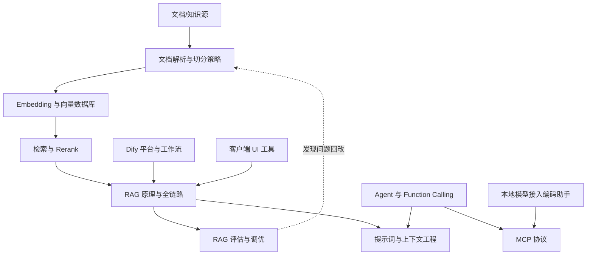

# 应用集成 MOC

> [!abstract] 一句话讲清楚
> 这个领域解决"模型跑起来之后，怎么让它真能干客户的活"：把企业文档变成可问答的知识库、把业务流程串成工作流、让模型能调工具、能被装进聊天客户端和编码助手。前面几个领域是"把发动机造好"，这里是"把车开上路"。

---

## 为什么这个领域最值钱

- **客户不为 API 付钱，为"事情办成了"付钱**。推理引擎是成本项，应用集成是收入项。
- 上游依赖：[[推理引擎 MOC]] 提供的 OpenAI 兼容 API、[[部署实战 MOC]] 提供的稳定服务；下游去向：[[工程化交付 MOC]] 的验收、监控、报价。
- 这一块的坑最隐蔽：模型没换、参数没改，效果差可能只是**切分**或 **top_k** 的事。不会定位就只能反复换模型烧时间。
- 典型的交付单：企业知识库问答（RAG 为主）、合同/报告解析、客服助手、内部编码助手、Dify 工作流自动化。

---

## 阅读顺序（推荐）

| 阶段 | 笔记 | 读完你应该能判断 |
|---|---|---|
| ① 先看全貌 | [[RAG 原理与全链路]] | RAG 到底几个环节、哪一步最容易坏 |
| ② 数据进库 | [[文档解析与切分策略]] → [[Embedding 与向量数据库]] | 文档怎么进来、怎么变成向量、存哪 |
| ③ 把答案捞准 | [[检索与 Rerank]] | 为什么"明明文档里有"却答不出来 |
| ④ 判断好坏 | [[RAG 评估与调优]] | 效果差是检索的锅还是生成的锅 |
| ⑤ 换成平台做 | [[Dify 平台与工作流]] | 什么时候用平台、什么时候自研 |
| ⑥ 让模型动手 | [[Agent 与 Function Calling]] → [[MCP 协议]] | 工具调用的稳定性从哪来 |
| ⑦ 装进壳里 | [[本地模型接入编码助手]] → [[客户端 UI 工具]] | base_url 怎么填、上下文多长够 |
| ⑧ 贯穿全局 | [[提示词与上下文工程]] | 抑制幻觉、控制成本、稳住格式 |

> [!tip] 只读三篇的话
> [[RAG 原理与全链路]] + [[RAG 评估与调优]] + [[本地模型接入编码助手]]，这三篇覆盖了 80% 的现场问题。

---

## 全部笔记

- [[应用集成 MOC]]（本页）
- [[RAG 原理与全链路]] — 索引期 / 查询期两阶段全链路，RAG vs 长上下文 vs 微调的取舍
- [[文档解析与切分策略]] — 文字版/扫描版 PDF、表格、清洗、chunk 大小与重叠、父子块
- [[Embedding 与向量数据库]] — 向量化原理、bge/m3e 选型、Milvus/Qdrant/Chroma/pgvector 对比
- [[检索与 Rerank]] — 向量/BM25/混合检索、多路召回、重排、阈值与查询改写
- [[RAG 评估与调优]] — 评测集、命中率/忠实度、检索差与生成差的分开定位
- [[Dify 平台与工作流]] — 平台定位、模型接入、知识库、节点与变量、API 发布
- [[Agent 与 Function Calling]] — Agent 循环、工具定义、ReAct、为什么小模型调不动工具
- [[MCP 协议]] — Host/Client/Server、tools/resources/prompts、接入方式
- [[本地模型接入编码助手]] — DeepSeek Harness / Cline / Continue / Roo 接本地 API
- [[客户端 UI 工具]] — Cherry Studio / Chatbox / Open WebUI / LM Studio 选型
- [[提示词与上下文工程]] — system prompt、few-shot、上下文预算与长对话压缩

---

## 领域内关系图

---

## 与上下游领域的边界

- **上游**：[[OpenAI 兼容 API 规范]] 决定你的 `base_url` 和参数怎么填；[[服务化与 API 鉴权]] 决定多用户并发怎么扛；[[上下文窗口与位置编码]] 决定你最多能塞多少资料。
- **下游**：[[容器化部署]] 把 RAG 服务打包；[[监控与日志]] 记录每次检索命中了什么；[[交付 SOP 与报价]] 里"知识库"是独立报价项。
- **容易混淆**：[[微调决策与 RAG 取舍]] 讨论的是"知识为什么要用 RAG 而不是练进权重"，两篇要对照着看。

---

## 这个领域的验收标准（自己给客户演示时用）

1. 能现场问一个"文档里明确写了"的问题，答案带引用、可点开原文。
2. 能现场问一个"文档里没有"的问题，模型会说"资料里没有"，而不是硬编。
3. 连续追问三轮不跑题，说明上下文管理没崩。
4. 断网状态下整条链路仍可用（本地模型 + 本地向量库），这是"本地化交付"的卖点。

---

## 返回

- [[技能栈总览 MOC]]
- [[学习路线图]]
- [[术语总表]]
