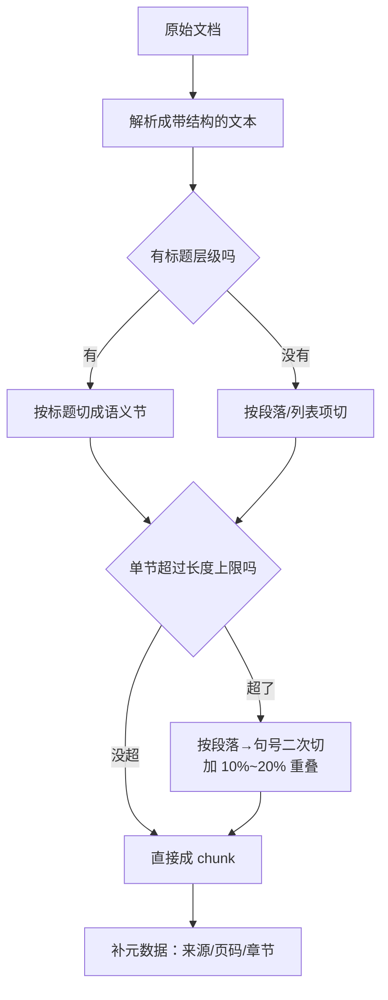

# 文档解析与切分策略

> [!abstract] 一句话讲清楚
> 这一篇讲 RAG 的"进货"环节：把客户乱七八糟的 PDF、Word、Excel 变成干净文本，再切成一段段**能独立看懂**的小块。切分是 RAG 里投入产出比最高的一步——同一份文档、同一个模型，切法不同，效果能差出明显一截。

---

## 为什么重要

- 检索的最小单位是 chunk，不是文档。**chunk 切坏了，后面全是白搭**：切太大检索糊、切太小答案缺上下文。
- 解析是链路里唯一"不可逆"的环节：原文里有、解析时丢了，后面无论换 embedding 还是换 32B 模型都补不回来。
- 真实场景：某客户 PDF 是扫描件，直接抽文本得到一堆空字符串，向量库入库了几千条空 chunk；用户问什么都没命中，最后怪模型不行。这类问题在交付现场非常常见。
- 上游：[[RAG 原理与全链路]] 的索引期；下游：[[Embedding 与向量数据库]]。切分的结果直接决定 embedding 的输入质量。

---

## 核心名词全解

| 名词 | 英文 / 缩写 | 大白话解释 | 容易混淆 / 注意 |
|---|---|---|---|
| 解析 | Parsing | 从文件里把文字、表格、图片抠出来 | 不是"转成纯文本"这么简单，版面和表格结构也算信息 |
| 文字版 PDF | Text-layer PDF | 打开能选中文字的 PDF，本身带文字层 | 和扫描版不是一个世界，处理方法完全不同 |
| 扫描版 PDF | Scanned PDF | 本质是一堆图片，没有文字层 | 必须 OCR，不做 OCR 抽出来就是空的 |
| OCR | Optical Character Recognition | 把图片里的字认成文字 | 中文、表格、手写体的识别率差别很大，务必抽样核对 |
| 版面分析 | Layout Analysis | 判断哪块是标题、正文、表格、页眉页脚 | 不做版面分析会把页眉页脚混进正文，污染检索 |
| 表格结构化 | Table Extraction | 把表格还原成"行-列"结构而不是一串字 | 直接转纯文本会让列和值错位，问答必错 |
| chunk | 块 / 片段 | 切出来的一段文本，检索的最小单位 | 一个 chunk 最好只讲一件事 |
| chunk 重叠 | Overlap | 相邻两块共享一小段文字 | 防切断语义，但重叠太多会让同一段被反复召回 |
| 按标题切 | Structural / Header Split | 顺着文档的标题层级切，而不是按字数硬切 | 是最省钱也最有效的一招，优先做 |
| 语义切分 | Semantic Chunking | 按相邻句子的语义相似度决定在哪断开 | 比按字数准，但更慢、参数更玄，别一上来就用 |
| 父子块 | Parent-Child / Small-to-Big | 用小块去检索、把小块所属的大块喂给模型 | 兼顾"检索准"和"上下文全"，工业界常用 |
| 元数据 | Metadata | chunk 的来源文件名、页码、章节、时间、权限 | 引用、过滤、权限都靠它，入库时丢就补不回来 |
| 清洗 | Cleaning | 去页眉页脚、目录、乱码、多余空行 | 别洗过头，把有意义的编号和层级删了也麻烦 |

---

## 原理与机制

### 直觉：切菜

一份 200 页的文档，不可能整份塞给模型。得像切菜一样切成小份。问题在于：

- 切得**太大**：一份里混了七八个主题，向量化之后这个向量"什么都像一点"，检索时谁都匹配不上；塞给模型还会挤占上下文。
- 切得**太小**：一句话被切成两半，前半在 A 块、后半在 B 块，检索命中 A 块，模型只看到半句话，答得理直气壮但是错的。

所以切分的目标一句话：**每个 chunk 单独拿出来，人能看懂它在说什么，且只讲一件事。**

### 机制一：解析是有损的

任何解析都会丢信息。损失按格式递增：

| 格式 | 抽文本的难度 | 主要损失 | 处理建议 |
|---|---|---|---|
| Markdown / TXT | 极低 | 几乎没有 | 直接读，保留标题层级 |
| HTML | 低 | 正文混进导航、广告、页脚 | 先做正文抽取，再转文本 |
| Word | 低~中 | 页眉页脚、文本框、批注、修订痕迹 | 抽正文 + 表格，忽略批注 |
| Excel | 中 | 多 sheet、合并单元格、公式结果 | 每行转成"列名: 值"的自描述文本 |
| 文字版 PDF | 中 | 双栏顺序错乱、页眉页脚、脚注混入 | 用版面分析或按栏切，去页眉页脚 |
| 扫描版 PDF / 图片 | 高 | 没有文字层、OCR 错字、表格错行 | OCR + 抽样人工核对 |
| PPT | 中 | 大量信息在图形和演讲者备注里 | 抽文本框 + 备注，图片走 OCR 或多模态 |
| 网页 / 在线文档 | 中 | 动态加载、登录墙、目录噪音 | 优先用导出文件，别硬爬 |

> [!tip] 解析后的第一件事
> 抽样看 10 段解析结果，和原文对照。**这一步花 10 分钟，能省后面 10 小时排错。**

### 机制二：切分决定了"检索能不能命中"

检索的本质是"用问题向量去比 chunk 向量"。chunk 的质量直接决定这个比较有没有意义：

- chunk 混了多个主题 → 它的向量是"平均脸"，和谁都不够像 → **召回不到**。
- chunk 太短、信息不完整 → 向量指向模糊 → 召回的是擦边内容。
- chunk 有清晰主题、关键词完整 → 向量干净 → **命中率高**。

这解释了一个反直觉现象：**很多"答不准"的问题，调好切分就解决了，不需要换模型。**

### 机制三：先按结构切，再按长度兜底

最实用的切分顺序是"两段式"：

1. **第一刀按文档结构切**：一级标题、二级标题、列表项、表格行。Markdown 的 `#`、Word 的标题样式、PDF 的版面临近关系都能用。
2. **第二刀按长度兜底**：如果某节超过上限，再按段落、句号、换行往下切，别在句子中间断。

### 机制四：父子块——检索用小块，生成用大块

这是个特别好用的技巧：

- **子块**（小，比如 200 字）：专门用来做向量检索，因为小所以向量干净、命中准。
- **父块**（大，比如 1500 字，即子块所属的整个小节）：检索命中子块后，**把父块整段塞给模型**。

这样既解决了"小块检索准"，又解决了"小块上下文不够"。代价是库变复杂、要维护父子映射。Dify 里叫"父子分段"，自研也就几十行代码的事。

---

## 完整流程：从文件到可检索 chunk

按"输入 → 动作 → 输出 → 验收"走：

1. **输入**：原始文件（可能几十上百份，格式混杂）。
   **动作**：盘点清单，标记格式；扫描件单独挑出来走 OCR 通道。
   **输出**：分类文档清单。**验收**：每一类都有明确处理方案，没有"不知道怎么办"的。
2. **输入**：分类清单。
   **动作**：批量解析，输出"带结构的中间文本"（保留标题标记、表格结构、页码锚点）。
   **输出**：中间文本。**验收**：抽样 10 份，和原文逐段对得上，表格列没串。
3. **输入**：中间文本。
   **动作**：清洗——去页眉页脚、页码、目录、重复水印、乱码；合并被硬换行打断的句子。
   **输出**：干净文本。**验收**：随机一段读起来通顺，无多余符号。
4. **输入**：干净文本。
   **动作**：按上文"两段式"切分；决定 chunk 大小、重叠、是否父子块。
   **输出**：chunk 列表。**验收**：随机抽 10 个 chunk，每个都能独立看懂。
5. **输入**：chunk 列表。
   **动作**：每个 chunk 补元数据（来源文件名、页码、章节标题、更新时间、权限标签）。
   **输出**：待向量化数据。**验收**：每条 chunk 都能回答"你从哪来"。
6. **输入**：待向量化数据。
   **动作**：抽样跑几条问题，看能不能召回刚切出来的正确 chunk（此时不用接大模型）。
   **输出**：切分有效性结论。**验收**：20 条测试问题里多数能召回正确块。**这一步没过，不要往下接生成。**

---

## 分类与对比：切分策略怎么选

| 策略 | 怎么切 | 优点 | 缺点 | 适合文档 |
|---|---|---|---|---|
| 固定长度 | 每 N 字切一刀，加重叠 | 最省事、长度可控 | 会在句子/段落中间切断 | 无结构的纯文本 |
| 按分隔符 | 按空行、句号、换行切 | 比固定长度自然 | 段落长短差异大 | 报告、文章 |
| 按标题/结构 | 顺着标题层级切，超长再往下切 | 语义完整、效果通常最好 | 依赖文档本身有标题结构 | 手册、制度、技术文档 |
| 按条目 | 每条 FAQ / 表格行 / 列表项一个 chunk | 检索极准 | 太短时缺上下文 | 制度条款、FAQ、参数表 |
| 语义切分 | 按句子间语义相似度找断点 | 切得"像人切" | 慢、参数不好调 | 长论述、散文式文档 |
| 父子块 | 小块检索 + 大块喂模型 | 兼顾准确与完整 | 实现复杂、存储翻倍 | 长篇论述、合同、报告 |

> [!important] 默认方案
> **优先"按标题/条目切"，加长度兜底和 10%~20% 重叠**。这份默认方案能覆盖 80% 的企业文档。别一开始就上语义切分。

### chunk 大小怎么定

| 文档类型 | 建议 chunk 大小（中文） | 理由 |
|---|---|---|
| FAQ / 制度条款 | 100~300 字 | 一条一个意思，切小才准 |
| 技术手册 / 产品文档 | 300~600 字 | 一个章节段落一个主题 |
| 长篇报告 / 合同 | 500~900 字，配父子块 | 上下文依赖强，需要更大窗口 |
| 表格类 | 一行/一组行一个 chunk | 保持行内字段对应关系 |

> [!warning] 没有万能数字
> chunk 大小和 embedding 模型的适配长度有关，也和文档密度有关。**唯一正确的做法是跑评测**：准备 20 条真实问题，对比两种切法的命中率，见 [[RAG 评估与调优]]。

---

## 决策点

- **岔路口 1：文档里有扫描件，做不做 OCR？**
  判断依据：抽样解析，抽出来是不是空的/乱码。
  → **推荐**：必须做。宁可多花一天做 OCR + 人工抽查，也不要让"空 chunk"进库。识别率差的页面考虑人工修。

- **岔路口 2：表格怎么处理？**
  判断依据：表格是否承载关键信息（报价、参数、条款）。
  → **推荐**：结构化。每行转成自描述文本，比如"产品 A｜功率 3kW｜质保 2 年"。**不要简单地把表格按行拼接成一串**，列名一丢，模型就不知道哪个数字对应什么。

- **岔路口 3：切大还是切小？**
  判断依据：文档是条目型还是论述型。
  → **推荐**：条目型切小（100~300 字），论述型用 500~900 字 + 父子块。拿不准就做 A/B 评测，用命中率说话。

- **岔路口 4：要不要做父子块？**
  判断依据：是否出现"检索命中了正确片段，但答案缺前因后果"的情况。
  → **推荐**：长文档（合同、报告、手册）直接上父子块；FAQ 类不需要。

- **岔路口 5：重叠加多少？**
  判断依据：切分点是否经常落在关键句中间。
  → **推荐**：10%~20%。重叠是保底手段，不是越多越好——重叠多了同一段会被多个 chunk 反复召回，去重还得额外做。

- **岔路口 6：文档有多个版本，怎么管？**
  判断依据：是不是每个 chunk 都带"版本/生效时间"。
  → **推荐**：元数据里带版本和生效日期，查询时过滤。别指望模型自己判断哪版是新的。

---

## 参数与配置说明

| 参数 | 作用 | 调大/调小的影响 | 常见取值 |
|---|---|---|---|
| chunk_size | 单块最大长度 | 大→上下文全但检索糊；小→检索准但易碎片化 | 中文 300~800 字，按文档类型定 |
| chunk_overlap | 相邻块重叠长度 | 大→防切断但冗余多；小→易丢衔接信息 | chunk 的 10%~20% |
| 分隔符优先级 | 按什么符号断句 | 影响是否会切断句子 | 标题 → 空行 → 换行 → 句号 |
| 最小块长度 | 小于此长度就合并到相邻块 | 太小会留下"目录、孤句"垃圾块 | 50~100 字 |
| 是否保留页眉页脚 | 清洗开关 | 开着会污染正文、干扰检索 | 关闭 |
| 父子块父长度 | 父块多大 | 太大挤上下文、太小白做 | 800~2000 字 |
| 解析置信度阈值 | OCR 低于此分则告警人工 | 高→更严但要人看的多 | 按版面复杂度实测 |

---

## 按文档类型的切分方案

切分没有万能参数，先看资料长什么样。

| 资料类型 | 典型结构 | 推荐切分 | 元数据要带什么 | 容易踩的坑 |
|---|---|---|---|---|
| 制度/手册 | 多级标题 | 按标题层级切，块内保留祖先标题 | 文档名 + 章节路径 | 子块脱离标题就失去含义 |
| 产品文档 | 标题 + 代码/表格 | 按标题切，表格整块不切 | 文档名 + 版本 | 表格被切断后语义崩掉 |
| FAQ / 客服问答 | 一问一答 | 一条问答一块，别按字数切 | 问题编号 | 答案跨条、一个答案有多个变体 |
| 合同 | 条款编号 | 按条款切，条款号写进块头 | 合同名 + 条款号 | 交叉引用（"见第 5.2 条"）丢上下文 |
| 论文/研报 | 章节 + 图表 | 按章节切，图表单独成块 | 论文名 + 章节 | 图表说明与正文割裂 |
| 代码库 | 函数/类 | 按语法结构切（AST），一个函数一块 | 文件路径 + 符号名 | 按字数切会把函数切两半 |
| 会议记录 | 时间 / 发言人 | 按议题或时间段切 | 会议日期 + 议题 | 一次会议太长导致块太杂 |

起点参数：块大小从几百字级开始，重叠留一到两成，每块前面补一行"来源 + 章节"的上下文头。**这是起点不是标准答案，最终以评估结果为准。**

## 切分效果怎么验

切完别直接上线，抽 20 条真实问题做三件事：

1. **搜得到吗**：把问题和每个块的向量算相似度，看正确的块排在前几。正确答案的块连前十都进不去，说明问题在切分或向量模型，不是生成的锅。
2. **块能独立读懂吗**：随便抽几个块单独看。如果读不出它在说什么，说明上下文头没补，或者切得太碎。
3. **垃圾块占多少**：目录页、页眉页脚、版权声明、空白块，这些进了库只会污染召回。统计一下，超过一成就要加清洗规则。

> [!tip] 一个快速信号
> 如果检索回来的块经常是"目录""感谢观看""版权所有"，那问题在清洗不在切分。先过滤这些块，再谈调参。

## 解析环节的止损点

解析没做对，切分怎么调都没用。三个必须处理的情况：

| 止损点 | 怎么发现 | 怎么处理 |
|---|---|---|
| 扫描件没做 OCR | 抽出来的文字是乱码或空白 | 先过 OCR，再入库 |
| 页眉页脚、水印没清 | 几乎每个块都带同样的噪音 | 按重复文本规则清洗掉 |
| 表格被拆散 | 数字和表头对不上号 | 表格整块保留，或转成结构化文本 |

一句话：**解析先做对，切分才有意义。** 乱码进库，向量也是乱码的向量，检索永远命中不了。

## 常见坑与误区

| 现象 | 原因 | 对策 |
|---|---|---|
| 库里几千条 chunk，问什么都检索不到 | 扫描版 PDF 抽出空文本或乱码 | 解析后先抽样，空文本一律不进库；加"最小块长度"过滤 |
| 每个 chunk 都以"××公司内部资料 第 3 页"开头 | 页眉页脚没洗，被当成正文切进每块 | 解析时按版面位置或重复模式去掉 |
| 表格问答永远答错行 | 表格被压成一行长文本，列对应关系丢失 | 表格转"列名: 值"结构，一行一个 chunk |
| 双栏 PDF 读出来句子交错 | 抽取顺序按坐标乱序，两栏内容穿插 | 用版面分析/分栏抽取，或换成有文字层的版本 |
| 关键结论被切成两半，答出来是半句 | 固定长度切分在句子中间断 | 改为按标题/段落切，加 10% 重叠，设置句号优先断开 |
| 同一段答案被引用五六次 | 重叠过大 + 没做去重 | 降低重叠，检索后按文本相似度去重 |
| 换 embedding 后效果变好一阵又崩 | 旧 chunk 和旧向量混在一起 | 换 embedding 必须整库重建，并用版本号标记 |
| 切完发现"目录"比正文还多 | 目录、封面、版权页没清洗 | 按页/按规则过滤前置页，或人工给"跳过页" |

---

## 自检问题

- [ ] 拿到一份 PDF，你怎么在 2 分钟内判断它是文字版还是扫描版？
- [ ] 为什么说"切分是 RAG 里投入产出比最高的一步"？
- [ ] chunk 太大和太小，各自会导致什么检索问题？
- [ ] 什么叫"一个 chunk 应该只讲一件事"？怎么在切分时保证？
- [ ] 父子块解决了什么矛盾？它的代价是什么？
- [ ] 表格为什么必须结构化？不结构化的典型错误长什么样？
- [ ] 哪些元数据必须在入库时写入？丢了会有什么后果？
- [ ] 切分方案怎么验证好坏？验证时需不需要接大模型？

---

## 相关笔记

- 上游：[[RAG 原理与全链路]]、[[Attention 与 KV Cache]]（解释为什么上下文不能塞太满）
- 下游：[[Embedding 与向量数据库]]、[[检索与 Rerank]]
- 调优：[[RAG 评估与调优]]
- 平台里怎么做：[[Dify 平台与工作流]]
- 返回：[[应用集成 MOC]]

---

## 交付视角（对客户怎么讲）

- **大白话解释**："您给的资料我先做成一份结构化的电子版，再切成一小段一小段，每段都标好是哪份文件、第几页。后面提问时系统就能精确找到那一段，还能告诉您答案出处在哪。"
- **客户最常问**："扫描件能不能用？" 能用，但要 OCR，而且**识别质量直接决定上限**，需要人工抽检。这是可以单独报价的工序，别不好意思收钱。
- **报价拆项**：解析/OCR（按页）、清洗与切分（按份）、入库（按 chunk 量或份数）。文档越脏，解析项越要报足。
- **风险提示**：明确告诉客户"文档质量决定效果上限"，并在合同里约定——客户提供的资料若扫描件占比高、或表格极多，工期和价格需要另算。这是后面扯皮最常见的点。
