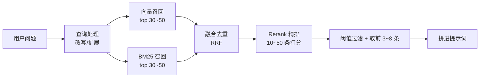

# 检索与 Rerank

> [!abstract] 一句话讲清楚
> 检索是 RAG 的"翻书"动作：用问题去库里找最相关的几段。单一向量检索经常漏，所以工业做法是"多路召回 + 融合去重 + 精排（rerank）"——先用便宜的方法捞一大把，再用贵的方法挑出真正对的。

---

## 为什么重要

- 检索是 RAG 链条上**最容易出效果差异**的一环。同样的模型、同样的资料，检索策略换一下，答对率能明显变化。
- 现场最常见的抱怨"文档里明明写了它却说没有"，九成是检索没召回，不是模型不行。不会调检索就只能换模型烧时间。
- 上游：[[Embedding 与向量数据库]] 提供向量库；下游：[[RAG 评估与调优]] 用命中率来判断你这套检索是否合格。
- 真实场景：客户文档里有大量设备型号（如 XH-2000A），纯向量检索怎么都匹配不准，加一路 BM25 关键词召回后立刻解决。

---

## 核心名词全解

| 名词 | 英文 / 缩写 | 大白话解释 | 容易混淆 / 注意 |
|---|---|---|---|
| 向量检索 | Dense Retrieval | 用语义向量找"意思像"的段落 | 对同义改写友好，对精确字符串不敏感 |
| 关键词检索 | Sparse Retrieval / BM25 | 按词频和稀有度找"字面像"的段落 | 对型号、编号、人名强，对同义改写弱 |
| 混合检索 | Hybrid Search | 两路都跑，把结果合并 | 不是简单相加，要有融合策略 |
| 多路召回 | Multi-channel Recall | 从多个来源/多种方式各捞一批 | 每路都要控制条数，否则融合后噪声爆炸 |
| RRF | Reciprocal Rank Fusion | 按"排名倒数"加权合并多路结果，不看分数只看名次 | 各检索分数不可比时最好用 |
| 重排 | Rerank | 对粗召回的候选做二次精排 | 和 embedding 检索不是一回事，模型结构不同 |
| 双塔模型 | Bi-encoder | query 和文档各自编码成向量再比 | 快，但 query 和文档没有"逐字交互" |
| 交叉编码器 | Cross-encoder | 把 query 和文档拼在一起送进模型打分 | 准，但慢，只适合给少量候选打分 |
| top_k | 召回条数 | 保留前 k 条 | 初筛和精排的 k 不是一回事 |
| 阈值 | Threshold | 低于分数线的直接丢弃 | 阈值取决于模型和度量方式，不能照抄 |
| 查询改写 | Query Rewrite | 把用户的口语问题改写成更适合检索的形式 | 多轮对话必须做，否则追问没法检索 |
| 多查询扩展 | Multi-Query | 把一个问题扩成几种问法，各检一次再合并 | 提升召回，代价是延迟翻倍 |
| HyDE | Hypothetical Document Embeddings | 先让模型编一段"像答案的话"，再用它去检索 | 对短问题有效，但多一次模型调用 |
| 元数据过滤 | Metadata Filter | 先按部门/年份/权限筛，再算相似度 | 先过滤会缩小候选，可能把正确答案过滤掉 |

---

## 原理与机制

### 直觉：为什么要"两路"而不是一路

把检索想成图书馆找书：

- **向量检索**像问管理员"有没有讲这个主题的书"，管理员理解意思，能给你找来同义表达的书。但你说"我要 XH-2000A 那本"，管理员可能给你一堆"讲类似设备的书"，偏偏不是这一本。
- **关键词检索**像查书名字典，你说 XH-2000A 它立刻精确给你。但你说"这个玩意儿老是过热怎么办"，字典查不到。

所以：**语义问题靠向量，精确字符串靠关键词，两个都要。**

### 机制一：双塔 vs 交叉编码器，为什么需要两段式

| | 双塔（bi-encoder，用于召回） | 交叉编码器（cross-encoder，用于 rerank） |
|---|---|---|
| 输入 | query 和 doc **分别**编码 | query + doc **拼在一起**编码 |
| 能否预计算 | 能，文档向量可提前存好 | 不能，必须现算 |
| 速度 | 快，几百万条毫秒级 | 慢，一次只能算一个 query-doc 对 |
| 精度 | 中（没有逐字交互） | 高（能看到 query 每个词与 doc 的对应） |
| 用途 | 从百万条里粗筛出几十条 | 从几十条里精挑出几条 |

这就是工业标准流程：**粗召回（快、从万到百）→ 精排（准、从百到个位数）**。



### 机制二：融合策略——RRF 为什么好用

向量检索的分（0~1 余弦）和 BM25 的分（可能 0~20）根本不是一个量纲，直接相加毫无意义。所以常用 **RRF：只看排名，不看分数**。

直觉公式：某文档在每一路里的排名越靠前，得分越高；最终得分 = 各路 `1/(常数+排名)` 之和。实现就一行，效果稳定。

```python
# RRF：不看分数只看名次，规避多路分数不可比的问题
def rrf(rank_lists, k=60):
    score = {}
    for ranking in rank_lists:
        for pos, doc_id in enumerate(ranking):
            score[doc_id] = score.get(doc_id, 0) + 1.0 / (k + pos + 1)
    return sorted(score, key=score.get, reverse=True)
```

> [!tip] 另一种做法
> 也可以两路各取前 N 条后"去重合并"，再用 rerank 统一排序。省掉融合参数，效果差不多，**实现更简单**，很多项目就这么干。

### 机制三：rerank 到底加分在哪

rerank 模型（交叉编码器）能看到 query 和 chunk 的逐词交互，所以能干这些事：

- 判断"问题问的是流程还是条件"，把只沾关键词但答非所问的段落压下去。
- 对同义但不精确的段落给低分，比向量相似度更"懂意图"。
- 在混合检索合并后的噪声里，把真正的正确段落顶上来。

代价：**每条候选都要跑一次模型，延迟和算力随候选数线性涨**。所以候选数别开太大，20~50 条足够。

### 机制四：查询改写，长对话里必须做

多轮对话时，用户说"那它的保修期呢"，直接拿这句话去检索，什么都找不到——因为"它"是谁没交代。

做法：让模型结合前几轮，把它改写成独立问题："XH-2000A 设备的保修期是多久"，再检索。

```text
用户：XH-2000A 的功率是多少？
助手：3kW。
用户：那保修呢？     ← 直接检索必失败
改写后：XH-2000A 的保修期是多久？   ← 检索成功
```

> [!warning] 这一步经常被省掉
> 省掉的后果是"第一问很准、第三问开始胡说"。demo 时连着问三轮就能暴露。

---

## 完整流程：一次查询的六步

1. **输入**：用户原始问题 + 最近几轮对话。
   **动作**：查询改写/扩展（口语→书面、指代→实体、必要时扩成多种问法）。
   **输出**：1~3 条检索用 query。**验收**：改写后的问题脱离上下文也能看懂。
2. **输入**：检索 query。
   **动作**：向量召回 top 30~50；同时 BM25 召回 top 30~50；带元数据过滤条件。
   **输出**：两路候选列表。**验收**：每路单独看，正确段落至少在一路的前 20 名里。
3. **输入**：多路候选。
   **动作**：RRF 或去重合并。
   **输出**：合并后的 30~60 条。**验收**：去重生效，没有大段重复。
4. **输入**：合并候选。
   **动作**：rerank 打分并排序。
   **输出**：带精排分的结果。**验收**：正确段落排进前 5。
5. **输入**：精排结果。
   **动作**：阈值过滤 + 取前 3~8 条 + 控制总 token。
   **输出**：最终上下文片段。**验收**：总 token 在预算内，片段之间不重复。
6. **输入**：片段 + 原问题。
   **动作**：拼提示词交给生成模型。
   **输出**：带引用答案。**验收**：每个结论都能对上某条片段。

---

## 分类与对比：三种检索方式怎么选

| 维度 | 纯向量检索 | 纯关键词 BM25 | 混合检索 + Rerank |
|---|---|---|---|
| 同义改写 | 强 | 弱 | 强 |
| 型号/编号/条款号 | 弱 | 强 | 强 |
| 实现复杂度 | 低 | 低 | 中（多一个 rerank 服务） |
| 延迟 | 低 | 低 | 增加 50~300ms 量级 |
| 算力要求 | 低 | 极低 | 中（要跑 rerank 模型） |
| 适合 | 口语化问答、FAQ | 法规条文、产品参数 | 企业知识库（默认选这个） |

> [!important] 默认答案
> **企业知识库默认上混合检索 + rerank**。如果资源紧张，至少做到"向量 + BM25 各召回、去重合并"，这已经能解决大部分精确匹配问题。纯向量只在文档非常口语化、且没有专有名词时够用。

---

## 决策点

- **岔路口 1：要不要上 rerank？**
  判断依据：粗召回 top_20 里正确段落是否经常排在第 10 名以后。
  → **推荐**：上。它是"提高准确率"里性价比最高的一招，通常比换更大的生成模型便宜得多。GPU 实在没有就换轻量的 rerank 模型。

- **岔路口 2：top_k 初筛取多少？**
  判断依据：rerank 的算力预算、延迟要求。
  → **推荐**：初筛 30~50，精排后取 3~8。**先保证召回，再靠精排压噪声**，顺序不能反。

- **岔路口 3：要不要加查询改写/多查询？**
  判断依据：是否多轮对话、用户提问是否口语化。
  → **推荐**：多轮场景**必做改写**；单轮且问题规范时不必。多查询扩展只在"召回明显不足"时开，因为它成倍增加检索次数。

- **岔路口 4：阈值怎么定？**
  判断依据：你用的 embedding 模型和度量方式的分数分布。
  → **推荐**：**在评测集上实测**，取"能挡住胡说、又不误杀正确答案"的位置。别抄别人的 0.7 或 0.8，不同模型尺度完全不同。

- **岔路口 5：元数据过滤放前面还是后面？**
  判断依据：过滤条件是否强（比如按客户/租户隔离）。
  → **推荐**：强制隔离类条件（权限、租户）**必须前置过滤**；软性条件（年份、部门）可以放宽或在精排后过滤，避免把正确答案筛掉。

---

## 参数与配置说明

| 参数 | 作用 | 调大/调小的影响 | 常见取值 |
|---|---|---|---|
| recall_k（向量） | 向量召回条数 | 大→召回高、后面的工作量大 | 30~50 |
| recall_k（BM25） | 关键词召回条数 | 同上 | 30~50 |
| fusion_k | RRF 常数 | 大→名次影响平缓 | 60 左右 |
| rerank_candidates | 送进精排的条数 | 大→准但慢 | 20~50 |
| final_k | 最终进提示词条数 | 大→上下文全但噪声多 | 3~8 |
| score_threshold | 分数下限 | 高→更多"不知道"，低→更多胡说 | 按评测集实测 |
| max_context_tokens | 上下文总预算 | 大→贵、慢、注意力稀释 | 窗口的一半以内 |
| query_rewrite | 是否改写查询 | 开→多一次模型调用，多轮必备 | 多轮开，单轮可关 |
| multi_query_n | 扩展问法数量 | 大→召回高但延迟成倍 | 2~3 |

---

## 召回失败的典型形态与对策

先分清"没召回到"和"召回了但没用"，两者的修法完全不同。

| 形态 | 现象 | 常见根因 | 对策 |
|---|---|---|---|
| 完全没召回到 | 检索结果里根本没有正确块 | 切分切坏、同义词不匹配、向量模型弱 | 换切分、加查询改写、换 embedding |
| 召回到了但排太后 | 正确块排在第 8 名，被截断丢掉 | 相似度区分度不够 | 加 Rerank、先放大 top_k 再重排 |
| 召回了错误版本 | 拿到旧版本的文档 | 索引没更新、缺版本过滤 | 重建索引、加时间/版本元数据过滤 |
| 召回了正确块但生成没用 | 上下文里有答案，答案还是错 | 生成侧问题，不是检索问题 | 改提示词、要求"必须引用原文回答" |
| 全是重复内容 | 多个块内容高度相似 | 切分重叠太大、文档重复入库 | 检索后去重、调小重叠 |
| 检索到相似但错误的话题 | 语义相近但答案不同 | 缺关键词约束 | 混合检索（关键词 + 向量） |
| 长查询越查越差 | 用户一次问了好几件事 | 查询太长导致向量被平均掉 | 拆问题、查询改写 |

> [!tip] 判断"检索差还是生成差"的土办法
> 把正确答案的原文块**手动**塞进提示词再问一次。答对了，问题在检索；还是答错，问题在生成或提示词。这个实验一分钟就能做，比猜快得多。

## 混合检索怎么配

纯向量检索擅长语义，不擅长精确词（型号、编号、专有名词）。生产上常见做法是**两路召回再融合**：

- 一路向量检索，负责"意思相近"；
- 一路关键词（BM25 类），负责"字面命中"；
- 按排名融合（如 RRF），而不是按分数相加——**两路分数不在一个量纲上，直接加会错**。

最后再接 Rerank 精排。顺序是：**多路召回 → 融合 → 精排 → 截断**。别把 Rerank 放在融合之前。

## 参数起点

| 参数 | 起点值 | 往哪调 |
|---|---|---|
| 召回条数 top_k | 先 20 左右 | 命中率低就加大，再靠 Rerank 收敛 |
| 精排后条数 | 3~8 | 太多会挤占上下文、引入噪音 |
| 相似度阈值 | 先不设阈值 | 有区分度后再设，避免直接漏召回 |
| RRF 常数 | 用常用默认即可 | 一般不用调 |
| 融合权重 | 两路各半起步 | 术语多的领域加大关键词权重 |

## 上线顺序建议

| 步骤 | 做什么 | 大概收益 | 成本 |
|---|---|---|---|
| 1 | 纯向量检索跑通，记录基线 | 能答 | 低 |
| 2 | 加关键词一路，做排名融合 | 型号、编号这类精确词命中明显变好 | 低 |
| 3 | 加 Rerank 精排 | 前几名的质量明显提升 | 中，多一次模型调用 |
| 4 | 调 top_k 与精排后条数 | 边际收益递减 | 低 |
| 5 | 加查询改写 | 口语化、含糊的问法变好 | 中 |

每一步都要用**同一套评估集**量效果，不然改完不知道到底有没有变好，只能靠感觉。

> [!tip] 优先级
> 如果只做一件事，就做 Rerank。它通常是把"看起来能用"变成"真的能用"的那一步。

## 常见坑与误区

| 现象 | 原因 | 对策 |
|---|---|---|
| 型号/编号类问题永远答错 | 只用了向量检索，对精确字符串不敏感 | 加 BM25 或稀疏向量，做混合检索 |
| 召回里明明有正确答案，模型却没用 | 正确段落排在很后面，被截断或噪声淹没 | 上 rerank，把 final_k 控制在 3~8 |
| 多轮对话第二轮就跑偏 | 没做查询改写，指代词直接拿去检索 | 先改写成独立问题再检索 |
| 阈值抄了别人的 0.8，结果什么都检索不到 | 不同 embedding 模型分数分布不同 | 在自己数据上采样看分布，实测定阈值 |
| rerank 一加，延迟从 1 秒变 5 秒 | 候选数开太大、rerank 模型太重 | 候选压到 20~30，或用轻量 rerank 模型 |
| 按部门过滤后经常"资料不存在" | 前置过滤太严，或元数据标错 | 软过滤后置，元数据入库时人工校验 |
| 混合检索后答案反而变差 | 关键词那路召回一堆含关键词但语义无关的内容，没去重/没精排 | 必须加融合去重和 rerank，不能直接拼 |
| 同一个问题每次结果不一样 | 候选分数过于接近，排序不稳定 | 固定随机性、加 rerank 拉开分差、必要时对近分结果做稳定排序 |

---

## 自检问题

- [ ] 双塔模型和交叉编码器各用在哪一步？为什么不能只用交叉编码器？
- [ ] 为什么纯向量检索对型号、编号不敏感？怎么补？
- [ ] RRF 解决了什么问题？它为什么"不看分数"？
- [ ] 粗召回和精排的 top_k 为什么不一样？各应该取多少？
- [ ] 多轮对话为什么必须做查询改写？不做会有什么现象？
- [ ] 相似度阈值应该怎么确定？为什么不能直接抄？
- [ ] 元数据过滤前置和后置各有什么风险？
- [ ] 加了 mix 检索但效果变差，最可能的原因是哪个环节？

---

## 相关笔记

- 上游：[[Embedding 与向量数据库]]、[[文档解析与切分策略]]
- 下游：[[RAG 评估与调优]]、[[提示词与上下文工程]]
- 平台实现：[[Dify 平台与工作流]]
- 部署：[[推理性能指标与调优]]（rerank 服务的延迟考量）
- 返回：[[应用集成 MOC]]

---

## 交付视角（对客户怎么讲）

- **大白话解释**："您提问时，系统不只是按关键字搜，还会理解您问的意思；先用两种方式各找一批，再请一个'评审'把最相关的几条挑出来。所以它既能答'这个意思'的问题，也能准确答出具体型号、条款号。"
- **客户最常问**："为什么它有时说没找到？" 因为设了相关度门槛，宁可不答也不瞎答。这个门槛可以按您的接受度调——要更敢答就调低，要更保守就调高。
- **报价拆项**：基础检索（一次性）、混合检索与 rerank 增量（一次性 + 算力）、检索策略调优（按轮次）。混合检索会多占 GPU，**报价里要体现 rerank 模型的算力成本**，不要白送。
