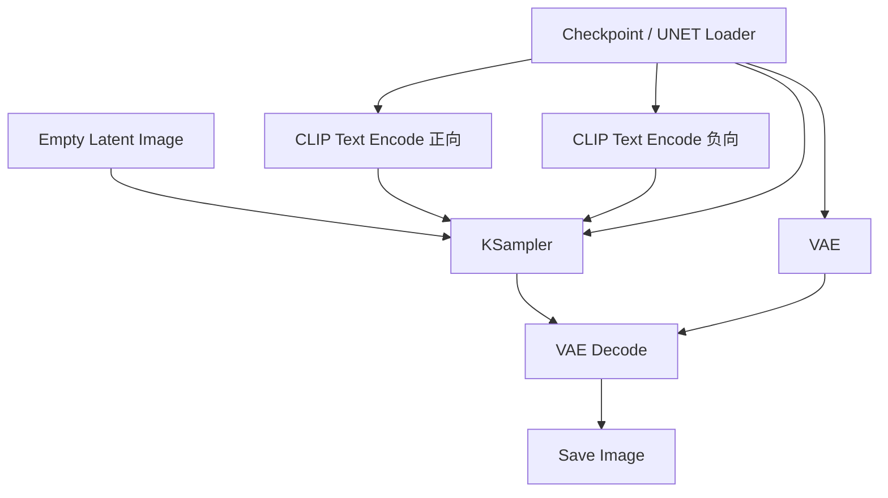
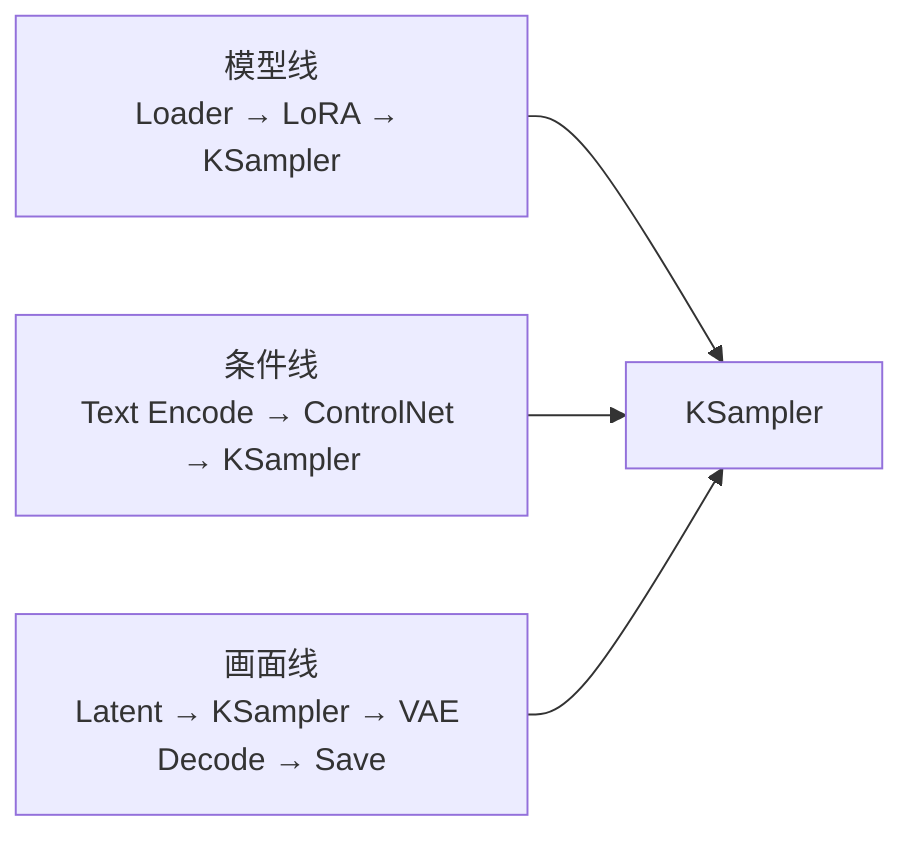

# ComfyUI 核心概念

> [!abstract] 一句话讲清楚
> ComfyUI 把"出图"拆成一堆小方块（节点），每个方块干一件小事，方块之间用线连起来传数据，连成一张拓扑图就是工作流。你在界面上拖线，本质上是在给一条图像生成流水线接线。

## 为什么重要

- 它是本领域事实上的交付工具：WebUI 那种"一堆滑杆 + 一个生成按钮"的方式改不动复杂流程，而 ComfyUI 能把 ControlNet、LoRA、放大、局部重绘串成一条能一键跑的流水线。
- 客户要的往往不是"一张图"，而是"一套稳定可复用的流程"。工作流可以存成 JSON 传给客户、可以调 API 批量跑、可以塞进 Docker 交付——这三件事 WebUI 都做不到。
- 不懂节点模型，你会陷入两种典型困境：看到红色节点不知道是缺插件还是缺模型；改了一个参数结果没生效，因为改了不参与执行的分支。
- 这一篇讲"为什么这样设计"，[[ComfyUI 工作流实操]] 讲"动手怎么改"，两篇要连起来看。

## 核心名词全解

| 名词 | 英文 / 缩写 | 大白话解释 | 容易混淆 / 注意 |
|---|---|---|---|
| 节点 | Node | 工作流里的一个小方块，输入数据、做一次计算、输出数据 | 节点不是"按钮"，它不吃点击只吃数据 |
| 连线 / 端口 | Link / Socket | 两个节点之间的数据管道，左进右出 | 只能连同类型数据，接错口要么连不上要么报错 |
| 有向无环图 | DAG | 所有节点按依赖关系组成、不能绕圈的网络 | 出现环就执行不了，ComfyUI 会拒绝 |
| 执行队列 | Queue | 点"运行"后，把要算的节点排个队依次执行 | 队列在跑时改参数，可能改的是下一轮 |
| 缓存 / 增量执行 | Caching | 没变化的分支直接复用上次结果 | 改了"看起来无关"的节点也会触发重跑 |
| latent | Latent | 图像被 VAE 压缩后的小尺寸表示，采样在它上面做 | latent 不是图，中间节点预览出来是雪花正常 |
| 像素空间 | Pixel Space | 真实的图像数据（宽×高×3 通道） | 保存图片、预览图片、很多后处理都在这里 |
| Checkpoint | ckpt | 打包好的一体化模型：去噪网络 + 文本编码器 + VAE | 换 ckpt 等于整套换，不只是换画风 |
| 文本编码节点 | CLIP Text Encode | 把正向/负向提示词变成条件向量 | Flux 类要接双编码器，接错就出黑图 |
| KSampler | KSampler | 采样器节点，管步数、CFG、采样器、种子、denoise | 名字叫 sampler，其实一个节点管了一整轮去噪 |
| VAE 解码 | VAE Decode | 把干净 latent 还原成像素图 | 高分辨率要换 tiled 版本，否则爆显存 |
| 工作流 JSON | Workflow JSON | 工作流的存档格式，节点和连线都在里面 | 有 UI 格式和 API 格式两种，不能混用 |
| 自定义节点 | Custom Node | 第三方写的扩展节点，通过 Manager 或 git 安装 | 依赖冲突、版本不匹配的主要来源 |
| ComfyUI Manager | Manager | 装节点、查缺失节点、更新版本的"应用商店" | 它自己也可能是冲突源，装完要重启 |

## 原理与机制

### 直觉版

把工作流想成一张 Excel 表格：每个节点是一个单元格公式，公式里引用了别的单元格；你改一个单元格，只有依赖它的公式会重算，其他保持原值。ComfyUI 的"缓存/增量执行"就是这个逻辑。

再往近里说，节点像函数：左边是参数，右边是返回值。连线就是把 A 的返回值喂给 B 的参数。你搭图就是在写一段"不用写代码的代码"。

### 拆解版

1. **节点 = 函数签名**：每个节点声明自己需要哪些输入（模型、latent、文本、数字滑杆），以及产出什么。输入没接、类型不匹配，节点就会红框/报错。
2. **连线 = 数据流**：连线本身不执行，只是"数据的路由"。真正的执行由后端调度器做：从输出节点（如 Save Image）反向找依赖，算出拓扑顺序，没变化的节点跳过。
3. **执行 = 拓扑排序**：有多个输出分支时，只有被"最终输出节点"依赖到的节点才会执行。你接了一条线但没连到 Save/Preview，那条分支就是死代码。
4. **前端 / 后端分离**：浏览器里那张图只是界面，真正的计算在本地 Python 服务里。所以关掉浏览器工作流还在跑，刷新页面能恢复。
5. **模型加载节点的三种形态**：
   - 一体化 `Checkpoint Loader`：一个 ckpt 出 MODEL / CLIP / VAE 三个输出，SD 一代最典型；
   - 分离式 `UNETLoader + DualCLIPLoader + VAELoader`：Flux、Qwen-Image 类常见，因为编码器和 VAE 是单独发布的；
   - 扩散模型目录（`diffusion_models`）专用加载器：只加载去噪主干，不碰编码器。
6. **KSampler 里面发生了什么**：它同时接收 MODEL、正向/负向条件、latent、步数、CFG、采样器、调度器、denoise、种子，然后跑完整个去噪循环，输出干净 latent。所以"采样参数"其实都在一个节点上，改它就等于改算法。
7. **工作流 JSON 的结构**：本质是 `nodes`（每个节点的类型、位置、参数值）+ `links`（谁连谁、连到第几个口）+ `widgets_values`（滑杆值）。UI 格式带前端布局信息，API 格式只保留执行所需，**批量调用后端要用 API 格式**。
8. **自定义节点的机制**：第三方节点是放在 `custom_nodes/` 目录下的 Python 包，可能带自己的 `requirements.txt`。ComfyUI 启动时扫描并注册它们的节点类；装不上或版本不匹配，界面上就显示成红色"缺失节点"。



### 后果

- **为什么工作流比"参数面板"强**：每个环节可插拔、可复用、可版本化。客户要加一个"面部修复"，你插两个节点就行，不用等软件升级。
- **为什么它难上手**：信息全在图里，图一复杂就"看不懂"。所以交付时要给节点分组、加注释框，不然客户看到 40 个节点直接放弃。
- **为什么它适合自动化**：JSON 可解析、可编程，能被你的脚本批量替换提示词后调用（API 模式）。
- **为什么它容易"环境地狱"**：插件各自锁依赖版本，Python 环境又共享一套。这是 ComfyUI 交付里最高频的故障源。

## 完整流程：从零跑通一张图

| 阶段 | 你要做的事 | 为什么 |
|---|---|---|
| ① 加载模型 | 接模型加载节点，选出正确的 ckpt 或分离式模型 | 模型决定能力上限，加载错后面全白搭 |
| ② 编码提示词 | 正向/负向两个文本编码节点，接到模型对应的编码器 | 文本条件不对，采样会"乱猜" |
| ③ 生成初始 latent | 用 Empty Latent 节点给出宽高 | 分辨率决定显存与构图 |
| ④ 采样 | KSampler 接齐模型、条件、latent 和参数 | 这是真正出图的环节 |
| ⑤ 解码 | VAE Decode 把 latent 变像素 | 缺这步就看不到图 |
| ⑥ 保存 | Save Image 指定输出目录与文件名前缀 | 交付要有可追溯的文件名 |

## 节点图的组织方式（交付级工作流的做法）

一个"自己能用"的工作流和一个"客户能用"的工作流，差别不在功能，在组织：

- **按阶段分组**：加载模型 / 提示词 / 采样 / 后处理 / 输出，每组一个边框 + 标题。客户找不到要改的地方，就会来问你。
- **只留一个"操作面板"**：把客户真正要改的东西（提示词、种子、张数、宽高）集中放一起，其余参数用固定值或注释说明，别让他乱动。
- **节点命名说人话**：把默认的 `KSampler` 改成 `采样-步数25`，`CLIP Text Encode` 改成 `正向提示词`。截图直接能当说明书。
- **模型节点固定死**：交付版把模型选择器设成固定文件，避免客户误切模型后出怪图，然后来投诉"效果不对"。
- **留一个"调试出口"**：保留 Preview Image 在采样前，方便远程时判断是模型问题还是参数问题。
- **版本化存档**：文件名带日期和场景，如 `电商主图_2026-10.json`，回滚靠它。

## ComfyUI 和其他出图工具的关系

| 工具类型 | 代表形态 | 强项 | 弱项 | 适合谁 |
|---|---|---|---|---|
| 节点式本地工具 | ComfyUI | 流程可编排、可自动化、可交付 | 上手门槛高 | 交付型工程师、重度用户 |
| 表单式本地工具 | 各类 WebUI | 上手快、插件多 | 复杂流程难表达、自动化弱 | 个人出图 |
| 云端 API | 各家在线服务 | 免硬件、免维护 | 数据出网、按量计费、风格受限 | 轻量需求 |
| 商业设计软件 | 传统设计工具 + AI 功能 | 排版/后期完整 | 生成能力受限于厂商 | 设计团队 |

## 自定义节点生态分类

| 类别 | 解决什么问题 | 典型需求 |
|---|---|---|
| 采样/加速 | 更快、更省显存、特殊采样器 | 低显存交付、批量出图 |
| 放大/修脸 | 分辨率提升、面部修复 | 电商图、人像精修 |
| 动画/视频 | 帧插值、连续帧生成、视频合成 | 短视频客户 |
| 控制类 | 姿态/深度/边缘/参考图控制 | 产品换背景、保持人物一致 |
| 音频类 | 配音、歌声、配乐 | 口播视频、音乐需求 |
| 工具类 | 批量处理、参数管理、队列控制 | 自动化交付 |

> [!tip] 装节点的原则
> 先问"内置节点能不能凑出来"，能就不装。必须装时，一次只装一个，装完立刻跑通一张图再装下一个——出问题时你才知道是谁干的。

## 分类与对比

### 三种模型加载方式

| 方式 | 典型场景 | 优点 | 缺点 |
|---|---|---|---|
| 一体化 Checkpoint | SD1.5 / SDXL 生态 | 一个文件搞定，最省事 | 换 VAE/编码器要额外接节点覆盖 |
| 分离式 UNET + CLIP + VAE | Flux / Qwen-Image 类 | 灵活、可单独换编码器和 VAE | 三个文件必须版本对齐，接错就黑图 |
| 扩散模型目录加载器 | 各类新架构 | 目录清晰、共享编码器 | 新手容易找不到"该选哪个目录" |

### 内置节点 vs 自定义节点

| 维度 | 内置节点 | 自定义节点 |
|---|---|---|
| 稳定性 | 跟主程序同步升级 | 常滞后于主程序 |
| 功能 | 覆盖标准流程 | 覆盖细分需求（特殊采样、动画、放大、音频） |
| 交付风险 | 低 | 高：客户机器装不上就是事故 |
| 建议 | 能内置就内置 | 必须用的挑"活跃维护"的，装完立刻打快照 |

### 界面操作 vs API 调用

| 维度 | 图形界面 | API 模式 |
|---|---|---|
| 适合谁 | 人工调参、演示 | 批量出图、接入客户系统 |
| 工作流格式 | UI 格式 JSON | API 格式 JSON |
| 输出 | 保存到本地文件夹 | HTTP 返回/轮询结果 |
| 交付含义 | 客户自己点 | 你写一层服务封装 |

## 决策点

- **岔路口 1：该不该装自定义节点**
  条件：需求用内置节点能实现 → 不装；客户机器长期离线、不好维护 → 尽量不装；
  条件：必须要面部修复/特定动画/特殊放大 → 只装一个、记录版本、随交付物一起打包；
  推荐：**能内置不自定义**。每多一个插件，远程排错概率就多一分。

- **岔路口 2：一体化 ckpt 还是分离式模型**
  条件：SD 一代生态 → 一体化最省事；
  条件：Flux / Qwen-Image 类 → 只能分离式，按官方推荐的编码器组合接；
  提醒：分离式里编码器、VAE、主干三者版本要对齐，不是任意组合。

- **岔路口 3：交付给客户"图"还是"工作流"**
  推荐：工作流 JSON + 操作截图 + 一份参数说明。只给图的工作流改不了，客户下次还会找你——这既是复购也是隐患（说明他没上手）。

- **岔路口 4：走界面还是走 API**
  条件：客户有业务系统要集成、要按量计费 → API 模式 + 自己封装一层；
  条件：客户是设计师，要边看边调 → 界面模式；
  提醒：API 模式必须用 **API 格式**导出的工作流，用界面格式会报结构错误。

- **岔路口 5：本机跑还是放服务器**
  条件：客户内网、要求数据不出门 → 本地/客户机房；
  条件：要多人同时用、要排队 → 服务器 + 队列，或做多实例；
  提醒：ComfyUI 单实例基本是串行的，多人共享会互相堵，报价前要问并发。

## 参数与配置说明

| 参数/配置 | 作用 | 说明 |
|---|---|---|
| 启动端口 | 服务监听端口 | 远程交付要改端口 + 加反向代理鉴权 |
| 输出目录 | 保存图片路径 | 交付时指到独立盘，别塞在系统盘 |
| 模型目录（extra_model_paths） | 让 ComfyUI 认识外部模型文件夹 | 大模型放机械盘/共享盘时必配 |
| 队列上限 | 同时排队任务数 | 单卡别开太大，显存不够会连环失败 |
| 节点分组与注释 | 给工作流分区标注 | 交付可读性全靠它 |
| 工作流版本 | JSON 存档带日期 | 客户改坏了能回滚 |

## 数据流的三条主线

再复杂的工作流，你顺着三条线理就不会迷路：

1. **模型线**：模型加载节点 → 采样器。中间可能插 LoRA 加载器、模型合并、量化/卸载节点。判断方法：线是"粗"的（模型对象），通常一条到底。
2. **条件线**：文本编码器（+ ControlNet / IP-Adapter 等额外条件）→ 采样器。判断方法：注意模型要用哪个编码器，Flux 类通常是"双编码器 → 合并 → 再进采样。
3. **画面线**：Empty Latent / 加载图片 → 采样器 → VAE 解码 → 保存。判断方法：这条线决定"图从哪来、到哪去"。

现场排错就按这三条线走：出图不对先看条件线（提示词/编码器），黑图先看模型线和 VAE，形状报错先看画面线的分辨率与 latent。



## 新手三天路径

- **第一天**：跑通官方默认模板，把每个节点截图标注一遍，弄明白"我的图从哪个节点出来"。
- **第二天**：换模型（同架构不同 ckpt）→ 换提示词 → 调步数/CFG，观察每一处变化，建立参数直觉。
- **第三天**：加一个 LoRA、加一个 ControlNet、用图生图做一次局部重绘，每个都从模板改，不要从空白画布硬搭。
- 之后才是低显存、API、批量。顺序反了，你会在环境问题里耗掉一周。

## latent 与像素空间的边界

这是新手最容易糊涂的一处，记住"哪些事在哪个空间做"就够了：

| 操作 | 在哪个空间 | 为什么 |
|---|---|---|
| 采样/去噪 | latent | 压缩 8 倍，省几十倍算力 |
| Empty Latent 设宽高 | latent | 节点会按宽高生成对应尺寸的噪声 |
| 预览中间结果 | latent → 像素 | 预览节点内部会做一次解码，只是不保存 |
| 换 VAE | 边界处 | VAE 是压缩机，换了它整条 latent 语义都变 |
| 局部重绘蒙版 | 像素空间定义、采样时映射回 latent | 蒙版在图上画，但要影响 latent 区域 |
| 放大、加字、合成 | 像素空间 | 这些是图像处理，不是生成 |
| latent 放大 | latent 直接放大再低 denoise 采样 | 快，但细节靠二次采样补 |

## 工作流 JSON 长什么样

不用背格式，但要能一眼认出关键字段（下面是示意，不是完整文件）：

```json
{
  "nodes": [
    {"id": 3, "type": "KSampler", "widgets_values": [25, 7, "dpmpp_2m", "karras", 12345]}
  ],
  "links": [[1, 4, 0, 3, 0, "MODEL"]]
}
```

- `nodes[].type` 是节点类型，缺插件时前端就靠它去匹配。
- `widgets_values` 是滑杆值，顺序跟节点定义绑定，**不同版本可能错位**——这就是"老工作流在新版里参数全乱"的原因。
- `links` 描述"从哪个节点第几个输出口 → 到哪个节点第几个输入口"，改连线的本质就是改这个数组。
- 交付前用 API 格式导出一份，用于脚本批量跑；UI 格式留一份给客户在界面里改。

## 常见坑与误区

| 现象 | 原因 | 对策 |
|---|---|---|
| 打开工作流，一堆红色节点写着"missing node" | 缺少对应自定义节点 | 用 Manager 的 Install Missing Nodes，装完重启；仍缺就查该节点仓库是否已停更 |
| 装了节点后 ComfyUI 起不来，控制台报 import error | 自定义节点依赖与主环境冲突（比如锁了某个旧版库） | 回退该节点版本/单独建环境；交付机尽量用干净环境 + 固定依赖清单 |
| 工作流在某台机器上能开、另一台报错 | 主程序版本不同，节点接口变了 | 交付前记录 ComfyUI 版本，把工作流在该版本上重新验证 |
| 模型明明放进目录了，加载器里找不到 | 放错子目录（如 lora 放进了 checkpoints）、文件名带中文/空格 | 按各目录约定放置，文件名用英文；改完刷新节点列表 |
| 改了一个参数预览图没变 | 改了没连到输出的死分支，或缓存命中 | 检查该节点是否被输出节点依赖，必要时清空缓存重跑 |
| latent 线接到像素输入口，或反之 | 数据类型接错 | ComfyUI 一般直接不让连；能连上的说明你选错了节点 |
| Flux 类工作流出全黑图 | 编码器接错/CLIP 或 T5 权重缺失 | 按官方模板逐个核对加载节点与编码器类型 |

## 自检问题

- [ ] 节点、连线、执行队列三者是什么关系？
- [ ] 为什么改了参数有时不生效？缓存机制怎么判断"该重算"？
- [ ] latent 和像素空间分别在哪几个节点之间转换？
- [ ] 一体化 ckpt 和分离式模型，为什么后者更容易接错？
- [ ] 工作流的 UI 格式和 API 格式有什么区别，什么时候用哪个？
- [ ] 自定义节点为什么会引发"环境地狱"？怎么降低交付风险？
- [ ] 一张 40 节点的工作流，你会怎么组织才能让客户看懂？
- [ ] 现场遇到红色 missing node，你的排查顺序是什么？

## 自检问题参考答案

> [!success]- 1. 节点、连线、执行队列三者是什么关系？
> 节点是函数：左进右出，声明自己吃哪些输入、吐什么。连线是数据路由，本身不执行，只负责把 A 的输出喂给 B 的输入，而且只能连同类型数据。
> 执行队列是点"运行"之后，后端从输出节点反向找依赖、算出拓扑顺序，再依次执行。
> 所以三者是"计算单元 + 数据流 + 本次算哪些"的关系；接了线但没连到最终输出节点的分支就是死代码，永远不执行。

> [!success]- 2. 为什么改了参数有时不生效？缓存怎么判断该重算？
> ComfyUI 有缓存/增量执行：没变化的节点直接复用上次结果，只重算受影响的分支，判断依据是节点输入（包括上游输出）有没有变。
> 改了不生效常见两个原因：一是改的节点没被输出节点依赖，属于死分支；二是改的节点其实是上游，触发链和你以为的不一样。
> 对策就一句：先确认这条线连到最终输出，再清空缓存重跑一次。

> [!success]- 3. latent 和像素空间在哪几个节点之间转换？
> 转换发生在 VAE 这个边界上：参考图那侧要被压进 latent 才能参与采样，生成结束再由 VAE Decode 还原成像素。
> 采样、Empty Latent 生成噪声、latent 放大都在 latent 空间；保存、预览、画蒙版、加字、合成都属于像素空间的事。
> 换 VAE 等于改了这个边界的"翻译词典"，所以换完常出现偏色、发灰，不是玄学。

> [!success]- 4. 一体化 ckpt 和分离式模型，为什么后者更容易接错？
> 一体化 ckpt 把去噪网络、文本编码器、VAE 打包成一个文件，一个加载节点出三个口，想接错都难。
> 分离式把三者拆成独立文件，各自有版本，必须版本对齐；Flux / Qwen-Image 类还常要双编码器合并，少接一路或接错类型就直接全黑。
> 灵活换来的是配错风险，所以分离式工作流交付前要逐个核对加载节点与编码器类型。

> [!success]- 5. UI 格式和 API 格式有什么区别，什么时候用哪个？
> UI 格式带前端布局信息，是给人在界面里打开、拖动、修改的；API 格式只保留执行所需的结构，脚本和后端调用必须用它。
> 用错会直接报结构错误：拿界面格式去批量调用跑不通，反过来客户也改不了。
> 所以交付两份：API 格式给服务或脚本，UI 格式给客户自己点。另外 `widgets_values` 的顺序跟节点定义绑定，版本一换可能错位，这是老工作流参数全乱的原因。

> [!success]- 6. 自定义节点为什么会引发环境地狱？怎么降低交付风险？
> 因为自定义节点是第三方 Python 包，各自锁依赖版本，却共享同一个 Python 环境；主程序一升级、或两个插件要的库版本打架，就报 import error 甚至起不来。
> 而且节点常滞后于主程序，停更后没人适配。
> 降低风险的做法：能内置就不装；必须装就一次装一个、跑通一张图再装下一个；记录版本并随交付打包快照；交付机用干净环境加固定依赖清单。

> [!success]- 7. 一张 40 节点的工作流，怎么组织才能让客户看懂？
> 按阶段分组加边框标题：加载模型、提示词、采样、后处理、输出，一组一块。
> 只留一个"操作面板"，把客户真正要改的提示词、种子、张数、宽高集中放一起，其余固定死。
> 节点改名说人话，比如把 KSampler 改成"采样-步数25"；再留一个 Preview 当调试出口，JSON 存档带日期和场景名方便回滚。目标是截图能直接当说明书。

> [!success]- 8. 现场遇到红色 missing node，排查顺序是什么？
> 先看缺的是哪个节点：用 Manager 的 Install Missing Nodes 装对应插件，装完重启；重启还缺，就查那个仓库是不是停更了。
> 如果装完反而起不来、控制台报 import error，那是依赖冲突，回退该节点版本或单独建环境。
> 再核对主程序版本与工作流是否匹配（跨机器报错常见原因），最后确认模型有没有放对子目录。

## 一句话记住

ComfyUI = 可执行的流程图：节点是函数、连线是参数、输出节点决定"算哪些"。排错第一问永远是"我要的这条线有没有连到最终输出"。

## 相关笔记

- 上游：[[扩散模型原理]]、[[Python 环境与依赖管理]]
- 下游：[[ComfyUI 工作流实操]]、[[模型目录与生态]]
- 对照：[[ControlNet 与 LoRA]]、[[低显存工作流优化]]
- 跨领域：[[容器化部署]]、[[远程交付与远程运维]]
- 返回：[[生成式多媒体 MOC]]

## 交付视角（对客户怎么讲）

- 客户问"这是软件还是插件"：它是一套本地运行的图形化流程工具，我们交付的是"配置好的流程 + 模型 + 操作说明"，不是装个软件就完事。
- 客户问"以后换风格麻烦吗"：换模型或加一个 LoRA 节点即可，工作流不用推倒重来，这正是它比"傻瓜出图软件"值钱的地方。
- 客户问"能不能给设计团队同时用"：可以，但要根据并发量决定是一台机器排队还是多台机器分实例，这部分在设计阶段就要算进报价。
- 交付时务必附上：工作流 JSON、版本号、模型清单、每张示例图的参数。这四样能省掉你后面 80% 的远程支持电话。

