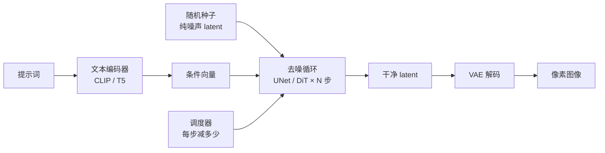

# 扩散模型原理

> [!abstract] 一句话讲清楚
> 扩散模型干的事就一件：先把一张图彻底加噪毁成雪花点，再训练一个网络学会"每一步该减掉多少噪声"，于是从纯噪声反推出一张新图。你调的步数、CFG、采样器，全是在控制这段"逆着走"的过程。

## 为什么重要

- 它是本领域所有东西的底座：文生图、图生视频、局部重绘、放大、音频生成，骨架都是"加噪—去噪"。
- 不懂它，你在 ComfyUI 里就是瞎点：不知道 `steps` 为什么 20 就够、`cfg` 调高为什么会糊、为什么换 VAE 会变色、为什么蒸馏模型只跑 4 步。
- 一个真实场景：客户说"我要 4 步出图，越快越好，质量别掉"。你要是知道"4 步模型是蒸馏出来的、跟正常模型不是同一个东西"，就不会拿普通模型硬改步数，而是直接换蒸馏版模型。
- 本领域显存的大头也在它：去噪网络（UNet/DiT）和 VAE 解码是两个吃显存的怪物，[[低显存工作流优化]] 的每一招都是在削它们。

## 核心名词全解

| 名词 | 英文 / 缩写 | 大白话解释 | 容易混淆 / 注意 |
|---|---|---|---|
| 扩散过程 | Forward Diffusion | 给图逐步撒噪声，最后变成纯噪声。训练时用 | 它是"人为规定"的，不是网络 |
| 去噪过程 | Reverse / Sampling | 从纯噪声出发，一步步把噪声减回去 | 采样步数说的就是这里 |
| 噪声预测网络 | Noise Predictor | 一个吃"当前图 + 步数 + 文本条件"、吐出"这图里有多少噪声"的网络 | 早期是 UNet，新模型多用 DiT |
| UNet | U-Net | 带下采样/上采样跳连的卷积网络，图像去噪的老功臣 | 说"UNet 模型"通常指 SD 那一代 |
| DiT | Diffusion Transformer | 用 Transformer 主干做去噪的新架构，Flux、Qwen-Image 类都是这条路 | 参数大、吃显存，但语义理解更强 |
| latent 空间 | Latent Space | 把图压缩 8 倍后的小图，去噪在它上面做，省显存省算力 | latent 不是像素，别拿去直接看 |
| VAE | Variational AutoEncoder | 负责"像素 ↔ latent"的压缩机：编码进 latent，解码回图像 | 换 VAE 常常为了色偏/清晰度 |
| 文本编码器 | Text Encoder（CLIP / T5） | 把提示词翻译成网络能读的条件向量 | 不同模型要配不同编码器，配错直接黑图 |
| 调度器 | Sampler / Scheduler | 决定每一步走多大、怎么走的算法 | Euler、DPM++、DDIM 是不同"走法" |
| CFG | Classifier-Free Guidance | 同时算"有提示词"和"没提示词"两个结果，往有提示词那边多推一点 | 也叫 guidance scale，太高会过饱和 |
| 采样步数 | Steps | 从噪声走回图像走几步 | 不是越多越好，20~30 是常见甜点 |
| 种子 | Seed | 随机噪声的编号，固定它就能复现同一张图 | 换了模型/步数/CFG，同种子也不同图 |
| 重绘幅度 | Denoise Strength | 图生图里"重新加多少噪"，1.0 等于从零画 | 局部重绘就靠它控制改动大小 |
| 蒸馏模型 | Distilled / Turbo / Lightning 类 | 通过蒸馏把几十步压到 1~8 步的加速模型 | 配错 CFG 会直接崩，通常 CFG=1 |

## 原理与机制

### 直觉版

想象一张照片被慢慢喷上白雾。喷到第 100 下，照片完全看不见了，只剩一片灰白雪花。现在你训一个"擦雾工"，只干小事：看一眼当前画面，告诉你"这一遍该擦掉多少雾"。

训练时你手上有原图，所以标准答案现成：第几步喷了多少雾，你自己清楚。擦雾工反复练，就学会了判断。

出图时反着来：先抓一把纯雪花（这就是种子），让擦雾工擦一下、再擦一下……擦二十几次，画面里就"长"出了东西。**它不是在画图，是在把噪声一步步减成一张图。**

### 拆解版

1. **三块零件**：文本编码器把提示词变成条件向量；去噪网络（UNet 或 DiT）负责"这一步减多少噪声"；VAE 负责在像素和 latent 之间来回搬运。
2. **训练**：拿一张真实图，随机挑一个步数、按公式撒噪，把"加噪后的图 + 步数 + 文本条件"喂给网络，让它预测撒进去的噪声，跟标准答案算误差、反向传播。**训练全程不需要人标注，图自己就是答案。**
3. **采样**：从纯噪声开始循环。每一步网络预测噪声 → 调度器决定把这坨噪声减掉多少 → 得到"稍微干净一点"的 latent。循环 N 次后，用 VAE 解码成像素图。
4. **条件的注入方式**：老一代用 cross-attention 把文本向量插进 UNet 中间层；新一代 DiT 常把文本和图像 token 拼在一起做联合注意力。不管哪种，本质都是"让文本影响每一步的去噪方向"。
5. **CFG 怎么工作**：每一步算两遍——一遍带提示词，一遍把提示词清空。然后做 `结果 = 无条件 + 强度 × (有条件 − 无条件)`。强度越大越"听话"，但也越容易过曝、细节僵硬。
6. **为什么在 latent 里做**：512×512 的图直接去噪，每一步都要算 78 万个像素；压到 64×64 的 latent 上算，便宜几十倍。代价是 VAE 这个压缩机本身有信息损失，所以 VAE 不好会糊、会偏色。

### 后果

- **显存由谁决定**：去噪网络的参数量与分辨率（latent 面积）+ VAE 解码的瞬时峰值。所以降分辨率、换小模型、量化、分块解码全都有效。
- **速度由谁决定**：步数 × 每步耗时。每步耗时又由模型大小和分辨率决定。要快就换蒸馏模型，而不是硬砍步数。
- **质量由谁决定**：模型本身（训练数据与容量）> 提示词与条件（CFG、ControlNet、LoRA）> 采样器与步数。后两者只能微调，救不了模型选错。

## 分类与对比

### 按去噪网络架构

| 维度 | UNet 类（SD / SDXL 一代） | DiT 类（Flux / Qwen-Image 类） |
|---|---|---|
| 主干 | 卷积 + 跳连 | Transformer 注意力 |
| 文本理解 | 靠 CLIP，短提示词友好 | 多配 T5 或大语言模型编码器，长句友好 |
| 参数量 | 中（几 G 权重） | 大（十几到几十 G 权重） |
| 显存门槛 | 低，8G 可以玩 | 高，通常 12G 起、量化后 8G 勉强 |
| 出图风格 | 二次元/写实都有成熟生态 | 写实质感、文字排版更强 |
| 生态 | LoRA/ControlNet 海量 | 生态在快速补齐，但仍有缺口 |

### 按工作空间

| 维度 | 像素空间扩散 | latent 扩散（现在主流） |
|---|---|---|
| 计算成本 | 高，分辨率一涨就爆 | 低，压 8 倍再算 |
| 细节上限 | 高 | 受 VAE 制约 |
| 显存 | 很高 | 可控 |
| 典型代表 | 早期扩散模型 | SD 之后几乎所有模型 |

### 按采样策略

| 采样器 | 特点 | 什么时候用 |
|---|---|---|
| Euler / Euler a | 快，20 步左右可用，`a` 版每步加随机性 | 日常出图、试提示词 |
| DPM++ 2M 系列 | 收敛好，细节稳，20~30 步 | 正式交付、批量出图 |
| DDIM | 老牌、确定性、可插值 | 需要复现/做插值实验 |
| 蒸馏配套采样器 | 1~8 步，必须配对应蒸馏模型 | 低配机器、要求出图速度 |

> [!tip] 采样器和模型要配套
> 蒸馏模型（Turbo/Lightning 类）必须用它自己推荐的采样器和极低 CFG；你拿普通采样器 + CFG 7 去跑蒸馏模型，只会得到糊图。

## 完整流程：从提示词到一张图

| 阶段 | 输入 | 动作 | 输出 | 验收标准 |
|---|---|---|---|---|
| ① 文本编码 | 提示词 + 负向提示词 | 文本编码器切成 token、压成条件向量 | 两组条件向量（正/负） | 提示词没有被截断，主体/风格/构图三类词齐全 |
| ② 准备噪声 | 种子 + 宽高 | 按分辨率生成纯噪声 latent | 初始 latent | 宽高在模型训练分辨率附近、是 8/64 的倍数 |
| ③ 循环去噪 | latent + 条件 + 参数 | 每步预测噪声、按调度器减掉 | 干净 latent | 步数够收敛、CFG 在安全区、采样器与模型配套 |
| ④ 解码 | 干净 latent | VAE 把 latent 还原成像素 | 像素图 | 颜色正常、没有网格/花块（有就是 VAE 问题） |
| ⑤ 后处理 | 像素图 | 放大、修复、加控制网精修 | 交付图 | 分辨率够印、边缘自然、无水印残留 |

每一步的"验收标准"就是现场排错的第一手抓手：出黑图先看 ④，出花图先看 ③ 的步数和 CFG，出双头先看 ② 的分辨率。

## 和相近生成路线的区别

| 路线 | 怎么生成 | 优点 | 缺点 | 现状 |
|---|---|---|---|---|
| GAN | 生成器与判别器对抗，一次前向出图 | 极快 | 训练不稳、模式崩塌、多样性差 | 出图领域基本退场 |
| 自回归（像素/离散 token） | 像大模型写字一样逐个 token 生成 | 可长序列、可与语言模型统一 | 慢，高分辨率代价大 | 在图像编辑/统一多模态模型里有用 |
| 扩散（去噪） | 从噪声多步去噪 | 稳定、质量高、生态最全 | 慢，需要迭代 | 当前图像/视频主流 |
| 流匹配（Flow Matching） | 学习从噪声到数据的"直线路径" | 路径更直、步数更少、训练更稳 | 概念新、部分工具链支持不一 | 新一代大模型常用，ComfyUI 里同样当采样器用 |

> [!tip] 看到"流匹配/整流"别慌
> 它和扩散是同一类东西（都是"从噪声往数据走"的连续变换），只是训练目标不同。在 ComfyUI 里对你来说就是"换了个模型、可能配了专用采样器"，操作习惯不用改。

## 决策点

- **岔路口 1：选 UNet 一代还是 DiT 新一代**
  条件：显存 ≤8G 且要快 → 选 SD1.5/SDXL 类，生态全、出图快；
  条件：12G 以上、客户要写实质感或中文文字 → 选 Flux / Qwen-Image 类（量化后跑）；
  代价：新模型权重更大、下载更慢、ControlNet/LoRA 生态可能缺件。

- **岔路口 2：出图慢，是该减步数还是换模型**
  判断：如果模型不是蒸馏版，步数从 30 砍到 10 通常质量掉得明显 → 别砍步数，**换蒸馏版模型**；
  判断：如果是蒸馏版还很慢 → 说明卡在分辨率/显存不够导致的换页，去查 [[低显存工作流优化]]。

- **岔路口 3：CFG 怎么定**
  推荐：常规模型 5~7；蒸馏模型 1~1.5（很多模型就是 1）；图生图可略低。
  判断依据：画面发灰、没细节 → 略加；过曝、颜色死、边缘发硬 → 降。

- **岔路口 4：图生图改动多大**
  `denoise` 0.3~0.5 = 保留原构图改风格；0.6~0.8 = 大改但保住主体位置；1.0 = 等于重画。
  推荐：需要保主体就用 0.4 左右先试，不够再加，别一步 0.9 上去。

- **岔路口 5：换不换 VAE**
  只在"明显偏色/发灰/文字糊"且确认原模型 VAE 有问题时换；换之前先固定种子做 A/B 对比。
  推荐：客户交付场景别乱换，换 VAE 是排查手段，不是常规操作。

## 参数与配置说明

| 参数 | 作用 | 调大/调小的影响 | 常见取值 |
|---|---|---|---|
| 采样步数 steps | 去噪循环跑几遍 | 调大：细节略增但收益递减、变慢；调小：明显变快、细节丢失 | 20~30（蒸馏模型 1~8） |
| CFG scale | 文本贴合强度 | 调大：更听话但过饱和/僵硬；调小：发散、不听话 | 5~7（蒸馏 1~1.5） |
| 采样器 sampler | 每步怎么减噪 | 影响细节与速度，不影响"理解提示词" | DPM++ 2M（稳妥） |
| 调度器 scheduler | 步长的曲线 | 影响收敛快慢 | 默认即可，别乱配 |
| 种子 seed | 初始噪声编号 | 固定可复现；换种子等于换构图 | 交付时固定 |
| 分辨率 | 生成画布大小 | 大面积涨显存，超训练分辨率会画出双头/重复 | 贴近模型训练分辨率 |
| denoise | 图生图重绘强度 | 越大改动越大 | 0.3~0.6 |
| 负向提示词 | 明确不要什么 | 蒸馏模型上常常无效 | 常规模型 1~3 个词 |

> [!warning] 分辨率的"安全区"
> 大多数模型是围绕某个分辨率训练的。跑到两倍以上，模型没见过这种构图，就会开始重复肢体、复制人头。要么先用模型原生分辨率出图再放大，要么用专门的放大流程。

## 显存与速度的量级感

不给"精确到 MB"的假数字，但你必须知道谁是大头：

| 组件 | 显存占用特征 | 能不能削 | 削它的手段 |
|---|---|---|---|
| 去噪网络权重 | 跟参数量和精度成正比，fp16→fp8 大约减半 | 能 | 量化模型、换小模型 |
| 激活值/中间结果 | 跟分辨率（latent 面积）正相关 | 能 | 降分辨率、分块 |
| 文本编码器（CLIP/T5） | 一次性占用，T5 类明显更大 | 能 | 用 fp8 编码器、CPU 端编码 |
| VAE 解码 | 分辨率越大峰值越高，高分辨率视频尤其夸张 | 能 | tiled VAE 分块解码 |
| 系统/驱动/框架开销 | 固定底噪 | 不能 | 换显存更大的卡 |

结论：8G 上做 SDXL 要"fp16 模型 + 原生分辨率 + tiled VAE"；8G 上做 Flux/Qwen-Image 类基本必须 int4/fp8 量化 + 分块，且速度只能是"演示级"。

## 三种场景的参数组合

| 场景 | 目标 | 步数 | CFG | 采样器 | 备注 |
|---|---|---|---|---|---|
| 试提示词 | 快速看构图 | 10~15 | 5~6 | Euler a | 分辨率减半，只判断内容不判断细节 |
| 正式出图 | 稳定高质量 | 25~30 | 5~7 | DPM++ 2M | 固定种子，方便微调 |
| 低配机器 | 有图就行、要快 | 4~8 | 1~1.5 | 蒸馏配套采样器 | 必须换蒸馏模型，不能硬砍步数 |
| 图生图精修 | 保主体改细节 | 20~25 | 4~6 | DPM++ 2M | denoise 0.35~0.55，配合蒙版 |

## 同一套原理的不同变体

| 生成类型 | 在原理上加什么 | 对应笔记 |
|---|---|---|
| 文生图 | 纯文本条件 | [[文生图模型生态]] |
| 图生图 | 把参考图加噪后当起点，`denoise` 控制重绘量 | [[ComfyUI 工作流实操]] |
| 局部重绘 | 加蒙版，只对蒙版区域去噪 | [[ComfyUI 工作流实操]] |
| 可控生成 | 额外注入姿态/深度/边缘条件 | [[ControlNet 与 LoRA]] |
| 放大 | 小图 → latent 放大 → 低 denoise 二次采样 | [[低显存工作流优化]] |
| 视频生成 | latent 从"一张"变成"多帧 + 时序层" | [[图生视频模型生态]] |
| 音频生成 | 在声学特征（如频谱）上做去噪 | [[音频与音乐生成]] |

## 记不住就记这四句话

- 训练 = 拿真实图加噪，让网络学会认噪声。
- 生成 = 从纯噪声开始，让网络一步步减噪声。
- 步数管"走几步回去"，CFG 管"多听提示词的话"。
- 显存吃在"去噪网络 + 高分辨率 + VAE 解码"上，优化就往这三处削。

## 常见坑与误区

| 现象 | 原因 | 对策 |
|---|---|---|
| CFG 拉到 12 以上，图变得油亮、颜色死 | 过强引导把结果推向极端 | 回到 5~7，想更贴提示词就改提示词本身 |
| 步数从 30 加到 80，质量几乎没变，时间翻倍 | 采样已收敛，收益递减 | 20~30 封顶，把时间花在换模型上 |
| 蒸馏模型按普通参数跑，出糊图/纯色块 | 蒸馏模型要求低 CFG + 配套采样器 + 短步数 | 用模型卡推荐的参数组合，别套老经验 |
| 换了 VAE 之后整体偏绿/发灰 | VAE 与模型不是一套，或权重放错目录 | 先清空 VAE 槽位用模型自带，确认是不是 VAE 问题 |
| 提示词里写"负面词 not blurry"反而更糊 | 普通模型里反向语义常常反向生效 | 负面词放负向提示词框，正文只写"要什么" |
| 高分辨率直出，人脸看着没事，手指数不对 | 超训练分辨率，模型退化成重复模式 | 原生分辨率出图 + 后期放大 |
| 同种子换模型，图完全不同 | 种子的噪声形状依赖模型与采样器 | 复现要"模型+采样器+步数+CFG+种子"整套固定 |
| 长提示词被截断，后半句没生效 | 文本编码器有 token 上限（CLIP 类通常 77 一组） | 用支持长文本的模型/编码器，或精简提示词 |

## 自检问题

- [ ] 能不能用"喷雾/擦雾"的比喻把扩散过程讲给客户听？
- [ ] 知道去噪网络、文本编码器、VAE 三块各负责什么吗？
- [ ] 为什么现在都在 latent 空间做，而不是像素空间？
- [ ] CFG 到底在算什么？调高为什么会有副作用？
- [ ] 步数为什么 20~30 就够，什么时候才需要蒸馏模型？
- [ ] UNet 和 DiT 的主要差别是什么，显存门槛差在哪？
- [ ] 同种子为什么换模型就不复现了？
- [ ] 显存峰值主要被哪几块吃掉？
- [ ] 流匹配和扩散是什么关系，为什么不用重新学一遍？
- [ ] 图生图的 `denoise` 和文生图的 `steps` 分别在调什么？

> [!tip] 用一张图自测
> 拿同一句提示词、同一个种子，只改 CFG（4 / 7 / 12）出三张图。如果你能解释清楚三张图的差别来自哪一步计算，这一篇就过关了。

## 自检问题参考答案

> [!success]- 1. 怎么用"喷雾/擦雾"把扩散讲给客户听？
> 训练时拿真实图反复撒噪，撒到只剩雪花，同时训一个"擦雾工"，让他看当前画面判断这一遍该擦掉多少雾——标准答案现成，因为喷了多少自己清楚。
> 出图反过来：抓一把纯噪声当起点，让擦雾工擦二十来下，画面就长出来了。
> 客户问"为什么不能一步出图"，就答：一步擦完只能得到一团灰，分步擦才能控制哪里清晰、哪里虚。

> [!success]- 2. 去噪网络、文本编码器、VAE 三块各管什么？
> 文本编码器把提示词翻成条件向量，负责"听指令"；去噪网络（UNet 或 DiT）负责每一步判断该减多少噪声，是画质与理解力的主力；VAE 负责像素与 latent 之间来回搬运、解码还原。
> 三块里任何一块接错都会直接翻车：编码器配错模型可能黑图，VAE 换错会偏色发灰。
> 现场指着节点问"这是干嘛的"，能一句话对上这三块，说明原理过关了。

> [!success]- 3. 为什么现在都在 latent 空间做，而不是像素空间？
> 因为便宜几十倍。512×512 的图直接去噪，每步要算 78 万像素；压 8 倍到 64×64 的 latent 上算，面积小两个数量级，显存和算力都省。
> 代价是 VAE 这个压缩机有信息损失，所以细节上限被 VAE 卡住——VAE 不好会糊、会偏色。
> 现在主流模型几乎全在 latent 上做，像素空间扩散只剩早期模型。

> [!success]- 4. CFG 到底在算什么，调高为什么会出副作用？
> 每一步算两遍：一遍带提示词、一遍把提示词清空，然后按"无条件 + 强度 ×（有条件 − 无条件）"往提示词那边推。
> 强度高更"听话"，但推得太狠会过曝、颜色发死、边缘发硬；常见安全区 5~7，蒸馏模型通常要 1 附近。
> 想更贴提示词，先改提示词本身，别一味拉 CFG。

> [!success]- 5. 步数为什么 20~30 就够，什么时候该换蒸馏模型？
> 采样会收敛，20~30 步之后细节收益递减，再加步数只是花时间，质量几乎不动。
> 真要 4 步出图，得换蒸馏模型（Turbo/Lightning 类），它要求极低 CFG 加配套采样器；拿普通模型硬砍步数只会掉质量、出糊图。
> 所以"快"的正确解法是换模型档位，不是拧步数。

> [!success]- 6. UNet 和 DiT 的差别是什么，显存门槛差在哪？
> UNet 是卷积加跳连的老架构，参数中等、显存门槛低，8G 能玩，LoRA 与控制网生态最全；DiT 用 Transformer 注意力做主干，参数量大，语义理解和文字排版更强。
> 门槛差距的直接原因是权重量级：DiT 类通常十几到几十 G 权重，一般 12G 起，量化后才勉强进 8G。
> 要低配快出图选 UNet 一代，要写实质感与中文文字再上 DiT 类。

> [!success]- 7. 同种子为什么换模型就不复现？
> 种子的作用是决定初始那团噪声的形状，而"这团噪声最后变成什么"取决于模型、采样器、步数、CFG 整套计算。
> 换了模型，同一个编号喂进去，经过的每一步计算都不同，结果自然不一样。
> 要复现必须把模型、采样器、步数、CFG、种子五件事整套固定，只记种子没用。

> [!success]- 8. 显存峰值主要被哪几块吃掉？
> 四块大头：去噪网络权重（跟参数量和精度成正比，fp16→fp8 约减半）、激活值与中间结果（跟分辨率面积正相关）、文本编码器（T5 类明显更大）、VAE 解码（分辨率越高峰值越高，高分辨率视频尤其夸张）。
> 再算上系统、驱动、框架的固定开销。
> 优化就是削这四块：量化模型、降分辨率、分块解码、换更小的编码器。

> [!success]- 9. 流匹配和扩散是什么关系，为什么不用重新学一遍？
> 是同一类东西，都是"从噪声往数据走的连续变换"，只是训练目标不同：扩散学逐步去噪，流匹配学一条更直的路径。
> 路径更直所以步数更少、训练更稳，新一代大模型常用它。
> 在 ComfyUI 里操作习惯不用改，对你来说就是换了个模型、可能配了专用采样器。

> [!success]- 10. 图生图的 denoise 和文生图的 steps 分别在调什么？
> steps 是文生图里"从噪声走回图像走几步"，管收敛程度；denoise 是图生图里"给参考图重新加多少噪"，决定从哪个起点开始走。
> denoise 0.3~0.5 保留构图改风格，0.6~0.8 大改但保住主体位置，1.0 等于重画。
> 一个是步数、一个是起点，现场调参时别混。

## 从原理到 ComfyUI 的对应关系

学完原理马上对照节点，下一章就不会觉得节点是"玄学积木"：

| 原理里的成分 | ComfyUI 里的节点 | 要留意的点 |
|---|---|---|
| 文本编码器 | CLIP Text Encode（Flux 类要接双编码器） | 模型用哪个编码器，就得接哪个，接错全黑 |
| 去噪网络权重 | Checkpoint Loader 或 UNET Loader | 一体化 ckpt 和分离式 unet 的加载方式不同 |
| 噪声 latent + 分辨率 | Empty Latent Image | 宽高决定显存与构图，别乱填 |
| 循环去噪 + CFG + 采样器 | KSampler | 一个节点同时管 steps/cfg/sampler/scheduler/denoise |
| VAE 解码 | VAE Decode（高分辨率改 tiled） | 黑图、灰图常从这里查 |
| 固定种子 | KSampler 的 seed 输入 | 复现一张图要固定整套参数 |
| 图生图重绘强度 | KSampler 的 denoise | 局部重绘还要配蒙版节点 |

理解这张表的用处：现场客户指着节点问"这个是干嘛的"，你能一句话对上原理；工作流报错时，你也能反推是哪一环节的条件不满足。

## 相关笔记

- 上游：[[多模态模型原理]]、[[量化技术]]
- 下游：[[ComfyUI 核心概念]]、[[文生图模型生态]]
- 对照：[[图生视频模型生态]]、[[ControlNet 与 LoRA]]
- 深入：[[低显存工作流优化]]
- 返回：[[生成式多媒体 MOC]]

## 交付视角（对客户怎么讲）

- 客户问"为什么不能一步出图"：就像洗照片显影，一步到位只能得到一团灰；分步显影才能控制哪里清晰、哪里虚。
- 客户问"为什么慢"：不是软件卡，是模型要"走二十几步"。想快有两个办法——换加速版模型（掉一点质量），或换更好的显卡（花钱）。
- 客户问"为什么同样的提示词，这次和上次不一样"：生成有随机性，要稳定就固定种子；但长文档级别的"一模一样复现"在扩散模型里不现实，提前说清楚。
- 报价时把"步数 × 张数 × 每步耗时"当成成本模型，先测单张耗时再报包年/包量，别拍脑袋。

