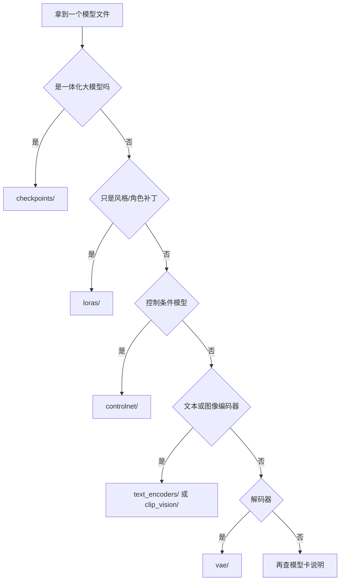

# 模型目录与生态

> [!abstract] 一句话讲清楚
> ComfyUI 靠"文件夹类型"认模型：checkpoints、loras、vae、controlnet 各有各的目录，放错目录加载器就看不见。这一篇讲清每个目录装什么、模型从哪来、以及"底模—编码器—VAE—LoRA"之间怎么对齐版本。

## 为什么重要

- 报错排行榜第一名不是显存，是"模型放错目录/找不到文件"。客户发来一张截图"我这里没有这个模型"，九成是目录问题。
- 模型格式选错会直接决定能不能跑：同一个模型有 fp16、fp8、gguf 几个版本，8G 卡选错就是 OOM。
- 版本对齐是本领域最隐蔽的坑：LoRA 要跟底模同架构，ControlNet 要跟底模同系列，编码器要和模型匹配。买错一个，效果全无。
- 交付时要给客户一份"模型清单"（文件名+来源+用途+许可证），这是资产，也是合规凭据。

## 核心名词全解

| 名词 | 英文 / 缩写 | 大白话解释 | 容易混淆 / 注意 |
|---|---|---|---|
| 模型根目录 | models | ComfyUI 下所有模型的"总仓库" | 不是插件目录，别往里塞 zip |
| checkpoints | ckpt | 一体化大模型：主干+编码器+VAE 打包 | SD 一代最常见，体积最大的那类 |
| diffusion_models / unet | Diffusion Model | 只装去噪主干的目录，新架构常用 | 和 checkpoints 二选一，别重复放 |
| loras | LoRA | 小补丁，改风格/角色/动作，几十到几百 MB | 必须与底模同架构才能生效 |
| vae | VAE | 单独的解码器，修色偏/提清晰度 | 换 VAE 是排查手段，不是常规操作 |
| text_encoders / clip | Text Encoder | 文本编码器权重，Flux 类模型必需 | 放错目录会报"编码器缺失" |
| clip_vision | CLIP Vision | 图像编码器，给 IP-Adapter、图生图参考用 | 和文本 CLIP 不是一回事 |
| controlnet | ControlNet | 条件控制模型，吃姿态/深度/边缘图 | 必须与底模同系列同分辨率档位 |
| upscale_models | Upscaler | 放大模型（如 ESRGAN 类） | 和"latent 放大"是两种放大方式 |
| embeddings | Textual Inversion | 老式"词向量"嵌入，用来加概念 | 现在多数场景已被 LoRA 取代 |
| safe tensors | .safetensors | 只存张量、不执行代码的模型格式 | 交付首选，比 .ckpt 安全 |
| gguf | GGUF | 量化社区格式，分级量化、可 CPU 卸载 | 低显存神器，但要配套加载节点 |
| fp8 / fp16 | 浮点精度 | 权重用几位小数存，越少越省显存 | fp8 通常质量损失可接受，fp4 要实测 |
| extra_model_paths | 外部模型路径配置 | 让 ComfyUI 读取别的盘的模型目录 | 大模型放机械盘/共享盘时必配 |

## 原理与机制

### 目录就是"类型字典"

ComfyUI 的加载节点不是"打开文件浏览器随便选"，而是启动时扫描 `models/` 下每个子目录，按**目录名**决定文件属于哪类资产，然后在对应的加载节点里列出来。

所以规则很简单：**什么类型就放哪个文件夹，文件名随意但要英文**。放错目录 = 加载器扫不到 = 看起来像"模型没下载成功"。

### 一个模型由哪几块组成

| 部件 | 作用 | 在新架构里的常见形态 |
|---|---|---|
| 去噪主干 | 真正干活的网络 | 单独文件（diffusion_models） |
| 文本编码器 | 提示词 → 条件 | 单独文件（text_encoders），可能两个 |
| VAE | latent ↔ 像素 | 单独文件（vae），也可能内嵌 |
| 条件控制/LoRA | 附加能力 | 各自目录，按需加载 |

一体化 ckpt 是把前三块打包；分离式是把它们拆开。**拆分是为了换部件方便，但也带来"少装一个就黑图"的风险。**

### 常见目录结构示意

```text
ComfyUI/
├── models/
│   ├── checkpoints/        # 一体化大模型
│   ├── diffusion_models/   # 只放去噪主干
│   ├── vae/                # 独立 VAE
│   ├── text_encoders/      # CLIP / T5
│   ├── clip_vision/        # 图像编码器
│   ├── loras/              # LoRA 补丁
│   ├── controlnet/         # 控制网模型
│   ├── upscale_models/     # 放大模型
│   └── embeddings/         # 老式词嵌入
├── custom_nodes/           # 自定义节点（插件）
└── input/  output/         # 素材与出图
```

### 格式怎么选

| 格式 | 体积 | 显存需求 | 兼容性 | 适用 |
|---|---|---|---|---|
| safetensors fp16 | 大 | 高 | 最好 | 显存充足、要原生质量 |
| fp8 量化 | 约一半 | 中 | 好，主流加载器支持 | 12~16G，画质损失小 |
| gguf 分级量化 | 小 | 低（可卸载） | 需专门加载节点 | 8G 及以下、演示级速度 |
| 老式 .ckpt（pickle） | 大 | 高 | 一般 | 能避开就避开，有安全风险 |

## 完整流程：拿到一个模型怎么办

| 阶段 | 动作 | 为什么 | 验收标准 |
|---|---|---|---|
| ① 看模型卡 | 确认架构、参数规模、推荐分辨率、许可证 | 决定放哪个目录、能不能商用 | 看懂"base model"一行 |
| ② 判断类型 | 一体化 ckpt / 主干 / LoRA / VAE / ControlNet | 决定目标目录 | 类型明确，不靠猜 |
| ③ 选格式 | fp16 / fp8 / gguf，按显存 | 决定能不能跑 | 与你的加载器兼容 |
| ④ 放目录 | 按类型放进 `models/` 对应子目录 | 加载器按目录扫描 | 文件名英文、无空格 |
| ⑤ 刷新/重启 | 重新拉取节点列表 | 新文件才被扫到 | 加载节点里能看到文件 |
| ⑥ 最小验证 | 用官方模板接上跑一张 | 验证模型本身没坏 | 能出图，无报错 |
| ⑦ 记录清单 | 文件名、来源、用途、许可证 | 交付与合规 | 清单能交给客户 |

### 模型从哪来

| 来源 | 特点 | 要注意 |
|---|---|---|
| 官方发布页（模型团队/机构仓库） | 最权威，配套文档全 | 大文件下载慢，注意分片 |
| 模型社区（C 站类） | 风格/LoRA 丰富 | 质量参差，检查示例图与底模 |
| 开源仓库（Hugging Face 类） | 版本全、有量化版 | 看清文件命名与格式 |
| 第三方网盘搬运 | 快、可能已量化 | 可能缺文件/被改名/夹带私货，必须验证 |
| 客户自己提供 | 最贴近业务 | 先问"配套编码器和 VAE 在哪" |

> [!warning] 许可证比下载更麻烦
> 代码开源不代表权重可商用，社区模型还常常禁止商用或限制用途。交付前查模型卡上的 license 字段，写进清单，必要时让客户书面确认。

## 分类与对比

### 目录作用速查

| 目录 | 装什么 | 典型体积量级 | 谁用它 |
|---|---|---|---|
| checkpoints | 一体化模型 | 几 G 到十几 G | 文生图主流程 |
| diffusion_models | 去噪主干 | 几 G 到几十 G | 新架构主流程 |
| vae | 独立解码器 | 几百 MB | 修色偏、高分辨率 |
| text_encoders | 文本编码器 | 几 G（T5 类偏大） | 分离式模型必需 |
| loras | 风格/角色补丁 | 几十到几百 MB | 定制化 |
| controlnet | 控制条件模型 | 几百 MB 到几 G | 构图/姿态控制 |
| upscale_models | 放大 | 几十 MB | 出图后放大 |
| embeddings | 词嵌入 | 几 KB 到几 MB | 老式概念注入 |
| clip_vision | 图像编码 | 几百 MB | IP-Adapter、参考图 |

### 一体化 vs 分离式

| 维度 | 一体化 ckpt | 分离式 |
|---|---|---|
| 上手难度 | 低 | 中高 |
| 换部件灵活度 | 低 | 高 |
| 缺件风险 | 低 | 高（缺编码器/VAE 就黑图） |
| 适用架构 | SD 一代生态 | Flux / Qwen-Image 类等新架构 |

### 不同显存档位的选择

| 显存 | 推荐格式 | 提示 |
|---|---|---|
| 8G | gguf 量化 + 小分辨率 + 分块 | 主流程可跑，速度是演示级 |
| 12~16G | fp8 量化 + 原生分辨率 | 主流新模型可接受 |
| 24G 及以上 | fp16 原生 | 质量与速度兼顾，可跑视频 |

## 模型命名与整理规范

模型一多就乱，乱就是事故。交付级整理建议：

- **命名三段式**：`系列_用途_格式`，例如 `sdxl_realistic_fp16.safetensors`、`flux_写实_fp8.safetensors`。客户和同事一眼能判断。
- **只留一份原件**：同一个模型不要存两个目录，用一个主目录 + `extra_model_paths` 共享给 ComfyUI。
- **按项目隔离**：给不同客户建 `models_customerA/`、`models_customerB/`，避免"这台机器上的模型被别的项目污染"。
- **不删旧版本**：模型迭代快，旧工作流可能只认旧文件。至少保留到该项目维护期结束。
- **记录三件事**：来源链接、下载日期、许可证。写在清单里，不要只存在你脑子里。
- **不碰系统盘**：模型和输出图都放数据盘；系统盘满了会导致服务崩溃、系统卡死。

## 模型转换与量化常识

- **能下现成的就别自己转**：fp8、gguf 版本通常有官方或社区现成的，自己转容易出错且耗时。
- **转换会掉质量**：量化本质是降低权重精度，掉多少要实测；人脸、文字、手部是重灾区。
- **低比特不是万能**：4bit 以下压缩在图像模型上往往很明显，8G 跑大模型要接受"演示级"的预期。
- **转完必须验证**：同一提示词同种子，跟原版对比，看是否出现色块、崩坏、文字糊。
- **加载器要配套**：gguf 需要专门加载节点，不是所有节点都认；工作流迁移时要把这点写进说明。

## 从社区模型到可用流程的检查单

1. 看示例图用的底模、分辨率、采样参数，别拿一套参数乱试。
2. 确认配套文件齐全（编码器、VAE、触发词、示例提示词）。
3. 用官方模板最小验证，先跑通再往你自己的工作流里搬。
4. 记录版本和许可证，再进项目库。
5. 跑 5 条业务提示词，确认不是"只在示例图上好看"。

## 模型体积与显存的粗算

只用来做"能不能跑"的初判，最终以实测为准：

- 权重显存 ≈ 参数量 × 每参数字节数。fp16 约 2 字节、fp8 约 1 字节、4bit 量化约 0.5 字节。
- 举例：一个约 12B 参数的模型，fp16 权重约 24G，fp8 约 12G，4bit 约 7G 上下。**再叠加**文本编码器、激活值和 VAE 峰值。
- 所以 24G 卡跑 fp16 的 12B 模型属于"刚好"，跑 8G 卡必须量化 + 分块 + 降分辨率。
- 视频模型的显存还要乘以帧数相关的中间激活，粗略看"帧数翻倍，激活涨一截"。
- 判断顺序：先看模型卡写的推荐显存，再用自己的卡实测峰值，别信论坛的"我 8G 能跑"（分辨率可能只有 512）。

## 文件后缀速查

| 后缀 | 是什么 | 能不能直接用 | 注意 |
|---|---|---|---|
| `.safetensors` | 安全张量格式 | 能 | 交付首选 |
| `.ckpt` | 老式打包格式 | 能 | 可执行代码，有安全风险 |
| `.pt` / `.pth` | PyTorch 权重 | 看加载器 | 可能是 LoRA、VAE 或别的部件 |
| `.gguf` | 量化社区格式 | 需配套加载器 | 分级量化，Q4/Q8 等 |
| `.bin` | 老式权重 | 看框架 | 多为文本编码器或老模型 |
| `.yaml` / `.json` | 配置 | 不单独用 | extra_model_paths 是 yaml |

## 模型生态的分层

| 层 | 谁在做 | 例子（系列级） | 对交付的意义 |
|---|---|---|---|
| 底模 | 研究机构/大厂 | SD 系、SDXL 系、Flux 系、Qwen-Image 类 | 决定能力上限，选对少走弯路 |
| 精调模型 | 社区/工作室 | 写实、二次元、电商等微调版 | 出图风格与稳定性，注意许可证 |
| LoRA | 个人/工作室 | 角色、画风、材质、姿势 | 几十 MB 解决定制需求，交付常用 |
| 控制网 | 研究机构/社区 | 姿态、深度、边缘、参考图类 | 决定"可控性"，是商用场景刚需 |
| 后处理 | 社区 | 放大、修脸、去噪 | 决定成片质量 |

## 决策点

- **岔路口 1：先看许可证还是先看效果**
  推荐：**先看许可证**。效果再好，不能商用就是白干；尤其给企业客户交付。
  代价：会筛掉一部分热门社区模型，但省掉后续法务风险。

- **岔路口 2：下哪个格式**
  条件：显存 ≥ 模型参数量对应需求（见模型卡）→ fp16；
  条件：差一档 → fp8；
  条件：差两档以上（如 8G 跑大模型）→ gguf 量化并接受速度/质量折损。
  推荐：**先下 fp8 试水**，能跑再决定要不要原生。

- **岔路口 3：一体化还是分离式**
  条件：客户机器固定、只用一个模型、要省事 → 一体化；
  条件：要混搭编码器/VAE、要多模型切换 → 分离式 + 规范目录。

- **岔路口 4：模型放系统盘还是数据盘**
  推荐：数据盘或独立 SSD，系统盘只放程序和缓存。一个视频模型几十 G，塞系统盘很快就满。
  大目录用 `extra_model_paths` 挂进来，不用挪文件。

- **岔路口 5：社区模型能不能直接交付**
  推荐：能，但要做好三件事——固定版本（存一份原文件）、记录来源与许可证、在自己的机器上跑过验收。**不要交付一个"下载链接"当交付。**

## 参数与配置说明

| 配置项 | 作用 | 怎么用 |
|---|---|---|
| models 根目录 | 默认模型仓库 | 常规放法，最省心 |
| extra_model_paths.yaml | 挂接外部目录 | 大模型在别的盘时用，按类型分别映射 |
| 文件名 | 加载器里的显示名 | 英文 + 能看出用途，如 `flux1-dev-fp8.safetensors` |
| 子目录层级 | loras 等目录可再分子类 | 太深不影响识别，但自己要理得清 |
| 下载校验 | 大文件完整性 | 对比文件大小/hash（如果来源提供） |
| 版本备份 | 保留原文件 | 模型更新换代太快，旧工作流可能只认旧版 |

## 一张图判断"这个文件放哪"



## 常见坑与误区

| 现象 | 原因 | 对策 |
|---|---|---|
| 下载了模型，加载器里找不到 | 放错子目录（如 LoRA 放进 checkpoints）、文件还在压缩包里 | 按类型放目录，解压后放文件本体，刷新节点列表 |
| 加载器能选到，但一跑就报错 | 文件不完整（断点下载）、格式和加载器不匹配 | 重新下载校验；确认加载器支持该格式 |
| LoRA 加载了但画风毫无变化 | 与底模架构不同（跨代）、权重太低、没写触发词 | 换同架构底模；权重 0.6~0.9；加触发词 |
| 分离式模型出黑图 | 缺编码器、编码器类型接错（CLIP vs T5） | 按官方模板核对接线，缺哪个补哪个 |
| ControlNet 完全没效果 | 控制图全黑/接错、控制模型与底模不同系列 | 先预览预处理图，再确认模型匹配 |
| 换 VAE 后偏色 | VAE 与模型不配套 | 换回模型自带 VAE 做对照 |
| 磁盘突然满了 | 模型重复存放、视频模型几十 G 起步 | 用外部路径共享一份，定期清理 |
| 客户机器杀毒软件报警 | 老式 .ckpt 格式本身可执行代码 | 统一用 safetensors 交付 |

## 自检问题

- [ ] 每个模型目录分别装什么，各由哪个加载节点使用？
- [ ] 为什么放错目录后加载器"看不见"模型？
- [ ] 一体化 ckpt 和分离式模型，各自的部件有哪些？
- [ ] 显存 8G / 12G / 24G 分别该选什么格式的权重？
- [ ] LoRA 生效的前提条件有哪些？
- [ ] 模型许可证要看模型卡的哪个字段，为什么它比代码许可证更关键？
- [ ] `extra_model_paths` 解决什么问题？
- [ ] 交付时模型清单应该包含哪些信息？

## 自检问题参考答案

> [!success]- 1. 每个模型目录分别装什么，各由哪个加载节点使用？
> 目录就是类型字典：checkpoints 装一体化大模型，对应一体化加载节点；diffusion_models 只装去噪主干，对应主干加载器；vae 装独立解码器；text_encoders 装 CLIP 或 T5；clip_vision 装图像编码器，给参考图类节点用。
> loras 装风格/角色补丁，controlnet 装控制模型，upscale_models 装放大模型，embeddings 装老式词嵌入。
> 记法就一句：什么类型放哪个文件夹，对应那一类加载节点才看得见。

> [!success]- 2. 为什么放错目录后加载器"看不见"模型？
> 因为加载节点不是打开文件浏览器随便选，而是启动时扫描 models 下每个子目录，按目录名把文件归类，只把对应那类文件列进下拉框。
> 放错目录，加载器根本不扫那个类型，看起来就像模型没下载成功。
> 放对之后还要刷新或重启节点列表才会出现；文件名用英文、别带空格，能少一半莫名其妙的麻烦。

> [!success]- 3. 一体化 ckpt 和分离式模型，各自的部件有哪些？
> 一体化 ckpt 把去噪主干、文本编码器、VAE 三块打包成一个文件，加载一次出三个输出，SD 一代生态最典型。
> 分离式是拆开存：主干放 diffusion_models、一到两个文本编码器放 text_encoders、解码器放 vae，Flux 与 Qwen-Image 类常见。
> 拆分的好处是换部件方便，代价是少装一个或编码器类型接错就直接黑图。

> [!success]- 4. 显存 8G / 12G / 24G 分别选什么格式？
> 8G 走 gguf 分级量化，配小分辨率和分块，主流程能跑但速度属于演示级；12~16G 用 fp8 量化配原生分辨率，主流新模型可接受；24G 及以上用 fp16 原生，质量和速度兼顾，还能跑视频。
> 判断顺序是先看模型卡写的推荐显存，再用自己的卡实测峰值。
> 别信论坛"我 8G 能跑"，他可能只跑了 512 分辨率。

> [!success]- 5. LoRA 生效的前提条件有哪些？
> 三个硬条件：底模同架构（跨代 LoRA 就算加载了也不起作用）、权重给到位（常见 0.6~0.9）、触发词写进正向提示词。
> 再往前一步，文件得放对 loras 目录，加载节点能选到。
> 如果都满足还没效果，就检查训练它用的底模版本是否与推理底模一致——不匹配时偶尔会有微弱影响，多数情况直接无效。

> [!success]- 6. 模型许可证看哪个字段，为什么比代码许可证更关键？
> 看模型卡上的 license 字段。代码开源不等于权重可商用，很多社区模型明确禁止商用或限制用途。
> 因为它直接决定"这个项目能不能交付到企业客户手里"，是合规凭据；效果再好不能商用就是白干。
> 交付前查清楚、写进模型清单，必要时让客户书面确认，这比事后解释便宜得多。

> [!success]- 7. `extra_model_paths` 解决什么问题？
> 解决"模型不想放在 ComfyUI 目录里"的问题：几十 G 的模型放独立数据盘、机械盘或共享盘，用一份 yaml 配置按类型把外部目录映射进来，不用挪文件。
> 它也解决"一个主目录共享给多个 ComfyUI 实例"的需求，避免同一模型重复存好几份。
> 改完要重启才生效；路径写错就等于没配。

> [!success]- 8. 交付时模型清单应该包含哪些信息？
> 每份模型的文件名、来源链接、下载日期、用途、许可证，加上格式与版本（fp16/fp8/gguf）和放置目录。
> 分离式模型还要写清配套文件：哪个编码器、哪个 VAE、有没有触发词。
> 这份清单是资产台账：客户以后要换、要补、要复现都照着它来，出纠纷时也是依据。

## 相关笔记

- 上游：[[量化技术]]、[[硬件基础与 GPU 生态]]
- 下游：[[ComfyUI 核心概念]]、[[文生图模型生态]]
- 对照：[[图生视频模型生态]]、[[低显存工作流优化]]
- 合规：[[开源许可证与合规]]
- 返回：[[生成式多媒体 MOC]]

## 交付视角（对客户怎么讲）

- 客户问"模型是不是要买"：大部分开源模型免费下载，但要看清商用条款；收费的通常是某类精调模型或商用授权，按项目报价。
- 客户问"以后能不能换模型"：能，工作流不用重做，换加载节点里的文件即可——前提是目录规范、版本记录在案。
- 客户问"为什么第一次要下载这么多"：每个模型是几个 G 到几十 G 的文件，交付时我们随机器一起拷好，不需要客户自己下。
- 交付物里务必包含模型清单表和许可证说明。这既是专业度的体现，也是将来纠纷时的依据。

