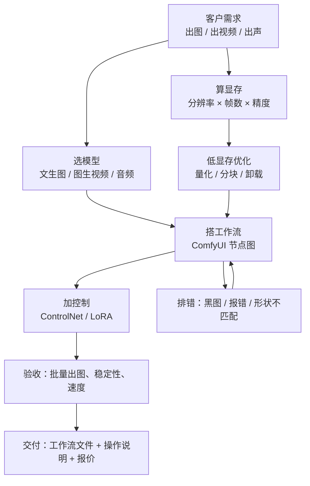

# 生成式多媒体 MOC

> [!abstract] 一句话讲清楚
> 这个领域讲的是"在自己的机器上跑图像、视频、音频生成"：原理是扩散模型，工具是 ComfyUI，交付物是一套客户能自己点开就用的工作流。

## 这个领域解决什么问题

- 客户不再满足于"调用云端 API 出图"，他们要**数据不出内网、按张数不限量、风格可私有化**的生成能力。
- 客户最常问的一句是："我这台 8G 显存的机器能跑什么？"——这个问题没有标准答案，取决于工作流设计，本领域最后一篇专门讲它。
- 交付形态通常是：一台机器 + 一套 ComfyUI + 若干工作流文件 + 用图说明。客户不需要懂原理，但你要懂，不然现场出黑图、报错、模型放错目录时没法十分钟解决。

## 阅读顺序

| 顺序 | 笔记 | 读它是为了 |
|---|---|---|
| ① | [[扩散模型原理]] | 建立"生成是怎么发生的"直觉，后面所有参数才有意义 |
| ② | [[ComfyUI 核心概念]] | 看懂节点、连线、latent 空间、KSampler 这几个词 |
| ③ | [[ComfyUI 工作流实操]] | 亲手把模板改成一条完整工作流，学会排错 |
| ④ | [[模型目录与生态]] | 模型该放哪个文件夹，版本怎么对齐 |
| ⑤ | [[文生图模型生态]] | 客户要"图好看、中文准、能商用"，选哪一类模型 |
| ⑥ | [[图生视频模型生态]] | 视频客户的预算和显存通常差一个量级，先算账 |
| ⑦ | [[ControlNet 与 LoRA]] | 客户要"可控"和"像我家产品"，靠这两个 |
| ⑧ | [[音频与音乐生成]] | 配音、声音克隆、配乐需求的落地路径 |
| ⑨ | [[低显存工作流优化]] | 8G/12G 交付的核心手艺，决定报价能不能做 |

## 全部笔记

| 笔记 | 一句话 | 类型 |
|---|---|---|
| [[扩散模型原理]] | 加噪再学会去噪，三块组件（文本编码器、去噪网络、VAE）分工干活 | 概念 |
| [[ComfyUI 核心概念]] | 节点是函数、连线是数据、工作流是一张可执行的图 | 概念 |
| [[ComfyUI 工作流实操]] | 从官方模板出发，改模型、改提示词、改采样、存图，逐段排错 | 流程 |
| [[模型目录与生态]] | checkpoints / loras / vae / controlnet 各就各位，放错就报错 | 清单 |
| [[文生图模型生态]] | SD、SDXL、Flux、Qwen-Image 类各管一段需求，中文场景另有讲究 | 对比 |
| [[图生视频模型生态]] | 分辨率和帧数一乘，显存需求翻倍，先算三角关系再谈方案 | 对比 |
| [[音频与音乐生成]] | TTS、声音克隆、音乐生成、SVC 是四条不同的技术路线 | 概念 |
| [[ControlNet 与 LoRA]] | 一个管"构图照着来"，一个管"风格/脸照着来" | 概念 |
| [[低显存工作流优化]] | 量化、分块、卸载、降规格，四板斧把 8G 用满 | 流程 |

## 领域内关系图

## 和其他领域的关系

- **上游**：[[硬件基础与 GPU 生态]] 决定你能买什么卡；[[量化技术]] 解释 fp8/gguf 为什么能省显存；[[Python 环境与依赖管理]] 是自定义节点依赖冲突的根因所在地。
- **平行**：[[多模态模型原理]] 讲的是"看懂图"，本领域讲的是"生成图"，两套模型的训练目标完全不同，别混为一谈。
- **下游**：[[容器化部署]] 把 ComfyUI 打进镜像；[[远程交付与远程运维]] 解决客户机器在内网、你只能远程操作的问题；[[交付 SOP 与报价]] 里要把"出图速度/并发"折算成价格。
- **合规**：[[开源许可证与合规]]——模型权重和 LoRA 的商用条款比代码许可证更麻烦，交付前必须查。

## 学习与交付建议

- 先跑通再优化：能用官方模板出图之后，再动低显存参数，否则你会同时面对"配置错"和"资源不够"两个问题。
- 每接一单，先问三个数：**显存多大、要出多大分辨率/多少帧、多久要出多少张**。这三个数直接决定方案和报价。
- 客户演示时不要现场调参数，用固定种子 + 固定工作流，现场只改提示词，稳定性比炫技重要。
- 把你调通的工作流 JSON 存成文件交付，附一页"每个参数是干嘛的"，这是复购率最高的东西。

## 相关笔记

- 总览：[[技能栈总览 MOC]]
- 路线：[[学习路线图]]
- 上游领域：[[模型认知 MOC]]、[[推理引擎 MOC]]
- 下游领域：[[工程化交付 MOC]]、[[微调训练 MOC]]
- 术语法：[[术语总表]]
- 返回：[[README 从这里开始]]
