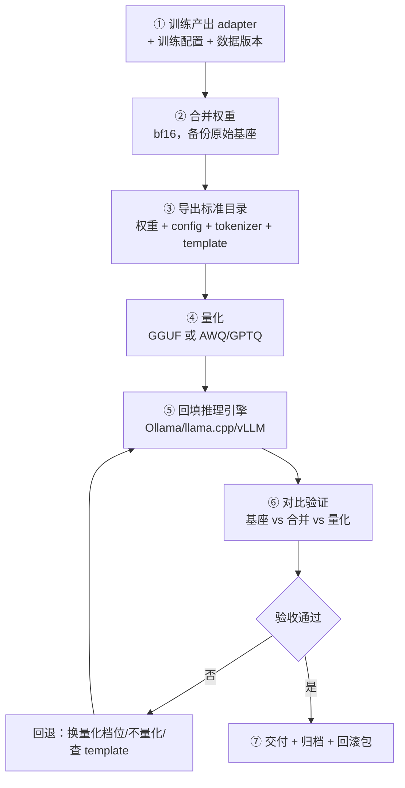

# 合并导出与部署闭环

> [!abstract] 一句话讲清楚
> 训练产出的是一个几十 MB 的 LoRA 补丁，客户要的是能跑起来的服务。这篇把"合并 → 导出 → 量化 → 回填推理引擎 → 对比验证"串成一个闭环，并点出每一步最容易掉的格式坑。

## 为什么重要

- 你现在的位置：训练完了（[[训练监控与评估]]），adapter 在硬盘上。**不把它变成推理引擎能加载的格式，前面所有工作等于零。**
- 不懂会踩的坑：
  - 合并后模型输出变差——精度处理错了，或者 chat template 丢了。
  - 转 GGUF 失败——转换脚本版本和模型架构对不上。
  - 量化后模型变傻——量化档位选太狠，业务场景又恰好对精度敏感。
  - 部署上去没做对比验证，客户第一句话就是"怎么感觉不如之前"。
- 真实场景：这是**交付前的最后一道关**，也是"看着简单、实际最容易翻车"的一步。合并和量化会改模型权重，任何一个环节出错都可能让几天训练白费。
- 一句话原则：**训练完不算完，回填到推理引擎并对比验证通过，才算这单做完。**

## 核心名词全解

| 名词 | 英文 / 缩写 | 大白话解释 | 容易混淆 / 注意 |
|---|---|---|---|
| 合并 | Merge | 把 LoRA 补丁的增量加回基座权重 | 合并会**改变权重**，不可逆，必须留原始基座 |
| 导出 | Export | 把模型保存成标准目录（权重 + 配置 + tokenizer） | 只存权重不够，配置和分词器缺一样都跑不了 |
| safetensors | — | 一种安全的权重文件格式，加载快、不易被植入代码 | 比 pickle 的 `.bin` 更推荐 |
| 量化 | Quantization | 把权重从高精度压成低精度，省显存 | 有损，档位越高越省也越可能掉点 |
| GGUF | GPT-Generated Unified Format | llama.cpp / Ollama 生态的模型格式 | 只给 CPU/混合推理用，vLLM 不吃 |
| AWQ / GPTQ | — | 面向 GPU 推理的量化格式 | 通常给 vLLM 用，和 GGUF 是两条线 |
| 推理引擎 | Inference Engine | 真正对外提供服务的程序（Ollama/vLLM/llama.cpp） | 和训练框架完全两套东西 |
| chat template | 对话模板 | 决定 prompt 怎么拼成模型输入 | 丢了它，模型会不认指令，这是最常见的坑 |
| adapter | 适配器 | LoRA 训练产出的补丁文件 | 可以不合并且直接动态加载 |
| 动态加载 | Dynamic Adapter Loading | 推理时临时挂补丁，基座不变 | 适合一套基座 + 多客户/多场景 |
| 冒烟测试 | Smoke Test | 上线前用几条问题快速验证服务正常 | 一定放在正式压测和验收之前 |
| 模型卡 | Model Card | 记录模型来源、训练数据、能力边界、局限的文档 | 交付物，别省 |
| 回滚 | Rollback | 出问题时切回上一版 | 交付前必须先准备好 |

## 原理与机制

### 直觉版

训练出来的是**便利贴**（adapter），客户要的是**一本完整的书**（能直接加载的模型）。

两个选择：

- **把便利贴抄进书里**（合并）→ 得到一本新书，谁都能读，但书的内容被永久改了。
- **读书时对照便利贴**（动态加载）→ 原书不动，可以同时挂很多张便利贴，但读的人得支持这个功能。

然后为了把书塞进更小的书架，你要**压缩排版**（量化）——压得越狠越省地方，但字会变模糊。

### 拆解版：合并到底在算什么

LoRA 的更新是 `W' = W + (α/r)·B·A`。合并就是把右边算出来，写回一个新的权重文件。

三个关键点：

1. **合并是有损的**：`W` 和补丁都用浮点存，相加后落盘成什么精度，决定了损失多少。**用 bf16 合并比 fp16 稳**（fp16 数值范围小，容易溢出/下溢）。
2. **合并不可逆**：补丁加进去就分不开了。**所以一定要备份原始基座和 adapter**，别覆盖。
3. **不是必须合并**：vLLM 等引擎支持运行时挂 adapter，基座不动，多套 adapter 热切换。

### 合并 vs 动态加载

| 维度 | 合并成一个模型 | 动态加载 adapter |
|---|---|---|
| 交付物 | 一整个模型目录（几 GB~几十 GB） | 基座 + 几个几十 MB 的补丁 |
| 推理兼容性 | 所有引擎都吃 | 需要引擎支持（vLLM / 部分框架） |
| 多场景切换 | 一个模型一个场景 | 一套基座挂多个补丁，可热切换 |
| 推理性能 | 无额外开销 | 有少量额外开销 |
| 出错风险 | 合并精度、template 丢失 | adapter 版本对不上、加载顺序错 |
| 适合 | 客户单一场景、要最好兼容 | 你托管服务、多客户/多版本 |

> 选择原则：**交付给客户自己部署 → 合并；你自己托管多套 → 动态加载。**

## 完整闭环：五步

### 第 1 步：确认训练产物完整

- **输入**：训练输出的 adapter 目录。
- **检查**：adapter 权重文件、训练时用的基座路径、`adapter_config.json`。
- **为什么**：合并必须用**训练时那个基座**，基座换版本，补丁就对不上了。
- **验收标准**：能读出 adapter 的配置，里面记录的基座路径/名称和你的基座一致。

### 第 2 步：合并权重

- **动作**：用框架的 export/merge 命令（LLaMA-Factory 的 export、PEFT 的 merge_and_unload 等）。
- **关键参数**：合并精度用 bf16；输出到**新目录**；确保显存/内存够放一份完整模型。
- **为什么**：把补丁加进权重，得到一个自包含的模型。
- **失败表现**：合并报 OOM（内存不够）、合并后输出乱码（精度问题）、合并后不理指令（template 没带）。
- **验收标准**：合并后的模型用 5 条训练集问题问一遍，输出正常。

### 第 3 步：导出标准目录

一个能用的模型目录至少要包含：

| 文件 | 作用 | 缺了会怎样 |
|---|---|---|
| 权重文件（safetensors） | 模型参数 | 加载不了 |
| `config.json` | 模型结构配置 | 不知道网络结构 |
| tokenizer 相关文件 | 分词器 | 字都切不对，输出乱码 |
| `chat_template`（在 tokenizer_config 里） | 对话格式 | 不认指令，说胡话 |
| generation_config | 默认生成参数 | 一般会回退默认，问题不大 |
| model card / README | 说明来源和局限 | 交付不专业，后续无法追溯 |

> **最容易丢的是 chat_template。** 合并工具有时不会自动带上，部署后发现模型不听指令，先查它。

### 第 4 步：量化

| 格式 | 给谁用 | 常见档位（量级说法） | 特点 |
|---|---|---|---|
| GGUF | llama.cpp / Ollama | 从高精度到 Q4、Q3 等 | 生态好，CPU/混合推理首选 |
| AWQ | vLLM 等 GPU 引擎 | 4bit 为主 | GPU 上快，生态成熟 |
| GPTQ | vLLM 等 GPU 引擎 | 4bit / 8bit | 老牌方案，兼容性好 |
| FP8（硬件支持时） | 支持 FP8 的卡和引擎 | 8bit 量级 | 掉点小，但要硬件支持 |

**量化不是越狠越好**：档位越低越省显存，但输出质量、格式稳定性、长回答完整性都可能变差。**风格/格式类微调对量化更敏感**——因为它的改变本来就细微，量化噪声容易把它盖掉。

### 第 5 步：回填推理引擎

| 引擎 | 吃什么 | 关键动作 |
|---|---|---|
| Ollama | GGUF | 写 Modelfile，指定模型、模板、参数 |
| llama.cpp | GGUF | 加 `-m` 参数指向 gguf 文件 |
| vLLM | safetensors（可带量化） | 指定模型目录、`max_model_len`、显存占比 |
| SGLang / TensorRT-LLM | 各自格式 | 有转换步骤，按官方文档 |

- **验收标准**：服务能起来、能通过 API 调通、返回格式正确。
- **注意**：引擎的默认上下文长度、默认参数可能和你评估时不一样，要显式对齐。

### 第 6 步：对比验证（最关键的一步）

**必须三组对比**：

1. 基座（未微调）
2. 合并后的完整精度模型
3. 量化后的部署版本

**必须用同一套**：评估用例、推理参数（temperature/top_p/max_tokens）、chat template。

**记录成表**：

| 组别 | 格式合规率 | 验收用例通过率 | 平均输出长度 | 备注 |
|---|---|---|---|---|
| 基座 | 记录基线 | 记录基线 | — | 训练前跑 |
| 合并（bf16） | 应明显提升 | 应明显提升 | 可能变长/变短 | 这是"理想上限" |
| 量化后 | 接近合并版 | 接近合并版 | — | 如果掉太多，升档位 |

> 三组里**任何一组自相矛盾**，都要停下来查。比如合并版比基座还差，那可能是 template 或合并精度出了问题。

## 部署后的收尾

- **压测**：并发几路、首 token 延迟、显存占用。参考 [[推理性能指标与调优]]。
- **回滚包**：上一版模型 + 配置 + 启动命令，出问题能 5 分钟切回去。
- **归档**：训练配置、数据版本、adapter、合并模型、评估报告、模型卡。**少一样，半年后都无法复现。**
- **交付文档**：怎么启动、怎么调参、常见报错。参考 [[交付 SOP 与报价]]。

## 决策点

- **岔路口 1：合并不合并**
  - 推荐：客户自己部署 → 合并；你托管多场景 → 动态 adapter。
  - 代价：合并要多占几 GB 磁盘和内存，且失去灵活性；动态加载依赖引擎支持，兼容性差一些。

- **岔路口 2：量化到哪一档**
  - 推荐：先量化到常见档位（如 4bit 级）跑验收用例；**掉点超过容忍范围就升一档，别硬压**。
  - 代价：档位高 → 显存大、可能跑不动；档位低 → 效果掉、客户不满意。**用验收用例决定，不用感觉决定。**

- **岔路口 3：GGUF 还是 GPU 量化格式**
  - 推荐：客户机器没有像样 GPU 或要 CPU 推理 → GGUF；有 GPU 且要并发 → AWQ/GPTQ + vLLM。
  - 代价：选错格式等于白转，还得重来一遍；训练前就该确定部署形态。

- **岔路口 4：合并后效果不如原模型**
  - 判断依据：先看 chat template 有没有带、再看不合并直接挂 adapter 的效果。
  - 推荐：**先查 template → 再查合并精度 → 最后怀疑训练本身**。
  - 代价：排查要一两个小时，但比重训一轮便宜得多。

- **岔路口 5：要不要保留原始基座**
  - 推荐：**必须保留**。至少保留模型名和版本，能在需要时重新下载。
  - 代价：多占十几 GB 磁盘；但不留就永远无法重新合并、也无法回滚。

## 参数与配置说明

| 参数 / 配置 | 作用 | 调大 / 调小的影响 | 常见取值 |
|---|---|---|---|
| 合并精度 | 合并时用的 dtype | fp16 易溢出；bf16 更稳 | bf16 优先 |
| 量化位宽 | 权重的 bit 数 | 低 → 省显存但掉点；高 → 稳但吃显存 | 4bit 级起步试 |
| 量化分组大小 | 量化分组粒度 | 小 → 精度高但体积大；大 → 反之 | 按工具默认起步 |
| `max_model_len` / 上下文长度 | 引擎允许的最长输入 | 大 → 吃显存；小 → 长文档截断 | 对齐训练 cutoff_len |
| `gpu_memory_utilization` | GPU 显存占用比例 | 大 → 能放更多 KV，但可能 OOM | 0.85~0.9 起步 |
| `max_num_seqs` / 并发数 | 同时在跑的请求数 | 大 → 吞吐高、显存高 | 按压测定 |
| `temperature` / `top_p` | 生成采样参数 | 影响输出稳定性和风格 | 与评估时保持一致 |
| chat template | 对话拼接格式 | 配错 → 模型不认指令 | 必须和基座原格式一致 |
| 启动命令 | 引擎参数 | 参数不一致会导致性能差异 | 写进交付文档 |

## 常见坑与误区

| 现象 | 原因 | 对策 |
|---|---|---|
| 合并后模型说胡话、不按指令答 | chat_template 没随模型导出 | 检查 tokenizer_config，手动补齐 template |
| 合并后效果比挂 adapter 差 | 合并精度不够（fp16 溢出/下溢） | 用 bf16 重新合并 |
| GGUF 转换脚本报错/架构不认识 | 转换脚本版本落后于模型架构 | 升级转换脚本；换官方推荐版本 |
| 量化后格式合规率明显下降 | 量化噪声盖掉了微调学到的细微行为 | 升量化档位；或不量化直接交付 |
| 推理引擎加载报"未知模型类型" | 引擎版本不认识新架构 | 升级引擎；换稳定版模型 |
| 客户部署后效果和演示不一样 | 推理参数/template/上下文长度不一致 | 交付文档固定参数；提供启动脚本 |
| 上游 API 能调通，但多轮对话错乱 | 服务端没维护对话历史或 template 拼接错 | 用引擎的 chat 接口，不要自己拼字符串 |
| 想回滚发现旧模型被覆盖了 | 合并时输出目录写成原模型目录 | 输出必须新目录；交付前准备回滚包 |

## 自检问题

- [ ] 合并的公式是什么？为什么说合并不可逆？
- [ ] 什么情况应该合并，什么情况应该动态加载 adapter？
- [ ] 一个能直接加载的模型目录，最少要包含哪几类文件？
- [ ] chat_template 丢了会出现什么现象？怎么排查？
- [ ] GGUF 和 AWQ/GPTQ 分别给谁用？选错会怎样？
- [ ] 为什么量化后一定要重新跑验收用例？
- [ ] 三组对比验证分别是哪三组？为什么要三组？
- [ ] 交给客户前必须准备的回滚包里有什么？

## 自检问题参考答案

> [!success]- 1. 合并的公式是什么？为什么说合并不可逆？
> 公式是 `W' = W + (α/r)·B·A`，把补丁的增量算出来加回基座权重，写成一个新的权重文件。
> 不可逆是因为加进去之后分不开了：新权重里没有"哪部分是补丁"的信息，而且浮点相加本身有精度损失。
> 所以合并必须输出到新目录、保留原始基座和 adapter，否则既没法回滚，也没法重新合并或调参。

> [!success]- 2. 什么时候合并，什么时候动态加载 adapter？
> 交付给客户自己部署就合并：一个自包含的模型目录，所有推理引擎都认，没有额外开销，客户拿到就能跑。
> 自己托管多客户/多场景就动态加载：基座不动，挂几十 MB 的补丁，可热切换，磁盘和加载都省。
> 动态加载依赖引擎支持，兼容性差一些，交付给客户时要确认对方引擎行不行。

> [!success]- 3. 能直接加载的模型目录最少要包含哪几类文件？
> 四类：权重文件（safetensors）、`config.json`（模型结构）、tokenizer 相关文件（分词器）、以及 tokenizer_config 里的 chat_template（对话格式）。generation_config 和 model card 算加分项。
> 缺权重或 config 直接加载不了，缺 tokenizer 输出乱码。
> 缺 chat_template 会出现"模型不认指令、说胡话"，而它恰恰最容易在合并/导出时丢。

> [!success]- 4. chat_template 丢了会出现什么现象？怎么排查？
> 现象是模型"不按指令答、说胡话、回答格式怪"，但权重其实没坏。
> 排查：看导出目录的 tokenizer_config 里有没有 chat_template 字段，没有就从基座原目录拷一份补上；再用同一条 prompt 分别问"挂 adapter 的版本"和"合并后的版本"，如果前者正常后者不行，基本就是 template 丢了。
> 合并工具不一定自动带，要主动检查。

> [!success]- 5. GGUF 和 AWQ/GPTQ 分别给谁用？选错会怎样？
> GGUF 给 llama.cpp / Ollama 生态，适合 CPU 或混合推理、客户机器没有像样 GPU 的场景。
> AWQ/GPTQ 是面向 GPU 推理的量化格式，通常配 vLLM 这类引擎。
> 选错等于白转：GGUF 喂给 vLLM 吃不了，AWQ 给 Ollama 也用不了，得从头再转一遍。所以训练前就该确定部署形态，避免训完才发现格式不对。

> [!success]- 6. 为什么量化后一定要重新跑验收用例？
> 因为量化是有损的，会引入噪声；而风格/格式类微调学到的改变本来就细微，量化噪声容易把它盖掉——表现是"格式合规率明显下降""长回答完整性变差"。
> 而且掉多少和量化档位、业务数据强相关，只能实测。
> 所以量化后必须用同一套用例、同样的推理参数重跑，掉点超过容忍范围就升一档，别硬压。

> [!success]- 7. 三组对比验证分别是哪三组？为什么是三组？
> 基座（未微调）、合并后的完整精度模型、量化后的部署版本。
> 三组的作用是把问题隔离开：基座 vs 合并版证明微调有没有效；合并版 vs 量化版证明量化掉了多少点。
> 只比两组的常见误判——量化版比基座差，你会以为微调失败，其实可能是量化太狠。三组里任何一组自相矛盾都要停下来查。

> [!success]- 8. 交给客户前必须准备的回滚包里有什么？
> 上一版模型 + 配置文件 + 启动命令，出问题能几分钟切回去。
> 同时保留原始基座或至少它的模型名和版本（方便重新下载重新合并）、adapter、训练配置、数据版本、评估报告。
> 归档清单少一样，半年后都无法复现：合并不可逆、输出目录被覆盖过就找不回来，回滚包是交付的底线。

## 相关笔记

- 上游：[[LoRA 与 QLoRA 原理]]
- 上游：[[训练监控与评估]]
- 下游：[[推理引擎选型决策树]]
- 下游：[[本地部署全流程]]
- 对照：[[量化技术]]
- 工具：[[llama.cpp 与 GGUF]]、[[Ollama]]、[[vLLM]]
- 返回：[[微调训练 MOC]]

## 交付视角（对客户怎么讲）

- 客户会问："这个模型多大？我这边什么配置能跑？"
  - 大白话：**"给您两个版本：一个是完整精度版，效果最好但占显存；一个是量化版，显存小一半左右，效果基本一样。您先按量化版上，不够我们再换。"**
- 交付物清单（写进合同附件）：
  1. 合并后的模型 / adapter；
  2. 训练配置与数据说明（不含原始隐私数据）；
  3. 评估对比报告；
  4. 部署文档 + 启动脚本 + 回滚包；
  5. 模型卡（能力边界与局限）。
- 报价与边界：
  - 量化、部署、验收是工作项，不要默认免费送；
  - **"效果以验收用例为准，不承诺公开榜单分数"**；
  - 客户现场硬件不达标导致的性能问题，属于环境项，不算模型问题；
  - 部署后的持续运维另行计价。
