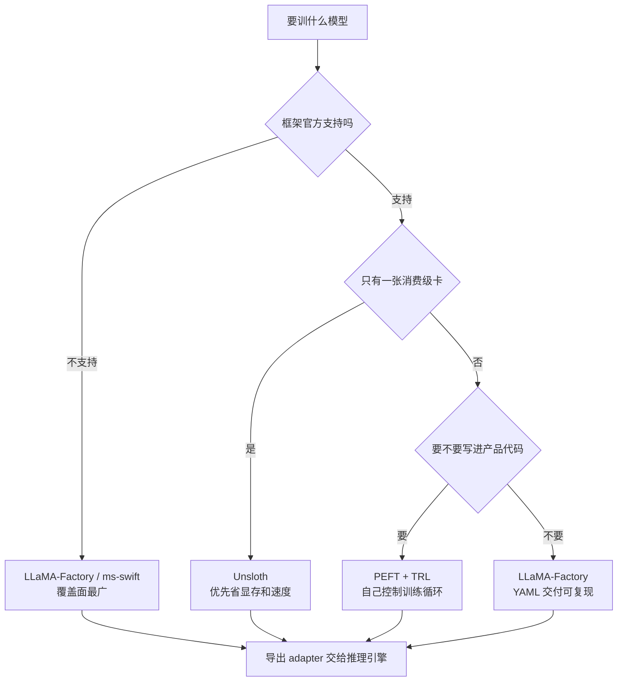

# 微调框架生态

> [!abstract] 一句话讲清楚
> 微调框架就是"帮你把模型加载、数据打包、LoRA 挂载、训练循环、导出"这些重复劳动封装好的工具。这篇把主流几个（LLaMA-Factory / Unsloth / Axolotl / PEFT / TRL）按定位、显存门槛、适合谁做一张表，让你十分钟内选对工具。

## 为什么重要

- 你现在的位置：[[LoRA 与 QLoRA 原理]] 讲清了原理，下一步是"用什么工具落地"。选错框架比选错参数更浪费时间——重装环境、换格式、踩版本坑，轻易一天就没了。
- 不懂会踩的坑：
  - 用 WebUI 默认配置直接开训，结果 chat template 不对，训出来的模型说话格式错乱。
  - Unsloth 跑不了你要的模型，中途换框架，数据格式全部重写。
  - 用 PEFT 从零写训练循环，花两天处理 gradient accumulation 和 dataloader。
- 真实场景：接单交付时，框架选型还影响**能不能复现**。客户半年后要重训一版，你的 `train.sh` 里全是随手改的参数，没人复现得出来。
- 一句话原则：**个人接单首选 LLaMA-Factory（能覆盖 80% 场景），单卡极致省显存看 Unsloth，要写进产品代码用 PEFT + TRL。**

## 核心名词全解

| 名词 | 英文 / 缩写 | 大白话解释 | 容易混淆 / 注意 |
|---|---|---|---|
| 训练框架 | Training Framework | 封装了加载模型、打包数据、训练循环的工具 | 和"推理引擎"不是一回事，别混 |
| LLaMA-Factory | — | 国产开源微调框架，带 WebUI 和 YAML 配置 | 支持模型最广，交付首选 |
| Unsloth | — | 单卡优化框架，靠手写 kernel 提速省显存 | 支持模型有限，换模型前先查兼容列表 |
| Axolotl | — | YAML 驱动、配置可版本化的训练框架 | 偏研究/工程，多机训练友好 |
| PEFT | Parameter-Efficient Fine-Tuning | HuggingFace 的参数高效微调底层库 | 是库不是框架，训练循环要自己搭或配 TRL |
| TRL | Transformer Reinforcement Learning | HF 官方训练库，提供 SFTTrainer / DPOTrainer 等 | 和 PEFT 搭配用，写脚本最自由 |
| ms-swift | — | 魔搭社区的微调框架，国产模型支持好 | 中文文档友好，生态和 LLaMA-Factory 有重叠 |
| 配置驱动 | Config-driven | 训练靠改 YAML/JSON，而不是改代码 | 好处是可复现、可版本管理 |
| chat template | 对话模板 | 把对话按模型训练时的格式拼成字符串 | 配错是"模型输出格式怪"的头号原因 |
| DeepSpeed / FSDP | 分布式训练方案 | 多卡时把模型和状态切开放到多张卡上 | 多卡才有意义，单卡用不上 |
| 梯度累积 | Gradient Accumulation | 攒几个小 batch 再更新一次，模拟大 batch | 省显存但拖慢速度 |
| WebUI | 图形界面 | 点鼠标配置训练参数 | 方便试错，但参数要落到文件里才能交付 |

## 原理与机制

### 直觉版

框架就像"装修队"：模型是房子，数据是建材，LoRA 是你要加装的柜子。

- **LLaMA-Factory** 是"全包套餐"：量房、买料、施工、验收一条龙，你只要填需求单。
- **Unsloth** 是"专业施工队"：只做它擅长的户型，但做得又快又省料。
- **Axolotl / PEFT / TRL** 是"半包 / 自己动手"：材料自己买、工序自己排，灵活但费人。

### 拆解版：一个训练框架实际在帮你做五件事

1. **加载模型**：下载/读取权重，处理 dtype、量化加载、device map。
2. **处理数据**：读 JSON/JSONL，套 chat template，拼成 token 序列，做 padding / packing、label mask。
3. **挂载微调方式**：注入 LoRA 层、冻结基座、配置可训练参数。
4. **跑训练循环**：前向、反向、梯度累积、学习率调度、梯度检查点、日志、断点续训。
5. **导出**：保存 adapter 或合并权重，转成推理引擎能吃的格式。

**这五件事里最容易出错的是第 2 件（数据 + template）和第 5 件（导出格式）**，而这两件恰恰是"框架替你决定了"的部分。所以选框架时，先看它对你手上的模型和数据格式支持得怎么样。

### 为什么会有这么多框架

因为不同人优化的目标不同：

- **覆盖广**：LLaMA-Factory、ms-swift —— 目标是"什么模型都能训"。
- **快和省**：Unsloth —— 目标是"单卡训得动、训得快"。
- **可复现和工程化**：Axolotl —— 目标是"配置进 git，训练可重放"。
- **可编程**：PEFT / TRL —— 目标是"我要自己控制 loss、自己加评估逻辑"。

没有"最好"的框架，只有"这个场景最省事"的框架。

## 分类与对比

| 维度 | LLaMA-Factory | Unsloth | Axolotl | PEFT | TRL |
|---|---|---|---|---|---|
| 形态 | 框架 + WebUI + CLI | 训练加速库/框架 | 配置驱动框架 | 底层库 | 训练库 |
| 上手难度 | 低 | 低~中 | 中 | 高 | 中~高 |
| 支持模型广度 | 很广 | 有限（先查兼容列表） | 较广 | 取决于 transformers | 取决于 transformers |
| 显存友好度 | 中（可开各种节省） | 很省 | 中 | 看你怎么配 | 看你怎么配 |
| 单卡消费级可行性 | 可以 | 最强 | 可以 | 可以 | 可以 |
| 多卡 / DeepSpeed | 支持 | 支持有限 | 强 | 自己配 | 自己配 |
| 配置可复现 | YAML 好复现 | 脚本为主 | YAML 强 | 代码即配置 | 代码即配置 |
| 导出合并 / 量化 | 内置，方便 | 内置 | 内置 | 自己做 | 自己做 |
| 适合谁 | 接单交付、入门、要 WebUI | 单卡快跑、消费级显卡 | 研究/工程可复现 | 要嵌进产品的开发者 | 要自定义训练逻辑的人 |

> 版本迭代很快，具体支持哪些模型/功能**以各项目官方文档和 release note 为准**。

## 选型决策树

## 三种常见搭配方案（直接抄作业）

| 场景 | 组合 | 数据格式 | 导出方式 | 说明 |
|---|---|---|---|---|
| 第一次做、要快速看效果 | LLaMA-Factory + WebUI | alpaca / sharegpt | 界面导出 adapter 或合并 | 半天能跑通全流程 |
| 单卡消费级、要快 | Unsloth + QLoRA | sharegpt | 框架内置导出 | 先查模型兼容列表 |
| 要做进产品、要迭代 | TRL SFTTrainer + PEFT | 自定义 Dataset | 代码里合并或存 adapter | 训练逻辑进 git |
| 多机/可复现要求高 | Axolotl + DeepSpeed | YAML 配置 | 内置导出 | 配置和实验管理最规范 |

> 不管选哪种，**导出环节都要提前想清楚**：部署用 GGUF 还是 safetensors，决定了你什么时候开始考虑格式，别训完再换。

## 完整流程：不管用哪个框架，都是这五步

### 第 1 步：确认框架支持你的模型

- **做什么**：在框架的模型支持列表里搜你的模型名。
- **为什么**：不支持时，有的框架会报错，有的会**静默用错 template**，训完才发现。
- **验收标准**：能加载模型，能正确套上 chat template（打印一条处理后的样本看看）。

### 第 2 步：把数据转成框架要的格式

- **做什么**：alpaca / sharegpt → 框架的数据集配置文件。
- **为什么**：框架按配置里的字段名取数据，字段对不上就等于没数据。
- **失败表现**：训练开始后 loss 异常、样本数对不上、全是 padding。
- **验收标准**：打印实际加载条数 == 原始条数。

### 第 3 步：先跑一个几十步的小实验

- **做什么**：`max_steps` 设小，跑通全流程。
- **为什么**：先暴露环境、显存、template 问题，别等 6 小时后 OOM。
- **验收标准**：能存出 adapter、能合并、能推理出一条结果。

### 第 4 步：正式训练 + 监控

- **做什么**：按 [[训练超参数]] 配好，盯着 loss 和显存。
- **验收标准**：loss 走势合理，没有 NaN，显存不持续上涨。

### 第 5 步：导出并回填推理引擎

- **做什么**：合并权重 → 量化 → 部署 → 对比验证。
- **详见**：[[合并导出与部署闭环]]。

## 决策点

- **岔路口 1：第一次做微调，选哪个**
  - 推荐：**LLaMA-Factory**。WebUI 能快速试错，YAML 能复现，导出链路完整。
  - 代价：依赖较多、版本升级偶尔会踩坑；WebUI 默认参数不可信，要自己核对。

- **岔路口 2：只有一张 4090/3090，想训 7B~14B**
  - 推荐：先试 **Unsloth** 跑通，再对比 LLaMA-Factory + QLoRA 的效果。
  - 代价：Unsloth 支持模型有限，换模型要重搭；它的加速可能带来轻微的精度差异，要看评估集。

- **岔路口 3：要把微调能力做进自己的产品**
  - 推荐：**PEFT + TRL**，训练逻辑写进代码，参数进配置，评估进流水线。
  - 代价：数据打包、梯度累积、断点续训都要自己处理，开发成本明显高。

- **岔路口 4：客户要求半年后可复现重训**
  - 推荐：**Axolotl 或 LLaMA-Factory 的 YAML 方案**，配置、数据版本、随机种子全部入库。
  - 代价：环境依赖要锁版本；不锁版本，半年后大概率跑不起来。

- **岔路口 5：国产模型 / 国内网络环境**
  - 推荐：**ms-swift 或 LLaMA-Factory**（模型可从魔搭/国内镜像拉）。
  - 代价：部分新模型的适配可能滞后，要等社区更新。

## 参数与配置说明

> 这里只列框架层最关键的配置项，训练超参的细节见 [[训练超参数]]。

| 配置项 | 作用 | 调大 / 调小的影响 | 常见取值 |
|---|---|---|---|
| `model_name_or_path` | 基座模型路径 | 路径错/版本错直接报错或加载错模型 | 本地路径或模型 ID |
| `template` / chat template | 对话拼接模板 | 配错 → 输出格式混乱、指令遵循变差 | 必须和基座原训练格式一致 |
| `stage` | 训练阶段（SFT/DPO/PT） | 阶段选错，数据格式也用错 | 先 SFT |
| `finetuning_type` | lora / full / freeze | lora 最常用；full 显存暴涨 | lora 起步 |
| `quantization_bit` | 基座量化位宽 | 4 最省、8 更稳 | 显存不够时用 4 |
| `dataset` / `data_path` | 数据集与字段映射 | 字段映射错 → 加载不出样本 | 必查加载条数 |
| `gradient_checkpointing` | 用时间换显存 | 开 → 省显存、慢 20%~30% 量级 | 显存紧张时开 |
| `flash_attn` | 注意力加速 | 开 → 快且省显存，但要求硬件和版本匹配 | 支持就开 |
| `deepspeed` | 多卡分布式配置 | 单卡不用；多卡配错直接起不来 | 多卡时按官方示例 |
| `output_dir` | 输出目录 | 路径写错/旧文件没清 → 找不到产物或混入旧 adapter | 每次训练用新目录 |

## 常见坑与误区

| 现象 | 原因 | 对策 |
|---|---|---|
| 训完模型回答格式怪、爱加奇怪前缀 | chat template 和基座不匹配，或干脆用错模板 | 打印一条处理后的训练样本；对照模型卡 |
| WebUI 点了"开始"能跑，但复现不出来 | 参数只在界面上，没落到配置文件 | 训练完把 YAML 导出存档，随交付物一起给 |
| 换了个模型，框架直接报错 | 模型架构太新，框架版本没跟上 | 升框架版本或换框架；别硬改源码 |
| Unsloth 训到一半 OOM，换框架又来一遍 | 模型不在官方兼容列表，走了降级路径 | 先查兼容列表；换框架前先问清支持情况 |
| 多卡训练比单卡还慢 | 卡间通信瓶颈 / DeepSpeed 配置照抄 | 单卡能跑就用单卡；多卡先看官方配置模板 |
| 环境重装后跑不起来 | 依赖没锁版本 | 用虚拟环境 + 锁定版本文件；交付时附环境说明 |
| 导出的模型推理引擎加载不了 | 框架导出的格式和引擎要求不一致 | 训练前就确定部署引擎，导出格式倒推 |

## 自检问题

- [ ] 能说出 LLaMA-Factory、Unsloth、PEFT 三者的本质区别吗？
- [ ] 为什么"chat template 配错"是训完效果差的头号嫌疑？
- [ ] 只有一张 4090 时，你会先用哪个框架试水？为什么？
- [ ] 客户要求可复现重训，你要保存哪些东西？
- [ ] 训练框架帮你做的五件事分别是哪五件？
- [ ] 什么时候应该从 WebUI 切到 YAML/代码？
- [ ] 多卡训练不一定是加速，什么情况下反而更慢？
- [ ] 训练前就确定部署引擎，为什么能少走弯路？

## 相关笔记

- 上游：[[LoRA 与 QLoRA 原理]]
- 上游：[[Python 环境与依赖管理]]
- 下游：[[训练超参数]]
- 下游：[[合并导出与部署闭环]]
- 对照：[[推理引擎选型决策树]]
- 返回：[[微调训练 MOC]]

## 交付视角（对客户怎么讲）

- 客户会问："你们用什么工具训？稳定吗？"
  - 大白话：**"用的是开源社区的主流框架，训练配置会存成文件随交付物一起给您。半年后想重训，按这份配置能原样跑起来。"**
- 交付物清单建议：训练 YAML/脚本、数据版本、adapter、合并后模型、评估报告、环境说明。**这几样齐了，项目才算闭环。**
- 报价口径：框架本身免费，收费的是"数据 + 训练 + 评估 + 部署"的人天。不要用"我们用了××框架"当卖点，客户买的是结果。
- 风险提示：**"框架和模型升级会导致需要重新验证，这部分属于变更项。"** 这条提前写进合同，能省掉很多返工争议。
