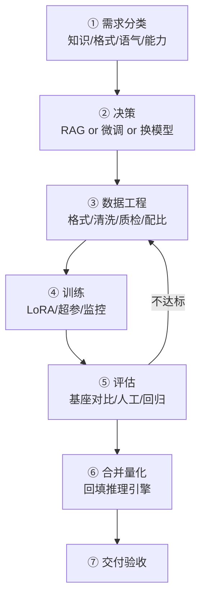

# 微调训练 MOC

> [!abstract] 一句话讲清楚
> 这个领域讲一件事：什么情况下值得花几天训练自己的模型，以及怎么把私有数据变成能交付、能验收的模型。它不是"教你炼丹"，而是一条从"判断该不该做"到"部署验收"的闭环。

## 这个领域在技能栈里的位置

- **上游**：[[模型认知 MOC]]（知道模型是什么、显存怎么算）、[[硬件基础与 GPU 生态]]（够不够卡）、[[Python 环境与依赖管理]]（环境能不能装起来）。
- **平级对照**：[[RAG 原理与全链路]]——它是微调最大的"竞争对手"，大多数客户以为需要微调的需求，其实 RAG 就能解决。
- **下游**：[[合并导出与部署闭环]] → [[推理引擎选型决策树]] → [[本地部署全流程]]，模型训完要落到服务上才算交付。
- **交付侧**：微调是整套技能里溢价最高、也最容易翻车的环节。翻车点通常不在训练，而在"该不该做"和"数据够不够"。

## 先记住四句话

1. **微调是教模型"怎么说"，RAG 是给模型"看什么"，换模型是让模型"更能想"。**
2. 80% 的时间花在数据上，不是训练上。数据烂，参数调到天上去也没用。
3. SFT 不能创造能力，只能把基座已有的能力"定向激发"出来。基座不会的，微调也大概率不会。
4. 没有评估方案，就别开始训练。你无法证明它变好了，就无法交付。

## 阅读顺序

| 顺序 | 笔记 | 一句话 | 什么时候读 |
|---|---|---|---|
| 0 | [[微调决策与 RAG 取舍]] | 先判断该不该微调 | 客户提需求时第一件事 |
| 1 | [[训练数据工程]] | 数据格式、清洗、去重、质检 | 决定要微调之后马上读 |
| 2 | [[LoRA 与 QLoRA 原理]] | 为什么只用训一小撮参数 | 想知道显存为什么够用 |
| 3 | [[微调框架生态]] | LLaMA-Factory / Unsloth / TRL 怎么选 | 准备动手前 |
| 4 | [[训练超参数]] | 每个参数调错长什么样 | 第一次跑训练时对照 |
| 5 | [[训练监控与评估]] | loss 曲线怎么读、怎么证明变好了 | 训练跑起来之后 |
| 6 | [[合并导出与部署闭环]] | 训完怎么变成能用的服务 | 训练完成后 |
| 7 | [[多模态微调]] | 图片/文档视觉任务的特例 | 需求里有图才读 |

## 硬件与时间门槛速查

| 模型量级 | LoRA 微调显存（量级） | 常见卡 | 说明 |
|---|---|---|---|
| 7B~8B | 16GB~24GB 可跑 QLoRA | 4090 / 3090 / A10 | 消费级单卡的主战场 |
| 14B | 24GB~48GB | 4090 单卡偏紧 / A6000 | QLoRA 能压，速度会慢 |
| 32B | 48GB~80GB | A100 / 双卡 | 一般不建议个人单卡硬上 |
| 70B+ | 多卡 80GB×2 起 | A100/H100 | 个人接单基本劝退，改用 API 或蒸馏 |

> 上表是量级参考，实际取决于 cutoff_len、batch、是否开梯度检查点、框架优化。**以自己实测为准**。全参微调的显存是 LoRA 的数倍，个人交付基本不用考虑。

## 三条最常见的误判

1. **"我要一个懂我们行业的模型"** —— 多半是知识问题，RAG 更便宜、可更新、可溯源。先读 [[微调决策与 RAG 取舍]]。
2. **"先训一版看看效果"** —— 没有评估集和验收标准，训完也只能靠感觉，最后扯皮。
3. **"数据我们有很多"** —— 多不等于能用。原始日志、聊天记录、扫描件需要先变成"问答对"，这步最耗时间。见 [[训练数据工程]]。

## 跨领域入口

- 显存为什么够用：[[参数量与显存估算]]、[[量化技术]]
- 训完怎么部署：[[本地部署全流程]]、[[vLLM]]、[[llama.cpp 与 GGUF]]
- 对比方案怎么做评估：[[RAG 评估与调优]]、[[提示词与上下文工程]]
- 交付怎么报价：[[交付 SOP 与报价]]、[[安全与合规]]
- 学习路径：[[8 周学习计划]]、[[项目阶梯与实战清单]]

## 学完这个领域，你应该能回答

- [ ] 客户说"要微调"，你能用三个问题判断出他其实要什么？
- [ ] 能说清 LoRA 为什么能在 24GB 卡上训 7B，显存在哪里省下来的？
- [ ] 拿到一堆业务文档，知道怎么变成训练数据，以及几千条够不够？
- [ ] 训练 loss 很低但效果不好，能说出至少三个可能原因？
- [ ] 能设计一套"基座 vs 微调后"的对比验证，让客户签字？
- [ ] 训练完知道合并、量化、回填推理引擎的完整链路？
