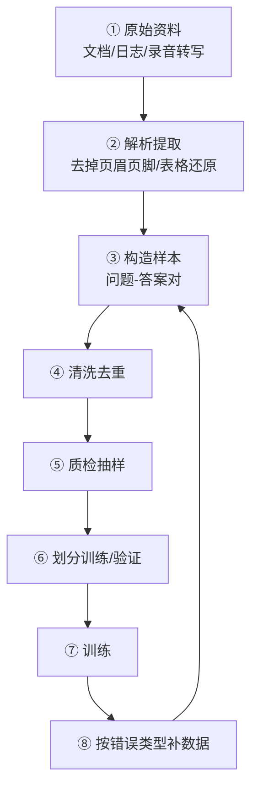

# 训练数据工程

> [!abstract] 一句话讲清楚
> 微调项目里 80% 的时间花在数据上，不在训练上。这篇讲清楚数据长什么样（alpaca / sharegpt）、怎么从客户资料变成训练样本、怎么清洗去重质检，以及"数据越多越好"为什么是错的。

## 为什么重要

- 你现在的位置：[[微调决策与 RAG 取舍]] 判断完"要做微调"，下一步就是这篇。数据没做好，后面 [[训练超参数]] 调到天亮也是白搭。
- 不懂数据会踩的坑：格式写错框架会**静默跳过**坏样本，你以为训了 5000 条，实际只训了 1200 条；重复样本会让模型背答案；验证集混进训练集会让你误判效果。
- 真实场景：客户给了一堆产品手册、客服聊天记录、扫描的合同，说"我们数据很多"。你要做的是把它们变成**几百到几千条干净问答对**，并且能向客户解释为什么剩下的"很多数据"用不上。
- 一句话判断项目能不能接：**先看数据，再看卡**。数据不可用，卡再好也不接。

## 核心名词全解

| 名词 | 英文 / 缩写 | 大白话解释 | 容易混淆 / 注意 |
|---|---|---|---|
| SFT 数据 | Supervised Fine-Tuning Data | "输入→标准输出"成对的数据，训练模型照着学 | 不是原始文档，文档要先转成问答对 |
| alpaca 格式 | Alpaca format | 单轮格式，字段是 instruction / input / output | 最省事的入门格式，多轮要自己拼 |
| sharegpt 格式 | ShareGPT format | 多轮格式，一个 conversations 数组，每条带角色和内容 | 对话类任务首选，LLaMA-Factory 等主流框架都认 |
| system prompt | 系统提示 | 每条样本最前面那段"你是一个××助手" | 全库必须统一，否则模型学到混乱的角色 |
| 数据清洗 | Data Cleaning | 去掉噪声：HTML 残留、乱码、重复、截断、无关内容 | 不是"格式化一下"，是筛掉不能用样本 |
| 去重 | Deduplication | 精确去重 + 近似去重（语义/哈希/相似度） | 只做完全一致去重不够，换个说法的重复也算 |
| 质量校验 | Quality Check | 抽样人工看、用强模型打分、规则校验 | 一定要有，否则垃圾进垃圾出 |
| 边缘递减 | Diminishing Returns | 数据加到一定量后，效果提升越来越小 | 1000 条到 2000 条可能有用，1 万到 2 万常常没用 |
| 合成数据 | Synthetic Data | 用强模型按种子生成训练样本 | 会继承强模型的错误和口癖，要人工过一道 |
| 训练 / 验证划分 | Train / Val Split | 大部分训，留一小部分只看不训 | 要和训练集**按来源**分开，防泄漏 |
| 数据配比 | Data Mix Ratio | 多类数据各占多少（业务 / 通用 / 格式） | 只放业务数据，通用能力会掉 |
| label mask | 标签掩码 | 只对"回答"部分算 loss，不学问题和系统提示 | 配错等于让模型学习复读用户提问 |
| packing | 样本拼接 | 把多条短样本拼进一个长序列，省显存提速度 | 拼错会串样本，见 [[训练超参数]] |

## 原理与机制

### 直觉版

训练数据就是给模型的**练习题 + 标准答案**。它学到的不是"知识本身"，而是"这类问题该怎么组织回答"。

就像带新人：你给他看的示范文档如果排版乱、答案错、同一道题抄了十遍，他学出来的就是"乱、错、死记硬背"。

### 拆解版：一份好数据要过五道关

1. **可用性**：内容能变成"问题 + 回答"吗？纯表格、纯图片、纯扫描件先别指望直接训。
2. **正确性**：答案对不对？谁对这个答案负责？客户必须有人签字，否则你在替客户猜。
3. **一致性**：同一类问题，格式、语气、长度是不是统一？不一致的样本会让模型"人格分裂"。
4. **多样性**：覆盖真实场景的长尾问法了吗？只放 50 种问法，上线第一次遇到新问法就崩。
5. **无泄漏**：验证集、验收用例集有没有混进训练集？混了，评估分数就是假的。

### 为什么 80% 时间在数据

因为一个真实项目的工时分布大概是：

| 环节 | 大致占比 | 主要消耗 |
|---|---|---|
| 需求与验收标准 | 10% | 和客户对齐"什么叫做对了" |
| 数据采集与转换 | 30%~40% | 文档解析、聊天记录清洗、问答对构造 |
| 数据质检与返工 | 20%~30% | 抽样、改错、补长尾 |
| 训练与调参 | 10%~15% | 其实是机器在跑 |
| 评估与迭代 | 15% | 建评估集、对比、回滚 |

> 上表是经验分布，不是精确统计。核心结论：**你能为数据投入多少人力，基本决定了项目上限。**

## 数据格式：两种主流写法

### alpaca：单轮任务的省事写法

```json
{"instruction": "把这段话改成客服口吻", "input": "您的订单已发货", "output": "您好，您的包裹已经发出啦，请注意查收～"}
```

- `instruction` 是任务，`input` 是可选素材，`output` 是标准答案。任务没有素材时 `input` 留空。
- 优点：字段清晰，写起来快；缺点：多轮对话要自己拼成一段，模型学不到轮次边界。

### sharegpt：多轮对话的标准写法

```json
{"conversations": [{"from": "human", "value": "这个订单能退吗？"}, {"from": "gpt", "value": "可以的，签收 7 天内……"}, {"from": "human", "value": "那我怎么操作？"}, {"from": "gpt", "value": "打开 App……"}]}
```

- `from` 字段名各框架略有差异（human/gpt、user/assistant），**以你所选框架的文档为准**。
- 优点：轮次清晰、可带 system；缺点：如果某轮回答很短，容易让模型学出"敷衍"。

> [!tip] 格式选型
> 一次问答能解决的任务用 alpaca；客服、坐席、陪练、多轮追问用 sharegpt。**同一批数据里不要混两种格式**，除非框架明确支持转换。

## 从客户资料到训练样本的完整流程



### 第 1 步：摸清数据家底

- **输入**：客户给的所有资料。
- **动作**：分类清点——多少是结构化文档、多少是聊天记录、多少是图片扫描件、多少是音视频。
- **输出**：一张数据清单，标注每类的可用度和预估能产出多少条样本。
- **为什么**：这一步决定报价和工期；也决定你需要劝客户补什么数据。
- **失败表现**：直接开干，做到一半发现一半资料是扫描件，OCR 又要三天。

### 第 2 步：构造问答对

- **输入**：清洗后的文本。
- **动作**：三种主流方式。
  1. **人工写**：质量最高、最慢，适合核心场景和验收用例。
  2. **规则生成**：FAQ 直接"问题→答案"；结构化字段套模板。
  3. **强模型生成**：把文档段落喂给强模型，让它出问题和答案，再人工过一遍。
- **为什么**：模型学的是"问答的模式"，不是"文本本身"。
- **验收标准**：随机抽 20 条，不看原文能答对的比例；答案是否只依赖给定资料（不发挥）。

### 第 3 步：清洗

必做的六件事，按性价比排序：

1. **去噪声**：HTML 标签、页眉页脚、乱码、重复水印。
2. **去截断**：问答被切一半的样本直接扔，别修。
3. **去无关**：目录页、版权页、空白页产生的"问答"。
4. **统一格式**：语气、长度、是否用列表、是否带落款，全库一致。
5. **PII 脱敏**：手机号、身份证、真实客户名，用占位符替换。
6. **长度过滤**：太短（答非所问）和太长（几百字说不到点）都影响学习。

### 第 4 步：去重

| 类型 | 做法 | 说明 |
|---|---|---|
| 精确去重 | 完整字段哈希比对 | 最便宜，先做 |
| 近似去重 | 归一化后比对（去标点、转小写、去空格） | 能抓到"换个标点"的重复 |
| 语义去重 | 向量相似度聚类 | 能抓到"换个说法问同一个问题"，成本较高 |
| 对话级去重 | 按整段会话比对，而不是单轮 | 多轮数据必须按会话去重，否则半截对话混进来 |

> 重复样本的后果：模型对这几个问题背得滚瓜烂熟，换个问法就不会；而且重复样本变相加了权重，容易带偏整体。

### 第 5 步：质检

- **规则校验**：字段齐全、角色交替正确、system 只有一个、没有空回答、特殊字符转义正常。
- **模型打分**：用强模型按"相关性 / 正确性 / 格式合规"三档打分，先批量筛掉明显不合格的。
- **人工抽样**：按 5%~10% 抽，重点看模型打低分和长度异常的。
- **一致性检查**：同一批数据里，同类问题的回答风格是否统一。

### 第 6 步：划分训练集与验证集

- 常见比例 90/10 或 95/5。
- **必须按来源划分**：同一份文档生成的问答对，要么全进训练，要么全进验证，不能混。否则验证 loss 会"假性很好"。
- 验证集**不要用来调参调到过拟合**。真正的验收用另外一套客户认可的验收用例集。

## 数据量与效果：边际递减是真的

| 数据量（量级） | 能学到什么 | 常见现象 |
|---|---|---|
| 几十~一两百条 | 只能学格式和极窄的任务 | 稍微换个问法就回到原始风格 |
| 几百~两千条 | 格式、话术、固定任务的稳定输出 | 性价比最高的一段，多数项目停在这里 |
| 两千~一万条 | 有领域感的对话、较复杂的任务 | 要开始担心数据一致性和过拟合 |
| 一万~几万条 | 领域风格深入、任务覆盖广 | 成本陡增，收益需要评估集才能看出来 |
| 十万+ | 接近继续预训练的规模 | 个人接单基本不碰，要专业团队和算力 |

三条经验：

1. **质量 > 数量**。1000 条精标数据通常打得过 5000 条脏数据。
2. **先做小实验**：用 500 条训一版，看评估结果，再决定要不要扩数据。别一次性标 5000 条。
3. **数据量上去效果不涨时，先换数据不换参数**：补长尾问法、补错误样本、补通用数据，而不是调 lr。

## 合成数据：能用，但要当心

**好处**：快、便宜、能覆盖真实数据没有的长尾。

**风险**：

- **错误放大**：强模型答错的地方，合成数据会把它固化成"标准答案"。
- **风格污染**：数据会带强模型的口头禅、排版习惯，训出来的小模型像"另一个模型的影子"。
- **分布偏移**：合成的问题往往比真实用户问得"太标准"，上线后遇到口语化输入就不行了。
- **许可证**：用某个模型的输出训练自己的模型对外交付，要先看该模型的商用条款。

**推荐做法**：种子（少量真人数据）→ 强模型扩写 → 规则 + 人工抽检 → 混入 20%~30% 真人数据再训。**永远不要把纯合成数据当唯一来源。**

## 决策点

- **岔路口 1：数据从哪来**
  - 条件：客户有文档没问答、有聊天记录、有真人可访谈。
  - 推荐：优先用**真实聊天记录/工单**提炼问答（最接近线上分布），再用文档补充，最后用强模型扩写。
  - 代价：真实记录脏、要脱敏、要人工挑；但分布最准，效果最好。

- **岔路口 2：先标多少**
  - 推荐：先标 300~500 条跑通全流程（数据→训练→评估）拿一版基线，再决定扩不扩。
  - 代价：小数据版效果一定差，但能提前暴露格式、显存、评估方案的问题，比标完 5000 条才发现强。

- **岔路口 3：要不要合成数据**
  - 推荐：真实数据不足 500 条时用合成数据垫底，但真人数据占比不低于 20%~30%。
  - 代价：合成数据审计成本高；纯合成训出来的模型，风格会像"别人的模型"。

- **岔路口 4：格式选 alpaca 还是 sharegpt**
  - 推荐：多轮业务对话一律 sharegpt；单轮信息抽取、改写、分类用 alpaca。
  - 代价：sharegpt 数据构造更麻烦，且对角色字段名敏感，格式写错会被框架静默跳过。

- **岔路口 5：验证集怎么留**
  - 推荐：按来源划分 + 另建一套客户验收用例，两套分开。
  - 代价：多花半天时间，但能避免"验证集看起来很好、上线一塌糊涂"的翻车。

## 参数与配置说明

| 参数 / 配置 | 作用 | 调大 / 调小的影响 | 常见取值 |
|---|---|---|---|
| max_samples | 限制参与训练的最大样本数 | 调小省时间但欠拟合；调大可能只是喂噪声 | 结合验证集结果定，常见几千 |
| cutoff_len | 单条样本最大长度 | 太小会截断长答案（丢了关键结论）；太大会爆显存 | 覆盖 95% 样本长度即可 |
| train_on_inputs | 是否对输入部分也算 loss | 开着会让模型学着复读问题 | 通常关掉 |
| system 字段 | 全局统一的角色设定 | 每条不一样会让模型人格混乱 | 全库一致 |
| 验证集比例 | 训练中监控泛化的比例 | 太小监控不准；太大会浪费高质量数据 | 5%~10% |
| 通用数据占比 | 防止灾难性遗忘的"压舱石" | 太低会遗忘；太高会冲淡业务风格 | 5%~20% |
| 单条回答长度上限 | 过滤超长回答 | 放太松会把啰嗦样本喂进去 | 按业务合理长度设 |

> 具体字段名以你使用的框架版本为准（[[微调框架生态]]），不同框架的 YAML 键名有差异。

## 常见坑与误区

| 现象 | 原因 | 对策 |
|---|---|---|
| 训了 5000 条，效果像只训了 1000 条 | 格式不合规的样本被框架静默跳过 | 训练前打印实际加载条数，和原始条数对账 |
| 模型开始背训练集原句 | 重复样本 + epoch 太多 | 去重 + 减 epoch + 打乱数据 |
| 验证 loss 一直降，上线效果一般 | 验证集和训练集同源，信息泄漏 | 按来源划分；另建客户验收用例集 |
| 第一轮回答还行，多轮就崩 | 多轮数据里只有单轮样本，或角色交替不规范 | 补多轮样本；检查角色字段与框架要求一致 |
| 模型学出了"客服腔"但答错内容 | 只关注了话术，答案正确性没校验 | 质检必须含"正确性"项，不能只看格式 |
| 上传文件后模型不认 | 训练数据格式是文档原文，不是问答对 | 文档 → 问答对是必做步骤，不能跳 |
| 纯合成数据训出来像个"复读机" | 分布太窄 + 风格污染 | 混入真人数据；合成数据必须抽检 |
| 改了数据数量但结果没变 | 数据目录里旧文件没删干净，框架全量读取 | 每次训练前清空输出目录并核对加载清单 |

## 自检问题

- [ ] 能默写 alpaca 和 sharegpt 两种格式的字段结构吗？
- [ ] 为什么说"文档多"不等于"训练数据多"？
- [ ] 去重的三种层级分别能抓到什么类型的重复？
- [ ] 验证集为什么要"按来源划分"，不这么做会出什么错？
- [ ] 数据量到多少条就该停下来看评估，而不是继续标？
- [ ] 合成数据的两个最大风险是什么？怎么降低？
- [ ] 训练前你要核对哪两个数字，防止样本被静默跳过？
- [ ] 如果客户只有 200 条可用问答，你会怎么设计项目？

## 相关笔记

- 上游：[[微调决策与 RAG 取舍]]
- 上游：[[文档解析与切分策略]]
- 下游：[[训练超参数]]
- 下游：[[训练监控与评估]]
- 对照：[[RAG 原理与全链路]]
- 工具：[[微调框架生态]]
- 返回：[[微调训练 MOC]]

## 交付视角（对客户怎么讲）

- 客户会问："我们数据很多，是不是直接就能训？"
  - 大白话：**"能训的不是数据，是'问题 + 标准答案'。您给的资料是原料，我们要把它加工成练习题，这部分占工期的七成。"**
- 报价：数据相关的工作必须单列成项，按"条数 × 单价 + 质检人天"报，写清楚：
  1. 客户需指定**业务负责人签字确认答案正确性**，我们负责流程和质量，不替客户判断业务对错；
  2. 数据量不足时的补数据方案与费用；
  3. 超出约定条数的增补按变更计费。
- 预期管理：**"我们先标 300 条跑一版给您看，确认方向对了再批量标，避免您花冤枉钱。"** 这句话能显著降低项目烂尾概率。
