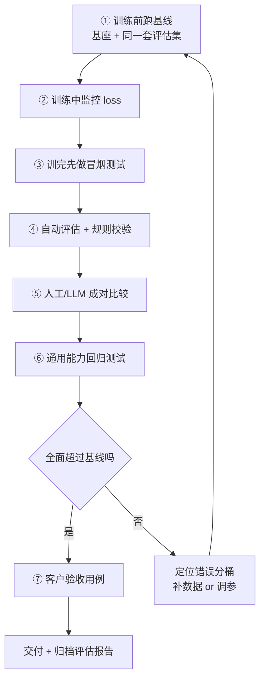

# 训练监控与评估

> [!abstract] 一句话讲清楚
> 训练时的 loss 只能告诉你"模型有没有在学"，不能告诉你"有没有学好"。这篇讲两件事：训练中怎么从 loss 曲线和输出判断该不该停，训练后怎么用评估集、人工评分和基座对比，证明这次微调真的有效。

## 为什么重要

- 你现在的位置：[[训练超参数]] 配好了，训练跑起来了，接下来必须回答一个问题——**这版模型到底变好没有？** 答不出来，就没法交付。
- 不懂评估会踩的坑：
  - 只看 loss 下降就宣布成功，上线后发现格式会了但内容还是错的。
  - 没有基线对比，客户问"比原来好在哪"，你只能说"感觉好多了"。
  - 评估集是从训练集里抽的，分数漂亮，上线一塌糊涂。
- 真实场景：这是**微调项目和客户扯皮的第一大来源**。把评估方案在项目开始就定下来，比训练本身更能决定项目能不能顺利收尾。
- 一句话原则：**没有评估方案的训练，等于没有终点线的跑步。**

## 核心名词全解

| 名词 | 英文 / 缩写 | 大白话解释 | 容易混淆 / 注意 |
|---|---|---|---|
| train loss | 训练损失 | 模型在训练集上的"做错程度" | 只说明拟合程度，越小不一定越好 |
| val loss / eval loss | 验证损失 | 模型在没见过的验证集上的表现 | 更接近真实泛化能力，但要防止泄漏 |
| 过拟合 | Overfitting | 模型把训练集背下来了，换个题就废 | 典型信号：train loss 继续降、val loss 开始升 |
| 欠拟合 | Underfitting | 模型没学到东西，训练集上也做不好 | 典型信号：两条 loss 都居高不下 |
| 灾难性遗忘 | Catastrophic Forgetting | 微调后通用能力明显下降 | 要专门测：闲聊、常识、通用指令 |
| 基线 | Baseline | 用来对比的参照物（通常是未微调的原模型） | 没基线就没有"变好"这回事 |
| 评估集 | Eval Set | 专门用来打分的题目，不参与训练 | 必须和训练集不同源 |
| 验收用例集 | Acceptance Set | 客户认可、写进合同的"答对才算过"的题 | 和内部评估集分开维护 |
| benchmark | 基准测试 | 公开的标准化测试集（MMLU、C-Eval 等） | 分数只做参考，不要拿来做交付承诺 |
| 人工评估 | Human Evaluation | 真人按评分表给回答打分 | 最可信，但贵、慢，适合抽样 |
| LLM-as-judge | 大模型当裁判 | 用强模型按标准给回答打分/对比 | 有偏好偏差，必须成对比较、打乱顺序 |
| 成对比较 | Pairwise Comparison | 把两个模型的回答放一起，让裁判选更好的 | 比绝对打分稳定，是首选方式 |
| 回归测试 | Regression Test | 每次迭代都跑同一套题，看有没有变差 | 防"改好一个、弄坏三个" |

## 原理与机制

### 直觉版

loss 是"训练时的错题本厚度"。它只统计**训练集**——也就是模型正在背的书。

评估是"月考"。月考的题如果和练习册一模一样，考满分也说明不了什么。

所以：**loss 看趋势，评估看能力，人工看体验，客户验收看合同。**

### 拆解版：三个层次，缺一不可

1. **训练层（监控）**：loss 曲线、显存、梯度范数。回答"训练有没有跑歪"。
2. **能力层（自动评估）**：在独立评估集上跑分、和基线对比。回答"是不是真的变强了"。
3. **体验层（人工）**：真人看回答的自然度、正确性、可用性。回答"客户会不会满意"。

只有第 1 层 → 自嗨；只有前 2 层 → 可能分数好但不好用；三层都做 → 才能交付。

### loss 曲线怎么读

| 曲线形态 | 含义 | 常见原因 | 动作 |
|---|---|---|---|
| 平滑下降后趋缓 | 健康 | 正常收敛 | 继续跑，准备评估 |
| 剧烈上下震荡 | 学习率偏大 / batch 太小 | lr 过冲、梯度噪声大 | 降 lr 或增梯度累积 |
| 几乎一条水平线 | 没在学 | lr 太小、LoRA 没挂上、数据加载错 | 查可训练参数、查加载条数、提 lr |
| 突然变 NaN 或爆点 | 数值问题 | lr 太大、fp16 溢出、坏样本 | 降 lr、换 bf16、加梯度裁剪 |
| train 降但 val 早早抬头 | 过拟合 | 数据少/重复、epoch 多 | 减 epoch、去重、加 dropout |
| 阶梯式下降 | 正常但不平滑 | 数据分组同质（batch 内样本太像） | 打乱数据，问题不大 |
| 一路降到很低 | 警惕 | 数据太少或重复，模型在背 | 看输出是否复读训练集原句 |

> 关键认知：**loss 的绝对值没有通用意义**。不同模型、不同数据、不同 tokenizer，loss 起点和终点都不一样。**只看自己这条曲线和基线对比**，不要和网上别人的数字比。

### 怎么判断过拟合（从输出看，比看曲线准）

1. **复读**：回答里出现训练集的原句、原编号、原标点。
2. **僵化**：换个问法就答不上，或者所有问题都套同一个模板开头。
3. **答非所问**：对训练集里的独特问法答得极好，对同义改写答得很差。
4. **通用能力下降**：问它"今天天气怎么样"这种闲聊都答得别扭。
5. **长度异常**：回答开始变得极长或极短。

## 评估方案怎么搭

### 第 1 步：建评估集

- **规模**：内部评估集 50~200 条即可起步，覆盖主要场景 + 长尾。
- **来源**：真实业务输入（不是从训练集抽），可以少量由业务方提供。
- **分桶**：按场景分类，比如"格式类 / 知识类 / 拒答类 / 多轮类"，分别看分。
- **验收用例集分开**：客户签字确认的那套，只在里程碑节点跑，别天天跑，防止"调参调到验收集上"。

### 第 2 步：自动评估

- **规则类**：格式是否合法（JSON 能不能解析）、是否含禁用词、长度是否合规、是否带引用。这类最便宜，先做。
- **对比类**：同一条问题，分别问基座和微调后，抽 20~30 条人工看谁更好。
- **benchmark（可选）**：跑一下通用能力测试做参考，**只在内部记录，不写进合同**。

### 第 3 步：人工评估

给评估人一张简单评分表，每项 1~5 分：

| 维度 | 看什么 |
|---|---|
| 正确性 | 内容对不对，有没有编 |
| 格式合规 | 结构、字段、长度是否符合要求 |
| 完整性 | 该说的说全了吗 |
| 语气 | 像不像目标角色 |
| 可用性 | 直接能用，还是要人改一大半 |

> 两个要求：**双盲**（评估人不知道哪条是微调后的）+ **至少两人交叉**。否则一定被"看起来更专业"的答案带偏。

### 第 4 步：LLM-as-judge

用强模型当裁判，成本低、可批量，适合迭代期快速筛选。

**做法**：

```text
你是一个评审。下面是同一个问题的两个回答 A 和 B。
请按"正确性 > 格式合规 > 完整性"的优先级判断哪个更好，只输出 A 或 B 或 TIE。
问题：{q}
回答 A：{a}
回答 B：{b}
```

**必须防的偏差**：

- **位置偏差**：裁判偏爱第一个/最后一个。→ 每对跑两次，交换 A/B 顺序，取一致结果。
- **长度偏差**：裁判偏爱长答案。→ 评分标准里明确"冗长不等于好"。
- **自我偏好**：用 A 模型当裁判会偏爱 A 风格。→ 别用被评测的模型当裁判。

**结论**：LLM-as-judge 用来**筛**，不用来**定案**。最终验收还是要人。

## 完整流程：一次迭代的闭环



**关键：基线必须训练前跑。** 训练后再想起来要基线，只能重新加载原模型跑一遍，很容易忘掉、也容易口径不一致。

### 冒烟测试（训完 5 分钟就能做）

- 用训练集里的 5 条问题问一遍，看格式对不对。
- 用训练集外的 5 条同类问题问一遍，看泛化。
- 用 3 条无关问题问一遍，看有没有把通用能力训坏。
- 用 2 条长输入问一遍，看会不会截断/超时。

## 灾难性遗忘怎么测、怎么缓解

**测法**：准备 20~50 条与业务无关的通用题（常识、算术、闲聊、指令遵循、简单代码），微调前后各跑一遍，看掉点比例。

**缓解手段（按优先级）**：

1. **降训练强度**：减 epoch、降 lr。最常见的原因就是训太狠。
2. **混通用数据**：训练集里掺 5%~20% 的通用指令数据。
3. **缩可训练范围**：只挂 attention，不扩到 MLP。
4. **回到 LoRA**：全参微调遗忘最严重，LoRA 天然轻。
5. **别用太窄的数据**：全是同一类问答，模型会被"掰弯"。

## 决策点

- **岔路口 1：什么时候停训**
  - 判断依据：验证 loss 抬头、或输出出现复读、或业务评估已达标。
  - 推荐：**业务评估达标就停**，不要为了"loss 更低"继续训。
  - 代价：早停可能没榨干效果；但继续训的收益通常不如把时间花在补数据上。

- **岔路口 2：评估用什么做主口径**
  - 推荐：**客户验收用例通过率**做主口径，内部评估集分桶看问题，benchmark 只做参考。
  - 代价：验收用例要客户参与制定，前期沟通成本高；但能避免收尾扯皮。

- **岔路口 3：要不要跑 benchmark**
  - 推荐：跑，但**只用于内部判断有没有训坏**，不对外承诺分数。
  - 代价：跑通用测试要时间和显存；而且分数受评测方式影响大，容易被误读。

- **岔路口 4：微调后不如基座怎么办**
  - 判断依据：错误分桶——是"格式没学会"（数据/参数问题）还是"内容变差"（过拟合/遗忘）。
  - 推荐：先回滚到数据，补长尾、去重复；调参是第二步。
  - 代价：回滚一版要重新训；但不回滚等于交付一个更差的模型。

- **岔路口 5：用 LLM-as-judge 还是纯人工**
  - 推荐：迭代期用 judge 快速筛，里程碑用人工定案。
  - 代价：judge 有系统性偏差，纯靠它会优化错方向；纯人工又太贵太慢。

## 参数与配置说明

> 这里列的是"评估环节"的参数（推理参数要和线上部署保持一致，否则评估结果不可信）。

| 参数 | 作用 | 调大 / 调小的影响 | 常见取值 |
|---|---|---|---|
| `temperature` | 采样随机性 | 高 → 答案发散、评估不稳定；低 → 稳定但可能死板 | 评估用 0~0.3 |
| `top_p` | 采样范围 | 和 temperature 一起影响稳定性 | 评估用 0.9 或默认 |
| `max_new_tokens` | 生成上限 | 太小 → 答案被截断，误判为"不完整" | 覆盖最长预期回答 |
| 评估样本数 | 决定结论可信度 | 太少波动大；太多成本高 | 内部 50~200，验收 50~100 |
| 评估次数 | 同一题跑几次 | 跑多次取平均更稳，成本翻倍 | 关键题跑 3 次 |
| `repetition_penalty` | 抑制重复 | 太高会让模型不敢重复必要词 | 评估时和线上一致 |
| 种子 | 复现性 | 不固定种子，评估结果不可复现 | 固定 |

> 铁律：**评估用的推理参数必须和线上部署一致**。评估用 greedy、线上用高温采样，评估分数再高也没意义。

## 常见坑与误区

| 现象 | 原因 | 对策 |
|---|---|---|
| 评估分数很高，上线效果一般 | 评估集和训练集同源/泄漏 | 按来源划分；用真实业务输入建评估集 |
| 客户不认账："你这算好了？" | 没有提前定义验收标准和用例 | 项目开始就写验收用例集，客户签字 |
| train loss 很低，回答全是复读 | 过拟合，数据少或有重复 | 减 epoch、去重、加通用数据、加 dropout |
| 微调后闲聊都不会了 | 灾难性遗忘 | 降训练强度、混通用数据、只挂 attention |
| LLM 裁判永远选长答案 | 长度偏差 | 评分标准约束；成对比较交换顺序 |
| 评估结果每次都不一样 | temperature 高、没固定种子 | 评估用低温度 + 固定种子 |
| 只跑了总平均分，不知道差在哪 | 没分桶 | 按场景分桶，看哪类掉点 |
| 客户拿 benchmark 分数要求写进合同 | 没做预期管理 | 明确只承诺验收用例通过率，不承诺公开榜单 |

## 自检问题

- [ ] 为什么 loss 下降不能直接等同于模型变好？
- [ ] 正常的 loss 曲线长什么样？震荡和平线分别说明什么？
- [ ] 从输出上判断过拟合，看哪几个信号？
- [ ] 评估集和验收用例集为什么要分开？
- [ ] 灾难性遗忘怎么测？缓解手段按什么顺序用？
- [ ] LLM-as-judge 的三个偏差是什么？怎么防？
- [ ] 为什么基线要在训练前跑，不能训完再补？
- [ ] 客户问"比原来好在哪"，你拿什么回答？

## 相关笔记

- 上游：[[训练超参数]]
- 上游：[[训练数据工程]]
- 下游：[[合并导出与部署闭环]]
- 对照：[[RAG 评估与调优]]
- 对照：[[推理性能指标与调优]]
- 交付：[[交付 SOP 与报价]]
- 返回：[[微调训练 MOC]]

## 交付视角（对客户怎么讲）

- 客户会问："你怎么证明它比原来的模型好？"
  - 大白话：**"我们在开始前就跑了一遍原模型的成绩，训练后用同一套题、同样的问法再跑一遍，逐条对比。报告里会有分场景的对比表，您也可以自己拿题来考它。"**
- 评估报告要包含：基线分数、微调后分数、分场景对比、典型正反例、通用能力有没有掉、以及**明确的局限说明**（哪些它还是不会）。
- **主动写局限，反而更容易被信任。** 只报喜的报告，客户第一反应是"是不是挑好的给我看"。
- 报价口径：评估和验收是工作项，不是赠品。把"评估集建设 + 对比报告"单独列一项，既显得专业，也能挡住"再改一版不要钱"的需求。
