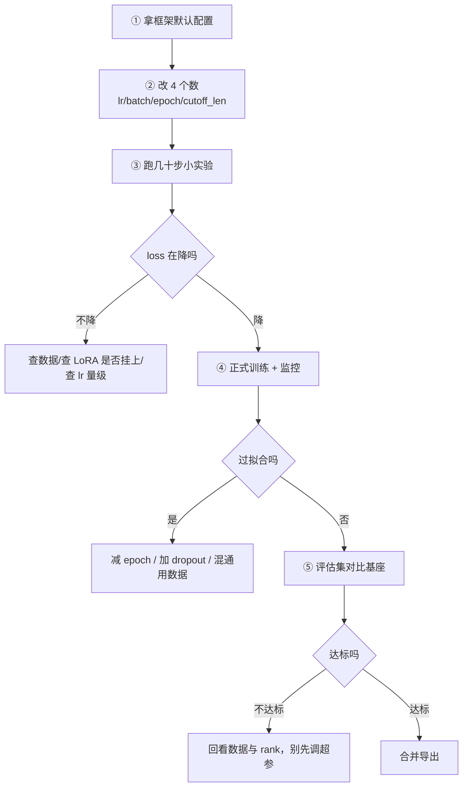

# 训练超参数

> [!abstract] 一句话讲清楚
> 超参数是"训练前你要拍板、训练中模型学不到"的那些数字。这篇不背默认值，讲的是每个参数调大调小会发生什么、调错时你在 loss 曲线和输出上会看到什么现象，让你能自己判断该动哪个旋钮。

## 为什么重要

- 你现在的位置：数据有了（[[训练数据工程]]），LoRA 原理懂了（[[LoRA 与 QLoRA 原理]]），框架选好了（[[微调框架生态]]），该填参数开训了。
- 不懂参数会怎样：一次训练几小时，参数错了就是白烧电费和时间；更糟的是**结果"看起来能跑"，但效果平庸**，你不知道是数据问题还是参数问题。
- 真实场景：第一次跑 7B LoRA，loss 从 2.x 掉到 0.8 就不动了，输出开始复读训练集。你调 batch、调 epoch 都没用，真正原因是**学习率给成了全参微调的量级**。
- 一条重要认知：**超参数的调整优先级远低于数据质量**。数据烂的时候，调参只是在烂数据上过拟合得更精致。

## 核心名词全解

| 名词 | 英文 / 缩写 | 大白话解释 | 容易混淆 / 注意 |
|---|---|---|---|
| 学习率 | learning rate, lr | 每次更新参数走多大一步 | 最重要也最危险，调大一步跨过头，调小走到天荒地老 |
| batch size | 批大小 | 一次看多少条样本再更新 | 不是"越大越好"，显存和泛化都受影响 |
| 梯度累积 | gradient accumulation | 攒 N 个小 batch 再更新一次 | 目的就是"假装"用大 batch，省显存 |
| 等效批大小 | effective batch size | 每设备 batch × 累积步数 × 卡数 | 真正决定训练动态的是它，不是单设备 batch |
| epoch | 轮次 | 把整个数据集看几遍 | 微调通常 1~3 轮，多了过拟合 |
| cutoff_len | 截断长度 | 每条样本最多保留多少 token | 调小会切掉答案尾巴；调大会爆显存 |
| warmup | 预热 | 训练开始前若干步把 lr 从很小升上来 | 防止开局一步走飞 |
| lr scheduler | 学习率调度器 | 按曲线动态改 lr（余弦、线性、常数） | 和 warmup 配合用 |
| packing | 样本拼接 | 多条短样本拼成一条长序列 | 提吞吐，但拼错会串样本 |
| weight decay | 权重衰减 | 正则化，抑制参数变大 | 对 LoRA 通常影响很小 |
| dropout | 随机丢弃 | 训练时随机丢一部分激活，抗过拟合 | LoRA 里指 `lora_dropout` |
| 梯度检查点 | gradient checkpointing | 不存中间激活，反向时重算 | 省显存换时间，经典权衡 |
| 梯度裁剪 | max grad norm | 梯度太大时按比例缩回 | 防止个别坏样本把训练带飞 |
| NaN / loss 爆炸 | — | 数值溢出，loss 变 inf/nan | 通常和 lr 太大、精度用 fp16 有关 |

## 原理与机制

### 直觉版

训练过程就像下山找最低点：

- **学习率** = 你每步迈多大。步子太大，一步跨过谷底，来回震荡；步子太小，天黑了下不了山。
- **batch size** = 你一次看多少条路况再决定方向。看太少容易被单条样本带偏；看太多反应迟钝、还费内存。
- **epoch** = 同一条路走几遍。走一两遍就够，走十遍你会把路边的石子都记下来（过拟合）。
- **warmup** = 刚起步先小步走，热身完再放开跑。

### 拆解版：这些参数是耦合的

**改动一个参数，往往要同步改另一个。** 这是新手最容易忽略的：

| 你改了什么 | 需要同步考虑什么 | 为什么 |
|---|---|---|
| 减小 batch size | 调小 lr（或增大梯度累积） | 小 batch 梯度噪声大，大 lr 容易震荡 |
| 增大等效批大小 | 可以适当调大 lr | 大 batch 梯度更稳，能吃更大步长 |
| 增大 rank | 可适当调小 lr | 可训练参数变多，同样 lr 可能过冲 |
| 拉长 cutoff_len | 可能要减 batch size | 序列越长，激活显存越大 |
| 增多 epoch | 可能要调小 lr | 训练更久，后期容易过拟合 |

**等效批大小的算法：**

```text
effective_batch = per_device_batch × grad_accum_steps × num_gpus
```

这就是为什么别人用 `batch=1, accum=16` 能训出好结果，而你用 `batch=16, accum=1` 显存爆了——**训练动态看的是等效批，显存看的是单设备 batch × 序列长度**。

### 关键机制：LoRA 的学习率和全参不是一个量级

- 全参微调 lr 通常在 `1e-5 ~ 2e-5` 量级。
- LoRA lr 通常在 `1e-4 ~ 3e-4` 量级（有的场景更高）。
- 原因：LoRA 只训一小撮参数，且初始化让补丁输出接近 0，需要更大的步长才学得动。

**把全参的 lr 给 LoRA** → 几乎学不动，loss 平得像没训练。
**把 LoRA 的 lr 给全参** → 一步走飞，loss 爆炸或直接 NaN。

这条记错，后面所有调参都白费。

## 参数调错时你会看到什么（重点）

| 参数 | 调太大的典型表现 | 调太小的典型表现 | 排查动作 |
|---|---|---|---|
| 学习率 | loss 剧烈震荡、突然 NaN、输出崩坏、通用能力断崖下跌 | loss 缓慢下降甚至不降；训很久和没训一样 | 先降一个数量级试；对比 1e-4 / 2e-4 |
| batch size | 显存 OOM；小数据上可能泛化变差 | 梯度噪声大、loss 抖、训练慢 | 用梯度累积换等效批 |
| 梯度累积 | 训练变慢；等效批过大可能泛化变差 | 等效批太小，loss 抖 | 按 `16~64` 的等效批为目标配 |
| epoch | 背训练集、复读、对新问题僵化、通用能力掉 | 欠拟合，格式学不稳 | 先 1~2 轮，看验证曲线再加 |
| cutoff_len | 显存爆、单步变慢 | 长答案被截断，模型学不会收尾 | 统计样本长度分布，覆盖 95% |
| warmup | 浪费训练步数（占比过大时） | 开局 loss 抖动甚至发散 | 总步数的 3%~10% |
| lr scheduler | 余弦太陡可能后期学不动 | 常数 lr 后期震荡 | 数据量小用 cosine + warmup 最稳 |
| packing | 样本串味、回答跑到别的问题下面 | 吞吐低、训练慢（短样本多时） | 确认框架正确设置 attention mask |
| dropout | 收敛慢、欠拟合 | 过拟合、背答案 | 数据少时 0.05，数据多可 0 |
| 梯度检查点 | 训练明显变慢 | 显存不够，OOM | 显存紧张时开，别默认一直开 |

> 上表是"典型表现"，不是绝对的。**同一个现象可能有多个原因**，所以要一次只改一个参数，改完看曲线。

## 完整流程：第一次跑训练该怎么配



### 第 1 步：从默认配置出发，只改四个数

**输入**：框架的示例配置 + 你的数据。
**动作**：只改 `learning_rate`、`per_device_train_batch_size + grad_accum`、`num_train_epochs`、`cutoff_len`。
**为什么**：一次改太多，出问题不知道是谁的锅。
**验收标准**：能跑起来、loss 有下降趋势、显存不爆。

### 第 2 步：跑几十步小实验

**动作**：`max_steps` 设几十到一两百步。
**为什么**：验证 lr 量级对不对、LoRA 有没有挂上、数据有没有被正确加载。
**失败表现**：loss 一动不动（lr 太小 / 没挂上 LoRA / 数据没加载）；loss 直接 NaN（lr 太大 / fp16 溢出）。

### 第 3 步：正式训练并盯曲线

**动作**：完整跑完，记录 loss 曲线和显存曲线。
**验收标准**：loss 平滑下降后趋缓，不发散；没有过拟合的早期信号。
**详见**：[[训练监控与评估]]。

### 第 4 步：OOM 了按性价比顺序降

| 顺序 | 动作 | 代价 |
|---|---|---|
| 1 | 减小 per_device batch，增大梯度累积 | 基本无损，只是慢一点 |
| 2 | 缩短 cutoff_len 到数据分布合理值 | 可能丢长样本信息 |
| 3 | 开梯度检查点 | 训练变慢 |
| 4 | 减 rank / 只挂 attention | 效果上限下降 |
| 5 | 上 QLoRA（4bit 基座） | 再省一截，速度更慢 |
| 6 | 换更小模型 / 换卡 | 最后手段 |

## 决策点

- **岔路口 1：第一次跑，lr 给多少**
  - 推荐：LoRA 从 `1e-4` 起步，全参从 `1e-5` 起步；跑几十步确认 loss 在动。
  - 代价：起步值保守意味着可能要多试几组；但比一步训飞重来便宜得多。

- **岔路口 2：显存不够，先动什么**
  - 推荐：按上表顺序——**batch → cutoff_len → 梯度检查点 → 降 rank → QLoRA**。
  - 代价：每一项都有损失；先动最便宜、影响最小的。

- **岔路口 3：训练多久算够**
  - 推荐：看验证集 loss 的拐点，而不是固定 epoch。通常 1~3 轮就够。
  - 代价：早停要多维护一套验证流程；但比训到过拟合强。

- **岔路口 4：loss 降不下去，先怀疑什么**
  - 推荐顺序：**数据格式/加载条数 → LoRA 是否真的挂上 → lr 量级 → 截断是否切掉答案 → 数据本身太差**。
  - 代价：这个排查流程要花半小时，但能避免盲目调参一整天。

- **岔路口 5：样本长短差异很大，要不要开 packing**
  - 推荐：短样本占多数时开 packing 提吞吐；但必须先确认 attention mask 正确。
  - 代价：配错会串样本（回答跑到别的问题下面），而且很难从 loss 上发现，只能靠推理测试。

## 参数与配置说明

| 参数 | 作用 | 调大 / 调小的影响 | 常见取值 |
|---|---|---|---|
| `learning_rate` | 每步更新幅度 | 大 → 震荡/发散/遗忘；小 → 学不动 | LoRA 1e-4~3e-4；全参 1e-5~2e-5 |
| `per_device_train_batch_size` | 单卡单次样本数 | 大 → 显存涨、可能泛化差；小 → 噪声大 | 1~8，看显存 |
| `gradient_accumulation_steps` | 累积几个小批再更新 | 大 → 等效批大、训练慢 | 4~32 |
| `num_train_epochs` | 数据看几遍 | 大 → 过拟合、遗忘；小 → 欠拟合 | 1~3 |
| `cutoff_len` / `max_seq_length` | 截断长度 | 大 → 吃显存；小 → 截断答案 | 覆盖 95% 样本长度 |
| `warmup_ratio` / `warmup_steps` | 预热比例/步数 | 大 → 浪费步数；小 → 开局不稳 | 3%~10% |
| `lr_scheduler_type` | 调度曲线 | cosine 稳、linear 简单、constant 后期抖 | cosine 优先 |
| `weight_decay` | 正则化强度 | 大 → 欠拟合；小 → 过拟合风险 | 0~0.1，LoRA 常 0 |
| `lora_dropout` | 补丁 dropout | 大 → 收敛慢；小 → 过拟合 | 0~0.1 |
| `max_grad_norm` | 梯度裁剪阈值 | 小 → 训练变慢；大 → 防不住爆炸 | 0.5~1.0 |
| `packing` | 是否拼接样本 | 开 → 快；配错 → 串样本 | 短样本多时开 |
| `gradient_checkpointing` | 激活重算 | 开 → 省显存、慢 | 显存紧张时开 |
| `bf16` / `fp16` | 计算精度 | bf16 更稳，fp16 老卡兼容但要防溢出 | 优先 bf16 |

## 常见坑与误区

| 现象 | 原因 | 对策 |
|---|---|---|
| loss 几乎不动，像没训练 | 用了全参量级的 lr 给 LoRA；或 LoRA 没挂上 | 先打印可训练参数占比，再把 lr 提一个数量级试 |
| 训练几百步后 loss 变 NaN | lr 太大 / fp16 溢出 / 坏样本 | 降 lr、改 bf16、加梯度裁剪、查异常样本 |
| 训完模型复读训练集原话 | epoch 太多 + 数据重复 + lr 大 | 减 epoch、去重、加 dropout |
| 输出总是在一半断掉 | cutoff_len 太小，长答案被截断，模型学不会收尾 | 按长度分布调大 cutoff_len |
| 显存一直涨最后 OOM | 序列长度突变、batch 太大、缓存没释放 | 固定 cutoff_len、降 batch、查数据里的超长样本 |
| 等效批算错，训练效果和预期对不上 | 只看了单设备 batch | 用"单设备 × 累积 × 卡数"重算 |
| 开了 packing 后回答串题 | 没有正确 mask，模型把下一个问题当成上一条的回答 | 关 packing 或确认框架的 mask 实现 |
| 换了 rank 没换 lr，效果突然变差 | rank 和 lr 耦合，参数变多后原 lr 过冲 | 一次只改一个变量，改完重新做小实验 |

## 自检问题

- [ ] 等效批大小怎么算？为什么它比单设备 batch 更重要？
- [ ] LoRA 和全参的 lr 为什么差一个数量级？搞反了会看到什么？
- [ ] loss 震荡和 loss 不降，分别先怀疑哪些参数？
- [ ] OOM 的处理顺序是什么？为什么先动 batch 而不是先上 QLoRA？
- [ ] epoch 为什么会过拟合？怎么从输出上判断？
- [ ] cutoff_len 设太小的后果是什么？怎么确定合理值？
- [ ] packing 的风险是什么？怎么验证它没把样本拼坏？
- [ ] 为什么说"调参不如换数据"？什么情况下调参才有意义？

## 相关笔记

- 上游：[[LoRA 与 QLoRA 原理]]
- 上游：[[训练数据工程]]
- 下游：[[训练监控与评估]]
- 下游：[[合并导出与部署闭环]]
- 对照：[[推理性能指标与调优]]
- 工具：[[微调框架生态]]
- 返回：[[微调训练 MOC]]

## 交付视角（对客户怎么讲）

- 客户会问："训练要多久？为什么上次说一天，这次要两天？"
  - 大白话：**"训练时间主要卡在数据量和显存上。参数调一次要重跑一轮，我们一般会先跑小实验确认方向，再跑正式版，避免反复烧机时。"**
- 交付时把训练配置随模型一起给：lr、batch、epoch、rank、数据版本。**没有配置的模型等于黑盒，客户下次想重训就得重新买一次服务。**
- 预期管理：**"loss 低不等于效果好。我们验收看的是用例通过率，不是训练日志上的数字。"** 这句话能挡掉大部分"你这个 loss 比上次低怎么效果还差"的扯皮。
