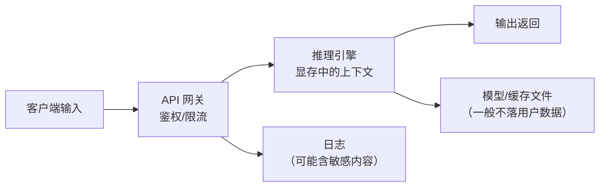

# 安全与合规

> [!abstract] 一句话讲清楚
> 交付本地大模型时，客户最关心的其实不是模型多聪明，而是"我的数据会不会出去、谁能用、出了事谁负责"。这篇讲怎么把这三件事说清楚、做到位。

## 为什么重要

- **"本地部署"的卖点就是数据不出域**。如果这一点没做到（比如引擎偷偷联网拉模型、日志全文上云、客户端走了公网 API），整个交付的前提就崩了。
- **客户问的问题往往很具体**：数据存在哪、留多久、谁能看、能不能审计、上次那批文档会不会被模型记住。答不上来就丢单。
- **安全边界是责任边界**。合同里写清楚"我们负责 API 鉴权，客户负责账号发放"，出事时才不会全算你的。
- **API 一旦裸奔，损失是实打实的**：别人拿你的卡跑自己的业务，电费、机器寿命、甚至违规内容都由你承担。

上游要结合 [[开源许可证与合规]]（模型能不能商用）和 [[服务化与 API 鉴权]]（技术实现），下游接 [[交付 SOP 与报价]] 里的责任条款。

## 核心名词全解

| 名词 | 英文 / 缩写 | 大白话解释 | 容易混淆 / 注意 |
|---|---|---|---|
| 数据不出域 | Data Residency | 数据从产生到销毁都在客户自己的机器/网络内 | 不只是"不传外网"，还包括不走第三方云、不留副本 |
| API 鉴权 | Authentication | 证明"你是谁"，通常是一个密钥（Key） | 鉴权 ≠ 授权，鉴权是认人，授权是定权限 |
| 授权 | Authorization | 决定"你能干什么"，比如只能查不能删 | 多租户场景必做，单机单用户可简化 |
| 限流 | Rate Limiting | 限制单位时间请求次数/并发 | 防滥用、防刷爆显存；不做限流，一个脚本就能把服务打死 |
| 越权 | Privilege Escalation | 权限不够的人做了不该做的事 | 常见于"用同一个 API Key 给所有人" |
| 提示词注入 | Prompt Injection | 用户在输入里写"忽略前面的指令"，诱导模型做别的事 | 本地部署同样有，尤其接了工具调用/Agent 时 |
| 日志脱敏 | Log Desensitization | 把日志里的敏感内容打码/去掉 | 不是"不记日志"，而是"记但不记敏感部分" |
| 内容安全 | Content Moderation | 拦截违规输出（涉政/涉黄/暴恐等） | 本地模型默认没有护栏，需要额外加 |
| 最小权限 | Least Privilege | 只给完成工作必需的权限 | 对交付方和对客户内部用户都适用 |
| 网络暴露面 | Attack Surface | 对外开了哪些端口、哪些服务 | 每开一个端口就多一份风险，能不开就不开 |
| 数据留存 | Data Retention | 数据存多久、什么时候删 | 客户合规审计必问，要能拿出策略 |
| 责任划分 | Liability Boundary | 出问题时谁负责哪一段 | 必须书面化，口头约定等于没有 |

## 原理与机制

### 直觉：本地部署不是"自动就安全"

很多人以为"东西都在内网，所以安全"。实际上一台裸奔的推理服务，通常有这四个洞：

1. **API 无鉴权**：任何能访问该 IP 的人都能调用。
2. **管理端口暴露**：Ollama 默认端口、Web UI 管理页面、Docker API 直接对外。
3. **日志成了数据副本**：为了排障把完整 prompt 记下来，等于把客户数据又存了一份，还没人管。
4. **对外连接没关**：引擎启动时自动拉模型、遥测上报、依赖库偷偷联网。

**所以安全动作的核心是两件事：收缩暴露面 + 明确数据流向。**

### 关键机制：大模型服务的数据流有五个节点

搞清楚数据在哪存、过哪，才能回答客户的问题：



- **输入**：从客户端到 API，走不走公网？走就得加密（HTTPS）。
- **网关**：鉴权、限流、审计记录都放这里，这是唯一该暴露的入口。
- **引擎内存**：用户数据只在显存/内存里存在一小会儿，进程重启就没了——这是本地部署的优势，要主动讲。
- **日志**：最容易变成"数据副本"的地方。
- **模型文件**：一般不含用户数据（除非做了在线微调/记忆功能，那要单独说明）。

**给客户的回答模板**："您的数据只在这台机器的内存里参与计算，算完就释放；日志只记录长度和耗时，不记录内容；不会发送到任何外部网络；如果需要审计，我们可以只在您授权的目录留一份操作日志。"

### 关键机制：API Key 只是第一层，限流才是止血带

一个真实事故：客户内部把 API 地址发到群里，某个同事写了个循环脚本，把整卡显存打满，所有人用不了。

- 鉴权解决"谁能用"；
- 限流解决"用多狠"；
- 配额解决"用多少"（按天/按账号统计）。

**三者缺一不可**。而且限流要分两层：网关层（每秒请求数、并发数）和引擎层（最大并发批、上下文长度上限）。

### 关键机制：提示词注入在本地的正确理解

- 单轮问答、没有工具调用：注入的危害有限（最多让他绕过你的系统提示词）。
- **接了工具调用、RAG、Agent**：危害大得多——模型可能被诱导去读不该读的文件、调不该调的接口。
- 防护思路不是"把提示词写得更严"，而是**在系统层面收权限**：工具只能访问白名单资源，敏感操作要二次确认，输出要过滤。

> 一句话：**别指望用提示词解决权限问题，权限要用代码解决。**

### 关键机制：合规是"证据链"问题

客户（尤其国企、医疗、金融）要的不是"你说安全"，而是"你能拿出证据"。所以交付时要有：

- 一份**部署架构图**：数据放在哪、流向哪、有没有外连。
- 一份**权限清单**：有哪些账号、什么权限、谁批的。
- 一份**日志策略**：记什么、不记什么、留多久、谁能看。
- 一份**模型授权说明**：这个模型能不能商用，依据是什么（见 [[开源许可证与合规]]）。

有了这四份，客户的安全评审能少跑几轮。

## 完整流程

`输入 → 动作 → 输出 → 验收标准`

### 1. 输入：安全需求访谈（交付前必做）

问客户这 5 个问题，答案决定了后面所有配置：

1. 数据能不能出这台机器/这个网段？
2. 有哪些人要用、要不要按人分权限？
3. 有没有等保/行业合规要求（医疗、金融、政务）？
4. 日志能不能留用户输入原文？
5. 出安全事件时，第一联系人是谁？

### 2. 动作：收缩暴露面

- 只暴露必要的端口（一般是 API 网关一个端口），数据库、缓存、管理面板一律绑内网/本机。
- 关掉引擎的自动下载和遥测（离线模式下尤其重要）。
- Docker 里不要挂 `docker.sock`，不要用 `--privileged`。见 [[容器化部署]]。
- 客户端如果只需要内网访问，就绑内网 IP，不对公网开放。
- 如果必须对外，前面加一层反向代理，做 TLS + 鉴权 + 限流。

### 3. 动作：鉴权与限流落地

```bash
# 网关层：一个 API Key + 每分钟请求数限制（示意，按实际组件配置）
API_KEY=<客户环境生成，不用默认值>
RATE_LIMIT=60/min
```

- **Key 要按人/按系统发**，不要一个 Key 全员用——出事查不到人。
- Key 存在配置或环境变量里，**不要硬编码进代码、不要提交到仓库**。
- 限流阈值从压测拐点往下留余量（见 [[性能调优清单]]）。
- 加审计：谁、什么时候、调了什么、返回多少字（不记内容）。

### 4. 动作：日志与数据留存策略

- 默认**不记录 prompt/输出原文**，只记请求 id、长度、耗时、错误类型。
- 确需记录时：单独目录、单独权限、明确保留期、告知客户。
- 配置数据清理任务：临时文件、上传的文档、缓存定期清。
- 明确"用户数据不参与训练"——如果没有在线微调功能，这句话是成立的，要主动写进文档。

### 5. 动作：内容安全（按需）

- 如果客户是面向公众的场景（客服、教育），需要输出过滤/敏感词拦截。
- 本地模型没有内置护栏，要么在前面加一层审核服务，要么在提示词层面约束（效果有限）。
- **明确责任**：如果由客户提供内容安全规则，责任在客户；如果用你的规则，责任在你。这条必须写进合同。

### 6. 输出与验收标准

| 交付物 | 验收方式 |
|---|---|
| 架构与数据流图 | 客户安全评审能看懂数据不出域 |
| 账号与权限清单 | 每个账号有归属人、有用途、有回收记录 |
| 鉴权与限流配置说明 | 无 Key 请求返回 401；超频返回 429 |
| 日志策略说明 | 明确"记什么不记什么、留多久" |
| 模型授权说明 | 附官方 LICENSE 与本项目使用范围 |
| 责任划分附件 | 双方签字/邮件确认 |

验收标准：**客户的安全或 IT 负责人看完文档后，能自己回答"数据在哪、谁能用、出了事找谁"。**

## 决策点

- **岔路口 1：客户要求"内网用，不许鉴权"**
  - 推荐：仍然加最小鉴权（一个共享 Key）。理由是限流和审计都挂在鉴权上，去掉鉴权等于去掉所有控制。
  - 代价：客户要多管一个 Key；如果实在不配合，把"无鉴权导致的风险"写进交付说明并让客户签收。

- **岔路口 2：日志记不记原文**
  - 推荐：**默认不记**。质量类问题用"客户提供样本复现"的方式解决。
  - 代价：部分问题排查变慢；需要客户配合。

- **岔路口 3：要不要做多租户/分权限**
  - 单部门内部用：不必要，一个 Key + 限流够。
  - 多部门/对外提供服务：必须做，按 Key 隔离配额和审计。
  - 推荐：**先从单租户做起，预留扩展点**，别一上来搞复杂鉴权体系。
  - 代价：多租户要维护账号体系，客户不一定会用。

- **岔路口 4：公网访问怎么开**
  - 推荐：**能不开就不开**；必须开时走反向代理 + TLS + 强鉴权 + 限流 + 访问日志。
  - 代价：多一层组件，维护成本和延迟都增加。

- **岔路口 5：内容安全谁负责**
  - 推荐：**按"谁定规则谁负责"划分**。客户业务场景的规则由客户定，你只负责技术实现。
  - 代价：客户往往想把责任全推给你，要在合同阶段挡住。

## 参数与配置说明

| 参数 | 作用 | 调大/调小的影响 | 常见取值 |
|---|---|---|---|
| API Key 长度/复杂度 | 防爆破 | 太短可被猜，太长客户记不住 | 随机字符串，别用有意义的词 |
| 限流 QPS | 单 Key 每秒请求数 | 太小影响正常业务，太大失去保护 | 按压测拐点留余量 |
| 并发上限 | 同时处理数 | 同上，且直接影响显存 | 略低于压测拐点 |
| 单请求最大 token | 防超长占用 | 太小会截断业务，太大拖垮并发 | 按真实需求设 |
| 日志保留天数 | 合规与磁盘平衡 | 太短不满足审计，太长占空间 | 30~180 天，按行业 |
| 会话/上下文保留 | 是否服务端保存对话 | 保存方便但形成数据副本 | 默认不保存，或只存内存 |
| TLS 证书 | 传输加密 | 内网可自签，公网必须有效证书 | 公网用受信任证书 |

## 常见坑与误区

| 现象 | 原因 | 对策 |
|---|---|---|
| 服务被外部扫描到并大量调用 | 端口映射到公网且无鉴权/无限流 | 只暴露网关端口、加 Key、加限流、查访问日志 |
| 客户安全评审不通过 | 拿不出数据流图和日志策略 | 交付前就准备四份材料（架构图/权限清单/日志策略/模型授权） |
| "数据没出内网"但引擎自动下载模型 | 引擎默认联网拉模型/上报遥测 | 离线模式启动，配置里禁用下载；用 `netstat` 验证无外连 |
| 一个 Key 全员共用，出事查不到人 | 图省事 | 按人/按系统发 Key，带审计记录 |
| 日志文件里全是客户原文 | 排障时顺手 print 了全文 | 改结构化日志，只记长度/hash；已有日志清理 |
| 接了 RAG 后模型被诱导读取其他文档 | 检索层没做权限过滤，提示词注入 | **在检索层做权限过滤**，不要靠提示词拦截 |
| 客户要求"所有操作可审计"，但容器日志默认不留 | 没配日志驱动/没挂载日志目录 | 日志落到宿主机固定目录 + 轮转 + 权限控制 |
| 商用后发现模型许可证不允许 | 交付前没核对 LICENSE | 交付前查模型卡和 LICENSE，把依据写进文档（见 [[开源许可证与合规]]） |

> [!warning] 一条底线
> 客户的密钥、数据、日志，**不要出现在你自己的电脑上，不要发到聊天工具里**。排障需要样本时，让客户脱敏后提供，或者现场看。这一条被违反一次，口碑就没了。

## 自检问题

- [ ] "本地部署"为什么不等于"自动安全"？常见的四个洞是什么？
- [ ] 大模型服务的数据流有哪五个节点？每个节点该做什么保护？
- [ ] 鉴权、限流、配额分别解决什么问题？为什么缺一不可？
- [ ] 提示词注入在什么场景下危害最大？为什么不能靠提示词防？
- [ ] 客户要"证据"时，你需要准备哪四份材料？
- [ ] 日志里为什么不能记 prompt 原文？不记的话怎么排质量类问题？
- [ ] API 要暴露到公网，至少要做哪几件事？
- [ ] 责任划分里，"内容安全"和"模型授权"分别该怎么界定？

## 自检问题参考答案

> [!success]- 1. 本地部署为什么不是自动安全？
> 东西在内网不等于安全，一台裸奔的推理服务通常有四个洞：API 无鉴权（能访问 IP 的人都能调）、管理端口暴露（Ollama 默认端口、Web UI、Docker API）、日志成了数据副本、对外连接没关（引擎自动拉模型、遥测上报、依赖偷偷联网）。核心动作就两件：收缩暴露面、明确数据流向。

> [!success]- 2. 数据流五个节点怎么保护？
> 客户端输入（走公网就上 HTTPS）、API 网关（鉴权、限流、审计都放这里，是唯一该暴露的入口）、推理引擎显存（用户数据只短暂参与计算，重启即释放，这个优势要主动讲）、日志（最容易变成数据副本，控制记什么）、模型与缓存文件（一般不含用户数据，有在线微调或记忆功能要单独说明）。

> [!success]- 3. 鉴权限流配额为什么缺一不可？
> 鉴权解决"谁能用"，限流解决"用多狠"（每秒请求数、并发数），配额解决"用多少"（按天按账号统计）。真实事故就是内部同事把地址发群里、有人写循环脚本把显存打满，所有人都用不了。而且限流要网关层和引擎层各做一层，只做一层挡不住。

> [!success]- 4. 提示词注入在什么场景最危险？
> 危害最大的是接了工具调用、RAG、Agent 的场景：模型可能被诱导去读不该读的文件、调不该调的接口。不能靠提示词防，因为提示词约束是概率性的；正确做法是在系统层面收权限——工具只能访问白名单资源，敏感操作要二次确认，输出要过滤，检索层要做权限过滤。

> [!success]- 5. 客户要证据要准备哪四份？
> 部署架构图（数据放在哪、流向哪、有没有外连）、权限清单（有哪些账号、什么权限、谁批的）、日志策略（记什么、不记什么、留多久、谁能看）、模型授权说明（能不能商用、依据是哪份 LICENSE）。有这四份，客户的安全评审能少跑几轮。

> [!success]- 6. 不记原文怎么排质量类问题？
> 靠客户脱敏后的样本复现，或者现场看、先告知再临时开启记录。日志默认只记请求 id、长度、耗时和错误类型；质量类问题如果没有样本，可以让客户挑几条典型输入去掉敏感信息后发过来。记全文的代价是数据副本失控，这个风险不能拿"方便排错"来换。

> [!success]- 7. API 暴露到公网至少做哪几件事？
> 五件事：前面加反向代理并上 HTTPS、强鉴权、限流、访问日志、关掉不必要的端口和管理面板。能不开就不开；必须开时还要配监控告警。公网裸奔的 API 一定会被扫描到并大量调用，电费、机器寿命和违规内容的风险都落到你头上。

> [!success]- 8. 内容安全和模型授权怎么划责？
> 内容安全按"谁定规则谁负责"：客户业务场景的规则由客户定，你负责技术实现（输出过滤、审核服务接入）。模型授权按事实材料：给出官方 LICENSE 和使用范围，不替客户做法律判断，但要提醒商用条件。这两条都要写进合同或附件，口头约定等于没有。

## 相关笔记

- 上游：[[开源许可证与合规]]、[[服务化与 API 鉴权]]
- 上游：[[网络基础与内网穿透]]、[[Docker 与容器化基础]]
- 下游：[[交付 SOP 与报价]]、[[远程交付与远程运维]]、[[监控与日志]]
- 对照：[[本地部署全流程]]、[[工程化交付 MOC]]
- 排错：[[故障案例库]]
- 返回：[[工程化交付 MOC]]

## 交付视角（对客户怎么讲）

- **客户问"数据会不会传到你们那"**：不会。数据只在这台机器的内存里参与计算，算完释放；不联网、不写外部、不参与训练。可以现场用抓包/`netstat` 证明。
- **客户问"我们的文档会不会被模型记住"**：不会。模型权重是固定的，除非做在线微调，而我们的方案里没有这个功能。
- **客户问"谁能看我们的日志"**：默认日志不记内容；操作日志只有你们 IT 和我们在授权期内能看，保留期到了自动清理。
- **客户问"模型能商用吗"**：给出模型官方 LICENSE 的依据和使用范围说明；我们不替客户做法律判断，但会提供事实材料。
- **报价口径**：基础部署含"最小鉴权 + 限流 + 日志策略"；等保整改、内容安全审核、多租户改造都是**单独项目**，不要打包进部署费。
- **限制说清**：本地部署能保证数据不出内网，但**不能保证输出内容正确**，也不能替代客户自身的合规审查。这两句一定要提前说。
