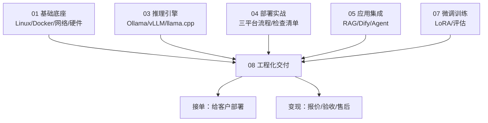

# 工程化交付 MOC

> [!abstract] 一句话讲清楚
> 这一层解决的是"本地能跑"到"能交给客户、能收钱、出事能救"的最后一公里：容器化、远程交付、调优、监控、安全、报价、排错、案例库。

## 为什么单独一层

前面 7 个领域讲的是"技术能不能实现"，这一层讲的是"能不能变现"。

一个能跑通的 demo 和一次能通过验收的交付，中间差的是这些东西：

- **环境一致性**：自己机器能跑，客户机器跑不起来，八成是环境没封装好 → [[容器化部署]]
- **进不去现场**：客户在内网、没有公网 IP、不让装远控 → [[远程交付与远程运维]]
- **速度不达标**：客户说"太慢了"，你得知道从哪查、先改哪个 → [[性能调优清单]]
- **出事没人知道**：半夜显存涨满服务挂了，第二天客户打电话才发现 → [[监控与日志]]
- **数据与责任**：客户问"我们的文档会不会传到网上"，你得答得上来 → [[安全与合规]]
- **报价与验收**：报低了亏钱，报高了没单；验收没过尾款收不到 → [[交付 SOP 与报价]]
- **排错**：客户只发一句"报错了"，你得有一套问出有效信息的方法 → [[排错方法论]]、[[故障案例库]]

说白了：**前 7 层决定你会不会，这一层决定你能不能靠它吃饭。**

## 阅读顺序

| 顺序 | 笔记 | 读完能干什么 | 建议耗时 |
|---|---|---|---|
| 1 | [[工程化交付 MOC]] | 知道这一层有哪些模块、先学哪个 | 10 分钟 |
| 2 | [[容器化部署]] | 把自己的环境打包成"换台机器也能跑"的镜像 | 2 小时 |
| 3 | [[远程交付与远程运维]] | 判断客户环境该用什么方式接入、怎么留后路 | 1.5 小时 |
| 4 | [[性能调优清单]] | 拿到"慢"的反馈后，按顺序一轮轮排查 | 2 小时 |
| 5 | [[监控与日志]] | 给交付出去的服务加上"体温计"和"黑匣子" | 1.5 小时 |
| 6 | [[安全与合规]] | 回答客户的安全问题、做基本的暴露面收缩 | 1.5 小时 |
| 7 | [[交付 SOP 与报价]] | 把一次交付拆成可报价、可验收的流程 | 2 小时 |
| 8 | [[排错方法论]] | 从"乱试"变成"分层定位 + 二分" | 2 小时 |
| 9 | [[故障案例库]] | 遇到具体报错时直接查手册 | 反复查阅 |

> [!tip] 怎么用这一层
> 第 2~7 篇适合**顺着读一遍**，建立流程感；第 8 篇要**背下来框架**；第 9 篇不要通读，**当字典用**，遇到报错先按关键词搜。

## 全部笔记

### 交付基础设施建设

- [[容器化部署]] —— Docker 封装推理服务、GPU 直通、compose 编排、镜像体积控制、模型挂载 vs 打包、一键启动脚本
- [[远程交付与远程运维]] —— 远程桌面与 SSH、内网穿透、离线交付、客户环境隔离、权限边界与"留一手"的退路

### 稳定性与性能

- [[性能调优清单]] —— 从慢到快的排查顺序：硬件 → 驱动 → 引擎参数 → 量化 → 批处理 → KV Cache → 投机解码，每条带预期收益与风险
- [[监控与日志]] —— 显存/温度/功耗/延迟/并发/错误率，nvidia-smi 的正确用法，日志规范与告警分级

### 商务与风险

- [[安全与合规]] —— 数据不出域、API 鉴权与限流、越权与注入、日志脱敏、责任划分
- [[交付 SOP 与报价]] —— 需求评估表、报价构成、工期估算、交付物清单、验收与售后、客户预期管理

### 排错体系

- [[排错方法论]] —— 分层定位模型（硬件→驱动→框架→参数→应用）、症状→假设→验证的闭环、给 AI 描述问题的模板
- [[故障案例库]] —— 15+ 条高频故障的完整档案：环境、现象、根因、解决、预防

## 与其他领域的关系

- **上游**：[[基础底座 MOC]]（Linux/Docker/网络）、[[推理引擎 MOC]]（引擎与参数）、[[部署实战 MOC]]（三平台流程）
- **下游**：[[学习与自检 MOC]] 里的项目阶梯，这一层的能力直接对应"能接什么单"
- **横向**：[[安全与合规]] 与 [[开源许可证与合规]] 是同一件事的两面（一个是数据，一个是模型授权）

## 这一层的验收标准

学完这一层，你应该能做到：

- [ ] 把一个推理服务打成镜像，换台机器 `docker compose up` 就能起来
- [ ] 客户在内网、只有一台 Windows 机器时，能给出 2 套远程接入方案
- [ ] 客户说"慢"，你能在 30 分钟内定位是硬件、驱动、参数还是应用层的问题
- [ ] 能说清哪些指标必须在交付前埋好、客户自己能看懂哪几个
- [ ] 能回答"数据会不会出内网"，并拿出对应的配置证明
- [ ] 拿到一个需求（场景 + 预算 + 机器），能给出模型选型 + 工期 + 报价区间
- [ ] 遇到报错，能按分层模型列出下一步要验证的 3 件事，而不是重启
- [ ] [[故障案例库]] 里的高频故障，看到现象能直接联想到根因

## 常见误区

- **误区：交付就是装个软件**。装完之后的操作培训、参数留档、出问题谁负责，才是交付的主要工作量。
- **误区：性能调优就是换更大的模型/更好的卡**。多数"慢"是参数配错或应用层串行导致的，先查便宜的项。
- **误区：监控是运维的事**。交付方不埋监控，等于把自己变成 7×24 客服。
- **误区：报价按"工时"报最安全**。客户听不懂工时，按"能力 + 交付物"报价，工时只用于内部核算。

## 相关笔记

- 上游：[[基础底座 MOC]]、[[推理引擎 MOC]]、[[部署实战 MOC]]
- 横向：[[应用集成 MOC]]、[[微调训练 MOC]]
- 返回：[[技能栈总览 MOC]]
- 名词对照：[[术语总表]]
