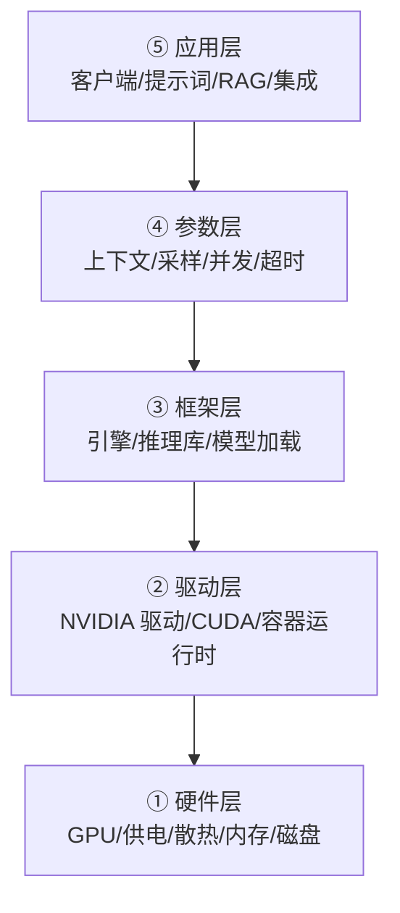

# 排错方法论

> [!abstract] 一句话讲清楚
> 排错不是"试试这个试试那个"，而是一个固定动作：**先确定故障在哪一层，再在该层内部二分**。这篇给你一个五层定位模型、每层的典型症状和验证思路，以及一个"把问题描述清楚"的模板。

## 为什么重要

- **绝大多数时间浪费在"层搞错了"**：客户说"模型不回答"，你花两小时调 prompt，最后发现是 API Key 错了。
- **报错信息经常说谎**：最外层的报错往往只是"下游挂了"的转述。比如应用层报"请求失败"，真正原因是显存 OOM。
- **排错能力决定交付口碑**：同样的问题，有人 10 分钟定位，有人一天。客户能感觉到差别。
- **这是唯一能"迁移"的能力**：工具会变、模型会变、框架会变，但"分层 + 二分 + 替换"这套思路一直有效。

上游是这一层所有技术笔记（每层对应一个领域的知识），下游是 [[故障案例库]]（具体的案例档案）。这篇是**方法**，案例库是**病历**。

## 核心名词全解

| 名词 | 英文 / 缩写 | 大白话解释 | 容易混淆 / 注意 |
|---|---|---|---|
| 分层定位 | Layered Diagnosis | 把系统按"从上到下"切成几层，先确定问题在哪一层 | 不是"从下往上查"，是"先定位再深入" |
| 症状 | Symptom | 你观察到的现象（报错、慢、乱码、不回答） | 症状 ≠ 原因；同一个症状可能来自不同层 |
| 假设 | Hypothesis | 你觉得最可能的原因 | 必须可验证，否则是猜 |
| 验证 | Verification | 用一个动作确认或否定假设 | 一次只验证一个假设 |
| 二分法 | Bisection | 把范围对半砍，快速缩小可能 | 适用于参数、配置、依赖、代码位置 |
| 替换法 | Substitution | 换一个已知好的东西（模型/端口/机器）看是否复现 | 最快区分"环境问题"和"配置问题" |
| 最小复现 | Minimal Repro | 砍到只剩一个请求/一个变量也能复现 | 能复现就成功了一半 |
| 现场 | State / Evidence | 出事那一刻的日志、显存、进程、网络状态 | 重启会毁掉现场，**先取证再重启** |
| 回归 | Regression | 改完 A 坏了 B | 大版本升级、换驱动后常见 |
| 变更关联 | Change Correlation | 90% 的故障发生在最近一次变更之后 | 先问"刚才改了什么" |
| 观测点 | Observation Point | 你在链路的哪个位置能看到数据 | 没观测点的地方只能盲猜 |
| 伪故障 | False Symptom | 看起来是故障，其实是配置/预期问题 | 例如上下文超限被截断，不是模型坏了 |

## 原理与机制

### 直觉：系统是一条链，故障是链上某一环断了

从用户点击到模型出字，链路大致是：

`客户端 → 网络 → API 网关 → 推理框架 → 驱动 → GPU 硬件 →（反向）输出`

任何一环断了，用户看到的都是"没反应"。所以**排错的第一目标不是找原因，是找断点**。

**判断断点位置的最快方法：看请求走到了哪一步。**

- 客户端根本没发出去 → 看客户端
- 发出了但没有响应 → 看网络/端口/服务进程
- 有响应但是错误码 → 看网关/框架
- 框架报错 → 看驱动/显存/模型
- 能出字但不对/乱码/慢 → 看参数/模型/编码

### 五层定位模型



> 从下往上查是"保险"，从上往下查是"高效"。**先按症状猜层，再从便宜的层开始验证。**

#### ① 硬件层

**典型症状**

- 昨天好好的，今天完全起不来；
- 跑一会儿就崩、变慢、花屏；
- `nvidia-smi` 报 XID 错误、掉卡、显示 `ERR!`；
- 加载模型时机器重启（多半是供电）；
- 磁盘满导致写模型/日志失败。

**验证思路（不是命令流水账）**

- 先看"卡还在不在"：系统能不能枚举到 GPU、`lspci` 能不能看到设备。看不到就是硬件/驱动级别，别往下查。
- 再看"卡健不健康"：温度、功耗、频率、错误计数、显存是否被别的进程占着。
- 再看"资源够不够"：磁盘剩余（模型动辄几十 G）、内存（加载时要用内存中转）、电源功率余量。
- 最后看"环境稳不稳"：是不是虚拟机/云主机没开 GPU 直通、是不是供电不足导致降频。

**这一层的判断特征**：**同一份配置，换台机器就好 / 换台机器也坏**。前者不是硬件，后者大概率是硬件或驱动。

#### ② 驱动层

**典型症状**

- `CUDA driver version is insufficient for CUDA runtime version`；
- `no CUDA-capable device is detected`；
- 容器里 `nvidia-smi` 显示不了卡；
- 框架日志里设备是 CPU；
- 多卡只认出 1 张、或卡间通信报错。

**验证思路**

- 先确认"宿主机自己认不认卡"：宿主机上能看到、容器里看不到 → 容器运行时问题；宿主机也看不到 → 驱动/硬件问题。
- 再看"版本链条"：宿主机驱动 → 容器里的 CUDA 运行时 → 框架编译时依赖的 CUDA → 三者不匹配就会报各种奇怪的错（见 [[驱动-CUDA-框架版本兼容]]）。
- 再看"框架实际用的设备"：很多"慢"是因为悄悄跑在 CPU 上，日志里会有一行设备信息。
- 如果是容器，查 GPU 是否被正确直通、驱动能力是否注入（见 [[容器化部署]]）。

**这一层的判断特征**：**报错里带着 CUDA、driver、device、cudnn 这类词**，且换成纯 CPU 模式能跑。

#### ③ 框架层

**典型症状**

- 模型加载失败：文件不完整、格式不对、分片缺一片；
- `out of memory`（OOM）；
- 引擎起得来但请求一直 pending；
- 第一次请求超时，之后正常；
- 换模型就崩，换参数就崩。

**验证思路**

- 先看"模型文件本身"：大小对不对、分片齐不齐、有没有下到一半的残留文件、用的是不是该引擎支持的格式（GGUF / safetensors / 引擎专有格式）。
- 再看"显存账"：加载时峰值多少、稳定后多少、KV Cache 吃多少。OOM 不一定是总量不够，可能是碎片或某个参数放大了需求（见下文二分）。
- 再看"启动日志"：绝大多数框架问题在启动日志里已经有明确提示，**别跳过日志直接看现象**。
- 再用**替换法**：同一个引擎换个更小的模型能不能跑？同一个模型换个引擎能不能跑？两个结果一交叉，问题范围就锁定了。

**这一层的判断特征**：**报错发生在"加载"或"第一次推理"时，且错误信息来自框架内部**。

#### ④ 参数层

**典型症状**

- 能跑，但输出被截断、莫名停止、重复循环；
- 上下文超限报错或静默截断；
- 速度慢、并发一高就排队或崩溃；
- 温度/采样改一下效果完全不同；
- 服务超时、客户端提前断开。

**验证思路**

- 先看"上限类参数"：上下文长度、最大输出 token、单请求超时、最大并发。这类参数最常导致"看起来是 bug，其实是配置"。
- 再看"采样类参数"：温度、top_p、重复惩罚。输出循环、胡言乱语经常出在这里，而不是模型坏了。
- 再看"资源类参数"：显存占比、批大小、KV Cache 精度。改了之后要重新压测。
- **一次只改一个参数**，改完必须能对比。同时改三个，等于没改。

**这一层的判断特征**：**同一个模型，改配置就能复现/消失**；换台机器、换模型都正常。

#### ⑤ 应用层

**典型症状**

- 模型明明能出字，但界面上显示错误/空白；
- 乱码（中文变问号、表情变方块）；
- 只有某个功能不好用，别的正常；
- RAG 答非所问、引用不存在的内容；
- 客户端连不上、报 CORS、报 401/403。

**验证思路**

- **绕开应用直接打 API**：用 curl 或最简单的客户端直接请求模型服务。通了 → 问题在应用；不通 → 问题在下层。这一步能砍掉一半的排查范围。
- 再看"数据在应用层有没有变形"：编码（UTF-8）、换行、转义、前端渲染、流式解析。乱码 90% 在这一层。
- 再看"集成配置"：地址、Key、超时、代理、CORS、证书。
- RAG 类问题单独看检索层：检索出来的内容对不对？先验证检索，再验证生成（见 [[RAG 评估与调优]]）。

**这一层的判断特征**：**服务本身健康，只有某个客户端/某个功能出问题**。

### 二分与替换：两个动作解决 80% 的问题

- **二分**：把可能范围对半砍。
  - 参数二分：先用一半上下文长度试。
  - 依赖二分：二分之一依赖装回去，看是否复现。
  - 链二分：绕开前半段（直接打 API），看后半段是否正常。
  - 版本二分：在最近一次变更前后各试一版。
- **替换**：
  - 换端口（是不是端口占用）；
  - 换模型（是不是模型文件问题）；
  - 换客户端（是不是应用层问题）；
  - 换机器（是不是环境问题）；
  - 换账号/Key（是不是权限问题）。

**替换法的价值在于"区分"，不在于"修复"**。它告诉你哪边是对的，剩下的那边就是问题所在。

### 现场保护：先取证，再动手

排错最大的浪费是"重启一下试试"——重启往往真的好了，但你永远不知道原因，下次还会再来。

**动手前至少留下五样东西**：

1. 完整报错文本（不是截图的一句话，要从第一行到最后一行）；
2. 出事时间点；
3. 最近一次变更（装了什么、改了什么配置、升级了什么）；
4. 当时的资源状态（显存、内存、磁盘、进程列表）；
5. 服务日志的尾部若干行。

> [!tip] 一条硬规则
> **先取证，再重启。** 重启只能解决"偶发"，不能解决"配置错"。如果重启后复发，说明根因还在。

### 怎么向 AI（或同事）描述问题才高效

大多数人描述问题是"报错了，怎么办"。信息量太低，回答也只能是泛泛的。

**一个高效的问题描述包含六段**，缺一段对方就要反问一次：

```text
【环境】Windows 11 + 单张 24G 显存卡 + 驱动版本按官方命名 / Linux + 双卡 / 容器 or 裸机
【目标】想做什么（比如：用 Ollama 跑量化模型，提供 OpenAI 兼容 API 给内部系统调用）
【操作】具体执行了什么（哪条命令 / 哪个界面点哪里），越短越好
【现象】原样贴报错（从第一行到最后一行，别只贴最后一句）
【时间线】之前能用吗？什么时候开始不能？期间改了什么？
【已排除】已经试过哪些，结果如何（换模型/换端口/重启/查了显存）
```

**追加两条能大幅提高答案质量**：

- 贴**日志上下文**，不只贴报错行；
- 说明**你判断问题在哪一层**，以及为什么。

**反例 vs 正例**：

| 反例 | 正例 |
|---|---|
| "模型跑不起来，怎么办" | "Linux + 单卡 24G，用 vLLM 起 4bit 量化模型，启动时报 `CUDA out of memory`，显存剩余约 20G；换小模型能起；已确认驱动版本高于镜像 CUDA；怀疑是显存碎片或 max-model-len 太大" |
| "接口连不上" | "服务端 `curl localhost:8000/health` 返回 200；同局域网另一台机器 curl 超时；服务监听 127.0.0.1；防火墙未开端口" |

**给 AI 描述时的一个额外技巧**：把你怀疑的层说出来，并给一个"最小复现步骤"。AI 不需要你说"请帮我排错"，它需要的是可判断的事实。

## 完整流程

`输入 → 动作 → 输出 → 验收标准`

### 输入：拿到故障现象

第一时间只做三件事：

1. **拿到原样报错**（不是转述）；
2. **确认影响范围**（一个人还是所有人、一个功能还是全部）；
3. **问最近变更**（"刚才动过什么"）。

### 动作：五步定位

1. **定层**：按症状猜最可能的层（用上面的症状表对号入座）。
2. **验证最便宜的一层**：绕开应用直接打 API、看启动日志、看显存，通常 1~2 个动作就能定位层。
3. **层内二分**：换模型/换参数/换端口/换客户端，一次只动一个。
4. **找根因**：找到"改这个就好、改回去就坏"的那个变量。
5. **验证修复并回归**：修复后测一遍**其他功能**，确认没引入新问题。

### 输出：排错记录

写成可复用的一页，格式固定（也是 [[故障案例库]] 的条目格式）：

- 环境
- 现象（原样报错）
- 根因
- 解决
- 预防（怎么避免、怎么让下次 5 分钟定位）

### 验收标准

- 能一句话说清"根因在哪个环节"，而不是"重启就好了"；
- 同样的故障再出现，你能在几分钟内处理；
- 修复后其他功能没有回归；
- 记录能给别人看（下次别人遇到能自己解决）。

## 决策点

- **岔路口 1：先重启还是先取证**
  - 推荐：**先取证再重启**；只有"完全不可用且客户在等"时才不惜一切先恢复，事后再补分析。
  - 代价：取证要几分钟，客户会觉得慢；但对反复出现的故障，这是唯一省时间的做法。

- **岔路口 2：从上往下查还是从下往上查**
  - 推荐：**按症状猜层，从最便宜的一层开始**。完全无线索时才从底层往上扫（硬件→驱动→框架）。
  - 代价：猜层可能猜错，所以要有一个"绕开中间层"的动作（直接打 API）兜底。

- **岔路口 3：换版本还是调配置**
  - 推荐：**先调配置，再换版本**。版本变更引入的不确定性远大于配置调整。
  - 代价：有些问题确实是版本 bug，调配置调不出来，要设定一个"试多久就升级"的上限。

- **岔路口 4：自己查还是找客户要信息**
  - 推荐：**能远程看的自己看**（日志、显存），需要客户操作的**一次问清**（别来回问三轮）。
  - 代价：一次问清需要你提前想好问什么，这就是这篇的价值。

- **岔路口 5：何时承认"需要换方案"**
  - 推荐：同一问题定位超过约定时间（比如 4 小时）仍无进展，就**换路径**：换模型/换引擎/换部署方式，而不是继续深挖。
  - 代价：换方案要重测，但比无限排查便宜。

## 参数与配置说明

| 观测项 | 在哪看 | 判断什么 |
|---|---|---|
| 进程在不在 | 进程列表 / 容器状态 | 服务是否真的活着 |
| 端口通不通 | 本机访问 / 跨机访问 | 是服务没监听还是网络不通 |
| GPU 状态 | `nvidia-smi` 系列工具 | 卡在不在、忙不忙、显存够不够、有没有报错 |
| 加载日志 | 服务日志开头部分 | 模型有没有加载成功、用的什么设备 |
| 显存曲线 | 长时间观察 | 是"稳态占用"还是"持续上涨（泄漏）" |
| 请求日志 | 网关/框架日志 | 请求到了哪一步、耗时分布、错误码 |
| 系统日志 | 系统级日志 | 有没有 OOM killer、驱动崩溃、硬件报错 |
| 时间戳对比 | 客户端 vs 服务端日志 | 是网络慢还是服务慢 |

## 常见坑与误区

| 现象 | 原因 | 对策 |
|---|---|---|
| 折腾两小时发现方向错了 | 一开始没定层，直接改参数 | 先花 5 分钟定层，再动手 |
| 报错信息解决不了问题 | 只看了最外层转述的报错 | 往下找原始报错：框架日志、系统日志 |
| 重启后好了，过几天又犯 | 没找根因，重启只是掩盖 | 先取证；查显存曲线、查变更记录 |
| 改了三个参数，不知道是哪个生效 | 没做单变量验证 | 一次只改一个，改完立刻测 |
| 客户描述模糊，来回问三轮 | 没有固定的提问清单 | 用本文的六段模板一次问全 |
| 修复了 A，坏了 B | 没有回归测试 | 修复后跑一遍关键路径 |
| 以为模型坏了，其实是参数 | 采样参数/上下文限制导致的"怪输出" | 先用默认参数 + 短输入复现；能正常就不是模型问题 |
| 换新版本后全乱 | 版本升级是最大的变更源 | 升级前记录版本、保留回退包；升级后全量回归 |

> [!warning] 一句话总结这篇
> **症状定层、证据定因、一次一动、改完回归。** 记不住就记这四句。

## 自检问题

- [ ] 五层定位模型是哪五层？各层的"判断特征"是什么？
- [ ] 为什么"直接绕开应用打 API"能砍掉一半排查范围？
- [ ] 二分法和替换法分别解决什么问题？举例说明。
- [ ] 为什么必须"先取证再重启"？重启会毁掉什么证据？
- [ ] 描述问题的六段模板缺哪一段最容易导致对方反问？
- [ ] 客户说"慢"，你如何用最小动作判断是网络、服务还是模型的问题？
- [ ] 改了配置好了，但怎么确认不是"碰巧好了"？
- [ ] 什么时候应该停止排查、换方案？

## 相关笔记

- 下游：[[故障案例库]]（具体病历，配合本篇使用）
- 上游：[[驱动-CUDA-框架版本兼容]]、[[硬件基础与 GPU 生态]]、[[Linux 基础与服务器操作]]
- 上游：[[推理引擎选型决策树]]、[[性能调优清单]]
- 对照：[[监控与日志]]（排错的观测基础）、[[部署检查清单]]
- 跨领域：[[高频咨询问题与话术]]（对客户怎么描述问题）
- 返回：[[工程化交付 MOC]]

## 交付视角（对客户怎么讲）

- **客户问"多久能修好"**：不说时间，说步骤。"我先定位在哪一层，一般这类问题有 X 种可能，我按顺序排除。"客户听到流程会安心。
- **客户只会说"用不了"**：不要表现出不耐烦，用六段模板一次问全，比来回问十次显得专业。
- **客户想自己排查**：给他一份"三步自检"——服务在不在、日志最后几行、显存够不够。能做这三步的客户，能省你很多次上门。
- **报价口径**：故障排查按"响应 + 定位 + 修复"三段计，不按"修好了才算"；不可复现的问题要说明"需要复现才能定位"。
- **责任边界**：定位后如果是客户环境问题（断电、改了配置、网络限制），修复是额外工作；这一点在交付文档里就写清楚，别到事发才争。
