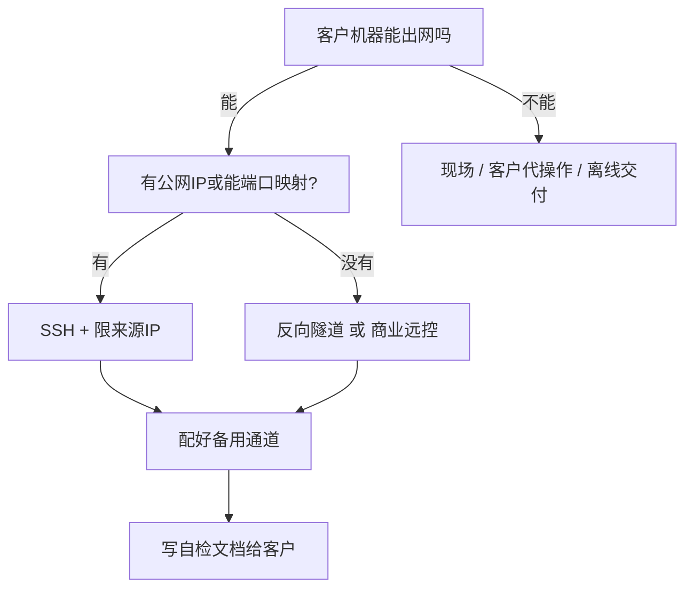

# 远程交付与远程运维

> [!abstract] 一句话讲清楚
> 你不在客户现场，怎么把服务装到他的机器上、怎么在他出问题时看到现场、以及怎么在"看得见"和"别越界"之间划一条线。

## 为什么重要

- 大部分本地部署单**不是现场做的**。客户把机器放机房/办公室，你远程连过去装。连接方式选错，第一天就卡死。
- 客户环境千奇百怪：有的只有一台 Windows、有的在内网不许出网、有的连 USB 都不让插、有的要求"操作全程录屏"。
- **远程运维是交付成本的大头**：装完只是开始，之后半年的"连不上了""变慢了""重启了"都找你。没有远程通道和日志留档，每次都要客户帮你操作，人力成本翻几倍。
- 也是**风险控制**：远程通道本身是安全暴露面，给客户留下一个不该留的账号，出事你解释不清。

上游是 [[网络基础与内网穿透]]、[[Linux 基础与服务器操作]]，下游接 [[监控与日志]] 和 [[交付 SOP 与报价]]（售后部分按运维方式定价）。

## 核心名词全解

| 名词 | 英文 / 缩写 | 大白话解释 | 容易混淆 / 注意 |
|---|---|---|---|
| SSH | Secure Shell | 加密的远程命令行通道，Linux 服务器的默认入口 | 不只是命令行，也能做端口转发和传文件；默认 22 端口常被扫 |
| 远程桌面 | RDP / VNC | 图形界面远程操作，Windows 常用 RDP | 慢、吃带宽；只是"看界面"，不适合长时间操作 |
| 商业远控 | 向日葵 / ToDesk / TeamViewer | 装个客户端就能远程控制，穿透性好 | 客户内网常封；免费版有商用限制和设备数限制 |
| 内网穿透 | NAT Traversal / Port Forwarding | 让没有公网 IP 的机器能被外网访问 | 家用/小型办公网络的刚需，但等于把机器暴露在公网上 |
| 跳板机 | Bastion Host | 客户内网里一台允许你登的机器，从它再进别的机器 | 客户安全规范常见要求；要提前确认你有权限用它 |
| 反向隧道 | Reverse Tunnel | 内部机器主动连出去，把端口"挂"到外部服务器上 | 解决"客户完全没公网"的经典手段，但要一台你有控制权的中转机 |
| 离线交付 | Offline Delivery | 全程不联网，靠 U 盘/移动硬盘拷文件 | 客户常见要求；见 [[模型获取与离线搬运]] |
| 权限边界 | Access Boundary | 你能做什么、不能做什么的约定 | 必须书面化：哪些目录能碰、能不能装软件、能不能改防火墙 |
| 会话留档 | Session Log | 操作过程留记录 | 客户审计常要；也能保护你自己（"这一步不是我做的"） |

## 原理与机制

### 直觉：远程交付只有一个难点

不是"怎么连"，是**"怎么在对方的网络规则里连"**。技术手段都是现成的，真正的判断在于：客户网络允许什么、客户安全规范要求什么、你需要在多长时间内反复进出。

按"谁主动发起连接"来分，就三类：

1. **你主动连客户**：SSH、RDP、内网穿透。要求客户给你一个可达的地址。
2. **客户主动连你**：你开一个临时环境，客户通过浏览器/远控进来看。适合演示和培训。
3. **内部主动连出去**：反向隧道。客户机器自己没有可达地址，但它能出网，就能"挂"到你的一台公有中转机上。

**判断顺序**：先问"客户机器能不能出网" → 能，用反向隧道最稳；不能，只能现场或客户配合；能出网但客户不让开端口 → 用反向隧道；客户有公网 IP → 直接 SSH + 限来源 IP。

### 关键机制：为什么"能上网"和"能被连"不是一回事

绝大多数办公室/机房网络是 NAT 后面：机器能出网（访问外网），但没有公网地址，外面无法主动连进来。

- **能出网** → 可以做反向隧道、可以用商业远控。
- **能被连** → 需要有公网 IP 或客户路由器做过端口映射。

这两条经常被客户混着说"我们网是通的"，所以你必须问具体：**"能从这台机器访问百度吗"、"有没有固定的公网 IP"、"路由器能不能做端口映射"**——三个分别对应三种方案。

### 关键机制：远程运维其实靠"三件套"

不是靠某个远控软件，而是这三样：

1. **一条稳定的进入通道**（SSH / 远控 / 隧道，最好有备用方案）；
2. **一套能自己说话的日志**（不靠你连进去看，见 [[监控与日志]]）；
3. **一套客户自己能执行的自检命令**（写在文档里，让客户念给你听结果）。

第 3 条最容易被忽略，但它是救命稻草：当所有通道都断了，客户照着文档敲两行命令把输出发你，你就能判断一半问题。

## 完整流程

`输入 → 动作 → 输出 → 验收标准`

### 1. 输入：交付前必须问清的 6 件事

| 要问的 | 为什么 |
|---|---|
| 机器在哪、谁有物理访问权 | 通道全断时只能靠现场的人 |
| 能不能出网、有没有公网 IP | 决定方案类型 |
| 允许哪种远程方式（客户 IT 有没有规定） | 很多企业禁止装商业远控，强推会被赶出去 |
| 你的账号给到多大权限 | root 还是普通用户 + sudo，直接决定能不能干活 |
| 操作是否需要报备/录屏 | 影响节奏，也影响你怎么留档 |
| 出问题找谁、响应时间怎么算 | 售后条款的基础，见 [[交付 SOP 与报价]] |

### 2. 动作：选通道（按优先级）

- 优先级：**SSH > 反向隧道 > 商业远控 > 现场**。图形远控带宽差、操作笨、断线率高，只用来做初装和演示。
- **永远配两条通道**：一条主用，一条备用（比如 SSH + 一个远控）。只留一条，断的那天你就只能打电话指挥客户敲命令。

### 3. 动作：通道加固（这步不做等于给自己埋雷）

- SSH 改端口、禁密码登录改密钥、限制来源 IP（有条件时）。
- 商业远控装完立刻设置**固定密码 + 二次验证**，关闭"无人值守免密"。
- 反向隧道只映射必要端口，不要整机代理。
- 在客户机器上建一个**专用账号**给交付方，别用 root 日常操作——这也是给客户看的专业度。

### 4. 动作：布"自己会说话"的东西

装完服务就顺手埋：

- 日志落到固定目录，带日期滚动（别只输出到屏幕）；
- 一个定时任务，每几分钟把关键指标写一行日志（显存、QPS、错误数）；
- 一个 `curl` 健康检查脚本，客户双击就能跑（Windows 给 `.bat`，Linux 给 `.sh`）；
- 服务启动日志里打一行"版本 + 模型 + 参数"，出问题时一眼确认跑的是哪套。

### 5. 动作：教会客户两件事

不是教他怎么运维，是教他：

1. **怎么重启服务**（一条命令或一个脚本，写清楚）；
2. **怎么把日志发给你**（哪个目录、哪几个文件、最近多少行）。

这两件事会省掉你未来一半的沟通成本。

### 6. 输出与验收标准

| 交付物 | 验收方式 |
|---|---|
| 通道说明文档 | 客户 IT 能看懂你开了什么、为什么开、怎么关 |
| 账号与权限清单 | 你有哪些账号、什么权限、交付结束后保留哪些 |
| 客户自检脚本 | 客户执行一次，你把输出读出来就能判断状态 |
| 日志目录与检索方式 | 客户能自己找到最近一次报错 |
| 应急流程一页纸 | 服务挂了、连不上、断电后，客户先做什么 |

验收标准：**客户在你不参与的情况下，能完成"重启服务 + 取日志 + 找到你"这三件事。**

> [!tip] 一个便宜但有效的动作
> 交付完成时录一段 5 分钟的屏，内容就三件事：怎么重启、日志在哪、怎么找到你。客户换人、你不在线时，这段视频比十页文档有用。

## 决策点

- **岔路口 1：客户不许装商业远控**
  - 推荐：走 SSH 或客户 IT 提供的跳板机，让他们自己开权限。
  - 代价：开通流程可能要几天，工期要预留；准备好"客户代操作"的脚本化文档兜底。

- **岔路口 2：客户机器完全不能出网且没人能配合**
  - 推荐：**离线交付 + 全套图文操作手册 + 视频录制**，把"客户自己装"当成正式交付方式。
  - 代价：文档工作量翻倍，且出问题排查变慢。报价时要把这部分算进去。

- **岔路口 3：内网穿透 vs 反向隧道**
  - 内网穿透适合"客户愿意让你长期访问他的机器"，配置简单但暴露面大；反向隧道适合"你有一台自己有控制权的中转机"，更可控。
  - 推荐：**优先反向隧道**，中转机算自己的成本；客户明确要求长期访问再考虑穿透。
  - 代价：多一台中转机的维护成本和带宽成本。

- **岔路口 4：给不给 root**
  - 客户给 root 最省事，但责任也最大。
  - 推荐：**日常用普通账号 + sudo**，明确"只改这几个目录、这几个服务"；真正必须 root 的操作做完就退出，不常驻。
  - 代价：多一步 `sudo`，慢一点，但边界清楚。

- **岔路口 5：远程运维按次收费还是包月**
  - 偶发问题多 → 按次；客户是长期业务依赖 → 包月（含监控巡检）。
  - 推荐：**首月包月观察，之后按实际工单量定**。首月按次往往低估。
  - 代价：包月要承诺响应时间，自己得有余量。

## 参数与配置说明

| 参数 | 作用 | 调大/调小的影响 | 常见取值 |
|---|---|---|---|
| `Port`（sshd） | SSH 端口 | 换端口只是减少扫描噪音，不是安全措施 | 客户 IT 指定，或 1024 以上 |
| `PermitRootLogin` | 是否允许 root 直连 | 设 `no` 更安全，但少了兜底路径 | `prohibit-password` |
| `PasswordAuthentication` | 是否允许密码登录 | 关掉更安全，但客户临时要进就得改配置 | 交付稳定后关 |
| 隧道保活 `ServerAliveInterval` | 客户端多久发一次心跳 | 太小浪费，太大断线发现慢 | `30`~`60` 秒 |
| `autossh` / 服务化 | 隧道断开自动重连 | 必须做，否则客户一重启隧道就没了 | 用 systemd 管住 |
| 远控"无人值守" | 是否允许不确认就进入 | 客户安全规范多半禁止 | 默认关，需要时开、用完关 |
| 日志保留天数 | 运维日志留多久 | 太短出事查不到，太长占空间 | 30 天起，合规场景更长 |

## 常见坑与误区

| 现象 | 原因 | 对策 |
|---|---|---|
| 白天连得好好的，晚上就断了 | 客户网络夜间断网/路由器重启，隧道不会自己恢复 | 隧道服务化 + 自动重连；把"断线自动恢复"写进验收 |
| 客户说"网是通的"，但你怎么都连不上 | "能出网"和"能被连"不是一回事 | 用三个具体问题拆开问（能否访问外网、有无公网 IP、能否端口映射） |
| 装完远控后被客户 IT 卸载了 | 违反了客户安全规范，或没走审批 | 事前问清允许的方式，把审批留痕；准备 SSH 备用方案 |
| 重启机器后服务没起来，客户也不知道你在哪 | 依赖"手动 `docker run`"和你的会话，没有开机自启 | 服务化/容器化 + 自启；把重启验证当成验收项 |
| 远程操作时误删客户数据 | root 权限 + 没有确认目录 + 没有备份 | 操作前 `pwd` 确认；危险命令先备份；重要操作前知会客户 |
| 交付结束后客户还留着你的账号/密钥 | 没有"收尾清单" | 交付完成时列一张"关闭清单"：删账号、撤密钥、关远控、关隧道 |
| 客户不给看日志，只转述"报错了" | 没有约定信息提供方式 | 交付文档里写明"报错时请提供这三样"；把它写进售后条款 |
| 用免费远控做商业交付被封号 | 免费版禁止商用/设备数超限 | 事前买商业授权，或只用系统自带 RDP/SSH |

> [!warning] 一条容易被忽略的法律/责任边界
> 你远程操作客户机器，**操作日志就是你的证据**。建议全程开启会话记录（SSH 可用 `script` 或堡垒机），发生纠纷时能自证"这一步不是我做的"。客户越正规，越会认可这个动作。

## 自检问题

- [ ] "能出网"和"能被连"的区别是什么？分别对应哪种方案？
- [ ] 为什么至少要有两条远程通道？断一条会怎样？
- [ ] 反向隧道和端口映射的本质差别是什么？
- [ ] 客户完全断网，你的交付方式要怎么变、文档要写什么？
- [ ] 交付结束时，必须回收/关闭的东西有哪些？
- [ ] 客户自检脚本应该包含哪几条检查？为什么它比"你连进去看"更可靠？
- [ ] 给客户 root 和给普通账号+sudo，风险差在哪？
- [ ] 远程操作留档对你自己有什么保护作用？

## 相关笔记

- 上游：[[网络基础与内网穿透]]、[[Linux 基础与服务器操作]]、[[Shell 与命令行基础]]
- 下游：[[监控与日志]]、[[交付 SOP 与报价]]、[[安全与合规]]
- 对照：[[本地部署全流程]]、[[模型获取与离线搬运]]、[[Docker 与容器化基础]]
- 排错：[[故障案例库]]、[[排错方法论]]
- 返回：[[工程化交付 MOC]]

## 交付视角（对客户怎么讲）

- **客户问"你们远程能看我们数据吗"**：能连进去，但可以约定"只操作指定目录、不导出数据、全程操作日志留存"，并把这条写进合同附件。越是主动提这个，客户越放心。
- **客户问"为什么要留一个通道"**：不留通道，下次服务异常你只能电话指挥客户敲命令，慢而且容易出错。可以约定"通道仅在报障时开启，工单结束关闭"。
- **客户问"能不能你们装完就撤，我们自己维护"**：可以，但要加"运维培训 + 文档交付"的钱。撤之前必须完成一次"客户独立操作"演练。
- **报价口径**：远程交付按"环境适配 + 通道搭建 + 文档 + 陪跑验收"计；远程运维按"包月（含巡检和响应时间）"或"按次工单"计，别把运维白送——它是长期成本。
- **限制要说清**：客户断网/限流的网络环境会显著拉长工期；客户内部审批流程导致的开通等待不算你的工期，但要在排期时留缓冲。
