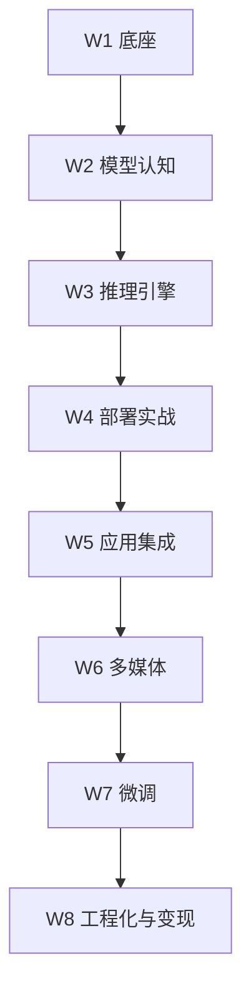

# 8 周学习计划

> [!abstract] 一句话讲清楚
> 这是一张**周级执行表**：每周干什么、交什么、怎么算过关、卡住了翻哪篇。不是能力地图，别拿它当"学习路线"看。

## 为什么重要

- **自学本地部署最常见的死法不是难，是乱**：今天看量化，明天装环境，两周后什么都没跑起来。
- **8 周是一个"能出第一个可演示成果"的周期**：再长容易放弃，再短只能学到皮毛。
- **每周有产出物，学习才有复利**：产出物既是验收，也是你接单时能拿出来的作品。

和 [[学习路线图]] 的区别：路线图告诉你"这条路上有哪几层能力"，这里告诉你"这周做什么、做到什么算完"。

## 核心名词全解

| 名词 | 英文 / 缩写 | 大白话解释 | 容易混淆 / 注意 |
|---|---|---|---|
| 周级执行表 | Weekly Plan | 以周为单位的任务清单，每项都有验收 | 不是能力地图，不做长期规划 |
| 产出物 | Deliverable | 每周结束时手里能拿出来的东西 | 笔记不算产出物，"能演示的东西"才算 |
| 验收标准 | Acceptance Criteria | 判断这周过没过关的具体标准 | 要可观察，不能写"理解原理" |
| 卡点 | Blocker | 让你卡住超过半天的问题 | 卡住不是问题，卡住不换路才是 |
| 最小可运行 | MVP | 能用最少的步骤跑通的那一版 | 不是"最终版"，先跑通再优化 |
| 复现 | Reproduce | 隔天/换机器还能再做一遍 | 只会一次 = 没学会 |
| 项目阶梯 | Project Ladder | 由易到难的项目清单 | 用来练手，不是用来炫技 |
| 时间块 | Time Block | 固定不被打扰的学习时段 | 碎片时间学不了部署这类实操 |
| 复盘 | Retro | 每周花 20 分钟写"哪里卡了、为什么" | 跳过复盘，同样的坑会踩第二次 |
| 能力自检 | Self-check | 用问题检验自己是否真会 | 和"看完笔记"是两回事 |

## 原理与机制

### 为什么是这个顺序

排课逻辑只有一条：**后面的东西依赖前面的东西**。

- 不摸过机器，学显存估算就是背公式；
- 没跑过引擎，看部署流程就是看天书；
- 没部署过服务，做 RAG 一定卡在"连不上模型"；
- 没做出过应用，学微调就不知道微调要解决什么问题。

所以别跳周。想快，就压缩每周的深度，但**顺序不变**。

### 每周的固定节奏

| 时段 | 时长 | 干什么 |
|---|---|---|
| 工作日晚上 | 每天 1~2 小时 | 看当周笔记 + 做小实验 |
| 周末大块 | 4~6 小时 | 把当周产出物做出来、验收、写复盘 |
| 每周固定 20 分钟 | 复盘 | 记录卡点、下周要补什么 |

关键不是总时长，是**周末必须有一次完整的动手**。只看不练，八周后会得到一堆"我好像看过"的错觉。

## 八周总览

| 周 | 主题 | 一句话目标 | 主产出物 |
|---|---|---|---|
| W1 | 打地基 | 有一台自己完全掌控的 Linux 环境 | 能干净重装的环境 + 命令速查 |
| W2 | 模型认知 | 能自己判断"这机器能跑多大模型" | 一页显存/模型选型表 |
| W3 | 推理引擎 | 本机跑起一个 OpenAI 兼容 API | 可调用的本地 API + 首轮压测 |
| W4 | 部署实战 | 完整走一遍交付流程 | 一次完整部署 + 验收清单 |
| W5 | 应用集成 | 做出一个能问答的本地知识库 | RAG demo + 客户端接入 |
| W6 | 生成式多媒体 | 能改、能复用 ComfyUI 工作流 | 3 个可复用工作流 |
| W7 | 微调入门 | 完成一次最小 LoRA 实验 | 微调前后对比报告 |
| W8 | 工程化与变现 | 把能力变成一份能报价的交付包 | 交付包 + 报价方案 |

## 每周详细执行表

### W1 打地基

| 项 | 内容 |
|---|---|
| 目标 | 装好一台 Linux 环境（真机/WSL2/云主机都行），会用命令行完成基本操作 |
| 本周必读 | [[Linux 基础与服务器操作]]、[[Shell 与命令行基础]]、[[硬件基础与 GPU 生态]] |
| 产出物 | ① 能干净重建的环境（记下每一步）② 一页常用命令速查（真的会看的那种） |
| 验收标准 | 不看教程能装好环境；能用命令行看显存、内存、磁盘、进程；重启后环境还在 |
| 卡住看哪篇 | [[Windows 部署要点]]（WSL2 相关）、[[驱动-CUDA-框架版本兼容]] |
| 时间分配 | 工作日 1h × 4 + 周末 5h |

### W2 模型认知

| 项 | 内容 |
|---|---|
| 目标 | 不再"看着参数猜"，能按硬件算模型档位和量化等级 |
| 本周必读 | [[Transformer 架构基础]]、[[参数量与显存估算]]、[[量化技术]]、[[上下文窗口与位置编码]] |
| 产出物 | 一页表：自己的机器 → 可跑模型档位 → 量化选择 → 预期速度量级 |
| 验收标准 | 给一台陌生机器配置，能在 5 分钟内说出"能跑多大、大概多快、几个人用" |
| 卡住看哪篇 | [[Dense 与 MoE 架构]]（搞不清参数怎么算时）、[[模型谱系 Qwen]]（不知道选哪个模型时） |
| 时间分配 | 工作日 1h × 4 + 周末 5h |

### W3 推理引擎

| 项 | 内容 |
|---|---|
| 目标 | 跑起一个真正的本地服务，并且能用 API 调用它 |
| 本周必读 | [[Ollama]]、[[llama.cpp 与 GGUF]]、[[OpenAI 兼容 API 规范]]、[[推理性能指标与调优]] |
| 产出物 | ① 一个跑通的本地 API ② 用 curl 或脚本调用成功的记录 ③ 第一次粗略测速 |
| 验收标准 | 换一台机器能连上（至少局域网）；多轮对话正常；记录下 tokens/s 量级 |
| 卡住看哪篇 | [[推理引擎选型决策树]]（不知道选哪个）、[[N卡 A卡 Mac 平台适配]]（平台问题） |
| 时间分配 | 工作日 1h × 4 + 周末 6h |

### W4 部署实战

| 项 | 内容 |
|---|---|
| 目标 | 按标准流程完整交付一次（客户可以是自己或朋友） |
| 本周必读 | [[本地部署全流程]]、[[部署检查清单]]、[[服务化与 API 鉴权]] |
| 产出物 | ① 一次完整部署 ② 填完的检查清单 ③ 一页使用说明 ④ 压测结论 |
| 验收标准 | 重启机器后服务自动可用；不带 Key 的请求被拒；清单上红线项全过 |
| 卡住看哪篇 | [[Windows 部署要点]] / [[Linux 部署要点]] / [[Mac 部署要点]]、[[模型获取与离线搬运]] |
| 时间分配 | 工作日 1.5h × 4 + 周末 8h（本周是最重的一周） |

### W5 应用集成

| 项 | 内容 |
|---|---|
| 目标 | 把模型接成"对别人有用"的东西：知识库 / 客户端 / 一点 Agent |
| 本周必读 | [[RAG 原理与全链路]]、[[文档解析与切分策略]]、[[Embedding 与向量数据库]]、[[客户端 UI 工具]] |
| 产出物 | ① 一个能回答自己文档问题的本地知识库 demo ② 一段演示录屏 |
| 验收标准 | 能连续回答 5 个基于文档的问题；答不上来时能说"文档里没有"而不是瞎编 |
| 卡住看哪篇 | [[检索与 Rerank]]（答非所问）、[[Dify 平台与工作流]]（不想自己写代码） |
| 时间分配 | 工作日 1h × 4 + 周末 6h |

### W6 生成式多媒体

| 项 | 内容 |
|---|---|
| 目标 | 能跑通并改造 ComfyUI 工作流，知道什么卡能出图/出视频 |
| 本周必读 | [[ComfyUI 核心概念]]、[[ComfyUI 工作流实操]]、[[模型目录与生态]] |
| 产出物 | ① 3 个工作流（基础出图 / 改图 / 一个进阶）② 每个工作流的参数说明 |
| 验收标准 | 能按客户需求改工作流（换模型、调尺寸、加控制），而不只是点"运行" |
| 卡住看哪篇 | [[低显存工作流优化]]（爆显存）、[[ControlNet 与 LoRA]]（效果不受控） |
| 时间分配 | 工作日 1h × 4 + 周末 6h |

### W7 微调入门

| 项 | 内容 |
|---|---|
| 目标 | 完成一次最小可用的 LoRA 实验，知道什么时候该微调、什么时候不该 |
| 本周必读 | [[微调决策与 RAG 取舍]]、[[LoRA 与 QLoRA 原理]]、[[训练数据工程]]、[[训练监控与评估]] |
| 产出物 | ① 一小份训练数据 ② 一次 LoRA 训练 ③ 前后效果对比报告（含失败案例） |
| 验收标准 | 能说清"微调解决了什么、没解决什么"，并诚实记录掉点和失败 |
| 卡住看哪篇 | [[微调框架生态]]（框架装不上）、[[训练超参数]]（loss 不降） |
| 时间分配 | 工作日 1h × 4 + 周末 6h |

### W8 工程化与变现

| 项 | 内容 |
|---|---|
| 目标 | 把前七周的成果打包成"能卖的东西" |
| 本周必读 | [[交付 SOP 与报价]]、[[容器化部署]]、[[远程交付与远程运维]]、[[高频咨询问题与话术]] |
| 产出物 | ① 一份完整交付包（流程 + 清单 + 文档模板 + 报价单）② 一次模拟客户沟通录音/文字稿 |
| 验收标准 | 能在 15 分钟内给一个陌生客户讲清"我能帮你做什么、怎么收费、多久交付" |
| 卡住看哪篇 | [[安全与合规]]（客户问隐私）、[[常见误区]]（被自己绕进去） |
| 时间分配 | 工作日 1h × 4 + 周末 6h |

## 决策点

- **岔路口 1：时间不够，能不能压缩？**
  现象：两周只能学一周的量。判断依据：**顺序不能动，深度可以降**。推荐：**延长时间而不是跳周**（8 周不成变 10~12 周）。代价：见效慢，但基础扎实，后面接单不慌。
- **岔路口 2：环境搭不起来，卡了三天怎么办？**
  现象：驱动/容器/网络反复失败。判断依据：**是环境问题还是能力问题**。推荐：**换一台云主机或另一台机器先跑通流程**，把环境问题单独记下来后面回头解决。代价：花一点钱，但保住了学习节奏。
- **岔路口 3：要不要先补数学和 Transformer 细节？**
  现象：看架构笔记头大。判断依据：**目标是交付还是研究**。推荐：**先学"够用的认知"（显存、量化、上下文），数学等真需要再补**。代价：某些调优场景理解会浅，但不影响接第一批单。
- **岔路口 4：W5 之后要不要先接单？**
  现象：有朋友说"帮我搞一个"。判断依据：**有没有能演示的成果 + 能不能兜住售后**。推荐：**W5 之后可以接"小而明确"的单，W8 之后才接需要长期维护的单**。代价：太早接单，售后会吃掉你所有学习时间。
- **岔路口 5：每周产出物做不完怎么办？**
  现象：周末只有半天。判断依据：**产出物是"能演示"还是"能完美"**。推荐：**做简化版，但一定要能演示**。代价：作品不精致，但保住了进度和信心。

## 关键参数（时间配置）

| 参数 | 作用 | 建议 | 注意 |
|---|---|---|---|
| 每日学习时长 | 保证连续性 | 1~1.5 小时 | 少于 30 分钟只够刷笔记 |
| 每周动手次数 | 保证熟练度 | 至少 2 次 | 只在周末动手，平时会忘 |
| 周末大块时长 | 做产出物 | 4~8 小时 | 拆成两段，中间休息 |
| 复盘时间 | 防止重复踩坑 | 每周 20~30 分钟 | 不写复盘等于没学 |
| 项目练习占比 | 防止"只会看" | 全程不低于 40% | 第五周后应更高 |
| 缓冲周 | 防止整体崩盘 | 每 4 周留 2~3 天 | 计划排太满一定断 |

## 常见坑与误区

| 现象 | 原因 | 对策 |
|---|---|---|
| 计划很好，第二周就断 | 排太满，没有缓冲 | 每天留 1 天机动；断一天不算失败，别整周放弃 |
| 笔记记了十几页，一个服务没跑起来 | 输入太多、动手太少 | 每周必须先交产出物，再补笔记 |
| 反复换模型、换工具，什么都没深入 | 追新，没有验收标准 | 每周锁死一个工具，跑通再说 |
| 卡在一个报错上一周 | 不肯换路 | 卡住超过半天就换方案：换机器、换引擎、换教程 |
| 学完就忘 | 没有复现和复盘 | 隔三天再从头做一遍，不看书 |
| 只学技术，不敢跟客户说话 | 缺少话术练习 | W8 前至少做 3 次模拟沟通，背下来常用回答 |
| 一做项目就想做"完美版" | 没区分 MVP 和成品 | 先做能演示的最小版本，再迭代 |

## 自检问题

- [ ] 为什么顺序不能跳？说出至少两条依赖关系。
- [ ] 你现在处于第几周？上周的产出物是什么、在哪？
- [ ] 如果这周只能学 2 小时，你会砍掉什么、保留什么？
- [ ] 卡住超过半天，你的判断标准是什么？
- [ ] 八周结束时，你手里应该有哪几样能拿给客户看的东西？
- [ ] 你的验收标准里，哪一条最容易自欺欺人？
- [ ] 这个计划你打算怎么调成适合自己的版本？

## 自检问题参考答案

> [!success]- 1. 为什么顺序不能跳？说出至少两条依赖关系。
> 不摸过机器，学显存估算就是背公式；没跑过引擎，看部署流程就是看天书。
> 再往后：没部署过服务，做 RAG 一定卡在"连不上模型"；没做出过应用，学微调就不知道它要解决什么问题。所以顺序不动，只压缩深度。

> [!success]- 2. 你现在第几周？上周产出物是什么、在哪？
> 自查方法：能不能不看书把上周的产出物重做一遍，能不能直接指出它存在哪个目录。
> 说不出来就退回上一周补，别用"我看过"糊过去；每周的验收标准本来就是能演示、能复现。

> [!success]- 3. 如果这周只能学 2 小时，砍掉什么、保留什么？
> 砍输入、保动手：少看两篇笔记，但要把当周产出物的最小可演示版本做出来，而不是等完美了再动手。
> 因为认知可以后补，手感断了就得重来；两小时就专注"跑通"这一件事，其余挪到缓冲时间。

> [!success]- 4. 卡住超过半天，判断标准是什么？
> 半天内没有任何进展（不是"没做完"，是"完全推不动"），并且已经换过一次查资料的方式，就算卡住。
> 卡住就换路：换机器、换引擎、换教程，把问题记进复盘单独处理，别用一周时间跟一个报错较劲。

> [!success]- 5. 八周结束时，手里应该有哪几样能拿给客户看的东西？
> 本地 API 服务、一次完整部署的验收清单、一个知识库 demo、可复用工作流、微调前后对比报告，再加一份交付包和报价方案。
> 它们共同证明"我能从零跑通并交付"，比证书和笔记有说服力得多。

> [!success]- 6. 你的验收标准里，哪一条最容易自欺欺人？
> "理解了原理"这类写不出来的标准最容易骗自己；合格的写法必须可观察，比如"不看教程能重装"、"换台机器能连上"。
> 自检方式就是让产出物替你说话：拿不出东西，就是没过。

> [!success]- 7. 这个计划你打算怎么调成适合自己的版本？
> 保留顺序和每周产出物，只调深度和时间：有基础就压缩前两周，没时间就拉长到十到十二周。
> 每周留缓冲，中断一天不算失败；唯一不能改的是"周末必须有一次完整动手"，这是底线。

## 相关笔记

- 上游：[[学习路线图]]
- 上游：[[技能栈总览 MOC]]
- 下游：[[项目阶梯与实战清单]]
- 对照：[[能力自检清单]]
- 跨领域：[[部署检查清单]]
- 跨领域：[[交付 SOP 与报价]]
- 返回：[[学习与自检 MOC]]

## 交付视角（对客户怎么讲）

- 别说"我在按计划学习"，要说"我有标准的八周落地路径，交付按周推进"，把学习计划翻译成项目排期。
- 客户问"你做过什么"：拿每周产出物当作品集——本地 API、知识库 demo、工作流、对比报告，比证书有用。
- 报价时用周为单位的排期更可信，但**对客户只报里程碑，不报你个人的学习进度**。
