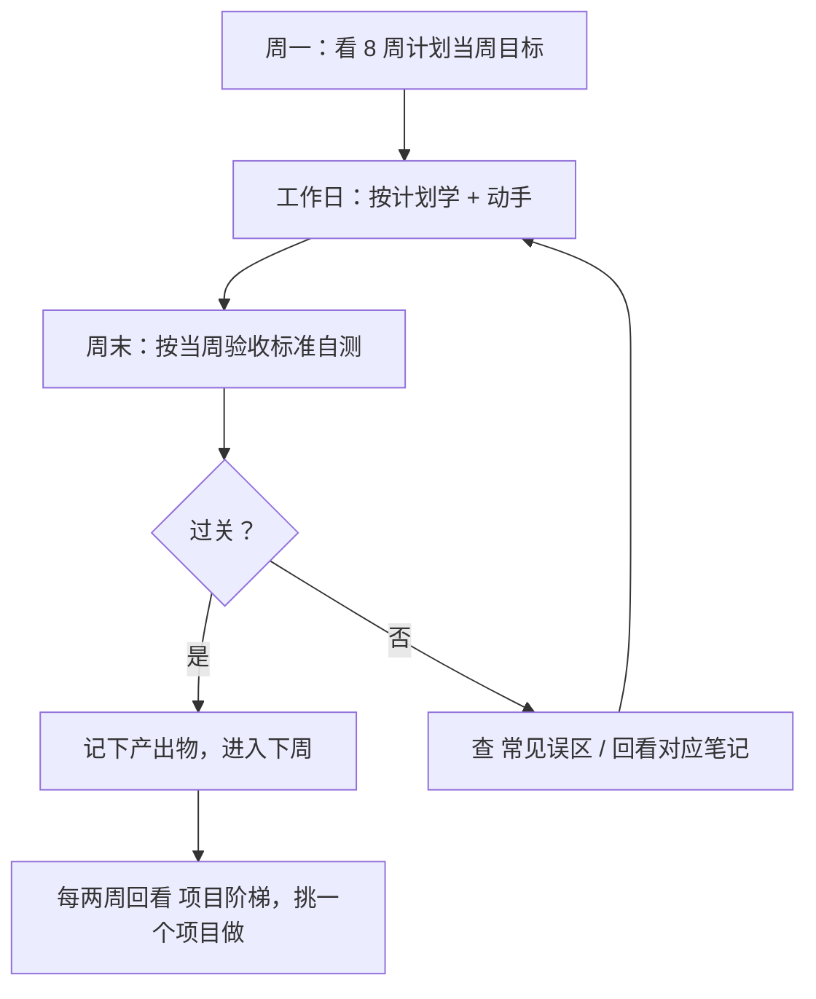

# 学习与自检 MOC

> [!abstract] 一句话讲清楚
> 技术怎么学、怎么练、怎么跟客户说、哪些坑别踩——这四件事决定你**能不能把技能变成单子**，而技术本身只是入场券。

## 这个领域的定位

- **它不教技术本身**，教的是"用技术的姿势"：学习节奏、项目顺序、话术、避坑。
- **上游**：整座知识库的技术内容（01~08）。
- **下游**：你的第一个付费单、第一份报价、第一次远程交付。

说白了：01~08 是"会什么"，这里管的是"怎么变现"。

## 五篇笔记怎么用

| 笔记 | 什么时候看 | 解决什么问题 |
|---|---|---|
| [[8 周学习计划]] | **开始学之前**看一遍，然后每周一翻当周 | 每周干什么、产出什么、卡住找哪篇 |
| [[项目阶梯与实战清单]] | 学完前三周开始动手时 | 做什么项目、做到什么程度算过关 |
| [[高频咨询问题与话术]] | 接第一个咨询前 | 客户问的那些问题怎么答、哪些话不能说 |
| [[常见误区]] | 卡住/想放弃/被客户投诉时 | 你正在犯哪个错、正确的理解是什么 |
| [[学习与自检 MOC]] | 你自己 | 全局导航 |

## 核心名词全解（8 个就够看懂这个领域）

| 名词 | 英文/缩写 | 大白话解释 | 容易混淆/注意 |
|---|---|---|---|
| 能力地图 | Capability Map | 按阶段列出"会什么"的路线图 | 只告诉你方向，不告诉你今天干嘛 |
| 周级执行表 | Weekly Plan | 每周目标、产出物、验收标准 | 和路线图是两回事，别混用 |
| 产出物 | Deliverable | 能拿给别人看的东西：服务、截图、文档 | "我看完了"不算产出物 |
| 验收标准 | Acceptance Criteria | 自己给自己定的过关线 | 定得太软，学习会变成"看过=会了" |
| 刻意练习 | Deliberate Practice | 卡在舒适区边缘、有反馈的重复练习 | 不是"多跑几遍教程" |
| 项目阶梯 | Project Ladder | 由易到难的项目清单 | 跳级等于自找挫败 |
| 话术 | Talk Track | 面对客户问题的标准答法 | 不是背稿，是讲清边界 |
| 演示能力 | Demoable Skill | 能当场演示给别人看的能力 | 只有"理解"不算 |

## 推荐使用节奏

- **每周验收不要跳过**：没有验收，学习会变成"看过 = 会了"。
- **卡住超过半天就换资料**：先把当周目标跑通，细节后面补，别在一篇笔记里死磕。
- **每学到能演示的程度，就用项目阶梯里的项目练手**：能演示的技能才是能卖钱的技能。

## 三条学习原则

1. **先跑通再理解**：本地部署这种技能，先让它跑起来，再回头补原理，效率高得多。
2. **以"能交付"为终点**：学完每块内容，问自己"这块能做成什么交付物"，而不是"我记住几个名词"。
3. **记录一切**：命令、参数、报错、解决过程。三个月后你会感谢现在的自己，这些记录也是你和客户沟通的底气。

## 和 [[学习路线图]] 的分工

- [[学习路线图]]：**能力地图**——告诉你这条路上有哪些能力阶段、每阶段要会什么。
- [[8 周学习计划]]：**周级执行表**——告诉你这一周具体干什么、交什么、怎么算过关。

地图看方向，计划管执行。别拿计划当路线图，也别指望路线图告诉你今天干嘛。

## 决策点：学习路上的三个岔路口

- **现象**：这周计划没完成，想"下周一起补"｜**判断依据**：欠的是动手产出还是阅读｜**推荐**：砍阅读，保留下周要用的动手产出｜**代价**：知识有缺口，但技能链不断。
- **现象**：卡在一个报错上超过半天｜**判断依据**：是否卡住当周的验收标准｜**推荐**：先用最小可行方案跑通，把报错记进排错记录｜**代价**：问题暂时绕过，后面要补。
- **现象**：学了两三个月还不敢接单｜**判断依据**：手上有几个能演示的项目｜**推荐**：先做完本地 API + 多引擎对比两个项目并录屏｜**代价**：多花一两周，但咨询时有作品可给。
- **现象**：客户问题当场答不上来｜**判断依据**：是技术不确定还是边界不敢承诺｜**推荐**：说"我确认后 24 小时内回复"，然后给书面答复｜**代价**：当场显得不专业，但长期更可信。

## 相关笔记

- 上游：[[技能栈总览 MOC]]
- 上游：[[学习路线图]]
- 对照：[[能力自检清单]]
- 跨领域：[[交付 SOP 与报价]]
- 跨领域：[[排错方法论]]
- 返回：[[技能栈总览 MOC]]

## 交付视角（对客户怎么讲）

- 别把"我在学习"露给客户。客户买的是结果，不是你的成长过程；不确定的就说"我确认后回复你"。
- 用"我有一套标准的部署流程和验收清单"来建立专业感，比说"我学过很多"有用得多。
- 第一批客户大概率来自你已有的圈子：能演示的项目越多，成交越快。
