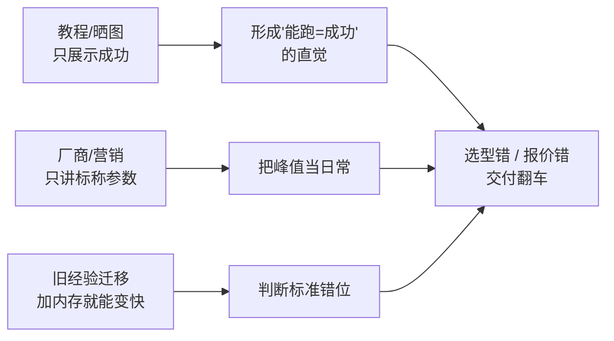

# 常见误区

> [!abstract] 一句话讲清楚
> 本地部署最容易犯的错不在技术细节，而在**判断标准错了**——把"能跑"当成功，把"参数量"当能力，把"标称参数"当实际性能。这篇把 17 个高频误区一条条拆开。

## 为什么重要

- **误区不纠正，学得越多越自信地错**：你会拿错误的判断标准去选型、给客户报价、解释现象。
- **这些误区全是从"演示能跑"到"客户现场能用"之间的坑**：踩中的代价往往是重做。
- **每个误区背后都有一个可以量化的真相**：这篇不只说"你错了"，还给判断依据。

## 核心名词全解

| 名词 | 英文 / 缩写 | 大白话解释 | 容易混淆 / 注意 |
|---|---|---|---|
| 误区 | Misconception | 看起来合理、实际不成立的判断 | 不等于"不懂"，往往是"懂一半" |
| 演示环境 | Demo Setup | 单人、短时、理想条件下的跑通 | 和客户生产环境差很远 |
| 显存 | VRAM | 显卡上专属的高速内存 | 和系统内存不是一回事，不能简单相加 |
| 量化 | Quantization | 用更低精度存权重，换更低占用 | 掉不掉质量取决于方法和模型 |
| 上下文窗口 | Context Window | 模型一次能"看到"的 token 上限 | 标称值和有效利用长度不是一回事 |
| 幻觉 | Hallucination | 模型编造看似合理的内容 | 采样温度低也会发生，根源不在这里 |
| 吞吐 | Throughput | 单位时间处理多少 token / 请求 | 和"在线人数"没有固定换算 |
| 微调 | Fine-tuning | 用数据继续训练，改变模型行为 | 不擅长"灌知识"，灌知识首选 RAG |
| 评估 | Evaluation | 用固定任务和指标量化效果 | 没有评估就没有"好坏"，只有感觉 |
| 幸存者偏差 | Survivorship Bias | 只看到成功案例，看不到失败案例 | 教程/晒图天然偏向成功者 |

## 原理与机制：误区是怎么形成的

三个来源：**信息只展示结果、参数只给峰值、经验跨场景硬套**。识别误区的方法很统一：追问"这个结论在什么条件下成立、有没有反例、怎么验证"。

下面的 17 条按"选型 → 部署 → 效果 → 交付"排列。

## 误区逐条拆解

### 误区 1：参数越大越好，70B 一定比 8B 强

> **误区表述**："能上 70B 就上 70B，参数大肯定更聪明。"

**为什么错**：参数量只决定"上限潜力"，实际表现还取决于训练数据、对齐质量、量化精度和你的任务类型。大模型在小显存上只能低量化或部分放内存，速度和质量双降；很多垂直任务上，小模型 + 好提示词 + 检索比大模型裸跑更准。

**正确理解**：按"任务难度 + 显存 + 延迟要求"选，不是按参数量排名选。先跑同一批真实问题对比，再决定。

→ 对应笔记：[[参数量与显存估算]]、[[Dense 与 MoE 架构]]

### 误区 2：模型能启动 = 部署成功

> **误区表述**："命令行里能对话了，部署就算完成了。"

**为什么错**：能启动只是"权重加载成功"。部署成功还包括：稳定服务化、开机自启、异常重启、鉴权、日志、压测、监控、验收。演示环境单请求正常，不代表并发时不 OOM、不超时。

**正确理解**：用验收标准定义"完成"——谁能访问、并发多少、延迟多少、出错怎么办、日志在哪。跑通是第一步，不是最后一步。

→ 对应笔记：[[部署检查清单]]、[[本地部署全流程]]

### 误区 3：显存不够就加内存条

> **误区表述**："显存满了就加大内存，反正都是内存。"

**为什么错**：GPU 计算必须把数据放进显存，系统内存只能当"仓库"。显存不够时要么把部分权重放内存（速度掉一个量级），要么靠内存交换（更慢）。加内存条能让"不崩"，但救不了速度。

**正确理解**：先算权重需要多少显存，再留出 KV Cache 和运行时开销；不够就降量化、换小模型、缩短上下文，而不是加内存条。

→ 对应笔记：[[参数量与显存估算]]、[[量化技术]]

### 误区 4：量化到 4bit 质量基本不掉

> **误区表述**："4bit 量化几乎无损，显存直接省一半多。"

**为什么错**：掉不掉取决于量化方法、模型规模和任务。低比特量化对简单对话影响小，对代码、数学、长推理、多语言任务影响明显；极端量化还可能破坏格式遵循能力。

**正确理解**：量化是"用质量换资源"的工程取舍，必须用自己的任务集对比。对精度敏感的任务，宁可换小一号模型也不要极限量化。

→ 对应笔记：[[量化技术]]、[[llama.cpp 与 GGUF]]

### 误区 5：标称 128K 上下文，就能塞 128K 内容

> **误区表述**："它支持 128K，我把整本手册丢进去就行。"

**为什么错**：标称窗口是"能接收"的上限，不等于"能有效利用"。长上下文中间部分容易被忽略（常说的"中间遗忘"），且长上下文会显著吃显存和拖慢速度。

**正确理解**：长文档先切分、检索、重排，只把相关片段喂进去。上下文是稀缺资源，不是垃圾桶。

→ 对应笔记：[[上下文窗口与位置编码]]、[[文档解析与切分策略]]

### 误区 6：本地部署 = 绝对安全

> **误区表述**："数据都在我们自己的机器上，绝对安全。"

**为什么错**：本地部署只去掉了"数据传给第三方"这一环。内部人员访问、日志留存、端口暴露公网、模型服务无鉴权、备份泄露，都是真实风险。很多事故不是外部攻击，是配置疏忽。

**正确理解**：安全 = 网络隔离 + 鉴权 + 日志审计 + 权限最小化，四件事一起做。说"数据不出内网"可以，说"绝对安全"不行。

→ 对应笔记：[[服务化与 API 鉴权]]、[[安全与合规]]

### 误区 7：答不准就微调

> **误区表述**："模型不懂我们公司的业务，微调一下就好了。"

**为什么错**：微调擅长改"说话方式、输出格式、任务习惯"，不擅长灌入事实知识——知识容易记不牢、更新还要重训、还容易放大幻觉。大部分"不懂业务"的需求，本质是"缺资料检索"。

**正确理解**：先 RAG（把资料喂给它查），只有当"回答格式/语气/任务流程"不满足时才考虑微调。顺序反了会白花很多钱。

→ 对应笔记：[[微调决策与 RAG 取舍]]、[[RAG 原理与全链路]]

### 误区 8：Ollama 跑得通，生产也能直接用

> **误区表述**："Ollama 一行命令就能跑，直接用就行了。"

**为什么错**：Ollama 面向本地体验，默认配置不是为高并发设计的；并发上来后排队、超时、显存打满都会出现。生产还需要鉴权、监控、限流、灰度，这些它默认不管。

**正确理解**：Ollama 适合个人和轻量场景；多人并发、要求稳定延迟时，要评估 vLLM 一类面向服务的引擎，或者至少加上网关和限流。

→ 对应笔记：[[Ollama]]、[[vLLM]]、[[推理引擎选型决策树]]

### 误区 9：Mac 上用 Docker 就能吃到 GPU 加速

> **误区表述**："Mac 装个 Docker 跑模型，跟 Linux 一样。"

**为什么错**：容器在 macOS 上拿不到 Metal GPU 加速，模型只能跑在 CPU 上，速度和原生方案差一个量级。Mac 的算力来自统一内存 + Metal，需要用原生框架（MLX / llama.cpp 的 Metal 后端 / Ollama 原生）。

**正确理解**：Mac 上别绕容器，走原生安装。要容器化就上 Linux 服务器。

→ 对应笔记：[[Mac 部署要点]]、[[MLX 与 Apple 芯片推理]]

### 误区 10：模型答得好 = 任务能交付

> **误区表述**："我测了十几个问题，答得都不错，可以交付了。"

**为什么错**："答得好"是你的主观感觉，不是可验收的指标。交付要面对：真实用户千奇百怪的问法、错误答案怎么兜底、响应超时怎么提示、出了错谁的锅。

**正确理解**：交付前要有一套评估集（典型问题 + 边界问题 + 陷阱问题）和兜底策略（不知道就说不知道、给引用、转人工）。

→ 对应笔记：[[RAG 评估与调优]]、[[部署检查清单]]

### 误区 11：跑分高的模型最适合我

> **误区表述**："这个模型 benchmark 第一，肯定选它。"

**为什么错**：榜单考的是通用能力，你的任务是具体的（客服、合同、代码、工单）。榜单还可能被针对性优化、数据污染影响。跑分高但中文口语差、格式遵循差的模型很常见。

**正确理解**：榜单用来缩小候选范围，最终一定用自己的 30~50 条真实问题做小规模对比，看准确率、格式、速度、成本。

→ 对应笔记：[[模型谱系 Qwen]]、[[推理性能指标与调优]]

### 误区 12：换模型就是换个文件，不用重测

> **误区表述**："新模型直接替换，架构不变，应该没问题。"

**为什么错**：新模型的格式、上下文长度、显存需求、chat 模板、采样建议都可能变。硬换会出现：启动失败、输出格式乱、显存爆、速度掉、原来能答的答不出了。

**正确理解**：换模型是"发版"，要走流程：更新镜像/权重 → 改配置 → 跑评估集 → 压测 → 灰度 → 回滚预案。

→ 对应笔记：[[模型获取与离线搬运]]、[[容器化部署]]

### 误区 13：并发数 = 在线人数

> **误区表述**："公司 100 人，买能支持 100 并发的配置就行。"

**为什么错**：100 人不会同时提问。真实并发是"每秒多少请求 + 每个请求多长"，取决于使用习惯、是否流式、有没有排队。按人数买配置，要么浪费要么打脸。

**正确理解**：用压测得到"P95 延迟在可接受范围内能扛多少 QPS"，再反推能支持多少人用。

→ 对应笔记：[[推理性能指标与调优]]、[[性能调优清单]]

### 误区 14：温度调低就不会胡说

> **误区表述**："把 temperature 设成 0，它就不会编了。"

**为什么错**：幻觉的根源是模型在不知道时仍会生成最可能的词，不是采样随机性。调低温度只是减少多样性，反而可能让它更"自信地"重复错误答案。

**正确理解**：抗幻觉靠三件事：检索到可靠资料、提示词要求"无依据就说不知道并给引用"、事后校验/人工兜底。

→ 对应笔记：[[采样参数与解码策略]]、[[提示词与上下文工程]]

### 误区 15：部署完就没事了

> **误区表述**："交付那天跑通，后面就不用管了。"

**为什么错**：模型服务是长期运行的系统：显存泄漏、磁盘写满、驱动更新、模型下线、业务量增长、安全补丁，都会让"当初好好的"变成"现在不可用"。没有监控就是出事才知道。

**正确理解**：交付即运维起点。要有健康检查、日志、告警、备份、升级流程和明确的责任边界。

→ 对应笔记：[[监控与日志]]、[[远程交付与远程运维]]

### 误区 16：开源模型 = 可以随便商用

> **误区表述**："都是开源的，拿去给客户用肯定没问题。"

**为什么错**："开源"指代码可获取，不等于许可证允许任意商用。不同模型许可证差异很大，有的限制商用、有的有用户量门槛、有的对输出有额外要求。给客户交付时这是法律风险。

**正确理解**：选型阶段就核对 LICENSE 与商用条款，拿不准就换许可证更宽松的模型，或让客户书面确认。

→ 对应笔记：[[开源许可证与合规]]、[[模型谱系 GLM 与 Gemma]]

### 误区 17：照着教程跑通 = 具备交付能力

> **误区表述**："教程我全程跑通了，接单没问题。"

**为什么错**：教程是删掉所有意外的"理想路径"：没有驱动冲突、没有内网限制、没有奇怪的硬件、没有客户改需求。交付能力 = 排错能力 + 沟通能力 + 验收能力，教程只训练了第一步。

**正确理解**：把教程在自己的机器上"故意跑坏"再修回来，做几个完整的项目闭环（含文档和验收），再谈接单。

→ 对应笔记：[[项目阶梯与实战清单]]、[[排错方法论]]

## 决策点：判断一个说法可不可信

- **岔路口 1：有人告诉你"某配置能跑某模型"。**
  判断依据：有没有说量化、上下文、并发、速度。推荐：**要四个条件，缺一个就当广告**。代价：显得较真，但少踩坑。
- **岔路口 2：看到"某模型碾压另一模型"的对比。**
  判断依据：谁做的、用什么题、有没有原始数据。推荐：**只看能不能复现，不能就忽略**。代价：放弃一些热闹信息。
- **岔路口 3：客户说"网上说 8G 就能跑"。**
  判断依据：那个"能跑"的定义是什么。推荐：**当场演示并解释差距**，把预期拉回现实。代价：可能显得不如"别人"厉害。
- **岔路口 4：旧经验与新场景冲突（比如 Mac 上照 Linux 教程操作）。**
  判断依据：平台有没有相同机制。推荐：**先查平台差异再动手**。代价：多花十分钟，省几小时。

## 关键参数（判断信息质量）

| 维度 | 说明 | 可信的信号 | 危险信号 |
|---|---|---|---|
| 条件完整度 | 有没有说清量化、上下文、并发 | 条件齐全、有边界 | 只说"能跑" |
| 数据来源 | 是实测还是转述 | 有原始日志/截图/脚本 | "据说""大家都说" |
| 可复现性 | 别人能不能照着做出来 | 给了版本和步骤 | 关键步骤跳过 |
| 时间戳 | 信息是否过期 | 近期、注明版本 | 两年前的教程 |
| 利益关系 | 说这话的人得到什么 | 中立对比 | 卖硬件、卖课、卖服务 |
| 反例 | 有没有人做失败过 | 提到失败案例 | 全是成功故事 |

## 常见坑与误区（元层面）

| 现象 | 原因 | 对策 |
|---|---|---|
| 学了半年还是不敢接单 | 一直在看教程，没做完整闭环 | 按项目阶梯强制产出 |
| 每次换机器都要重新踩一遍 | 没有记录环境和排错过程 | 建自己的排错记录和 checklist |
| 客户问细节就慌 | 只记结论没记依据 | 每个结论都追问"为什么" |
| 被"最新最强"追着跑 | 把选型当追新 | 定好评估集，新模型先跑分再说 |
| 报价总是偏低 | 只算了动手时间，没算沟通/文档/返工 | 用交付 SOP 拆工作项 |
| 一出问题就想重装 | 不会定位就推倒重来 | 先分层排查：硬件→驱动→引擎→模型→应用 |

## 自检问题

- [ ] 你能说出"部署成功"的三个可验收标准吗？
- [ ] 为什么"显存不够加内存条"是错的？
- [ ] 什么情况下该微调、什么情况下该做 RAG？
- [ ] 标称上下文窗口和有效利用长度差在哪？
- [ ] 客户说"网上说 8G 能跑"，你怎么回应？
- [ ] 判断一个技术说法可信，你会问哪四个问题？
- [ ] 你自己踩过上面哪几条误区？现在怎么避免？

## 自检问题参考答案

> [!success]- 1. 你能说出"部署成功"的三个可验收标准吗？
> 三个：重启机器后服务自动可用；不带 Key 或错 Key 的请求被拒；压测给出的并发范围内 P95 延迟可接受。
> 共同点是都能现场演示、能留下记录，而不是"我觉得没问题"。

> [!success]- 2. 为什么"显存不够加内存条"是错的？
> GPU 计算要求数据先进显存，系统内存只能当仓库，加内存条救不了计算时的显存缺口。
> 显存不够该做的是降量化、换小模型、缩短上下文；硬撑的结果是部分权重走内存，速度掉一个量级。

> [!success]- 3. 什么情况下该微调、什么情况下该做 RAG？
> 缺事实知识、资料经常更新、需要给出处，先做 RAG：把资料检索出来喂给模型。
> 要改说话方式、输出格式、任务流程和语气，才考虑微调；顺序反了容易白花钱还解决不了问题。

> [!success]- 4. 标称上下文窗口和有效利用长度差在哪？
> 标称窗口是"能接收"的上限，不保证中间内容被用上；长文里中段容易被忽略，还会显著吃显存、拖慢速度。
> 所以长文档要先切分、检索、重排，只把相关片段喂进去——上下文是稀缺资源，不是垃圾桶。

> [!success]- 5. 客户说"网上说 8G 能跑"，你怎么回应？
> 先接住："能跑是真的，但要问怎么跑"——什么量化、多长上下文、几个人同时用、速度多少。
> 然后当场演示或给出数据，把"能加载"和"能日常用"的差距讲清楚，把预期拉回现实，避免交付后扯皮。

> [!success]- 6. 判断一个技术说法可信，你会问哪四个问题？
> 条件全不全（量化、上下文、并发、速度）、数据是实测还是转述、步骤能不能复现、信息有没有过期。
> 再加一条：说这话的人有没有利益关系、有没有失败反例；缺条件的结论一律先当广告处理。

> [!success]- 7. 你自己踩过上面哪几条误区？现在怎么避免？
> 最常见的是"能启动等于部署成功"和"答得好就能交付"，本质都是拿演示标准当生产标准。
> 现在用两张清单卡住：交付前过部署检查清单，效果用真实问题集跑一遍，拿不出证据就不算过。

## 相关笔记

- 上游：[[学习与自检 MOC]]
- 相关：[[高频咨询问题与话术]]
- 相关：[[项目阶梯与实战清单]]
- 跨领域：[[参数量与显存估算]]
- 跨领域：[[量化技术]]
- 跨领域：[[微调决策与 RAG 取舍]]
- 跨领域：[[部署检查清单]]
- 返回：[[技能栈总览 MOC]]

## 交付视角（对客户怎么讲）

- 误区不是"丢人的事"，主动告诉客户常见坑，反而显得专业。比如："很多方案说 8G 能跑 70B，能跑和好用差很远，我们会先给你演示实际速度。"
- 客户最容易被"参数大、跑分高、开源免费"三个词带偏。你的价值就是帮他把这三个词翻译成"在你场景下表现如何、成本多少、风险在哪"。
- 把自己的误区清单变成交付前的自检项，每一单都过一遍——这比任何话术都更能减少返工。
