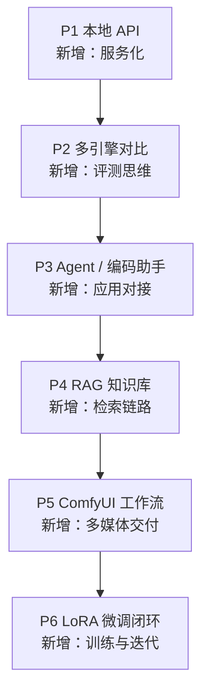

# 项目阶梯与实战清单

> [!abstract] 一句话讲清楚
> 六个由易到难的项目，每上一个台阶只加一个"新能力"。做完就有六件能演示、能写进简历、能拿去接单的作品。

## 为什么重要

- **只看笔记不练，等于不会**：本地部署这行，面试/接单时没人考你名词，都问"你做过什么"。
- **项目顺序错了会反复受挫**：一上来做 RAG，先被环境问题卡三天，信心没了。
- **每个项目都要"能演示"**：演示是技能变现的最小单位，不是"我懂原理"。

这六件事全部围着"交付"设计：每个项目都要求你**从零跑通 + 能讲清 + 能复现**。

## 核心名词全解

| 名词 | 英文 / 缩写 | 大白话解释 | 容易混淆 / 注意 |
|---|---|---|---|
| 项目阶梯 | Project Ladder | 按能力依赖排好顺序的项目清单 | 不是随便挑喜欢的做，顺序有意义 |
| 端到端 | End-to-End | 从输入到输出整条路都自己跑通 | 只跑通中间一段不算 |
| 基线 | Baseline | 对比实验的"参照物" | 没有基线，就没法说"我的方案更好" |
| 对比评测 | Benchmark / A-B Test | 固定题目、固定条件，比两种方案 | 条件不一致的对比等于没比 |
| 闭环 | Closed Loop | 数据 → 训练/配置 → 部署 → 验证，能回到起点 | 只训不部署不叫闭环 |
| 可复现 | Reproducible | 换台机器、隔一周还能做出同样结果 | 靠"我记得当时点了那个"不算 |
| 作品集 | Portfolio | 能给人看的成果集合 | 截图不算，能现场演示才算 |
| 验收 | Acceptance | 判断项目做完没有的标准 | 要可观察、可量化，不能"感觉可以" |
| 最小可行 | MVP | 用最少工作做出能演示的版本 | 先做出来，再做好 |
| 演示脚本 | Demo Script | 演示时按顺序说什么、点什么 | 临场发挥的演示必翻车 |

## 原理与机制

### 六个项目，六个新增能力

每个项目只在上一级基础上**加一个维度**，不要同时加两个。比如 P4 已经够复杂了，就别同时要求自己把 P4 做成 SaaS。

### 每个项目的通用验收框架

做完任何一个项目，都用这四个问题验收：

1. **能演示吗**：陌生人坐你旁边，你能在 10 分钟内跑一遍并讲清每一步？
2. **能复现吗**：换台机器（或重装）还能做出来？
3. **能解释吗**：为什么这么选、哪里会崩、崩了怎么办？
4. **有记录吗**：命令、参数、报错、解决过程是否留下？

四个都过，这个项目才算"做完"，否则只是"试过"。

## 六个项目总览

| 项目 | 难度 | 前置 | 预计投入 | 核心产出 |
|---|---|---|---|---|
| P1 本地 API 服务 | 入门 | W1~W3 | 3~6 小时 | 一个可调用的本地接口 |
| P2 多引擎对比评测 | 进阶 | P1 | 1~2 天 | 一份对比报告 |
| P3 接入 Agent / 编码助手 | 进阶 | P1 | 半天~1 天 | 一个能干活的工作流 |
| P4 本地 RAG 知识库 | 进阶 | P1 | 2~4 天 | 一个能回答文档问题的应用 |
| P5 ComfyUI 工作流交付 | 进阶 | 基础出图能力 | 2~3 天 | 3 个可复用工作流 |
| P6 LoRA 微调闭环 | 高级 | P4 或明确场景 | 3~5 天 | 一次完整微调对比报告 |

## P1 本地 API 服务

| 项 | 内容 |
|---|---|
| 目标 | 在自己机器上跑起一个模型服务，能被别的程序调用 |
| 步骤 | ① 选引擎（Ollama 最快）② 拉一个适合硬件的模型 ③ 起服务并监听局域网 ④ 用命令行发请求 ⑤ 记录参数和测速 |
| 验收 | 另一台设备能连上；多轮对话正常；能说出首字延迟和生成速度的量级 |
| 简历产出 | "独立完成本地大模型服务部署，提供 OpenAI 兼容接口，支持局域网多设备接入" |
| 容易翻车 | 只监听本机、模型格式不对、上下文设太大导致慢 |

## P2 多引擎对比评测

| 项 | 内容 |
|---|---|
| 目标 | 用同一批题目、同样条件，对比至少两个引擎/两个模型的效果与速度 |
| 步骤 | ① 固定 10~20 道真实题目 ② 固定参数（温度、上下文）③ 分别跑两个方案 ④ 记录速度、显存、失败情况 ⑤ 写结论：什么场景选谁 |
| 验收 | 有对比表；结论里每句话都有数据支撑；能指出对比中的不公平因素 |
| 简历产出 | "完成本地推理引擎横向评测，输出选型建议报告，覆盖速度/显存/稳定性三类指标" |
| 容易翻车 | 两个方案的参数不一致（温度、上下文不同），结论不成立 |

## P3 接入 Agent / 编码助手

| 项 | 内容 |
|---|---|
| 目标 | 让本地模型真正"干活"，而不是只聊天 |
| 步骤 | ① 选一个客户端（编码助手或 Agent 框架）② 配置 API 地址和模型名 ③ 给它工具/文件权限 ④ 完成一个真实小任务 ⑤ 记录失败案例 |
| 验收 | 完成一个你原本要手动做的事（如批量改文件、查资料整理）；能说清它的能力边界 |
| 简历产出 | "将本地模型接入编码助手与工具调用链路，实现离线环境下的代码辅助工作流" |
| 容易翻车 | 模型不支持工具调用却硬配、上下文太短导致任务中途失忆 |

## P4 本地 RAG 知识库

| 项 | 内容 |
|---|---|
| 目标 | 让模型能回答"你自己的文档"里的问题，并且不瞎编 |
| 步骤 | ① 选一份真实文档（产品手册/规章制度）② 解析切分 ③ 建向量库 ④ 检索 + 重排 ⑤ 接模型生成 ⑥ 测 20 个问题，统计命中率 |
| 验收 | 5 个连续问题答对；问文档里没有的内容会明确说"没有找到"；能说清检索和生成各出过错在哪 |
| 简历产出 | "搭建离线 RAG 知识库问答系统，含文档解析、向量检索、Rerank 与效果评估闭环" |
| 容易翻车 | 切分太碎/太粗、只测"能答"不测"答错"、没做评估 |

## P5 ComfyUI 工作流交付

| 项 | 内容 |
|---|---|
| 目标 | 能按客户需求交付可复用的出图/改图工作流 |
| 步骤 | ① 装 ComfyUI 与基础模型 ② 跑通官方示例 ③ 改造：换模型、调尺寸、加控制 ④ 封装成"给客户点几下就能用"的形态 ⑤ 写参数说明 |
| 验收 | 客户/朋友按你的说明能自己出图；显存不够时有降级方案；能解释每个节点在干嘛 |
| 简历产出 | "交付 ComfyUI 可复用工作流，含低显存优化与参数说明文档" |
| 容易翻车 | 只在自己机器能跑、节点依赖没记录、显存优化靠猜 |

## P6 LoRA 微调闭环

| 项 | 内容 |
|---|---|
| 目标 | 完成一次"数据 → 训练 → 部署 → 评估"的完整微调，并诚实评估收益 |
| 步骤 | ① 选一个明确的小场景 ② 准备几十到几百条数据 ③ 训练 LoRA ④ 合并/加载 ⑤ 用同一批题目对比微调前后 ⑥ 写报告：提升在哪、掉点在哪、值不值 |
| 验收 | 有可复现的训练脚本与数据；对比报告里包含失败案例；能说"这个场景该用微调还是 RAG" |
| 简历产出 | "完成 LoRA 微调全流程闭环，含数据构造、训练、评估与部署，输出前后对比报告" |
| 容易翻车 | 数据质量问题、只测"变得更像"不测"是否变笨"、训练完不会部署 |

## 决策点

- **岔路口 1：第一次做哪个项目？**
  现象：想直接做 RAG/微调。判断依据：**有没有跑通过一次完整的部署**。推荐：**从 P1 开始，P1 做完再挑**。代价：前面看起来"太简单"，但它是后面一切的地基。
- **岔路口 2：项目做多大？**
  现象：越做越复杂，永远做不完。判断依据：**能不能在几天内演示**。推荐：**MVP 优先，能演示立刻停手写文档**。代价：不完美，但你能进入下一个项目。
- **岔路口 3：先做 P3 还是 P4？**
  现象：两个都想要。判断依据：**你想要"更酷"还是"更接近生意"**。推荐：**想接单优先 P4（RAG 需求最多），想提升自己效率先 P3**。代价：选一个就先把另一个放下。
- **岔路口 4：要不要把所有项目都做一遍？**
  现象：时间有限。判断依据：**你的目标客户是谁**。推荐：**P1 + P4 是必做，其余按客户类型挑一个深耕**。代价：作品集少，但深度够，讲得透。
- **岔路口 5：项目效果不好，要不要一直调？**
  现象：达不到预期。判断依据：**是"没做完"还是"调优"**。推荐：**先保证端到端跑通并记录问题，调优放到第二阶段**。代价：第一阶段成果不够亮眼，但你能交付了。

## 关键参数（项目验收维度）

| 维度 | 说明 | 及格线 | 加分项 |
|---|---|---|---|
| 端到端 | 从输入到输出是否全通 | 能演示完整流程 | 换机器也能复现 |
| 可解释 | 能否讲清每步为什么 | 能答出关键选择的原因 | 能说出失败场景 |
| 稳定性 | 多跑几次是否一致 | 不随机崩 | 有异常处理和降级 |
| 文档 | 是否留下记录 | 命令+参数可追溯 | 有使用说明和排错条目 |
| 评估 | 是否诚实评估效果 | 有失败案例记录 | 有量化对比 |
| 演示 | 是否能现场讲 | 10 分钟内讲完 | 有演示脚本和备选方案 |

## 常见坑与误区

| 现象 | 原因 | 对策 |
|---|---|---|
| 项目做了一堆，一个都讲不清 | 只追数量不追深度 | 每个项目都要能"10 分钟讲完 + 答三个为什么" |
| 项目只能在自己机器跑 | 环境没记录、依赖没固定 | 从 P1 就开始写环境记录，逼自己复现一次 |
| 演示时当场翻车 | 没做演示脚本和备用方案 | 提前彩排，准备截图/录屏兜底 |
| 微调项目"感觉变好了" | 没有基线、没有对比 | 固定题目 + 前后对比 + 记录失败 |
| RAG 项目答错却没人发现 | 只测成功案例 | 专门测"文档里没有"的问题 |
| 项目越做越大，永远交付不了 | 没设 MVP 边界 | 先定"演示范围"，做完再迭代 |
| 做完不写文档 | 觉得浪费时间 | 文档是项目的一部分，写不出文档 = 没做完 |

## 自检问题

- [ ] 你现在能演示哪几个项目？分别能讲几分钟？
- [ ] 六个项目里，哪个最接近你想接的单？为什么？
- [ ] 你的 P1 换台机器能重现吗？缺了哪些记录？
- [ ] P2 的对比里，参数真的保持一致了吗？
- [ ] P4 里，你怎么证明"不是模型瞎编"？
- [ ] P6 的微调，收益到底来自数据还是来自参数？
- [ ] 每个项目的验收框架四问，你卡在第几问？

## 自检问题参考答案

> [!success]- 1. 你现在能演示哪几个项目？分别能讲几分钟？
> 判断标准很硬：陌生人坐旁边，你能不能 10 分钟内从零跑一遍并讲清每一步。
> 讲不完、或者必须现场翻资料的，就还没"做完"；按 P1 到 P6 的顺序，每个都准备一段演示脚本。

> [!success]- 2. 六个项目里，哪个最接近你想接的单？为什么？
> 看客户类型：想做企业知识库就深耕 P4，想服务开发者做 P2 或 P3，想做内容生产就做 P5。
> 通用建议是 P1 加 P4 必做，因为部署服务和知识库问答是市场上最常见的两类需求。

> [!success]- 3. 你的 P1 换台机器能重现吗？缺了哪些记录？
> 检查三样：环境安装步骤（驱动、引擎、版本）、模型来源与校验值、启动参数和端口。
> 缺任意一样，换机器就得重踩一遍；P1 阶段就把环境记录写下来，比交付前再补便宜得多。

> [!success]- 4. P2 的对比里，参数真的保持一致了吗？
> 要一致的是：同一批题目、相同温度和采样参数、相同上下文长度、相同并发条件、相同显存余量。
> 还要记录每个方案的量化等级和显存占用，否则"快"可能只是量化更低、上下文更短换来的。

> [!success]- 5. P4 里，你怎么证明"不是模型瞎编"？
> 两个办法：答完给引用来源（哪份文档哪一段），以及专门测"文档里没有"的问题，看它会不会说没找到。
> 再固定 20 道题统计命中率、把答错的记下来，这才叫评估，不是"我问了五个都挺好"。

> [!success]- 6. P6 的微调，收益到底来自数据还是参数？
> 用同一批题目做前后对比，再加一组"只用更好提示词或 RAG"的对照，看提升是不是真来自训练。
> 还要看掉点：格式遵循、通用问答有没有变差；只盯着"更像我们的话术"容易高估微调的价值。

> [!success]- 7. 每个项目的验收框架四问，你卡在第几问？
> 四问是：能演示、能复现、能解释、有记录；大多数人卡在"能复现"和"有记录"。
> 卡在哪就补哪：不能复现就重写环境记录，解释不清就把每个选择的原因写一行，直到四问都过。

## 相关笔记

- 上游：[[8 周学习计划]]
- 上游：[[本地部署全流程]]
- 下游：[[交付 SOP 与报价]]
- 跨领域：[[RAG 原理与全链路]]
- 跨领域：[[ComfyUI 工作流实操]]
- 跨领域：[[合并导出与部署闭环]]
- 返回：[[学习与自检 MOC]]

## 交付视角（对客户怎么讲）

- 客户不问你会什么技术，只问"你做过类似的吗"。每个项目都准备一句**成果 + 一个数字**，比如"给 30 人的团队做过内部知识库，20 个测试问题答对 17 个"。
- 演示时**先演示失败边界**（比如"这个它答不了"），客户反而更信任你。
- P2 的对比报告是报价利器：你能说清"多花的钱买到什么"，客户才愿意为更高配置付钱。
