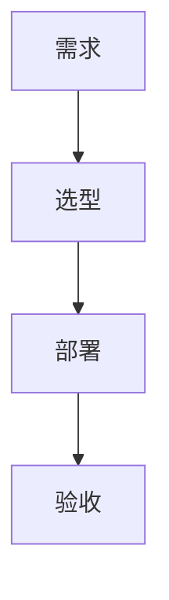

# 写作规范（知识库唯一契约）

> [!abstract] 一句话讲清楚
> 这是整个知识库的"排版与质量契约"。任何一篇笔记都必须遵守，否则知识库会变成一堆互相链接不上的散碎文件。

---

## 1. 知识库定位与读者画像

- **定位**：一套"本地大模型部署与交付"的完整技能栈学习资料库，最终服务于**接单交付**（给企业/个人做本地化部署、知识库、ComfyUI、微调）。
- **读者画像**：有一定编程能力、准备把这套技能变成业务的人。**不缺"学习意愿"，缺的是"全局地图 + 专业名词解释 + 流程岔路口判断"**。
- **读者的真实需求**（决定了写作口气）：
  1. 先明白**大概流程**，再补细节；
  2. **每一个专业名词**都要讲清楚，包括它和什么容易混淆；
  3. **不要大段代码和安装流水账**，要的是"这段命令在干什么、为什么这么做"；
  4. 看完能**自己做判断**：这台机器能跑多大模型、该选哪个引擎、效果差是哪里出了问题。

> [!warning] 写作红线
> - **不写营销腔**（"赋能""一站式""极速"一律不要）。
> - **不写空话**（"非常重要""意义重大"后面必须接具体原因）。
> - **不编造**精确的 benchmark 分数、模型版本号、价格、显存数字；必须给数字时用"量级/通常/以官方模型卡为准"。
> - **不写安装命令流水账**。代码块只保留"关键参数/关键配置"，并配一句解释。

---

## 2. 目录结构与命名规则

```
llm-er/                        ← Obsidian 库根目录
├── README 从这里开始.md         ← 入口
├── 00-总览/                    ← 总图、路线图、术语总表、自检
├── 01-基础底座/                ← Linux / Shell / Python / Docker / 网络 / 硬件
├── 02-模型认知/                ← 架构 / 量化 / 显存 / 模型谱系 / 多模态
├── 03-推理引擎/                ← Ollama / llama.cpp / vLLM / API 规范
├── 04-部署实战/                ← 三平台部署流程 / 检查清单
├── 05-应用集成/                ← RAG / Dify / Agent / MCP / 客户端
├── 06-生成式多媒体/            ← 扩散模型 / ComfyUI / 文生图 / 图生视频
├── 07-微调训练/                ← 数据工程 / LoRA / 框架 / 评估
├── 08-工程化交付/              ← 容器化 / 远程交付 / 调优 / SOP / 排错
├── 09-学习与自检/              ← 8 周计划 / 项目阶梯 / 高频问题 / 误区
└── 90-模板/                    ← 模板与规范（本文件）
```

**命名规则**：

1. 文件名用**中文 + 英文缩写**，见名知意，**不加数字前缀**（排序靠 MOC 索引控制）。
2. 文件名**全库唯一**（Obsidian 的 `[[双链]]` 是按文件名全局解析的，重名会串）。
3. 文件名中**禁用** Windows 非法字符 `\ / : * ? " < > |`，也避免使用半角冒号。
4. 每个领域文件夹**必须**有一个 `《领域名》 MOC.md` 作为入口索引。
5. 空格允许使用，但一个文件名里不要连续两个空格。

---

## 3. 全库文件清单（链接白名单）

> [!important] 链接只能用下面清单里的文件名
> 写 `[[双链]]` 前必须确认目标文件在此清单中；清单里没有的，**不要链接**，也不要自己新建文件。

### 00-总览
- 技能栈总览 MOC
- 学习路线图
- 术语总表
- 能力自检清单

### 01-基础底座
- 基础底座 MOC
- Linux 基础与服务器操作
- Shell 与命令行基础
- Python 环境与依赖管理
- Docker 与容器化基础
- 网络基础与内网穿透
- 硬件基础与 GPU 生态
- 驱动-CUDA-框架版本兼容

### 02-模型认知
- 模型认知 MOC
- Transformer 架构基础
- Attention 与 KV Cache
- Dense 与 MoE 架构
- 参数量与显存估算
- 量化技术
- 上下文窗口与位置编码
- 采样参数与解码策略
- 模型谱系 Qwen
- 模型谱系 DeepSeek
- 模型谱系 GLM 与 Gemma
- 多模态模型原理
- 开源许可证与合规

### 03-推理引擎
- 推理引擎 MOC
- 推理引擎选型决策树
- Ollama
- llama.cpp 与 GGUF
- vLLM
- SGLang 与 TensorRT-LLM
- MLX 与 Apple 芯片推理
- OpenAI 兼容 API 规范
- 推理性能指标与调优
- N卡 A卡 Mac 平台适配

### 04-部署实战
- 部署实战 MOC
- 本地部署全流程
- Windows 部署要点
- Linux 部署要点
- Mac 部署要点
- 模型获取与离线搬运
- 服务化与 API 鉴权
- 部署检查清单

### 05-应用集成
- 应用集成 MOC
- RAG 原理与全链路
- 文档解析与切分策略
- Embedding 与向量数据库
- 检索与 Rerank
- RAG 评估与调优
- Dify 平台与工作流
- Agent 与 Function Calling
- MCP 协议
- 本地模型接入编码助手
- 客户端 UI 工具
- 提示词与上下文工程

### 06-生成式多媒体
- 生成式多媒体 MOC
- 扩散模型原理
- ComfyUI 核心概念
- ComfyUI 工作流实操
- 模型目录与生态
- 文生图模型生态
- 图生视频模型生态
- 音频与音乐生成
- ControlNet 与 LoRA
- 低显存工作流优化

### 07-微调训练
- 微调训练 MOC
- 微调决策与 RAG 取舍
- 训练数据工程
- LoRA 与 QLoRA 原理
- 微调框架生态
- 训练超参数
- 训练监控与评估
- 合并导出与部署闭环
- 多模态微调

### 08-工程化交付
- 工程化交付 MOC
- 容器化部署
- 远程交付与远程运维
- 性能调优清单
- 监控与日志
- 安全与合规
- 交付 SOP 与报价
- 排错方法论
- 故障案例库

### 09-学习与自检
- 学习与自检 MOC
- 8 周学习计划
- 项目阶梯与实战清单
- 高频咨询问题与话术
- 常见误区

### 90-模板
- 写作规范
- 概念笔记模板
- 流程笔记模板
- 排错记录模板
- 项目复盘模板

---

## 4. 单篇笔记的必备结构

> [!tip] 结构固定是为了"可扫读"
> 读者查资料时是"跳读"，所以每篇都要有固定位置的：定义 → 名词表 → 原理 → 流程/对比 → 决策点 → 坑 → 自检 → 链接。

````markdown
---
title: "笔记标题"
aliases: [别名1, 别名2, 英文缩写]
tags:
  - 领域/<领域名>
  - 类型/<概念|流程|对比|清单|排错|案例|索引|术语>
  - 难度/<入门|进阶|高级>
created: 2026-10-28
updated: 2026-10-28
---

# 笔记标题

> [!abstract] 一句话讲清楚
> 用 1~2 句话说明它是什么、解决什么问题。不要重复标题。

## 为什么重要

- 它在整个技能栈里处于什么位置（上游是什么、下游是什么）
- 不知道它会踩什么坑 / 会多花多少钱或多少时间
- 一个真实场景（部署、交付、排错、报价）

## 核心名词全解

| 名词 | 英文 / 缩写 | 大白话解释 | 容易混淆 / 注意 |
|---|---|---|---|
| ... | ... | ... | ... |

> 表格至少 8 行（概念类）/ 6 行（流程类）。每个名词的解释不超过 2 句，但要"人话"。

## 原理与机制

- 用"类比 + 拆解"讲清楚它是怎么运作的
- 分层讲：先讲直觉，再讲关键机制，最后讲"所以它会带来什么后果"
- 有对比对象时，用表格或 mermaid 图对比

## 完整流程 / 分类与对比

流程类笔记：`输入 → 动作 → 输出 → 验收标准` 四段式，每一步说明"为什么做这一步"。
概念类笔记：分类维度 + 对比表。

## 决策点

> 这是读者最需要的东西：岔路口在哪、怎么判断、通常怎么选。

- **岔路口 1**：现象/条件 → 判断依据 → 推荐选择 → 代价
- **岔路口 2**：……

## 参数与配置说明

| 参数 | 作用 | 调大/调小的影响 | 常见取值 |
|---|---|---|---|
| ... | ... | ... | ... |

## 常见坑与误区

| 现象 | 原因 | 对策 |
|---|---|---|
| ... | ... | ... |

> 至少 5 条，写"真实的坑"，不要写"注意安全"这种废话。

## 自检问题

- [ ] 问题 1（能用自己的话答出来才算过关）
- [ ] ……6~8 条

## 相关笔记

- 上游：[[xxx]]
- 下游：[[yyy]]
- 对照：[[zzz]]
- 返回：[[《领域名》 MOC]]

## 交付视角（对客户怎么讲）

- 客户会问什么、怎么用大白话解释、怎么报价/说明限制
````

**篇幅要求**：

| 笔记类型 | 目标行数（含空行） | 说明 |
|---|---|---|
| 领域 MOC 索引 | 60~120 行 | 定位 + 阅读顺序表 + 全部笔记链接 + 关系图 |
| 主干概念/流程笔记 | 220~350 行 | 这是知识库的主体，要"详细" |
| 辅助/清单/案例笔记 | 120~220 行 | 高密度，不注水 |

---

## 5. Frontmatter 规范

```yaml
---
title: "与文件名一致的中文标题"
aliases: [别名, 英文名, 常见简称]      # ≥2 个，方便搜索
tags:
  - 领域/模型认知
  - 类型/概念
  - 难度/进阶
created: 2026-10-28
updated: 2026-10-28
---
```

**标签词表（只能用这些，不要自创）**：

- `领域/`：`基础底座` `模型认知` `推理引擎` `部署实战` `应用集成` `生成式多媒体` `微调训练` `工程化交付` `学习方法`
- `类型/`：`概念` `流程` `对比` `清单` `排错` `案例` `索引` `术语`
- `难度/`：`入门` `进阶` `高级`

> [!tip] 为什么标签要受控
> 标签一多就废了。受控词表 = 在 Obsidian 里点标签能稳定筛出同类笔记，而不是筛出 200 个一次性标签。

---

## 6. 链接规范

1. 一律用 Obsidian 双链：`[[文件名]]`，**不带路径、不带 `.md`**。
2. 需要在句子里换显示文字时：`[[文件名|显示文字]]`。
3. **表格里**的双链必须转义竖线：`[[文件名\|显示文字]]`。
4. 每篇笔记的 `## 相关笔记` 至少 4 条、最多 8 条，必须包含**本领域 MOC** 和至少 1 条**跨领域**链接。
5. 不要制造"链接到不存在的文件"（Obsidian 里显示为灰色，等于断链）。

---

## 7. 图表规范

- 优先用 `mermaid` 表达流程、层级、决策树。Obsidian 原生渲染。
- 节点文字必须**用双引号包起来**，例如 `A["① 摸硬件<br/>nvidia-smi"]`，避免括号/斜杠导致解析失败。
- 图不要超过 15 个节点，否则读者直接跳过。
- 允许用 `mindmap` 表达知识结构、`flowchart TD` 表达流程、`flowchart LR` 表达对比。



---

## 8. 代码与命令规范

- 全文代码/命令占比 **≤ 15%**，宁少勿多。
- 只写**关键片段**：一行启动参数、一个配置项、一个请求示例。**不写"apt install 一长串"这种流水账**。
- 每个代码块**上面一句、下面一句**："这段在干嘛 / 关键参数是哪个"。
- 参数必须解释含义，而不是只贴出来。
- 涉及具体版本号时写"以官方文档为准"。

---

## 9. 事实与口径规范

- 模型迭代很快（Qwen / DeepSeek / GLM / Gemma 等），**不要背版本号**，要讲"怎么看模型卡、怎么自己压测"。
- 显存估算给**公式和量级**，不给"精确到 MB"的假数字。
- 性能和价格的数字统一加"通常/大约/量级"。
- 涉及许可证（Apache-2.0 / MIT / 自定义商用条款）时，强调"以官方 LICENSE 与商用条款为准"。

---

## 10. 写作风格

- **人话优先**：先给类比，再给定义。
- **段落短**：一段不超过 5 行；能用列表/表格就不用长段落。
- **每节开头先给结论**，再展开原因。
- **禁止**："综上所述""值得注意的是""随着人工智能的发展"这类填充句。
- **允许**："说白了""坑在于""这时候你要判断的是"——口语化反而好读。

---

## 11. 质量验收清单（写完自查）

- [ ] frontmatter 完整、标签在受控词表内
- [ ] 有 `> [!abstract] 一句话讲清楚`
- [ ] 名词表 ≥ 8 行且是"人话解释"
- [ ] 有"决策点"章节，且给出推荐选择
- [ ] 坑至少 5 条，格式为"现象→原因→对策"
- [ ] 自检问题 6~8 条
- [ ] 相关笔记 4~8 条，全部指向白名单文件
- [ ] 篇幅达到要求，无注水段落
- [ ] 代码占比 ≤ 15%
- [ ] 没有编造精确数字/版本号

---

## 12. 协作规则

- **只写自己负责的文件夹**，绝不修改其他领域的文件（避免并行写入冲突）。
- 不要新建白名单之外的文件。
- 不要修改 `.obsidian/` 配置。
- 写文件**必须用 write 工具**（不要用 shell echo / 重定向写中文，Windows 下会乱码）。
- 写完自己负责的全部文件后，回一条简报：文件数、各文件行数、有没有遇到白名单外的链接需求。

---

## 相关笔记

- [[README 从这里开始]]
- [[技能栈总览 MOC]]
- [[概念笔记模板]]
- [[流程笔记模板]]
